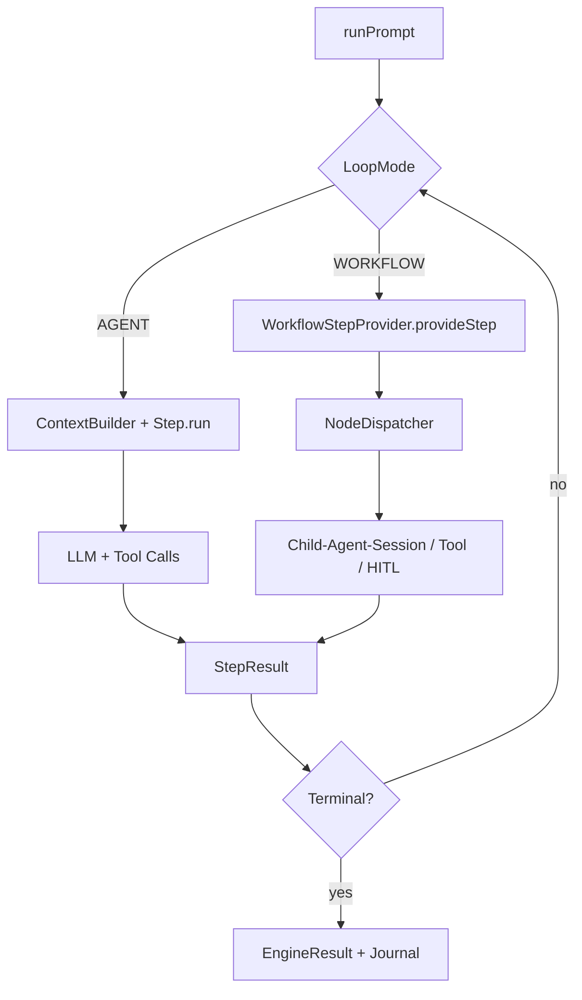
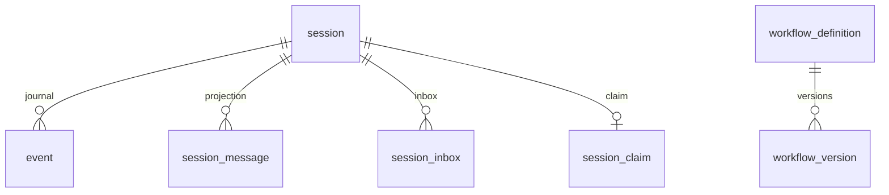

# Features – QOC Engine and Workflow Runner

> **Purpose:** Compact feature inventory of the current state.
> **Focus:** Isomorphic loop and database/persistence.
> **Status:** Engine M0–M14 implemented; workflow mode and workflow runner are active.
> **Sources:** Code under `../engine/`, `../workflow-runner/`, `../quarkus/`
> as well as `./spec/` and `./engineering/`.

## Contents

- [1. Architecture](#1-architecture)
- [2. Isomorphic Loop](#2-isomorphic-loop)
- [3. QOC Engine](#3-qoc-engine)
- [4. Workflow Runner](#4-workflow-runner)
- [5. Database and Persistence](#5-database-and-persistence)
- [6. Implemented vs. Concept](#6-implemented-vs-concept)
- [7. References](#7-references)

---

## 1. Architecture

| Component | Role |
|---|---|
| **QOC Engine** (`engine/`) | Pure Java core: sessions, context, LLM steps, tools, permissions, compaction, recovery, journal. |
| **QOC Quarkus Skin** (`quarkus/`) | REST/SSE, chat UI, agent config, MCP, A2A, workflow API. |
| **Workflow Runner** (`workflow-runner/`) | Validate, store, execute, and resume ReactFlow graphs. |
| **Database** | Event log as truth, projections, claims, specifications, HITL, tool artifacts. |

The engine is the runtime. The workflow runner is a **step provider** for
the same engine. This yields the isomorphic loop.

---

## 2. Isomorphic Loop

### 2.1 One Loop, Two Modes

`QocEngine.runPrompt(...)` decides based on the arguments:

```java
LoopMode loopMode = (workflowStepProvider != null && workflowContext != null)
        ? LoopMode.WORKFLOW : LoopMode.AGENT;
```



| Aspect | **Agent mode** | **Workflow mode** |
|---|---|---|
| Step source | `Step.run(...)` → LLM | `WorkflowStepProvider.provideStep(...)` → graph node |
| Result | `StepResult.Finished` incl. tool calls | `StepResult.Finished` with text, no tool calls |
| End | no tool calls / TurnPolicy / Verify-on-Stop | explicit `StepResult.WorkflowDone` |
| LLM call | directly in the loop | inside the node, usually as a **child session** |
| Limits | `agent.maxSteps`, TurnPolicy | `workflowMaxSteps` + node circuit breaker |
| Compaction | automatic possible | not in the workflow loop; error → "insert a compact node" |
| Shared | Session, claim, journal, live SSE, `EngineResult`, Paused/Failed | identical |

**The loop itself is identical:** `while`, `stepNo`, `StepResult`,
`EngineResult`, journaling and claim release. Only the source of the next
step is swapped.

### 2.2 Workflow Mode in Detail

- `WorkflowStepProviderImpl.provideStep(...)` delivers exactly one
  node step per call.
- The provider sets `currentNodeId` **only after success** — a retry
  re-executes exactly the interrupted node.
- On `Paused` → `StepResult.Paused`; on error → `StepResult.Failed`.
- On `WorkflowDone` the engine ends the loop successfully.
- After `workflowMaxSteps` without `WorkflowDone` → error.
- Node repetitions are counted per node; after
  `workflowNodeMaxRepetitions` the circuit breaker kicks in.
- In workflow mode the following are **skipped**: preflight, TurnPolicy,
  Verify-on-Stop, forced final LLM step, automatic compaction.

### 2.3 Navigation in the Graph

`getNextNodeId(...)`:

1. `currentNodeId == null` → start node.
2. No outgoing edge → `DONE`.
3. Exactly one edge → its target.
4. Multiple edges → first edge whose `condition` matches.
5. Otherwise → first edge.
6. Dynamic override via `state.nextNode`.
7. `DONE` or unknown node → workflow end or error.

### 2.4 Node Types

The workflow runner supports 16 backend node types (14 of them in the ReactFlow editor;
`guard` and `inject` are backend types, but not in the editor palette):

`agent`, `context_agent_executor`, `decision`, `start`, `hitl`,
`subworkflow`, `fork`, `join`, `loop`, `compact`, `guard`, `inject`,
`classify`, `mcp_call`, `rest_call`, `end`

Important semantics:

- **`agent`**: starts a child session, runs `QocEngine.runPrompt(...)`,
  returns `NodeResult.childSessionId`.
- **`context_agent_executor`**: builds context per policy `FULL`, `ARTIFACTS`
  or `CUSTOM` and checks the budget.
- **`decision` / `classify`**: evaluates branches or typed
  classification.
- **`hitl`**: pauses durably; `approvalId` is journaled.
- **`loop`**: `maxIterations`, `nextNode` override.
- **`guard` / `inject` / `compact`**: correction rounds, context injection,
  context compaction.
- **`mcp_call` / `rest_call`**: external tools and HTTP.
- **`subworkflow`**: runs the referenced workflow as a nested run (depth limit 3).
- **`fork` / `join`**: structural graph nodes; execution remains
  step-based.

### 2.5 Run Identity, Pause, and Resume

- A workflow run is a **normal session** with title
  `workflow:<workflowId>`.
- There is **no `workflow_run` table**.
- Run state is stored as events in the engine journal:
  `WorkflowRunStarted`, `WorkflowNodeStarted`, `WorkflowNodeCompleted`,
  `WorkflowNodeFailed`, `WorkflowRunResumed`, `WorkflowRunFinished`,
  `WorkflowRunFailed`.
- `WorkflowRunJournal.load(...)` replays these events and reconstructs:
  node outputs, workflow state, `currentNodeId`, child session IDs,
  resume count, and status.
- `WorkflowExecutor.resume(...)` loads the matching definition version via
  `definitionVersion` / `contentHash`, releases a stale claim, and
  continues the run at the last successful node.
- `WorkflowRecovery` scans up to 200 runs on startup and automatically
  resumes interrupted runs — limited by
  `engine.workflow.max-resume-attempts` (default 10).

---

## 3. QOC Engine

| Area | Features |
|---|---|
| **Sessions** | Create, list, delete, owner/project, execution mode, workspace root, paused prompt, archiving. |
| **Durable Execution** | Event log, claims, resume counter, crash recovery, session inbox with `STEER`/`QUEUE`. |
| **Context** | System prompt, `AGENTS.md`/`CLAUDE.md`, `SYSTEM.md`/`APPEND_SYSTEM.md`, history, conversation folding, title generation, prompt cache key. |
| **Compaction** | Automatic on overflow, manual, epoch/instruction semantics, context window. |
| **Revert/Snapshots** | Session snapshots, file snapshots, commit/abort. |
| **Skills** | Scan, frontmatter, progressive disclosure, 8 KiB body limit, `allow`/`deny`/`max`, hidden skills. |
| **Tools** | `read`, `write`, `edit`, `patch`, `glob`, `grep`, `shell` (incl. PTY/background/timeout), process tools, web fetch, Firecrawl, secure REST, skills, todos, questions, worktrees, subagent/task, MCP, A2A, email, remote shell, `submit_result`. |
| **MCP** | Stdio/HTTP, tools, resources, discovery, OAuth, server manager, UI-registered servers. |
| **A2A** | External agents as tools, agent card cache, discovery, opt-in JSON-RPC server. |
| **Permissions** | Deny-by-default, wildcards, last matching rule, `deny > ask > allow`, saved approvals, ask modes, shell scanner, directory boundaries. |
| **HITL** | Approval pause, approval URL, durable `pending_approval`, question requests via UI/email. |
| **Provider** | OpenAI-compatible adapter, streaming, event translation, error classification, retry/backoff. |
| **Resilience** | Loop detector, triage, preflight checks, webhook alerts, step timeout, turn budgets (tool calls/tokens/wall time), forced final answer. |
| **Verify-on-Stop** | Declarative rules, `CONTINUE`/`FAIL`/`WARN`, check before turn end. |
| **Agent Config** | Model, temperature, max tokens, top-p, tools, guardrails, hooks, JSON output, response schema, mode, skills, roles, max steps. |
| **Guardrails** | External webhook guardrail (block/allow/rewrite/redact/ask); no declarative rule engine. |
| **Credentials** | Integrations, active connection, OAuth renewal, env fallback. |
| **Observability** | SSE live stream, OpenTelemetry, rotating LLM trace, cost/token accounting. |
| **Operations** | Memory/SQLite/PostgreSQL, Docker (JVM/native), systemd, Quarkus Dev Services. |
| **Outer Skin** | REST/SSE, chat UI under `/core`, agent selector, MCP/A2A endpoints, workflow API. |

---

## 4. Workflow Runner

| Area | Features |
|---|---|
| **Graph Model** | ReactFlow format: nodes, edges, positions, branches, handles, agents, `inputSchema`, `systemPrompt`, owner. |
| **Node Types** | 16 types, incl. agent, context, HITL, MCP, REST, guard, loop, and classification nodes. |
| **Execution** | Stepwise navigation, conditions, loops, subworkflow expansion, fork/join, HITL pause, dynamic `nextNode`. |
| **Data Flow** | Node outputs, `lastResult`, `lastStatus`, state deltas, artifacts, context include/exclude, `_initialInput`, `_lastStructuredResult`. |
| **Templates** | Placeholder/condition validation, strict resolution, unknown references as errors. |
| **Contracts** | `inputSchema` validation, `outputContract`, `strict` mode, JSON schema conversion (Java record, Java source, OpenAPI, YAML). |
| **Context** | `ContextAssembler` with `FULL`/`ARTIFACTS`/`CUSTOM`, `ContextBudgetGate`, `ContextRefResolver`. |
| **Validation** | `GraphCompiler`: node types, IDs, edges, agent refs, at least one `end`, cycle detection, template checks, **SDW-03 budget binding**, **SDW-07 gate bypass**. |
| **Security** | Max steps, node circuit breaker, RBAC via `rolesAllowed`, owner checks, HITL gates. |
| **Persistence** | Workflow definition + immutable versions + content hash + expanded graph snapshot. Backends: `file`, `memory`, `sqlite`, `postgres`. |
| **Agent Storage** | Global agent definitions (SSOT), reference by ID/name, import from QOC config/Markdown, generated agents with `gen-...` IDs. |
| **Run Lifecycle** | `WorkflowExecution` with run ID/session ID/status; resume from journal; automatic recovery on startup. |
| **HTTP API (Standalone)** | `GET /health`, `/agents` CRUD, `/workflows` CRUD, `/workflows/validate`, `/workflows/:id/versions`, `/workflows/run`, `/workflows/generate`. Port `8097`. |
| **HTTP API (Quarkus)** | Additionally `/api/workflows/runs`, `/api/workflows/runs/{runId}`, `/api/workflows/runs/{runId}/resume`; owner/access guard on definitions, run/resume endpoints currently without ownership check. |
| **Generation** | Prompt → LLM → strip fences → parse steps → build graph → validate → persist agents → save. |
| **Check Tools** | `test_runner`, `hash_checker` for SDLC/check nodes. |
| **SDLC** | Graph invariants for gates, budgets, delta classification; workflow SDLC documentation. |

---

## 5. Database and Persistence

### 5.1 Principles

1. **The event log is the truth.** Everything else is a projection.
2. **One transaction, one aggregate.** Event + projections arise together.
3. **Do not duplicate state.**
4. **No table without a writer.**
5. **Projections are idempotent and reconstructable from the log.**



### 5.2 Backends and Migrations

- **Memory**, **SQLite**, **PostgreSQL** — configurable per port via
  `StorageKind`.
- Flyway migrations **V1–V12** for PostgreSQL and SQLite.
- PostgreSQL uses `jsonb`, `timestamptz`, `bigserial`; SQLite uses the
  corresponding dialect variant.
- Workflow specs and agent specs may additionally reside as **files** or
  **in-memory**; Quarkus wiring chooses the engine backend via `auto`.

### 5.3 Tables by Group (current state: 22 tables)

| Group | Tables | Purpose |
|---|---|---|
| **Protocol** | `event`, `event_sequence` | Event log, sequence counter per aggregate. |
| **Session/Execution** | `session`, `session_claim`, `resume_counter`, `session_message`, `session_inbox` | Metadata, claim against concurrent execution, resume counter, chat history, `STEER`/`QUEUE` inbox. |
| **Rights/Credentials** | `saved_approval`, `credential` | Stored approvals, active integration (at most one active per integration). |
| **Instructions** | `instruction_state`, `instruction_entry`, `instruction_blob` | Dynamic instructions, deltas, blob deduplication. |
| **Tools/Artifacts** | `tool_output`, `tool_result_cache`, `snapshot`, `snapshot_file` | Tool outputs, idempotent tool execution, undo snapshots. |
| **HITL** | `pending_approval`, `question_request` | Durable approvals and questions (UI + email), token/deadline/status. |
| **Specifications** | `workflow_definition`, `workflow_version`, `agent_definition`, `mcp_server` | Workflow graph + versions + content hash, agent SSOT, UI-registered MCP servers. |

### 5.4 Workflow and DB: No Run Table

This is the most important DB point for the isomorphic loop:

- A workflow run is a **session**.
- The run state lives in `event` as `WorkflowRun*` events.
- `session_message` is the chat/history projection, **not** the
  workflow state.
- `WorkflowContext` is a **runtime object** and is restored from the journal.
- `workflow_definition` / `workflow_version` store only the
  **specification**, not the run.
- `WorkflowRunJournal` deliberately has **no run table**: it replays the
  session's events and scans workflow sessions via the title prefix
  `workflow:`.

### 5.5 Further DB Properties

- `session` contains, among others, `execution_mode`, `state`, `workspace_root`,
  `instance_id`, `retain`, `paused_prompt`, `owner_id`.
- `session_inbox.delivery` is restricted to `steer` or `queue`.
- `pending_approval` has token, channel, decision, feedback;
  `question_request` has `token_hash`, deadline, and status.
- `tool_output` was extended with `session_id`, `artifact_id`, `media_type`, `sha256`,
  `size`.
- `workflow_definition` and `workflow_version` carry `content_hash`;
  versions are immutable.
- `agent_definition` is the SSOT for agents; `mcp_server` stores
  UI-registered servers.
- `SystemMessage` is a `session_message.type` value — **no separate
  table**.

### 5.6 Spec vs. Migrations

The persistence spec partially describes a target model with different names:

- Spec: `session_v2`, `permission`, `project`, `worktree`
- Migrations: `session`, `saved_approval`, no `project`/`worktree` tables

This is not a contradiction in the loop, but important when you rely on "the
DB spec": **the current code follows migrations V1–V12, not the older
spec naming one-to-one.**

---

## 6. Implemented vs. Concept

**Implemented:**

- Engine M0–M14.
- Agent mode and workflow mode in the same `QocEngine` loop.
- Workflow runner with graph validation, execution, resume, and recovery.
- Workflow, agent, and MCP specs in DB or files.
- Quarkus workflow API and standalone runner.

**Spec/concept only (do not count as features):**

- **Temporal integration** in the workflow runner: described as a plan in
  `engineering/Workflow.md`, not implemented in the current runner. The
  standalone runner uses an in-memory `QocEngine`.
- **Runtime plan adaptation / goal-driven planning**: `RequirementChecker`,
  `RuntimePlan`, `AdaptationPlan`, `PlanValidator` do not yet exist as
  code.
- **`project`/`worktree` tables** from the persistence spec are not present
  in the current migration state.
- **`workflow_run` table** deliberately does not exist.

---

## 7. References

| Topic | Path |
|---|---|
| Engine loop | `../engine/src/main/java/de/augmentia/oc/engine/runtime/QocEngine.java` |
| Step results | `../engine/src/main/java/de/augmentia/oc/engine/runtime/step/StepResult.java` |
| Workflow provider | `../workflow-runner/src/main/java/de/augmentia/qoc/workflowrunner/runner/WorkflowStepProviderImpl.java` |
| Node dispatch | `../workflow-runner/src/main/java/de/augmentia/qoc/workflowrunner/runner/DefaultNodeDispatcher.java` |
| Graph validation | `../workflow-runner/src/main/java/de/augmentia/qoc/workflowrunner/validation/GraphCompiler.java` |
| Run journal | `../workflow-runner/src/main/java/de/augmentia/qoc/workflowrunner/runner/WorkflowRunJournal.java` |
| Workflow execution | `../workflow-runner/src/main/java/de/augmentia/qoc/workflowrunner/runner/WorkflowExecutor.java` |
| DB migrations | `../engine/src/main/resources/db/migration/` |
| Persistence spec | `./spec/persistence/` |
| Workflow docs | `./engineering/Workflow.md` |
| Workflow SDLC | `./engineering/Workflow-SDLC.md` |