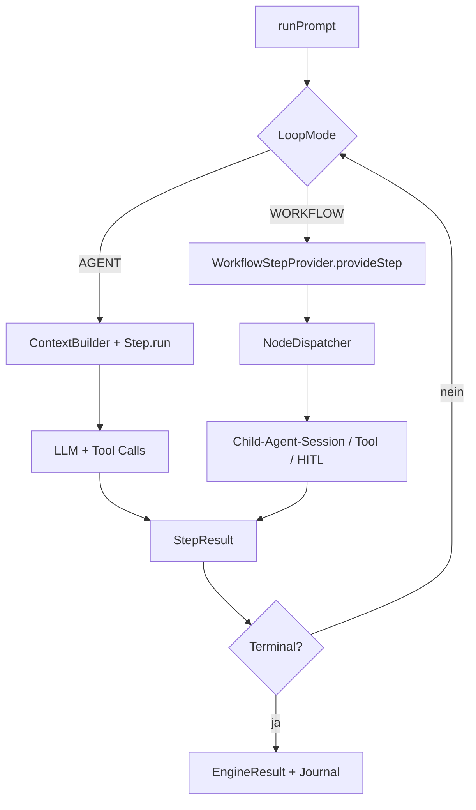
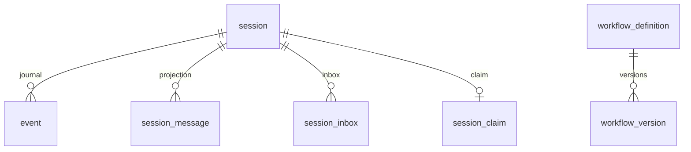

# Features – QOC Engine und Workflow Runner

> **Zweck:** Kompaktes Feature-Inventar des aktuellen Stands.
> **Schwerpunkt:** isomorpher Loop und Datenbank/Persistenz.
> **Status:** M0–M14 der Engine implementiert; Workflow-Mode und Workflow Runner sind aktiv.
> **Quellen:** Code unter `../engine/`, `../workflow-runner/`, `../quarkus/`
> sowie `./spec/` und `./engineering/`.

## Inhalt

- [1. Architektur](#1-architektur)
- [2. Isomorpher Loop](#2-isomorpher-loop)
- [3. QOC Engine](#3-qoc-engine)
- [4. Workflow Runner](#4-workflow-runner)
- [5. Datenbank und Persistenz](#5-datenbank-und-persistenz)
- [6. Implementiert vs. Konzept](#6-implementiert-vs-konzept)
- [7. Referenzen](#7-referenzen)

---

## 1. Architektur

| Baustein | Rolle |
|---|---|
| **QOC Engine** (`engine/`) | Reiner Java-Kern: Sessions, Kontext, LLM-Steps, Tools, Permissions, Compaction, Recovery, Journal. |
| **QOC Quarkus Skin** (`quarkus/`) | REST/SSE, Chat-UI, Agent-Config, MCP, A2A, Workflow-API. |
| **Workflow Runner** (`workflow-runner/`) | ReactFlow-Graphen validieren, speichern, ausführen und wieder aufnehmen. |
| **Datenbank** | Event-Log als Wahrheit, Projektionen, Claims, Spezifikationen, HITL, Tool-Artefakte. |

Die Engine ist die Laufzeit. Der Workflow Runner ist ein **Step-Provider** für
dieselbe Engine. Daraus entsteht der isomorphe Loop.

---

## 2. Isomorpher Loop

### 2.1 Ein Loop, zwei Modi

`QocEngine.runPrompt(...)` entscheidet anhand der Übergabe:

```java
LoopMode loopMode = (workflowStepProvider != null && workflowContext != null)
        ? LoopMode.WORKFLOW : LoopMode.AGENT;
```



| Aspekt | **Agent-Modus** | **Workflow-Modus** |
|---|---|---|
| Schrittquelle | `Step.run(...)` → LLM | `WorkflowStepProvider.provideStep(...)` → Graph-Node |
| Ergebnis | `StepResult.Finished` inkl. Tool-Calls | `StepResult.Finished` mit Text, ohne Tool-Calls |
| Ende | keine Tool-Calls / TurnPolicy / Verify-on-Stop | explizit `StepResult.WorkflowDone` |
| LLM-Aufruf | direkt im Loop | im Node, meist als **Child-Session** |
| Limits | `agent.maxSteps`, TurnPolicy | `workflowMaxSteps` + Node-Circuit-Breaker |
| Compaction | automatisch möglich | nicht im Workflow-Loop; Fehler → „insert a compact node“ |
| Gemeinsam | Session, Claim, Journal, Live-SSE, `EngineResult`, Paused/Failed | identisch |

**Der Loop selbst ist identisch:** `while`, `stepNo`, `StepResult`,
`EngineResult`, Journaling und Claim-Freigabe. Nur die Quelle des nächsten
Schritts ist ausgetauscht.

### 2.2 Workflow-Modus im Detail

- `WorkflowStepProviderImpl.provideStep(...)` liefert pro Aufruf genau einen
  Node-Schritt.
- Der Provider setzt `currentNodeId` **erst nach Erfolg** — ein Retry führt
  exakt den unterbrochenen Node erneut aus.
- Bei `Paused` → `StepResult.Paused`; bei Fehler → `StepResult.Failed`.
- Bei `WorkflowDone` beendet die Engine den Loop erfolgreich.
- Nach `workflowMaxSteps` ohne `WorkflowDone` → Fehler.
- Node-Wiederholungen werden pro Node gezählt; nach
  `workflowNodeMaxRepetitions` greift der Circuit-Breaker.
- Im Workflow-Modus werden **übersprungen**: Preflight, TurnPolicy,
  Verify-on-Stop, erzwungener finaler LLM-Step, automatische Compaction.

### 2.3 Navigation im Graphen

`getNextNodeId(...)`:

1. `currentNodeId == null` → Start-Node.
2. Keine ausgehende Edge → `DONE`.
3. Genau eine Edge → deren Target.
4. Mehrere Edges → erste Edge, deren `condition` passt.
5. Sonst → erste Edge.
6. Dynamischer Override über `state.nextNode`.
7. `DONE` oder unbekannter Node → Workflow-Ende bzw. Fehler.

### 2.4 Node-Typen

Der Workflow Runner unterstützt 16 Backend-Node-Typen (14 davon im ReactFlow-Editor;
`guard` und `inject` sind Backend-Typen, aber nicht in der Editor-Palette):

`agent`, `context_agent_executor`, `decision`, `start`, `hitl`,
`subworkflow`, `fork`, `join`, `loop`, `compact`, `guard`, `inject`,
`classify`, `mcp_call`, `rest_call`, `end`

Wichtige Semantiken:

- **`agent`**: startet eine Child-Session, führt `QocEngine.runPrompt(...)`
  aus, liefert `NodeResult.childSessionId`.
- **`context_agent_executor`**: baut Kontext nach Policy `FULL`, `ARTIFACTS`
  oder `CUSTOM` und prüft das Budget.
- **`decision` / `classify`**: wertet Branches bzw. typisierte
  Klassifikation aus.
- **`hitl`**: pausiert durabel; `approvalId` wird journaled.
- **`loop`**: `maxIterations`, `nextNode`-Override.
- **`guard` / `inject` / `compact`**: Korrekturrunden, Kontext-Injektion,
  Kontext-Kompaktierung.
- **`mcp_call` / `rest_call`**: externe Tools und HTTP.
- **`subworkflow`**: führt den referenzierten Workflow als geschachtelten Run aus (Tiefenlimit 3).
- **`fork` / `join`**: strukturelle Graph-Knoten; die Ausführung bleibt
  step-basiert.

### 2.5 Run-Identität, Pause und Resume

- Ein Workflow-Run ist eine **normale Session** mit Titel
  `workflow:<workflowId>`.
- Es gibt **keine `workflow_run`-Tabelle**.
- Run-State wird als Events im Engine-Journal gespeichert:
  `WorkflowRunStarted`, `WorkflowNodeStarted`, `WorkflowNodeCompleted`,
  `WorkflowNodeFailed`, `WorkflowRunResumed`, `WorkflowRunFinished`,
  `WorkflowRunFailed`.
- `WorkflowRunJournal.load(...)` replayt diese Events und rekonstruiert:
  Node-Outputs, Workflow-State, `currentNodeId`, Child-Session-IDs,
  Resume-Count und Status.
- `WorkflowExecutor.resume(...)` lädt die passende Definitionsversion über
  `definitionVersion` / `contentHash`, gibt einen stale Claim frei und setzt
  den Run am letzten erfolgreichen Node fort.
- `WorkflowRecovery` scannt beim Start bis zu 200 Runs und resumiert
  unterbrochene Runs automatisch — begrenzt durch
  `engine.workflow.max-resume-attempts` (Default 10).

---

## 3. QOC Engine

| Bereich | Features |
|---|---|
| **Sessions** | Erstellen, Listen, Löschen, Owner/Projekt, Execution-Mode, Workspace-Root, Paused-Prompt, Archivierung. |
| **Durable Execution** | Event-Log, Claims, Resume-Counter, Recovery nach Crash, Session-Inbox mit `STEER`/`QUEUE`. |
| **Kontext** | System-Prompt, `AGENTS.md`/`CLAUDE.md`, `SYSTEM.md`/`APPEND_SYSTEM.md`, Historie, Conversation-Folding, Title-Generation, Prompt-Cache-Key. |
| **Compaction** | Automatisch bei Overflow, manuell, Epoch-/Instruction-Semantik, Kontextfenster. |
| **Revert/Snapshots** | Session-Snapshots, Datei-Snapshots, Commit/Abort. |
| **Skills** | Scan, Frontmatter, progressive Disclosure, 8-KiB-Body-Limit, `allow`/`deny`/`max`, versteckte Skills. |
| **Tools** | `read`, `write`, `edit`, `patch`, `glob`, `grep`, `shell` (inkl. PTY/Background/Timeout), Prozess-Tools, Web-Fetch, Firecrawl, Secure-REST, Skills, Todos, Questions, Worktrees, Subagent/Task, MCP, A2A, Email, Remote-Shell, `submit_result`. |
| **MCP** | Stdio/HTTP, Tools, Resources, Discovery, OAuth, Server-Manager, UI-registrierte Server. |
| **A2A** | Externe Agenten als Tools, Agent-Card-Cache, Discovery, opt-in JSON-RPC-Server. |
| **Permissions** | Deny-by-default, Wildcards, letzte passende Regel, `deny > ask > allow`, gespeicherte Approvals, Ask-Modi, Shell-Scanner, Directory-Boundaries. |
| **HITL** | Approval-Pause, Approval-URL, durable `pending_approval`, Question-Requests per UI/E-Mail. |
| **Provider** | OpenAI-kompatibler Adapter, Streaming, Event-Übersetzung, Fehlerklassifikation, Retry/Backoff. |
| **Resilienz** | Loop-Detector, Triage, Preflight-Checks, Webhook-Alerts, Step-Timeout, Turn-Budgets (Tool-Calls/Tokens/Wall-Time), erzwungene finale Antwort. |
| **Verify-on-Stop** | Deklarative Regeln, `CONTINUE`/`FAIL`/`WARN`, Prüfung vor dem Turn-Ende. |
| **Agent-Config** | Modell, Temperatur, Max-Tokens, Top-P, Tools, Guardrails, Hooks, JSON-Output, Response-Schema, Modus, Skills, Rollen, Max-Steps. |
| **Guardrails** | Externer Webhook-Guardrail (block/allow/rewrite/redact/ask); keine deklarative Regel-Engine. |
| **Credentials** | Integrationen, aktive Connection, OAuth-Erneuerung, Env-Fallback. |
| **Observability** | SSE-Live-Stream, OpenTelemetry, rotierender LLM-Trace, Kosten-/Token-Accounting. |
| **Betrieb** | Memory/SQLite/PostgreSQL, Docker (JVM/native), systemd, Quarkus Dev Services. |
| **Outer Skin** | REST/SSE, Chat-UI unter `/core`, Agent-Selector, MCP-/A2A-Endpunkte, Workflow-API. |

---

## 4. Workflow Runner

| Bereich | Features |
|---|---|
| **Graph-Modell** | ReactFlow-Format: Nodes, Edges, Positionen, Branches, Handles, Agents, `inputSchema`, `systemPrompt`, Owner. |
| **Node-Typen** | 16 Typen, inkl. Agent-, Kontext-, HITL-, MCP-, REST-, Guard-, Loop- und Klassifikations-Nodes. |
| **Ausführung** | Schrittweise Navigation, Conditions, Loops, Subworkflow-Expansion, Fork/Join, HITL-Pause, dynamisches `nextNode`. |
| **Datenfluss** | Node-Outputs, `lastResult`, `lastStatus`, State-Deltas, Artifacts, Context-Include/Exclude, `_initialInput`, `_lastStructuredResult`. |
| **Templates** | Platzhalter-/Condition-Validierung, strikte Auflösung, unbekannte Referenzen als Fehler. |
| **Contracts** | `inputSchema`-Validierung, `outputContract`, `strict`-Modus, JSON-Schema-Konvertierung (Java-Record, Java-Source, OpenAPI, YAML). |
| **Kontext** | `ContextAssembler` mit `FULL`/`ARTIFACTS`/`CUSTOM`, `ContextBudgetGate`, `ContextRefResolver`. |
| **Validierung** | `GraphCompiler`: Node-Typen, IDs, Edges, Agent-Refs, mindestens ein `end`, Cycle-Erkennung, Template-Checks, **SDW-03 Budget-Binding**, **SDW-07 Gate-Bypass**. |
| **Sicherheit** | Max-Steps, Node-Circuit-Breaker, RBAC über `rolesAllowed`, Owner-Checks, HITL-Gates. |
| **Persistenz** | Workflow-Definition + unveränderliche Versionen + Content-Hash + expandierter Graph-Snapshot. Backends: `file`, `memory`, `sqlite`, `postgres`. |
| **Agent-Speicher** | Globale Agent-Definitionen (SSOT), Referenz per ID/Name, Import aus QOC-Config/Markdown, generierte Agenten mit `gen-...`-IDs. |
| **Run-Lifecycle** | `WorkflowExecution` mit Run-ID/Session-ID/Status; Resume aus Journal; automatische Recovery beim Start. |
| **HTTP-API (Standalone)** | `GET /health`, `/agents` CRUD, `/workflows` CRUD, `/workflows/validate`, `/workflows/:id/versions`, `/workflows/run`, `/workflows/generate`. Port `8097`. |
| **HTTP-API (Quarkus)** | Zusätzlich `/api/workflows/runs`, `/api/workflows/runs/{runId}`, `/api/workflows/runs/{runId}/resume`; Owner-/Access-Guard bei Definitionen, Run-/Resume-Endpunkte derzeit ohne Ownership-Prüfung. |
| **Generierung** | Prompt → LLM → Fences strippen → Steps parsen → Graph bauen → validieren → Agenten persistieren → speichern. |
| **Check-Tools** | `test_runner`, `hash_checker` für SDLC-/Check-Nodes. |
| **SDLC** | Graph-Invarianten für Gates, Budgets, Delta-Klassifikation; Workflow-SDLC-Dokumentation. |

---

## 5. Datenbank und Persistenz

### 5.1 Prinzipien

1. **Das Event-Log ist die Wahrheit.** Alles andere ist Projektion.
2. **Eine Transaktion, ein Aggregate.** Event + Projektionen entstehen zusammen.
3. **State nicht doppelt halten.**
4. **Keine Tabelle ohne Writer.**
5. **Projektionen sind idempotent und aus dem Log rekonstruierbar.**



### 5.2 Backends und Migrationen

- **Memory**, **SQLite**, **PostgreSQL** — pro Port konfigurierbar über
  `StorageKind`.
- Flyway-Migrationen **V1–V12** für PostgreSQL und SQLite.
- PostgreSQL nutzt `jsonb`, `timestamptz`, `bigserial`; SQLite nutzt die
  entsprechende Dialekt-Variante.
- Workflow-Specs und Agent-Specs können zusätzlich als **Dateien** oder
  **in-memory** liegen; die Quarkus-Wiring wählt per `auto` das Backend der
  Engine.

### 5.3 Tabellen nach Gruppe (Ist-Stand: 22 Tabellen)

| Gruppe | Tabellen | Zweck |
|---|---|---|
| **Protokoll** | `event`, `event_sequence` | Event-Log, Sequenzzähler pro Aggregate. |
| **Session/Execution** | `session`, `session_claim`, `resume_counter`, `session_message`, `session_inbox` | Metadaten, Claim gegen Parallelausführung, Resume-Zähler, Chat-Historie, `STEER`/`QUEUE`-Inbox. |
| **Rechte/Credentials** | `saved_approval`, `credential` | Gespeicherte Approvals, aktive Integration (max. eine aktive pro Integration). |
| **Instructions** | `instruction_state`, `instruction_entry`, `instruction_blob` | Dynamische Instruktionen, Deltas, Blob-Deduplizierung. |
| **Tools/Artefakte** | `tool_output`, `tool_result_cache`, `snapshot`, `snapshot_file` | Tool-Outputs, idempotente Tool-Ausführung, Undo-Snapshots. |
| **HITL** | `pending_approval`, `question_request` | Durable Approvals und Fragen (UI + E-Mail), Token/Deadline/Status. |
| **Spezifikationen** | `workflow_definition`, `workflow_version`, `agent_definition`, `mcp_server` | Workflow-Graph + Versionen + Content-Hash, Agent-SSOT, UI-registrierte MCP-Server. |

### 5.4 Workflow und DB: kein Run-Table

Das ist der wichtigste DB-Punkt für den isomorphen Loop:

- Ein Workflow-Run ist eine **Session**.
- Der Run-State liegt in `event` als `WorkflowRun*`-Events.
- `session_message` ist die Chat-/Historien-Projektion, **nicht** der
  Workflow-State.
- `WorkflowContext` ist ein **Laufzeitobjekt** und wird aus dem Journal
  restauriert.
- `workflow_definition` / `workflow_version` speichern nur die
  **Spezifikation**, nicht den Run.
- `WorkflowRunJournal` hat bewusst **keine Run-Tabelle**: Es replayt die
  Events der Session und scannt Workflow-Sessions über den Titel-Prefix
  `workflow:`.

### 5.5 Weitere DB-Eigenschaften

- `session` enthält u. a. `execution_mode`, `state`, `workspace_root`,
  `instance_id`, `retain`, `paused_prompt`, `owner_id`.
- `session_inbox.delivery` ist auf `steer` oder `queue` beschränkt.
- `pending_approval` hat Token, Channel, Decision, Feedback;
  `question_request` hat `token_hash`, Deadline und Status.
- `tool_output` wurde um `session_id`, `artifact_id`, `media_type`, `sha256`,
  `size` erweitert.
- `workflow_definition` und `workflow_version` tragen `content_hash`;
  Versionen sind unveränderlich.
- `agent_definition` ist die SSOT für Agenten; `mcp_server` speichert
  UI-registrierte Server.
- `SystemMessage` ist ein `session_message.type`-Wert — **keine eigene
  Tabelle**.

### 5.6 Abgrenzung Spec vs. Migrationen

Die Persistenz-Spec beschreibt teilweise ein Zielmodell mit anderen Namen:

- Spec: `session_v2`, `permission`, `project`, `worktree`
- Migrationen: `session`, `saved_approval`, keine `project`/`worktree`-Tabellen

Das ist kein Widerspruch im Loop, aber wichtig, wenn du dich auf „die
DB-Spec“ berufst: **Der aktuelle Code folgt den Migrationen V1–V12, nicht
eins zu eins der älteren Spec-Benennung.**

---

## 6. Implementiert vs. Konzept

**Implementiert:**

- M0–M14 der Engine.
- Agent-Modus und Workflow-Modus im selben `QocEngine`-Loop.
- Workflow Runner mit Graph-Validierung, Ausführung, Resume und Recovery.
- Workflow-, Agent- und MCP-Specs in DB oder Dateien.
- Quarkus-Workflow-API und Standalone-Runner.

**Nur Spec/Konzept (nicht als Feature zählen):**

- **Temporal-Integration** im Workflow Runner: in `engineering/Workflow.md`
  als Plan beschrieben, im aktuellen Runner nicht implementiert. Der
  Standalone-Runner nutzt eine In-Memory-`QocEngine`.
- **Runtime Plan Adaptation / Goal-driven Planning**: `RequirementChecker`,
  `RuntimePlan`, `AdaptationPlan`, `PlanValidator` existieren noch nicht als
  Code.
- **`project`/`worktree`-Tabellen** aus der Persistenz-Spec sind im aktuellen
  Migrationsstand nicht vorhanden.
- **`workflow_run`-Tabelle** gibt es bewusst nicht.

---

## 7. Referenzen

| Thema | Pfad |
|---|---|
| Engine-Loop | `../engine/src/main/java/de/augmentia/oc/engine/runtime/QocEngine.java` |
| Step-Ergebnisse | `../engine/src/main/java/de/augmentia/oc/engine/runtime/step/StepResult.java` |
| Workflow-Provider | `../workflow-runner/src/main/java/de/augmentia/qoc/workflowrunner/runner/WorkflowStepProviderImpl.java` |
| Node-Dispatch | `../workflow-runner/src/main/java/de/augmentia/qoc/workflowrunner/runner/DefaultNodeDispatcher.java` |
| Graph-Validierung | `../workflow-runner/src/main/java/de/augmentia/qoc/workflowrunner/validation/GraphCompiler.java` |
| Run-Journal | `../workflow-runner/src/main/java/de/augmentia/qoc/workflowrunner/runner/WorkflowRunJournal.java` |
| Workflow-Ausführung | `../workflow-runner/src/main/java/de/augmentia/qoc/workflowrunner/runner/WorkflowExecutor.java` |
| DB-Migrationen | `../engine/src/main/resources/db/migration/` |
| Persistenz-Spec | `./spec/persistence/` |
| Workflow-Doku | `./engineering/Workflow.md` |
| Workflow-SDLC | `./engineering/Workflow-SDLC.md` |
