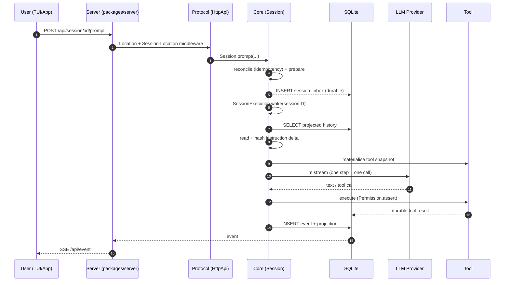
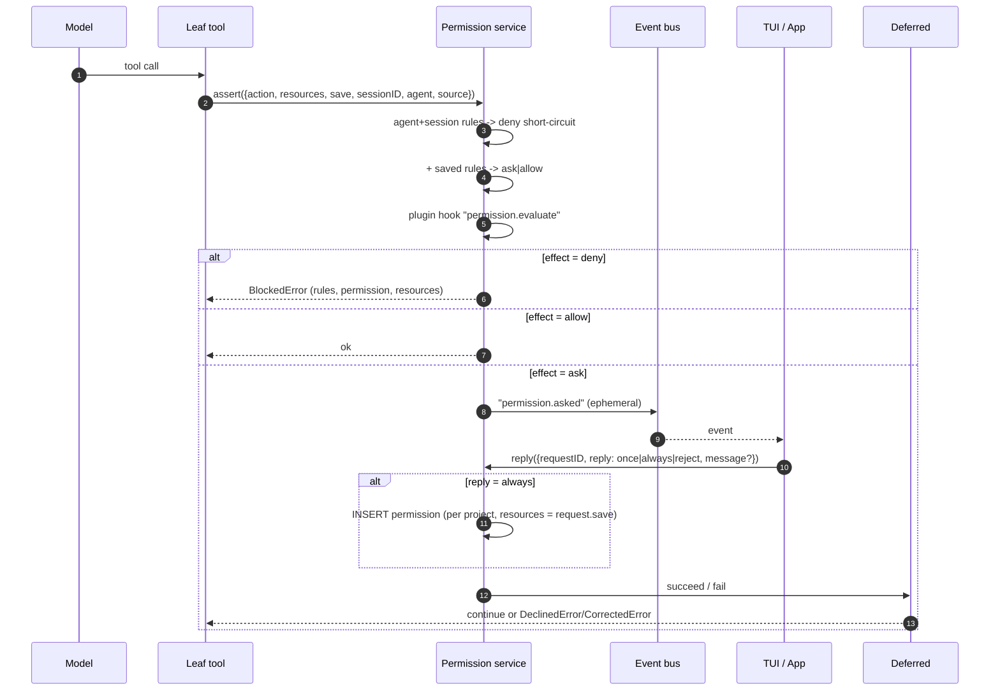
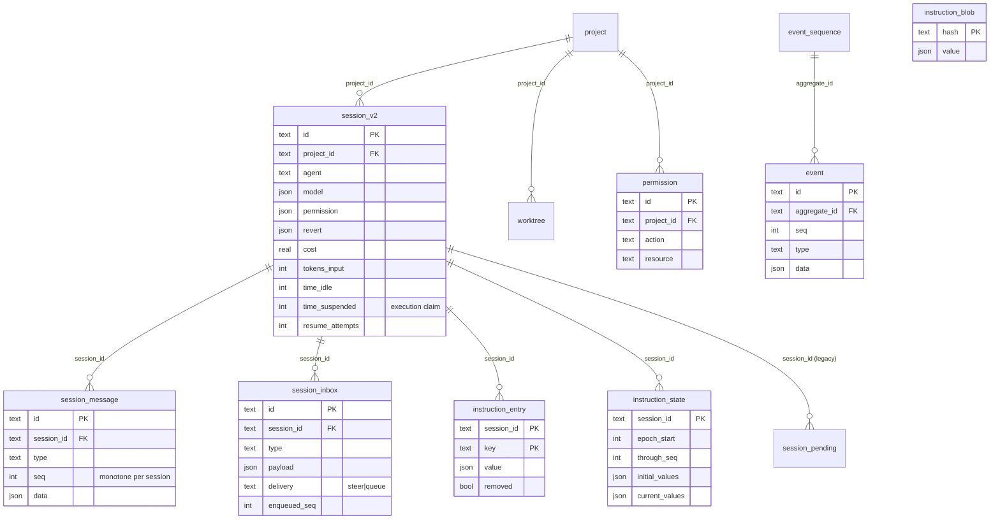
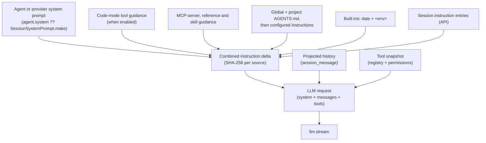

# 02 – Data Flow & Data Lineage

> **Rolle:** reference analysis des OpenCode-V2-Checkouts, not an operative
> QOC-Spec. For the implementation, see [`spec/`](../spec/README.md).

> **Workflow 2:** Data-Flow & Data-Lineage Mapping
> `[Codebase & DB-Schema] ➔ [Static Analysis] ➔ [LLM Data-Flow Agent] ➔ [Mermaid + Data Dictionary]`
>
> **As of:** 2026-10-21, Repo `dev` @ `3108505b2f`
> **Method:** Event catalog from `packages/schema/src/session-event.ts` (53 types),
> projection mapping read directly from `packages/core/src/session/projector.ts:464-800`
> and `packages/core/src/session/inbox.ts:277-386`, tables from the `sql.ts` files,
> endpoint groups from `packages/protocol/openapi.json`
> (121 paths / **146 operations**, counted manually).

---

## Contents

- [1. Entry Points](#1-entry-points)
- [2. Event Catalog and Lineage](#2-event-catalog-and-lineage)
- [3. Data Dictionary](#3-data-dictionary)
- [4. Entity Lifecycles](#4-entity-lifecycles)
- [5. Side effects outside the database](#5-side-effects-outside-the-database)
- [6. Mermaid diagrams](#6-mermaid-diagrams)
- [7. Notable observations](#7-notable-observations)

## 1. Entry Points

### 1.1 HTTP (121 paths, **146 operations**, 30 tags)

Counted from `packages/protocol/openapi.json` (one operation = 1 path × 1 method,
each operation has exactly 1 tag). Cross-check: number of `HttpApiEndpoint.`
occurrences per group file = number of operations per tag (sum 146).

| Group (tag) | Ops | Most important operations |
|---|---:|---|
| `session` | **44** | `POST /api/session` · `POST /api/session/{id}/prompt` · `/interrupt` · `/compact` · `/fork` · `/move` · `/revert/{stage,commit}` · `GET /api/session/{id}/log` (durable replay) · `/context` · `/diff` · `/inbox[/{id}]` · `/permission` |
| `integration` | 12 | `POST /api/integration/{id}/connect/{command,external,key,oauth}` |
| `persistentPty` | 11 | `GET/POST /api/experimental/session/{id}/terminal` · `.../persistent-pty/{ptyID}/connect` |
| `permission` | 8 | `POST /api/session/{id}/permission` · `.../permission/{requestID}/reply` · `GET /api/permission/request` · `PATCH/DELETE /api/permission/saved/{id}` |
| `pty` | 7 | `GET/POST /api/pty` · `GET/PUT/DELETE /api/pty/{ptyID}` · `.../connect`, `.../connect-token` |
| `mcp` | 6 | `PUT/DELETE /api/experimental/mcp/{server}` · `.../connect` · `.../disconnect` · `GET /api/mcp`, `/api/mcp/resource` |
| `vcs` | 6 | `GET /api/vcs/{base,branch,diff,status}` · `POST /api/vcs/init` |
| `credential` | 5 | `GET/POST /api/credential` · `PATCH/DELETE /api/credential/{id}` · `.../activate` |
| `shell` | 5 | `GET/POST /api/shell` · `GET/DELETE /api/shell/{id}` · `GET /api/shell/{id}/output` |
| `filesystem` | 4 | `GET /api/fs/{find,list,read/*}` · `POST /api/experimental/fs/write` |
| `worktree` | 4 | `GET/POST/DELETE /api/worktree` · `POST /api/worktree/refresh` |
| `server`, `plugin`, `voice`, `config` | 3 each | `GET /api/info` · `POST /api/pair` · `GET /api/plugin` · `GET /api/config` |
| `location`, `agent`, `model`, `provider`, `project`, `debug`, `websearch` | 2 each | per domain |
| `generate`, `form`, `command`, `skill`, `rpc`, `event`, `reference`, `migration` | 1 each | `GET /api/event` = **SSE stream** · `POST /api/rpc/{rpcID}/{method}` |

> **Number drift:** `V2_HTTP_API_AUDIT.md:4` states "Current endpoint count: 139"
> (as of 2026-09-13). The current `openapi.json` contains **146** operations –
> the audit document has not been updated.

Sources: `packages/protocol/openapi.json`, `packages/protocol/src/groups/` (31 files),
`packages/protocol/src/api.ts:161-201` (registration), `packages/server/src/handlers/`
(34 handlers), `packages/server/src/routes.ts:178-189` (assembly).

### 1.2 CLI (`packages/cli/src/index.ts:28-82`)

`default` (TUI) · `upgrade` · `uninstall` · `acp` · `api` · `debug {agents,config,paths}` ·
`auth {list,login,logout,export,import,switch}` · `mcp {list,add,auth,logout}` ·
`plugin {list,add,check,update,remove}` · `models` · `stats` · `mini` · `run` ·
`session {list,delete,export,import}` · `service {start,restart,status,stop,get,set,unset}` ·
`serve` · `pair` · `reload`

### 1.3 Further entry points

| Entry point | Location |
|---|---|
| Web/app routes | `packages/app/src/shell/routes/routes.tsx:46-72` (`/`, `/settings`, `/server/:serverKey/session/:id`, `/new-session`) |
| Desktop | `packages/desktop/src/main/index.ts` (Electron main process) |
| MCP (external) | `packages/core/src/mcp/index.ts` – stdio + Streamable HTTP |
| Plugin (external) | `packages/core/src/plugin/host.ts` – Promise and Effect plugins |
| RPC | `packages/core/src/rpc.ts` → `/api/rpc/:rpcID/:method` |
| VS Code | `sdks/vscode/` |
| GitHub Action | `github/action.yml` |

### 1.4 Scheduled / background processes

| Process | Interval / trigger | Location |
|---|---|---|
| models.dev catalog refresh | **5 min** (TTL), fetch `/api.json` with 10 s timeout | `packages/core/src/models-dev.ts:434, 331, 346` |
| Console config/policy fetch | **1 min** (only while connected), `GET /api/v2/config` | `packages/core/src/plugin/provider/opencode.ts:617, 634` |
| Session warming | **4 min** idle, up to **30 min** after last non-warming request | `packages/core/src/plugin/warming.ts:11-12, 31-56` |
| Location idle unload | **60 min** without session activity | `packages/core/src/location-activity.ts:45-47` |
| Workspace idle suspension | threshold **20 min**, poll **1 min** | `packages/core/src/workspace.ts:93, 222, 205` |
| Project activity / sweep | activity at most **1×/min**, sweep **1 h** | `packages/core/src/project.ts:60-61, 464` |
| Shell output cleanup | sweep **1 h**, retention **7 days** | `packages/core/src/shell.ts:118, 33, 91` |
| Tool output cleanup | **1 h** | `packages/core/src/tool-output.ts:143` |
| Integration credential scrub | **30 s** (attempt lifetime 10 min, terminal retention 1 min) | `packages/core/src/integration.ts:582-583, 261-263` |
| Model retry backoff | `min(exponential(2s), spaced(10s))` | `packages/core/src/model-retry.ts:26` |
| Snapshot Git pack | **10 min** | `packages/core/src/snapshot.ts:120` |
| PTY ticket TTL | **60 s** | `packages/core/src/pty/ticket.ts:9` |
| Form retention | **10 min** after terminal state | `packages/core/src/form.ts:8, 113-115` |
| Shell kill grace | `forceKillAfter: 3 s` | `packages/core/src/shell.ts:316, 385` |
| MCP close grace | 2 s grace, 2 s force-kill, 1 s exit-wait | `packages/core/src/mcp/stdio.ts:10-17` |
| Startup recovery | at server start, max. **10** attempts per claim | `packages/core/src/session/execution/restart.ts:193, 33` |
| Event heartbeat | **15 s** | `packages/server/src/handlers/event.ts:21` |
| Client SSE watchdog | idle timeout **45 s** | `packages/client/src/solid/connection.ts:35` |

---

## 2. Event Catalog and Lineage

Legend: **D** = durable (in the event log, replayable) · **E** = ephemeral (live-only,
**not** in the log). The schema knows exactly these two classes
(`packages/schema/src/event.ts:42, 55`); "live" in the spec sense
(`specs/v2/session.md:110`) means exactly the ephemeral deltas.
Source of the types: `packages/schema/src/session-event.ts`.

| Event type | Class | Produced by | Projection → target |
|---|---|---|---|
| `session.created` | D | `session/session.ts` | `session_v2` (create row) · `projector.ts:464` |
| `session.deleted` | D | session deletion | `session_v2` (delete) · `:569` |
| `session.renamed` | D | rename | `session_v2.title` · `:594` |
| `session.archived` / `session.unarchived` | D | archiving | `session_v2.time_archived` · `:632`, `:640` |
| `session.metadata.updated` | D | metadata | `session_v2.metadata` · `:602` |
| `session.permissions` | D | permission change | `session_v2.permission` · `:610` |
| `session.agent.selected` | D | agent switch | `session_v2.agent` · `:572` |
| `session.model.selected` | D | model switch | `session_v2.model` · `:583` |
| `session.viewed` | D | session viewed | `session_v2.time_viewed` · `:618` |
| `session.moved` | D | session moved | `session_v2` · `:492` |
| `session.forked` | D | fork | new `session_v2` + messages up to boundary · `projectFork` `:115`, `:650` |
| `session.inbox.enqueued` | D | admission | **INSERT `session_inbox`** · `inbox.ts:169-202`, `projector.ts:683` |
| `session.inbox.delivered` | D | delivery | **DELETE `session_inbox` + INSERT `session_message`** · `projector.ts:651` |
| `session.inbox.cancelled` | D | cancellation | remove from `session_inbox` · `:700` |
| `session.inbox.delivery.changed` | D | mode change | `session_inbox.delivery` · `:706` |
| `session.instructions.updated` | D | instruction delta | `instruction_entry` + `instruction_blob` + `instruction_state` · `:716` |
| `session.synthetic` | D | system input (e.g. plan mode) | `session_message` (type `synthetic`) · `:722` |
| `session.skill.activated` | D | skill loaded | `session_message` (type `skill`) · `:723` |
| `session.shell.started` / `.ended` | D | shell execution | `session_message` (type `shell`) · `:724`, `:725` |
| `session.step.started` | D | step start | `session_message` + `session_v2.time_updated` · `:726` |
| `session.step.ended` | D | step end | `session_message` + cost/token (`applyUsage`) · `:733` |
| `session.step.failed` | D | step failure | `session_message` + possibly `applyUsage` · `:741` |
| `session.step.streamed` | D | step delta | `session_message` · `:732` |
| `session.text.started` / `.ended` | D | text block | `session_message` (assistant content) · `:751`, `:752` |
| `session.reasoning.started` / `.ended` | D | reasoning | `session_message` (assistant content) · `:757`, `:758` |
| `session.tool.input.started` / `.ended` | D | tool input | `session_message` · `:753`, `:754` |
| `session.tool.called` | D | tool start | `session_message` · `:755` |
| `session.tool.success` | D | tool success | `session_message` · `:756` |
| `session.tool.failed` | D | tool failure | `session_message` · `:757`-neighbourhood (`message-updater.ts:363-381`) |
| `session.tool.progress` | E | tool progress | – (no log) · `session-event.ts:534` |
| `session.text.delta` | E | text streaming | – (not replayable) · `:457` |
| `session.reasoning.delta` | E | reasoning streaming | – · `:501` |
| `session.tool.input.delta` | E | tool input streaming | – · `:418` |
| `session.compaction.started` | D | compaction | `session_message` (type `compaction`, `running`) · `:764` |
| `session.compaction.ended` | D | compaction done | `session_message` + **epoch** change in `instruction_state` · `:765` |
| `session.compaction.failed` | D | compaction failure | `session_message` (`failed`) · `:772` |
| `session.compaction.delta` | E | summary streaming | – · `:608` |
| `session.revert.staged` | D | revert prepared | `session_v2.revert` · `:773` |
| `session.revert.committed` | D | revert executed | messages + `session_v2.revert` · `:791` |
| `session.revert.cleared` | D | revert discarded | `session_v2.revert = null` · `:786` |
| `session.execution.started` | D | execution start | write-ahead claim → `session_v2.time_suspended` |
| `session.execution.succeeded` / `.failed` / `.interrupted` | D | execution end | `projectIdle` → `session_v2.time_idle` + `idle_outcome` · `:713-715` |
| `session.retry.scheduled` | D | retry scheduled | `session_message` · `:759` |
| `session.usage.recorded` | D | usage recorded | `session_v2` cost/token · `:649` |
| `session.usage.updated` | D | usage updated | `publishSessionUsage` · `:103` |
| `permission.asked` | E | permission prompt | – (no log) |
| `permission.replied` | E | permission reply | – (no log) |

**Split**: 53 session event types = **47 durable** + **6 ephemeral**
(`packages/schema/src/session-event.ts:663-725`).

**Not projected / not logged** – all 6 ephemeral events:

| Event | Reason | Reference |
|---|---|---|
| `session.text.delta` | ephemeral ⇒ no durable event, no `bus.project` entry | no entry in `projector.ts`; `message-updater.ts` is exhaustive over `DurableEvent` (`:80-81`) |
| `session.reasoning.delta` | ditto | ditto |
| `session.tool.input.delta` | ephemeral **and never emitted** – `fragments("tool input", …)` passes no `delta` callback | `packages/core/src/session/runner/publish-llm-event.ts:277-290`; test `packages/core/test/session-runner-tool-events.test.ts:524` |
| `session.tool.progress` | ephemeral | no entry in `projector.ts` |
| `session.compaction.delta` | ephemeral | no entry in `projector.ts` |
| `session.usage.updated` | ephemeral; produced **from** the projection instead of projected | `packages/core/src/session/projector.ts:103-113` |

The durable log contains only `session.*` events from `SessionEvent.DurableDefinitions`
plus `Worktree.Event.Resolved`
(`packages/schema/src/durable-event-manifest.ts:5`; manifest construction in
`session-event.ts:718-726`).

**Two projection layers** (important for every change):

1. **Table projection** – `packages/core/src/session/projector.ts:460-841`
   (`bus.project(...)`, 47 registrations)
2. **Message fold** – `packages/core/src/session/message-updater.ts:79-482`
   (`Match.type` over all durable events, exhaustive)

> A new durable event needs **both** layers, otherwise the message stays incomplete
> even if the table is correct.

---

## 3. Data Dictionary

SQLite via Drizzle; schema per domain in `packages/core/src/<domain>/sql.ts`.
Current schema: `packages/core/src/database/schema.gen.ts`, migrations in
`packages/core/src/database/migration/`.

### 3.1 `session_v2` (`session/sql.ts:22-77`)

| Column | Type | Meaning |
|---|---|---|
| `id` | text PK | Session ID |
| `project_id` | text FK→`project` | owning project (cascade delete) |
| `workspace_id` | text | optional workspace identity |
| `parent_id`, `fork_session_id` | text | parent/fork reference |
| `fork_boundary` | json | fork boundary |
| `slug`, `directory`, `path` | text | display name, location directory, path |
| `title` | text | session title |
| `version` | text | schema/agent version |
| `share_url` | text | share link |
| `summary_additions/deletions/files/diffs` | int/json | diff statistics |
| `metadata` | json | free metadata |
| `cost` | real | accumulated cost |
| `tokens_input/output/reasoning/cache_read/cache_write` | int | token counters |
| `revert` | json | revert state (snapshot list) |
| `permission` | json | **session-local** permission ruleset |
| `agent` | text | selected agent |
| `model` | json | `{id, providerID, variant?}` |
| `time_created`, `time_updated` | int | timestamps |
| `time_idle`, `idle_outcome` | int/text | **derived**: last idle + result |
| `time_viewed` | int | last viewed |
| `time_compacting` | int | **legacy** (now in `SessionMessage.Compaction`) |
| `time_archived` | int | archived timestamp |
| `time_suspended` | int | **execution claim** (write-ahead) |
| `resume_attempts` | int | recovery attempts |

Indexes: `project_id`, `workspace_id`, `parent_id`, `time_suspended` (partial).

### 3.2 `session_message` (`session/sql.ts:79-98`)

`id` (PK) · `session_id` (FK) · `type` (user/assistant/synthetic/skill/shell/compaction/idle/…) ·
`seq` (monotone sequence per session) · `data` (JSON) · `time_created`/`time_updated`.
Indexes: `(session_id, seq)` unique, `(session_id, type, seq)`, `(session_id, time_created, id)`.

### 3.3 `session_inbox` (`session/sql.ts:125-145`)

`id` (PK) · `session_id` (FK) · `type` (user/synthetic/compaction/move) · `payload` (JSON) ·
`delivery` (`steer`/`queue`) · `enqueued_seq` · `time_created`.
Indexes: `(session_id, delivery, enqueued_seq)`, `(session_id, enqueued_seq)` unique.

### 3.4 `session_pending` (`session/sql.ts:100-123`)

**Legacy** from the V2.0 inbox design (migration `20260812181746_session_inbox.ts`).
Active path is `session_inbox`.

### 3.5 `instruction_entry` / `instruction_blob` / `instruction_state`

| Table | Content |
|---|---|
| `instruction_entry` (`sql.ts:147-160`) | PK `(session_id, key)`; `value` JSON; `removed` bool – **delta** per source |
| `instruction_blob` (`sql.ts:162-165`) | PK `hash` (SHA-256); `value` JSON – canonical body **exactly once** |
| `instruction_state` (`sql.ts:167-176`) | PK `session_id`; `epoch_start`, `through_seq`, `initial_values` (JSON), `current_values` (JSON) |

### 3.6 Further tables

| Table | File | Content | Writing location |
|---|---|---|---|
| `project` | `project/sql.ts:12` | project ID, canonical directory (`worktree` column), `time_active`, `time_archived`, `sandboxes` (JSON), `commands` (JSON) | `Project` service |
| `worktree` | `worktree/sql.ts:6` | PK `(project_id, directory)`, `strategy` | `Worktree` service |
| `permission` | `permission/sql.ts:7` | PK-ish; unique `(project_id, action, resource)` – **saved "always" approvals** | `PermissionSaved` |
| `event` | `event/sql.ts:10` | PK `id`; `aggregate_id` (FK), `seq`, `type`, `data` JSON, `created` | event bus |
| `event_sequence` | `event/sql.ts:4` | PK `aggregate_id`; `seq`, `owner_id` | event bus |
| `credential` | `credential/sql.ts:5` | credentials per provider | `Credential` service |
| `account`, `account_state` | `account/sql.ts:5,15` | logged-in accounts | `Account` service |
| `kv` | `kv/sql.ts:5` | key-value store | various |
| `workspace` | `workspace/sql.ts:5` | `provider`, `binding` – reserved for clustering | `Workspace` service |

### 3.7 Completely unused tables (verified by grep)

| Table | File | Finding |
|---|---|---|
| `session_pending` | `session/sql.ts:100-123` | is **nowhere** read or written – only in the migration schema (`schema.gen.ts:172-182`) |
| `project_directory` | `project/sql.ts:32-47` | is **nowhere** read or written – only in the migration schema (`schema.gen.ts:91-100`) |
| `account`, `account_state` | `account/sql.ts:5-17` | are **nowhere** read or written – only in the migration schema (`schema.gen.ts:8-39`) |
| `control_account` | `account/sql.ts:19-36` | ditto |

> Four tables exist only in the schema. They come from the V1 state and are needed
> by the V1 migration, but have no writer anymore.

### 3.8 Not in the DB

* **Snapshots**: separate Git repository under
  `~/.local/share/opencode/snapshot/<projectID>/<hash>` (`packages/core/src/snapshot.ts:92-103`)
* **Shell output**: managed storage (file path in the tool result)
* **Configuration**: files (`settings.json(c)`, `AGENTS.md`, `.opencode/`)
* **Console credentials**: obtained via `GET /api/v2/config`, not persisted locally

---

## 4. Entity Lifecycles

### 4.1 Session

```
Entry:    Session.create  →  "session.created"  →  INSERT session_v2
          (+ possibly parent_id, fork_session_id)
State:    time_suspended (claim)  ⇄  time_idle + idle_outcome
          agent / model / permission / metadata / title / revert per column
          seq counter in session_message
Persistence: all state changes as durable events → event table
             → projection into session_v2 / session_message
Exit:     session.deleted  →  DELETE (cascade on session_message/inbox)
          session.archived  →  time_archived set
          session.moved     →  directory/path/workspace_id
          session.forked    →  copy up to boundary + new aggregate sequence
```

### 4.2 Message / Assistant turn

```
Entry:    Inbox delivery  →  "session.inbox.delivered"
          →  DELETE session_inbox
          →  INSERT session_message (type = user|synthetic)
          seq = event.durable.seq
Turn:     "session.step.started"  →  INSERT assistant message
          "session.text.started"/".ended"  →  content parts in data
          "session.tool.called"/".success"/".failed"  →  AssistantTool in data
          "session.step.ended"  →  completion + applyUsage (cost/token)
Persistence: seq is monotone; no deletion, even on compaction
Exit:     Revert → messages re-projected; Compaction → older messages
          remain stored but are no longer sent
```

### 4.3 Inbox item

```
Entry:    Session.prompt  →  reconcile (idempotency)
          →  prepare (hooks, files, skills)
          →  admit  →  "session.inbox.enqueued"  →  INSERT session_inbox
State:    delivery = steer | queue ; type = user|synthetic|compaction|move
Persistence: durable from admission; the row IS the state
Exit:     delivered → DELETE + visible message
          cancelled → DELETE
          delivery.changed → UPDATE delivery
          move → location change, item remains
```

### 4.4 Permission request

```
Entry:    Leaf tool calls permission.assert({action, resources, save, ...})
          →  evaluate: agent+session rules -> deny short-circuit
          →  + saved rules -> ask/allow
          →  + plugin hook evaluate -> possibly deny
State:    only in memory (Map pending) + ephemeral event
Persistence: **none** (only `permission.asked`/`permission.replied` ephemeral)
Exit:     once  → resolve deferred
          always → row in table `permission` (per project) + resolve deferred
          reject → DeclinedError/CorrectedError to all parallel requests
```

### 4.5 Instruction

```
Entry:    Source (global/project/config/URL) read -> SHA-256 of the encoded value
State:    instruction_entry (delta per key) + instruction_blob (body per hash)
          instruction_state (epoch start, initial/current values)
Persistence: delta admitted atomically BEFORE input delivery
Exit:     Compaction end -> advanceEpoch (new baseline = current values)
          Revert commit -> state deleted -> fresh baseline
          Fork -> adopts the parent's latest values
```

### 4.6 Project / Worktree

```
Entry:    Project.resolve  →  search upward for .git/.hg
          ID = Hash(Git remote host/path) | cached opencode file
               | root commit | Hash("directory:<dir>")
Persistence: table `project`, session_v2.project_id FK
Worktree:  worktree_create -> create directory -> INSERT worktree
           -> project config determines target and strategy
           -> default: Git, target ~/.local/share/opencode/worktree/<projectID[:6]>
```

### 4.7 Credential / Account

```
Entry:    /connect, OAuth flow, API key
Persistence: table `credential` or `account`/`account_state`
Usage:    model-resolver resolves provider credentials
Redaction: apiKey is removed when sharing models (model-resolver.ts:224, 261)
```

### 4.8 Event / Log

```
Entry:    Bus.publish(event)  →  increment seq per aggregate (event_sequence)
          →  INSERT event (aggregate_id, seq, type, data, created)
Projection: Bus.project(...) writes into the domain tables in the same transaction
Replay:   sessions.log({sessionID, after, follow}) reads event after seq
          on follow: subscribe first, then replay, then synchronisation marker
```

---

## 5. Side effects outside the database

| Location | Effect | Triggered by | Durably logged? |
|---|---|---|---|
| `core/src/shell.ts`, `shell/scan.ts` | shell command in the host user context | tool `shell` | yes (`session.shell.*`, tool result) |
| `core/src/tool/plugin/{write,edit,patch}.ts`, `core/src/file-mutation.ts:87-118` | file change | tools `write`/`edit`/`patch` | **no** – `file-mutation.ts:129-134` contains a TODO ("Publish watcher/file-edit events"); only the tool call is durable |
| `core/src/snapshot.ts` | snapshot commit in a dedicated Git repo | before file change | yes (revert event) |
| `core/src/git.ts`, `vcs.ts`, `worktree.ts` | Git commands, worktrees | tools, VCS group | **no** – VCS events are ephemeral (`packages/schema/src/vcs-event.ts`) |
| `core/src/pty.ts`, `persistent-pty/` | terminal processes start/stop | `pty` group, `shell` | **no** – PTY info is ephemeral events |
| `core/src/mcp/` | MCP connections, tool list | MCP plugin | no (ephemeral) |
| `core/src/provider.ts`, `ai/` | network to provider | step | yes (step/usage events) |
| `tool/plugin/webfetch.ts`, `websearch.ts` | HTTP request | tools | yes (tool events) |
| `core/src/credential.ts`, `oauth/` | keychain/token | auth flow | yes (table) |
| `core/src/form.ts` | form retention 10 min (in-memory cache) | tool `question` | no |
| `core/src/plugin/provider/opencode.ts` | console config fetch (~1 min) | background | no |
| `core/src/plugin/warming.ts` | periodic model request | timer | **no** (transient) |
| `core/src/location-activity.ts` | unload location services | timer | no |

---

## 6. Mermaid diagrams

### 6.1 Prompt → Execution → Tool → Event → SSE → UI



### 6.2 Permission ask including user reply



### 6.3 Data model (core tables)



### 6.4 Composition of the model request



---

## 7. Notable observations

1. **`session_pending` is dead** – the active path is `session_inbox`
   (migration `20260812181746_session_inbox.ts`).
2. **`SessionStatusEvent`** is registered in the manifest, but Core **does not**
   publish it – status is derived from claim + `time_idle`.
3. **`session_v2.time_compacting`** is legacy; the current compaction state
   lives in `SessionMessage.Compaction`.
4. **`permission.asked`/`permission.replied` are ephemeral** – there is **no**
   permission audit log. Only the `permission` table holds "always" approvals.
5. **Warming writes nothing durable** – it is deliberately transient, but produces
   real provider costs.
6. **Snapshots live outside the DB** in a separate Git repository – a database
   backup contains **no** undo history.
7. **File mutations are not durably logged** – the code contains its own TODO
   for this (`file-mutation.ts:129-134`). The replay shows tool call and success,
   but **not** which bytes changed.
8. **`session.usage.updated` is not an input event**, but is produced from the
   table projection (`projector.ts:103-113`) – the session's costs are a
   projection, not an input.
9. **`session.tool.input.delta` exists in the schema but is never emitted**
   (`publish-llm-event.ts:277-290`). A client waiting for it waits in vain.