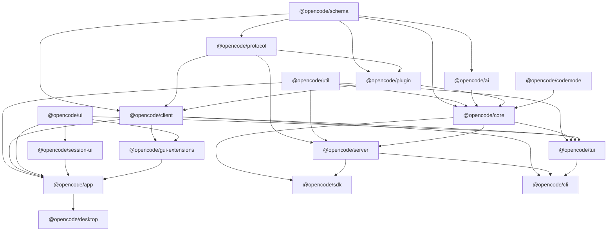
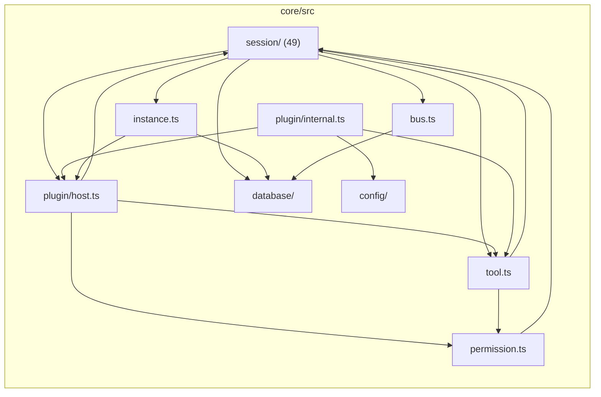

# 03 – Modular Decomposition & Bounded Contexts

> **Rolle:** reference analysis des OpenCode-V2-Checkouts, not an operative
> QOC-Spec. For the implementation, see [`spec/`](../spec/README.md).

> **Workflow 3:** Modular decomposition (finding bounded contexts)
> `[Import/Call diagram] ➔ [LLM cluster analysis] ➔ [Bounded contexts + migration plan]`
>
> **As of:** 2026-10-21, Repo `dev` @ `3108505b2f`
> **Method:** Package edges from real `@opencode/*` imports in `packages/`
> (not only `package.json`), module coupling in `packages/core/src` via
> file-import resolution (NodeNext `.js` suffixes are resolved).
> Reproducible with: `node docs/tools/coupling-analysis.mjs`.

---

## Contents

- [1. Dependency matrix at package level](#1-dependency-matrix-at-package-level)
- [2. Module coupling inside `packages/core/src`](#2-module-coupling-inside-packagescoresrc)
- [2.7 Orientation: dependency graph](#27-orientation-dependency-graph)
- [3. Bounded Contexts (proposal)](#3-bounded-contexts-proposal)
- [4. Boundary violations and thresholds](#4-boundary-violations-and-thresholds)
- [5. Strangler-Fig Plan](#5-strangler-fig-plan)
- [6. Concrete recommendations (small, safe steps)](#6-concrete-recommendations-small-safe-steps)
- [7. Open questions](#7-open-questions)

## 1. Dependency matrix at package level

### 1.1 Measured import edges (top 30)

| Count | Edge | Count | Edge |
|---:|---|---:|---|
| 510 | `core → schema` | 149 | `core → ai` |
| 499 | `core → util` | 142 | `gui-extensions → ui` |
| 375 | `app → ui` | 139 | `app → client` |
| 159 | `server → core` | 121 | `client → schema` |
| 153 | `core → plugin` | 115 | `session-ui → ui` |
| 106 | `plugin → schema` | 102 | `tui → client` |
| 85 | `cli → client` | 85 | `protocol → schema` |
| 62 | `cli → util` | 58 | `tui → plugin` |
| 57 | `app → gui-extensions` | 53 | `cli → schema` |
| 50 | `app → session-ui` | 49 | `app → util` |
| 48 | `sdk → schema` | 48 | `server → protocol` |
| 43 | `plugin → client` (exclusively **type** imports) | 35 | `tui → util` |
| 33 | `sdk → core` | 32 | `session-ui → client` |

### 1.2 Boundary check – all rules observed

The boundaries defined in the root `AGENTS.md` were checked against **real
imports**, not only `package.json`:

| Rule | Total hits | In production code |
|---|---:|---:|
| `client → core` forbidden | 0 | 0 |
| `client → server` forbidden | 0 | 0 |
| `schema → core` forbidden | 0 | 0 |
| `schema → protocol` forbidden | 0 | 0 |
| `protocol → core` forbidden | 0 | 0 |
| `protocol → server` forbidden | 0 | 0 |
| `core → server` forbidden | 0 | 0 |
| `core → client` forbidden | 0 | 0 |
| `core → protocol` forbidden | 0 | 0 |
| `app → core` forbidden | 0 | 0 |
| `tui → server` forbidden | 0 | 0 |
| `session-ui → core` forbidden | 0 | 0 |
| `ui → core` forbidden | 0 | 0 |

Two nuances:

* `server → client` exists **only in tests**
  (`packages/server/test/message.test.ts`, `sse-failure.test.ts`, `worktree.test.ts`) –
  integration tests against the server itself. Permissible, but worth noting.
* `plugin → client` is exclusively **type** imports
  (`packages/plugin/src/effect/rpc.ts:2`, `promise/rpc.ts:5`, `tui/context.ts:25`) –
  no runtime coupling.

> **Conclusion:** The package boundaries are **not wishful thinking**, but
> enforced in the code. Every violation would be immediately visible.

---

## 2. Module coupling inside `packages/core/src`

426 files, 69,276 lines, 37 subdirectories.

| Subdirectory | Files | Lines | Fan-out | Fan-in |
|---|---:|---:|---:|---:|
| `(root)` – 62 domain files | 62 | 17,283 | 367 | **658** |
| `session` | 49 | 10,715 | 368 | 282 |
| `plugin` | 68 | 10,074 | 365 | 135 |
| `database` | 79 | 6,704 | 162 | 193 |
| `tool` | 21 | 4,567 | 110 | 56 |
| `github-copilot` | 24 | 4,315 | 31 | 30 |
| `config` | 27 | 3,176 | 130 | 72 |
| `shell` | 7 | 3,150 | 9 | 19 |
| `mcp` | 5 | 2,142 | 24 | 16 |
| `persistent-pty` | 6 | 1,217 | 5 | 4 |
| `filesystem` | 10 | 833 | 24 | 29 |
| `codemode` | 4 | 747 | 9 | 10 |
| `v1` | 8 | 648 | 20 | 24 |
| `environment` | 8 | 640 | 25 | 44 |
| `instructions` | 2 | 318 | 4 | 17 |
| `skill` | 2 | 309 | 6 | 6 |
| `formatter` | 1 | 295 | 1 | 2 |
| `oauth` | 1 | 277 | 1 | 8 |
| `pty` | 6 | 211 | 5 | 5 |
| `effect` | 4 | 194 | 7 | 19 |
| `util` | 7 | 167 | 4 | 25 |
| `permission` | 2 | 165 | 6 | 4 |
| `worktree` | 4 | 153 | 15 | 14 |
| `modal` | 1 | 152 | 3 | 2 |
| `ripgrep` | 1 | 129 | 1 | 1 |
| `image` | 4 | 124 | 2 | 0 |
| `vcs` | 1 | 107 | 1 | 6 |
| `workspace` | 2 | 101 | 3 | 4 |
| `reference` | 1 | 100 | 3 | 3 |
| `project` | 2 | 90 | 7 | 11 |
| `account`, `wellknown`, `event`, `integration`, `instance`, `credential`, `kv` | 1 each | 10–37 | 0–3 | 0–13 |

### 2.1 The `(root)` problem

The 62 top-level files form the **hub** of the package: fan-in **658**,
fan-out **367** – more than half of all package edges.

Top files in `(root)`:

| Lines | File | Domain |
|---:|---|---|
| 1,424 | `git.ts` | version control |
| 1,069 | `aisdk.ts` | AI-SDK integration |
| 915 | `bus.ts` | event bus |
| 887 | `integration.ts` | integrations (MCP/hosted) |
| 691 | `variant.ts` | model variants |
| 533 | `provider.ts` | provider registry |
| 532 | `session.ts` | session facade |
| 492 | `job.ts` | background jobs |
| 483 | `model-resolver.ts` | model resolution |
| 474 | `shell.ts` | shell |
| 471 | `project.ts` | projects |

Imported from `(root)` (fan-in, file level):

| File | Fan-in |
|---|---:|
| `bus.ts` | 64 |
| `database/migration.ts` | 54 |
| `location.ts` | 49 |
| `schema.ts` | 43 |
| `session/schema.ts` | 36 |
| `config.ts` | 34 |
| `provider.ts` | 32 |
| `permission.ts` | 31 |
| `database/database.ts` | 28 |
| `model.ts` | 27 |
| `session/message.ts` | 27 |
| `state.ts` | 25 |

### 2.2 Fan-out hubs (importers)

| File | Local imports | Role |
|---|---:|---|
| `plugin/internal.ts` | 96 | registry of **all** built-in plugins |
| `instance.ts` | 54 | instance/project bootstrap |
| `database/migration.gen.ts` | 51 | generated migrations |
| `session.ts` | 34 | session facade |
| `plugin/provider.ts` | 33 | provider plugins |
| `plugin/host.ts` | 30 | plugin host |
| `session/runner/llm.ts` | 27 | model stream |
| `session/context.ts` | 23 | request context |

### 2.3 Cyclic dependencies (directory level, measured)

| Pair | Edges | Assessment |
|---|---|---|
| `(root) ↔ session` | 41 / 75 | **expected** – session facade ↔ domain modules |
| `(root) ↔ plugin` | 9 / 168 | **expected** – plugin hook ↔ domain modules |
| `(root) ↔ config` | 4 / 55 | **expected** – config plugins ↔ domain modules |
| `(root) ↔ tool` | 4 / 66 | **expected** |
| `(root) ↔ database` | 8 / 1 | negligible |
| `(root) ↔ filesystem` | 4 / 8 | negligible |
| `(root) ↔ worktree` | 7 / 6 | negligible |
| `plugin ↔ session` | 7 / 8 | **real coupling** – session hook ↔ plugin host |
| `session ↔ tool` | 4 / 5 | **real coupling** – tool execution ↔ session context |
| `config ↔ plugin` | 1 / 20 | config plugins → plugin API |
| `config ↔ tool` | 2 / 1 | tool configuration |
| `mcp ↔ tool` | 1 / 2 | MCP tools ↔ registry |
| `database ↔ session` | 3 / 20 | projection ↔ DB |

> The patterns are **architecturally intended**: `(root)` is deliberately the
> place for the domain facade and shared contracts. The interesting cycles are
> `plugin ↔ session` and `session ↔ tool` – that is where change costs arise.

### 2.4 Strongly Connected Components (Tarjan, file level)

A second, more precise measurement (Tarjan SCC over the file import graph,
426 files) shows **12 SCCs with more than one file**:

| # | Size | Content | Assessment |
|---|---:|---|---|
| 1 | **53** | `database/migration.gen.ts` + `database/migration.ts` + 50 migration files + `schema.gen.ts` | **No real cycle**, but a Drizzle codegen pattern. Harmless, but: the largest SCC – sensible to extract into its own package |
| 2 | **44** | `plugin/host.ts`, `plugin/internal.ts`, `plugin/provider.ts` + 11 provider adapters, `plugin/sdk.ts`, `plugin/supervisor.ts`, `session.ts`, `session/{command,diff,execution,generate,move,prompt,revert,session,shell,skill}.ts`, `session/runner/llm.ts`, `session/subagent-*.ts`, `tool/plugin/{opencode,shell,subagent}.ts`, `worktree.ts`, `instance.ts`, `instance/service.ts`, `location-lifecycle.ts`, `location-service-map.ts`, `plugin/{instance,module,verbosity}.ts`, `config/plugin/command.ts`, `filesystem/location-watcher.ts` | **The core cycle**: Session ↔ Plugin ↔ Tool ↔ Instance |
| 3 | 8 | `database/drizzle/sqlite-core/effect/*` | vendor adapter, expected |
| 4 | 7 | `bus.ts`, `location.ts`, `project.ts`, `session/{history,inbox,instruction-state,sql}.ts` | bus ↔ session tables |
| 5 | 3 | `config.ts`, `config/discovery.ts`, `config/watch.ts` | small, negligible |
| 6–11 | 2 each | `credential ↔ credential/sql`, `aisdk-native ↔ provider`, `kv ↔ kv/sql`, `environment/environment ↔ environment/index`, `image ↔ image/photon`, `permission/saved ↔ permission/sql` | **Barrel pattern**, no real cycles |
| 12 | 2 | `worktree/git ↔ worktree/strategies` | **real coupling** (strategy selection ↔ Git implementation) |

> **The only structural weak point is the 44-file SCC.** Everything else is
> either a barrel pattern or deliberate codegen structure.

### 2.5 Existing boundary tests (the strongest lever)

The repo already has **five** boundary test files that mechanically prevent
layer violations:

| Test | Effect |
|---|---|
| `packages/client/test/import-boundaries.test.ts` | bundle isolation: the client must not contain Core/Server |
| `packages/sdk/test/import-boundaries.test.ts:10-19` | requires the SDK to bundle Client **and** Core **and** Server |
| `packages/cli/test/import-boundaries.test.ts:12-19` | "does not import Core directly" |
| `packages/session-ui/src/import-boundaries.test.ts:5,17` | forbids `@opencode/core\|sdk\|server` |
| `packages/core/test/mcp-import-boundary.test.ts:28-41` | enforces lazy loading for MCP client/OAuth |

> For a strangler plan this means: the **tools already exist**. What is missing
> is only a Core-internal test that forbids foreign-cluster imports in
> `packages/core/src/<cluster>/`.

### 2.6 Package metrics (files / lines)

| Package | Files | Lines | Internal deps (runtime) |
|---|---:|---:|---|
| `packages/app` | 763 | 179,790 | client, schema, gui-extensions, session-ui, ui, util |
| `packages/core` | 758 | 176,989 | ai, codemode, plugin, plugin-browser, schema, util |
| `packages/gui-extensions` | 846 | 60,947 | client, plugin-browser, schema, session-ui, ui, util |
| `packages/tui` | 491 | 111,583 | client, core, latex, merman, plugin, schema, simulation, theme, ui, util |
| `packages/ai` | 408 | 80,304 | schema |
| `packages/ui` | 222 | 36,631 | – |
| `packages/cli` | 196 | 25,299 | client, plugin, schema, server, tui, util |
| `packages/desktop` | 172 | 14,592 | (dev) app, gui-extensions, client, schema, ui |
| `packages/session-ui` | 155 | 29,466 | client, ui, util |
| `packages/schema` | 122 | 7,598 | – |
| `packages/console/app` | 94 | 16,194 | console-resource, ui |
| `packages/server` | 91 | 9,516 | core, protocol, schema, simulation, util |
| `packages/merman` | 89 | 21,649 | plugin |
| `packages/codemode` | 85 | 31,876 | – |
| `packages/database` (in core) | 79 | 6,704 | – |
| `packages/stats/app` | 67 | 15,044 | stats-core, ui |
| `packages/plugin` | 66 | 3,589 | ai, client, protocol, schema, util |
| `packages/client` | 61 | 23,043 | schema, protocol |
| `packages/util` | 54 | 5,066 | – |
| `packages/protocol` | 46 | 4,678 | schema |
| **Total (35 packages)** | **5,109** | | |

---

## 2.7 Orientation: dependency graph

**Core cycle in `packages/core/src` (44 files, simplified):**

> The common thread is `session ↔ plugin ↔ tool ↔ instance`. As long as
> `instance.ts` knows all location services and the plugin host knows all domains,
> this is a single coupling structure – not four separate ones.

## 3. Bounded Contexts (proposal)

The contexts are **factually already present** – recognisable by cohesion
(within a folder) and low external coupling.

### BC-1 – Session lifecycle

* **Modules**: `core/src/session/` (49 files), `core/src/session.ts`
* **Language**: Session, Inbox Item, Step, Attempt, Execution, Delivery, Claim,
  Epoch, Compaction, Revert, Fork
* **Owns**: `session_v2`, `session_message`, `session_inbox`, `session_pending`
* **Out**: Event bus, instruction store, tool registry, permission
* **Responsibility**: prompt admission, delivery, step execution, recovery,
  compaction, session transactions

### BC-2 – Tool execution

* **Modules**: `core/src/tool.ts`, `core/src/tool/` (21 files)
* **Language**: Tool, Registration, Snapshot, Outcome, Content, Metadata, Code Mode
* **Owns**: no table (effects land in BC-1)
* **Out**: Permission, session context, plugin hooks, MCP
* **Responsibility**: registration, lookup, execution, normalisation, bounding

### BC-3 – Permissions & policies

* **Modules**: `core/src/permission.ts`, `core/src/permission/`,
  `core/src/managed-policy.ts`, `core/src/config/plugin/policy.ts`
* **Language**: Rule, Ruleset, Effect, Request, Reply, Saved Approval, Statement,
  Managed Policy
* **Owns**: `permission` table
* **Out**: Agent, Session, tool registry, console plugin
* **Responsibility**: evaluation, asking, approval list, organisation rules
* **Special**: domain-closed, but technically hooked into almost all areas via the
  `permission.evaluate` hook

### BC-4 – Provider & model catalog

* **Modules**: `core/src/provider.ts`, `model.ts`, `model-resolver.ts`,
  `models-dev*`, `variant.ts`, `aisdk*.ts`, `core/src/plugin/provider/`,
  `core/src/plugin/models-dev.ts`, `packages/ai/` (48 protocols, 52 providers)
* **Language**: Provider, Model, Variant, Route, Effort, Cache Policy
* **Owns**: `credential`, `account`, `account_state`
* **Out**: Schema, Config, Policy
* **Responsibility**: catalog, variants, credential resolution, transport

### BC-5 – Plugin & extension runtime

* **Modules**: `core/src/plugin.ts`, `core/src/plugin/` (68 files),
  `packages/plugin/`, `packages/plugin-browser/`
* **Language**: Plugin, Hook, Transform, Registration, Scope, Domain
* **Owns**: no own table
* **Out**: all domains (agent, tool, permission, provider, MCP, skill)
* **Responsibility**: loading, activation, hook execution, state replay
* **Special**: the largest cross-cutting context – with 68 files and 168
  imports from `(root)` the strongest coupling driver

### BC-6 – Workspace & project

* **Modules**: `core/src/project.ts`, `workspace.ts`, `worktree.ts`, `vcs.ts`,
  `git.ts`, `core/src/instance/`, `location*.ts`
* **Language**: Project, Workspace, Location, Worktree, Checkout, Strategy
* **Owns**: `project`, `workspace`, `worktree`
* **Out**: Session, Config, Shell
* **Responsibility**: directory identity, location lifecycle, Git operations

### BC-7 – Terminal & shell

* **Modules**: `core/src/shell.ts`, `core/src/shell/` (7 files, 3,150 lines),
  `core/src/pty/`, `core/src/persistent-pty/`, `core/src/environment/`
* **Language**: Command, Scanner, Workdir, Timeout, PTY, Ticket
* **Owns**: no table
* **Out**: Session, Permission, Tool
* **Responsibility**: command execution, scanning, PTY lifecycle

### BC-8 – Filesystem & snapshots

* **Modules**: `core/src/filesystem.ts`, `core/src/filesystem/`,
  `core/src/file-access.ts`, `file-mutation.ts`, `file-retention.ts`,
  `snapshot.ts`
* **Language**: Target, Root, Resource, Boundary, Snapshot
* **Owns**: snapshot repo (filesystem)
* **Out**: Permission, Tool, Session

### BC-9 – Instructions & context building

* **Modules**: `core/src/instructions/`, `instruction-discovery.ts`,
  `core/src/config/plugin/instruction.ts`, `core/src/session/context.ts`,
  `core/src/session/model-request.ts`, `core/src/session/instruction-*.ts`
* **Language**: Source, Key, Hash, Delta, Epoch, Baseline, Instruction Entry
* **Owns**: `instruction_entry`, `instruction_blob`, `instruction_state`
* **Out**: Session, Skill, MCP, Reference, Tool

### BC-10 – Persistence & events

* **Modules**: `core/src/database/` (79 files), `core/src/bus.ts`,
  `core/src/event/`, `core/src/kv/`
* **Language**: Aggregate, Sequence, Projection, Durable, Live, Ephemeral
* **Owns**: all tables
* **Out**: all domains (via the bus)
* **Responsibility**: transactions, migrations, replay

### BC-11 – Surfaces

* **Modules**: `packages/tui/`, `packages/app/`, `packages/ui/`,
  `packages/session-ui/`, `packages/gui-extensions/`, `packages/desktop/`,
  `packages/cli/`
* **Language**: Composer, Timeline, Tab, Pane, Dialog, Session View
* **Owns**: no table (only local UI state, e.g. `app/src/runtime/persistence/`)
* **Out**: `client`, `session-ui`, `ui`
* **Responsibility**: presentation, input, navigation

### BC-12 – Integrations & connectivity

* **Modules**: `core/src/mcp/`, `core/src/integration.ts`,
  `core/src/plugin/provider/opencode.ts`, `core/src/oauth/`,
  `core/src/credential.ts`, `core/src/websearch.ts`, `core/src/reference.ts`
* **Language**: Server, Resource, Integration, Credential, Connection
* **Owns**: `credential`, `account`
* **Out**: Tool, Policy, Config

### BC-13 – V1 compatibility (temporary)

* **Modules**: `core/src/v1/` (8 files, 648 lines),
  `core/src/database/v1-migration.bun.ts` (1,156 lines),
  `packages/schema/src/v1/`
* **Owns**: nothing (writes into V2 tables)
* **Responsibility**: reading and configuring legacy data
* **Status**: **explicitly temporary** – `packages/schema/AGENTS.md`:
  *"V1 coexistence is temporary … delete the V1 subtree when the legacy runtime
  is retired."*

---

## 4. Boundary violations and thresholds

| # | Finding | Severity | Reference |
|---|---|---|---|
| 1 | `core/src/plugin/internal.ts` imports **96** local modules and registers **all** built-ins in one place – a change risk for every new plugin type | medium | `packages/core/src/plugin/internal.ts` |
| 2 | `core/src/instance.ts` imports **54** local modules – bootstrap knows almost everything. It is the only place that knows **all** location services → every package extraction forces a change here | **critical** | `packages/core/src/instance.ts:1-25` |
| 3 | `core/src/shell/scan.ts` is the largest file in the core package at **2,410 lines** (shell scanner, tree-sitter + portable scanner) | high | `packages/core/src/shell/scan.ts` |
| 4 | `core/src/git.ts` (1,424 lines) bundles VCS logic outside the `vcs/` folder | medium | `packages/core/src/git.ts` |
| 5 | `core/src/plugin/provider/opencode.ts` (812 lines) contains console integration, provider and SSO – three domains in one file | high | `packages/core/src/plugin/provider/opencode.ts` |
| 6 | `core/src/integration.ts` (887 lines) + `core/src/mcp/index.ts` (847 lines) – MCP logic duplicated (core MCP and plugin MCP); `mcp ↔ tool` is a real cycle | medium | `packages/core/src/mcp/index.ts`, `core/src/tool/mcp.ts` |
| 7 | `core/src/session/projector.ts` (844 lines) knows **all** event types – a mandatory single source of truth, but high change friction | medium | `packages/core/src/session/projector.ts:464-800` |
| 8 | `packages/server/src/handlers/session.ts` (686 lines, 43 handlers) contains **domain decisions**: empty title triggers title generation instead of rename (`:229-237`), delivery dispatch steer/queue (`:536-538`), location fallback to `process.cwd()` (`:105`, `:119`) | high | `packages/server/src/handlers/session.ts` |
| 9 | `packages/server/src/location.ts:71-96` decodes session IDs and parses the `x-opencode-directory` header – transport with domain effect | medium | |
| 10 | The server imports **45 different core submodules** (not only facades), incl. `core/session/transfer`, `core/session/title`, `core/session/stats`, `core/permission/saved`, `core/shell/select`, `core/pty/ticket` | medium | `packages/server/src/handlers/*.ts` |
| 11 | `core/src/plugin/host.ts` (704 lines) knows **27 services** at once – the only point where all domains come together | high | `packages/core/src/plugin/host.ts:8-38` |
| 12 | `packages/core/src/rpc.ts` (12 KB) is a **second** transport model beside HTTP | medium | |
| 13 | `packages/core/src/github-copilot/` (24 files, 4,315 lines) lives **in core**, but is a pure provider special case → belongs domain-wise in BC-4 | low | |
| 14 | `packages/tui` declares `@opencode/core` as a runtime dep, but uses it at **only one place** (`core/util/slug`) | low | `packages/tui/src/component/dialog-worktree-name.tsx:1` |
| 15 | `packages/plugin` (contract SDK) depends via `dependencies` on `@opencode/client` and `@opencode/ai` → transitive coupling of the SDK to the HTTP client | low | `packages/plugin/package.json` |
| 16 | `packages/tui/src/routes/session/index.tsx` (135.5 KB) is the **largest production file in the whole repo** | medium | |

---

## 5. Strangler-Fig Plan

If the monolith ever had to be cut – the order:

| Step | Goal | Why first |
|---|---|---|
| 0 | **Consolidate boundary tests** + add a core-internal cluster test | The five existing boundary tests are the scaffold; without them every extraction is unprotected |
| 1 | **Extract `packages/core/src/github-copilot/`** from core | 4,315 lines, pure provider special logic, no session/tool coupling. Lowest risk |
| 2 | **Split `shell/scan.ts`** (2,410 lines) into scanner + evaluation + inference | isolatable, own tests, no domain coupling; 80 % of the `shell/` cluster |
| 3 | **BC-7 Terminal & Shell** as its own package | clear boundary (pty, shell, environment), own language, low fan-in (3-5) |
| 4 | **BC-8 Filesystem & Snapshots** | own data (filesystem, not DB), clear interface (`file-access`) |
| 5 | **BC-12 Integrations & Credentials** | high fan-in (29) at low fan-out (5) – the ideal leaf domain |
| 6 | **BC-6 Workspace & Project** | responsibility for location, worktree, Git – separable from session |
| 7 | **BC-2 Tool execution** | needs BC-3 (permissions) and BC-9 (context) as neighbours; move session-specific tools (`shell`, `subagent`) to `session/tools/` first |
| 8 | **BC-9 Instructions** | instruction hash store is standalone (fan-in 15 / fan-out 2), but tightly coupled to session epochs |
| 9 | **BC-3 Permissions** | last, because `permission.evaluate` hooks into all areas |
| 10 | **Decompose `instance.ts`** (composition root per domain) | the real lever – must come **after** 1–9, otherwise it moves along in every step |
| 11 | **BC-1 Session lifecycle** | remains the core; the "strangler" ends here |

### 5.1 What is **not** extractable

* **Session execution is deliberately process-local** – "Local execution remains
  process-owned until clustering introduces an explicit placement and fencing
  protocol" (`specs/v2/session.md:118`). Extracting into a separate service would
  undo exactly what the spec deliberately excludes.
* **Event bus and projections** are transactionally bound to the DB
  (`Bus.project(...)` writes in the same transaction) – a separation would
  require outbox/CDC and would change the delivery guarantees.
* **`packages/schema` and `packages/protocol`** are the stable contracts and
  remain **untouched** – they are the interface that every extraction would
  have to produce first.

### 5.2 Stable interfaces for an extraction

| Contract | Location | Stability |
|---|---|---|
| `HttpApi` (31 groups, 146 operations) | `packages/protocol/src/api.ts` | public, generated client |
| `OpenCodeEvent` (SSE) | `packages/protocol/src/groups/event.ts` | public |
| Domain shapes | `packages/schema/src/` | public, `V1`/`V2` suffixes |
| Plugin API | `packages/plugin/src/` | public |
| Client | `packages/client/src/` | generated, Promise + Effect + Solid |

---

### 5.3 What is **clean** (positively evidenced)

| Check | Result |
|---|---|
| Package level **acyclic** | 0 cycles (all deps incl. dev, and runtime-only) |
| Core imports no UI | 0 hits for `@opencode/ui`, `@opencode/theme`, `@opentui/*`, `solid-js`, `@opencode/session-ui` |
| Core imports no Server/Client | 0 hits for `@opencode/server`, `@opencode/client` |
| Client does not know Core | 0 hits, **contractually secured** by `packages/client/test/import-boundaries.test.ts` |
| App and session-ui do not know Core | 0 hits; `packages/session-ui/src/import-boundaries.test.ts:5,17` forbids `@opencode/core\|sdk\|server` |
| CLI frontend does not know Core | `packages/cli/test/import-boundaries.test.ts:12-19` |
| MCP SDK only lazy | `packages/core/test/mcp-import-boundary.test.ts:28-41` enforces `dynamic-import` |
| SDK composes deliberately | `packages/sdk/test/import-boundaries.test.ts:10-19` requires Client **and** Core **and** Server |

> **The upper architecture is healthy. The breaks lie exclusively *inside*
> `packages/core/src` and in the Server→Core granularity.**

## 6. Concrete recommendations (small, safe steps)

| # | Measure | Risk | Benefit |
|---|---|---|---|
| 0 | Consolidate the 5 boundary tests into a common check + add a core-internal cluster test | low | **Protects all following steps** |
| 1 | Move `core/src/github-copilot/` → `packages/ai/src/providers/github-copilot/` | low | 4,315 lines out of the core |
| 2 | Split `shell/scan.ts` into `shell/scanner/`, `shell/infer/` | medium | resolve the 2,410-line file (80 % of the cluster) |
| 3 | Split `plugin/internal.ts` (96 imports) into domain groups | medium | decouple the registration point |
| 4 | Split `provider/opencode.ts` into console client, provider and SSO | medium | three domains in one file |
| 5 | Move domain logic out of `packages/server/src/handlers/session.ts` back into core (title generation, delivery dispatch, location fallback) | medium | server stays a transport adapter |
| 6 | Break `plugin/host.ts` (27 services) into narrow capability slices | medium | the only point where all domains come together |
| 7 | Split `instance.ts` (54 imports) into composition roots per domain | high | **the real lever** – prevents further growth |
| 8 | Split `session/projector.ts` into domain parts per event group | medium | 844-line file |
| 9 | Remove `session_pending` once V1 compatibility ends | low | legacy ballast |

---

## 7. Open questions

1. The V1 compatibility subtree (`core/src/v1/`, `database/v1-migration.bun.ts`)
   is the only area with **deliberately** duplicated domain logic – until when
   should it live?
2. `packages/core/src/rpc.ts` vs. HTTP: two transport models for the same
   domain state – which is the canonical way for third parties?
3. Is **explicit module documentation** per subfolder missing? Currently only
   `tool/`, `schema/`, `plugin/` and a few others carry an `AGENTS.md`.
4. Which of the 13 BCs are **real** domain boundaries and which are only
   technical folders? The answer hinges on whether `github-copilot` is a
   provider special case or its own domain.