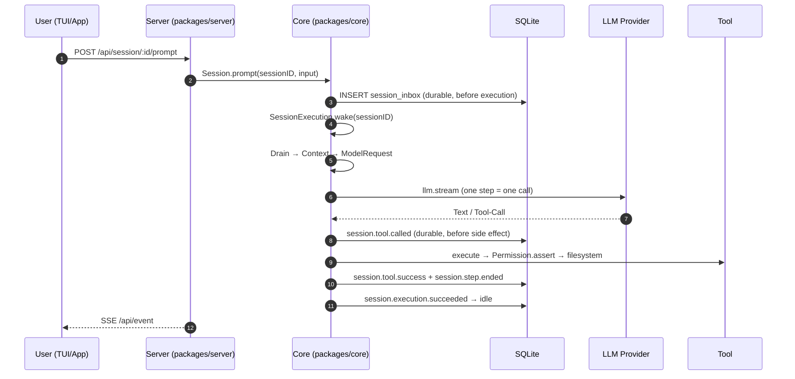

# 00 – Overview: the whole picture

> Depth: **overview**. Each block is a black-box call; the details live in
> `01`–`04`.

## The single diagram



## The six phases

### ① Key press → HTTP

The client sends `POST /api/session/:sessionID/prompt` with `text`, optionally
`files`/`agents`/`skills`/`metadata`/`delivery`/`resume`.

* Endpoint: `packages/protocol/src/groups/session.ts:334-355`
* Handler: `packages/server/src/handlers/session.ts:278-314`
* Location middleware reads `x-opencode-directory`
  (`packages/server/src/location.ts:72-75`), the session-location middleware
  attaches the session ID
  (`packages/protocol/src/api.ts:38-106`).

**Nothing happens at the model yet.** The request is pure transport.

### ② Admission → durable inbox row

`Session.prompt` (`packages/core/src/session/session.ts:155-188`):

| Step | Location | Effect |
|---|---|---|
| Load session | `session.ts:158` | `NotFoundError` if unknown |
| Determine ID | `session.ts:159` | Client ID or new `SessionMessage.ID` |
| **Reconcile** | `session.ts:161-167` → `inbox.ts:155-167` | Does the item ID already exist? → first admission wins, retry payload ignored |
| **Prepare** | `session.ts:169-173` → `prompt.ts:29-91` | Hook `session.prompt`, materialize attachments, resolve skills |
| Commit revert | `session.ts:175` | a staged revert is committed before new work |
| **Admit** | `session.ts:176-180` → `inbox.ts:169-202` | publish `session.inbox.enqueued` → projection: **INSERT `session_inbox`** |
| **Wake** | `session.ts:184` | `SessionExecution.wake(sessionID)` – except `resume === false` |

The publish runs through the bus: event row **and** projection happen in
**one** transaction (`packages/core/src/bus.ts:322-323`, `:406-408`;
projection `packages/core/src/session/projector.ts:683-699`).

> **Key point:** The inbox item lives **outside** the model-visible
> history. Only `session.inbox.delivered` makes it visible
> (`projector.ts:651-682`: DELETE `session_inbox` + INSERT `session_message`).

### ③ Execution → Drain

`wake` is a "doorbell" (`packages/core/src/session/run-coordinator.ts:131-140`):

* Session idle → start a fiber (`:82-107`)
* Session busy → remember `pendingWake`, the drain continues afterward (`:69-80`)

The fiber does:

1. Publish `session.execution.started` **+ set the write-ahead claim**
   (`execution.ts:109-113`) – in the same transaction.
2. `drain` → location-scoped runner (`execution.ts:84-107`,
   `instances.provide(session)`).
3. At the end exactly **one** terminal execution event
   (`execution.ts:116-144`): `succeeded` / `failed` / `interrupted`.

The drain itself (`packages/core/src/session/runner/llm.ts:56-193`):

```
advanceToStep (loop)
 ├─ Location closed?       → close transport, Reloaded
 ├─ pending control?       → compaction | move
 ├─ promote()              → inbox item becomes visible message
 ├─ prepareContext()       → agent, instructions, tool snapshot
 └─ context.load()         → model + history
runStep → steps.attempt → llm.stream
```

### ④ Context building

`SessionContext.select` (`packages/core/src/session/context.ts:126-166`) returns
session, agent, instructions and tool snapshot. `SessionContext.load`
(`:168-184`) adds model and active history.

The system prompt consists of two parts
(`packages/core/src/session/model-request.ts:99-119`):

```
system = [ agent.system  OR  SessionSystemPrompt.make(toolNames) , initial ]
```

`initial` is the instruction block (AGENTS.md, skills, MCP, builtins …) that
arises in cache-friendly order in `Instructions.combine`
(`context.ts:155-163`).

### ⑤ One step = one `llm.stream`

`packages/core/src/session/runner/step.ts:73-289`:

```
llm.stream(request, options)            → provider stream
  ├─ Text delta      → session.text.delta (live)
  ├─ Tool call       → session.tool.called (durable) → tool fiber starts
  │                                      → Permission.assert
  │                                      → leaf file operation
  │                                      → session.tool.success | failed
  └─ finish          → session.step.ended (cost, tokens, snapshot, files)
```

The tool call runs in its **own fiber** (`step.ts:122-134`), several tool
calls run in parallel – but the order of tool starts stays serial (the
publication `session.tool.called` must finish first).

### ⑥ Settlement

* `session.step.ended` → assistant message completed, cost/tokens
  (`step.ts:250-260`, projection `projector.ts:733-738`).
* `session.execution.succeeded` → `session_v2.time_idle` + `idle_outcome`
  (`execution.ts:121-124`, projection `projector.ts:713`).
* The client sees everything through the SSE feed `GET /api/event`.

## What is durable – and what is not

| Event | Durable? | Where |
|---|---|---|
| Prompt admission | **yes** (`session_inbox` + event log) | `inbox.ts:176-181` |
| Visible user message | **yes** (`session_message`) | `projector.ts:651-682` |
| Assistant text/reasoning | **yes** | `projector.ts:752-758` |
| Tool call and result | **yes** | `projector.ts:756-758` |
| Cost/tokens | **yes** (projection from `step.ended`) | `projector.ts:733-738` |
| Text/reasoning deltas | **no** (live) | `publish-llm-event.ts` |
| `permission.asked` / `.replied` | **no** (ephemeral) | `permission.ts:220`, `:274` |
| **File content** of a mutation | **no** | TODO in `tool/plugin/write.ts:42-43` |
| Snapshots (undo) | in their **own Git repo**, not in the DB | `packages/core/src/snapshot.ts` |

> **Consequence:** The replay shows *that* a file was written, but **not which
> bytes**. And a DB backup contains **no** undo history.

## The flow in numbers (typical session, no retry/compaction)

| Step | DB operations | Events |
|---|---|---|
| Admission | 1× INSERT `session_inbox` | `session.inbox.enqueued` |
| Execution start | 1× UPDATE `session_v2.time_suspended` | `session.execution.started` |
| Delivery | 1× DELETE `session_inbox` + 1× INSERT `session_message` | `session.inbox.delivered` |
| Step | 1× INSERT `session_message` (assistant) + UPDATEs | `session.step.started`, `session.text.*`, `session.tool.*`, `session.step.ended` |
| End | 1× UPDATE `session_v2.time_idle` | `session.execution.succeeded` |

Every durable event also writes a row in `event` and increments
`event_sequence` for the aggregate (`bus.ts:377-419`).

## What this level deliberately omits

* **No in-memory tool loop** – after every tool result a new step.
* **No model rotation "on failure"** – fallbacks apply only to title and
  helper models (`packages/core/src/session/context.ts:94-124`).
* **No instruction registry** – instructions are value deltas.
* **No permission audit log** – `permission.asked` is ephemeral.
* **No sandbox** – the permission system is a UX feature (`SECURITY.md:15-19`).

## Next

* Transport & admission in detail → [`01-stufe-1-transport-admission.md`](./01-stufe-1-transport-admission.md)
* Execution, drain, context → [`02-stufe-2-execution-runner.md`](./02-stufe-2-execution-runner.md)
* Tool call including permissions and file writing → [`03-stufe-3-toolcall.md`](./03-stufe-3-toolcall.md)
* Errors at all levels → [`04-stufe-4-fehler.md`](./04-stufe-4-fehler.md)