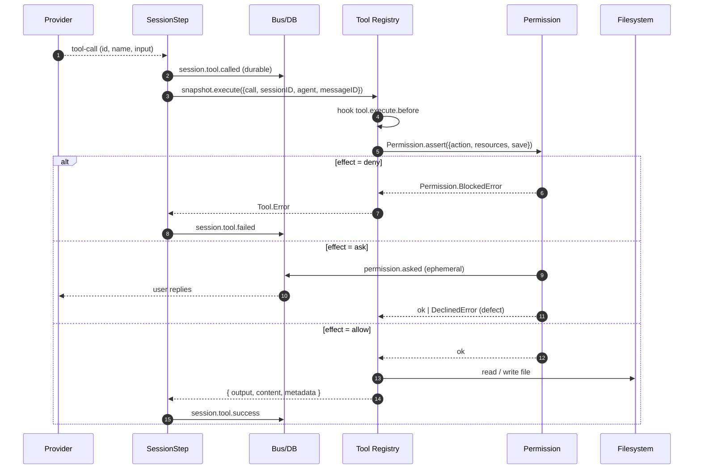

# 03 – Level 3: Model call, tool call, permissions, file writing

> Depth: **Level 3**. The request is built. Now: provider stream, tool call,
> execution, permission check, result, bounding.

## Contents

- [1. `llm.stream` – the model call](#1-llmstream-the-model-call)
- [2. The tool-call lifecycle](#2-the-tool-call-lifecycle)
- [3. The execution chain in detail](#3-the-execution-chain-in-detail)
- [4. The permission system](#4-the-permission-system)
- [5. Path authorization (`packages/core/src/file-access.ts`)](#5-path-authorization-packagescoresrcfile-accessts)
- [6. The leaf tools in detail](#6-the-leaf-tools-in-detail)
- [7. Output bounding (`packages/core/src/tool-output.ts:69-120`)](#7-output-bounding-packagescoresrctool-outputts69-120)
- [8. Code mode](#8-code-mode)
- [Checkpoints for your own changes](#checkpoints-for-your-own-changes)
- [Next](#next)

## 1. `llm.stream` – the model call

```ts
// packages/core/src/session/runner/step.ts:107-138
const providerStream = llm.stream(input.prepared.request, input.prepared.options).pipe(
  Stream.runForEach((event) =>
    Effect.gen(function* () {
      if (overflowFailure || publisher.hasProviderError()) return
      if (!publisher.hasStarted()) yield* Fiber.join(pendingStartSnapshot)     // :112
      if (LLMEvent.is.providerError(event) && isContextOverflowFailure(event)
          && !publisher.record().outputStarted) { overflowFailure = event; return }   // :113-120
      yield* publisher.publish(event)                                        // :121
      if (event.type !== "tool-call" || event.providerExecuted) return
      toolRuns.push({ call: event, fiber: yield* Effect.uninterruptibleMask((restore) =>
        restore(executeTool(event))
          .pipe(Effect.flatMap(toolOutput.truncate),                       // :127
                Effect.flatMap((outcome) => publisher.toolExecution(event.id, event.name, outcome)),
                Effect.catchTag("Tool.Error", (error) =>
                  publisher.failTool(event.id, toSessionError(error), error.metadata).pipe(Effect.asVoid)))
      ).pipe(Effect.forkScoped) })                                          // :122-134
    }),
  ),
  Effect.ensuring(publisher.flush()),
)
```

Four properties:

1. **One call = one `llm.stream`.** The stream is fully consumed
   (`Stream.runForEach`), not just until the `finish` event – the comment
   `step.ts:106` gives the reason: "Read to the end, not just the finish event,
   so the next request can reuse this response."
2. **Each tool call gets its own fiber** (`:133`). Several tool calls run in
   parallel; the *publication* of `session.tool.called` stays serial because it
   happens in the publisher stream.
3. **The snapshot starts in parallel** (`:76`): `snapshots.capture()` runs
   forked so that producing the start snapshot does not delay the provider
   request. Before `Step.Started` it is still awaited (`:112`).
4. **`Tool.Called` is durable before the side effect** – see §2.

### The publisher (`packages/core/src/session/runner/publish-llm-event.ts`)

| LLMEvent | SessionEvent | Line |
|---|---|---|
| `text-start/end` | `session.text.started/ended` | `:291-304` (message folder) |
| `tool-input-start/delta/end` | `session.tool.input.started/ended` | `:473-492` |
| **`tool-call`** | **`session.tool.called`** | `:493-511` |
| `tool-result` (provider-hosted) | `session.tool.success/failed` | `:512-547` |
| `tool-error` | `session.tool.failed` | `:548-568` |
| `step-finish` | terminal info stored | `:569-583` |
| `provider-error` | `failAssistant` | `:586-589` |

The publisher knows a state per tool call (`called`, `settled`,
`providerExecuted`) and throws **hard** (`Effect.die`) on violation:

* "Tool call before tool input start" – `:479`
* "Tool name changed for …" – `:481`, `:498`
* "Duplicate tool call" – `:499`
* "Tool result before call" – `:515`
* "Duplicate tool result" – `:518-523`
* "Tool execution before call" – `:610`
* "Tool execution has no content" – `:616`

These are **invariants of the flow**, not user errors – a violation is a defect
in the runner.

## 2. The tool-call lifecycle



The order is contractual:

| Order | Rule | Evidence |
|---|---|---|
| `tool.called` **before** `execute` | durable before the side effect | `step.ts:121` → `:122-134` |
| `execute.before` hook **before** execution | plugin may rewrite input | `tool.ts:103-111`, `:272` |
| Permission **before** the side effect | leaf decides | `tool/plugin/write.ts:78-86` |
| `tool.success`/`tool.failed` **after** execution | exactly one terminal event | `publish-llm-event.ts:608-625`, `:370-380` |
| Bounding **after** execution | registry bounding ≠ producer limit | `step.ts:127`, `core/src/tool/AGENTS.md` |

## 3. The execution chain in detail

### 3.1 Snapshot execution (`packages/core/src/tool.ts:264-285`)

```ts
execute: Effect.fnUntraced(function* (input) {
  const context: Tool.Context = {
    sessionID, agent, messageID, id: Tool.CallID.make(input.call.id), progress,
  }
  const event = yield* beforeExecute(input.call.name, input.call.input, context)  // :272
  const requested = input.definitions?.get(event.tool)                            // :273
  if (!requested && input.definitions && (direct.has(event.tool) || codeModeTool?.name === event.tool))
    return yield* new Tool.Error({ message: `Tool is not available for this request: ${event.tool}` })  // :275-276
  const name = requested?.name ?? event.tool                                       // :277
  if (name === "execute" && codeModeTool) return yield* executeTool(codeModeTool, name, event.input, context)
  const tool = direct.get(name)
  if (tool) return yield* executeTool(tool, name, event.input, context)
  return yield* new Tool.Error({ message: `No tool named "${name}" is currently available. …` })  // :282-284
})
```

The `definitions` map comes from `prepared.request` – those are the tools the
provider **advertised in this request**. Two rules follow:

* **The executor is frozen.** `direct` and `codeModeTool` come from the
  snapshot (`tool.ts:236-238`); a later deregistration removes the tool from
  **future** snapshots, not from this running request.
* **The name must have been advertised.** A tool the provider calls but that
  was not advertised in this request fails with "Tool is not available for this
  request" (`tool.ts:275-276`); a completely unknown name with "No tool named
  \"x\" is currently available" (`tool.ts:282-284`).

This is the law from `specs/v2/tools.md`: *exactly the tool version advertised
in the model request is executed.*

### 3.2 The runtime core (`packages/core/src/tool/runtime.ts:30-62`)

```ts
export const execute = (tool, input, context) =>
  Effect.gen(function* () {
    const decoded = yield* decodeInput(tool, input)                  // :32
    const result = yield* tool.execute(decoded, context).pipe(       // :38
      Effect.mapError((error) => error instanceof Tool.Error
        ? error
        : new Tool.Error({ message: error instanceof Error ? error.message : String(error) })),  // :39-45
    )
    if (tool.output === undefined) {                                  // :47-54
      if ("output" in result) return yield* Effect.die("Tool result declared output without an output schema")
      return { output: undefined, content: normalizeContent(result.content), … }
    }
    if (!("output" in result)) return yield* new Tool.Error({ message: "Tool did not return its declared output" })  // :55
    const output = yield* encodeOutput(tool.output, result.output)    // :56
    return { output, content: normalizeContent(result.content, output), … }
  })
```

* **Input decoding** (`:64-70`): Effect schema, Standard Schema V1, or
  Standard JSON Schema V1. On failure: `Tool.Error` with a
  **model-friendly** message – the path per issue, max. 5 issues, plus the
  passed arguments and the hint "Update the arguments and call the tool
  again." (`:89-101`).
* **Output encoding** (`:111-134`): invalid output → `Tool.Error` ("Tool
  returned an invalid value for its output schema").
* **Foreign errors** (`:39-45`): a plugin that throws a foreign failure is
  normalized to `Tool.Error` at the untrusted boundary – otherwise the call
  would stay unsettled forever.
* `normalizeContent` (`:259-263`): empty content is stringified from `output`.
  Per `specs/v2/tools.md:142` a tool **without** `output` must deliver
  non-empty model content – the runtime does not enforce this (otherwise the
  text `"undefined"` would arise); it is an obligation for tool authors.

### 3.3 Hooks and normalization (`packages/core/src/tool.ts:113-156`)

```
runtime execute
  → Tool.Error?  → execute.after(status="error") → rethrow error        (:131-139)
  → execute.after(status="completed")                                            (:140-149)
  → normalizeImages(normalizeContent(content, output))                          (:150)
```

`execute.after` **must never fail** – the hook receives the result and may
change it (`:149` uses `afterEvent.result`, not the original).
`normalizeImages` (`:74-101`) normalizes images and replaces unreadable or
too-large ones with a note ("[N images omitted: …]").

## 4. The permission system

### 4.1 Evaluation (`packages/core/src/permission.ts:87-97`)

```ts
export function evaluate(action, resource, ...rulesets) {
  return rulesets.flat().findLast(
    (rule) => Wildcard.match(action, rule.action) && Wildcard.match(resource, rule.resource),
  ) ?? { action, resource: "*", effect: "ask" }
}
```

* **The last matching rule wins.**
* No match → `ask`.
* `action` is a **free string** (`packages/schema/src/permission.ts`), not a
  closed enum.

### 4.2 `assert` (`permission.ts:235-267`)

```ts
const assert = (input) =>
  Effect.gen(function* () {
    if (closed) return yield* Effect.die(new DeclinedError())                 // :237
    const result = yield* evaluateInput(input)                               // :238
    return yield* Effect.uninterruptibleMask((restore) =>
      Effect.gen(function* () {
        if (result.effect === "deny")
          return yield* new BlockedError({ rules, permission, resources, reason })   // :241-248
        if (result.effect === "allow") return                               // :249
        const item = yield* create(request(input, result.message), input.agent)   // :250
        return yield* restore(Deferred.await(item.deferred)).pipe(            // :251
          Effect.catchTag("Permission.DeclinedError", (error) => Effect.die(error)),  // :257
          Effect.ensuring(Effect.sync(() => { pending.delete(item.request.id) })),    // :258-262
        )
      }),
    )
  })
```

`evaluateInput` (`:173-189`):

1. Rules = agent permissions ++ session permissions (`:158-163`). If the
   agent is completely missing: `[{action:"*",resource:"*",effect:"deny"}]`
   (`:19`).
2. **Deny short-circuit** (`:165-167`, `:175`): any resource `deny` →
   `deny`. This runs **before** saved approvals – a saved approval beats
   `ask`, but **never** `deny`.
3. Then: all rules + saved approvals (`:176`).
4. Effect = `ask` if any resource yields `ask`, otherwise `allow`
   (`:177-178`).
5. **Plugin hook** `permission.evaluate` may override effect and message
   (`:179-188`).

### 4.3 The three replies (`permission.ts:269-329`)

| Reply | Effect |
|---|---|
| `once` | only this call is released (`:310`) |
| `always` | the `save` pattern is **stored per project** (`:303-309`); afterward all other pending requests are re-evaluated and released if possible (`:312-326`) |
| `reject` | all **parallel** requests of the same session are rejected (`:280-300`); with feedback → `CorrectedError`, without → `DeclinedError` |

The `save` suggestion comes from the **tool**, not the user – e.g. `read`/`edit`
suggest `["*"]`, `shell` concrete command prefixes.

> **Behavior change vs. V1:** "always" is in V2 **project-wide persistent**,
> not just for the current session.

### 4.4 The defect technique

A **reject without feedback** is deliberately tunneled as a *defect*
(`permission.ts:257`), so that a `catchCause`/`mapError` in the leaf does not
turn it into model-side tool output. It reappears as a typed error only in
`SessionModelRequest.executeTool`
(`packages/core/src/session/model-request.ts:388-402`):

```ts
executeTool: (call) =>
  tools.execute({ ...call, definitions: hooked }).pipe(
    Effect.catchCauseFilter(
      (cause) => { /* DeclinedError | CancelledError in the defect channel */ },
      (decline) => Effect.fail(decline),
    ),
  )
```

A **reject with feedback** (`CorrectedError`) stays typed – the leaf may turn
it into a `ToolFailure` so the model can continue.

## 5. Path authorization (`packages/core/src/file-access.ts`)

```
resolve({path, kind})        :93-123
 ├─ inside location.directory or non-root project worktree?
 │     → resource = location-relative path (e.g. "src/db.ts")
 └─ otherwise (external)
       → externalDirectory = { action:"external_directory", directory, resource:"<dir>/*", save:"<root>/*" }

authorizeExternal(targets)   :125-142  → permission.assert({action:"external_directory", …})
authorizeRead(file, ctx)     :144-161  → authorizeExternal → permission.assert({action:"read", resources:[resource], save:["*"]})
```

The order is fixed: **first** `external_directory`, **then** `read`/`edit`
(`file-access.ts:153-159`). `external_directory` is `allow` by default – so
external access produces **no** prompt unless a rule changes that. The sandbox
boundary is therefore not active, only the permission check.

## 6. The leaf tools in detail

### 6.1 `read` (`packages/core/src/tool/plugin/read.ts:47-133`)

```
1. access.authorizeRead(input.path, context)      :55   → external? → edit?
2. reader.read(target.absolute, target.resource, {offset, limit})   :49-53
3. File not found?
     → alternatePath(): normalize + NFC, case-insensitive? no – exact basename match  :138-150
     → re-authorize (with siblingOf)  :66
     → still not there → ToolFailure "File not found" + 3 name suggestions  :152-171
4. AGENTS.md discovery upward (up to location root)  :87-107
     → SessionInstructions.load → durable synthetic message
     → errors swallowed (Effect.catch / catchDefect)  :104-106
5. Binary file (base64, not image/PDF) → BinaryFileError  :108-113
6. content = toModelContent(...)  → "<line>: <content>" prefix, truncation notice  :175-211
```

The AGENTS.md hook matters: **a successful read can change the context** by
injecting new instructions. That is why `read` is more than just "read file".

### 6.2 `write` (`packages/core/src/tool/plugin/write.ts:64-96`)

```
1. access.resolve({path, kind:"file"})            :71
2. access.authorizeExternal([target], context)    :72
3. read current content (for the diff)          :73-75
4. Diff preview = fileDiff(resource, alt, new, "added"|"modified")   :77
5. permission.assert({ action:"edit", resources:[target.resource],
                       save:["*"], metadata:{ files:[preview] } })   :78-86
6. fileMutation.writeTextPreservingBom(...)       :87
7. Apply formatter, sync BOM                     :88-91
```

* The action is **`edit`** – `write`, `edit` and `patch` share it
  (`packages/core/src/tool/AGENTS.md`).
* `save: ["*"]` means: "always" stores a project-wide approval for **every**
  path.
* The diff goes as `metadata` to the permission request – the UI can show it
  **before** it is allowed.
* `FileMutation` serializes mutations per path via a keyed mutex
  (`packages/core/src/file-mutation.ts:71-78`), process-local. External writers
  can still race (comment `:62-64`).
* **The bytes of the file change are not logged durably** – the code contains
  its own TODO (`write.ts:42`, `file-mutation.ts:129-134`).

## 7. Output bounding (`packages/core/src/tool-output.ts:69-120`)

After execution, **in the runner** (`step.ts:127`):

```ts
const truncate = (result) => {
  if (result.metadata?.truncated !== undefined) return result   // :70  producer already truncated
  const text = content.filter(text).join("\n")
  if (lines <= 2000 && bytes <= 50 KiB) return { …, metadata:{truncated:false} }
  // keep head, write rest to file
  const file = path.join(directory, fileName())                  // ~/.local/share/opencode/tool-output/tool_…
  yield* fs.writeFileString(file, text)
  const marker = `[showing ${shown} of ${lines.length}; full output saved to ${file}]`
  return { …, content: bounded, metadata:{ truncated:true, outputPath:file } }
}
```

Limits: `MAX_LINES = 2000`, `MAX_BYTES = 50 KiB` (`:13-14`), retention
7 days (`:15`), cleanup hourly (`:138-147`).

> The **producer** may set its own limits (e.g. `read` paginates); the
> generic bounding only kicks in when the producer marked nothing.

## 8. Code mode

When `experimental`/config enables code mode, tools get a JS API instead of
native tool calls (`packages/core/src/tool.ts:245-254`):

* The outer code-mode tool `execute` is built **per snapshot** and therefore
  is not registered in the registry.
* `codemode: false` keeps a tool on the native provider list
  (`packages/schema/src/tool.ts:44-51`).
* The runtime has **no** filesystem access, no imports, no timers – only
  `fetch`. Everything else goes through the tool catalog.

## Checkpoints for your own changes

* New tool action → `packages/schema/src/permission.ts` (free string),
  defaults in `packages/schema/src/agent.ts:46-51`, leaf implements
  `permission.assert`.
* New tool → `packages/core/src/tool/plugin/<name>.ts` + registration in
  `packages/core/src/plugin/internal.ts` + read `packages/core/src/tool/AGENTS.md`.
* Change output shape → `packages/schema/src/tool.ts` (output schema) +
  `packages/core/src/tool/runtime.ts:111-134`.
* Change bounding → `packages/core/src/tool-output.ts:13-15` (defaults) or
  `packages/schema/src/config/tool-output.ts` (config).

## Next

* All error paths → [`04-stufe-4-fehler.md`](./04-stufe-4-fehler.md)
* The concrete prompt → [`05-szenario.md`](./05-szenario.md)