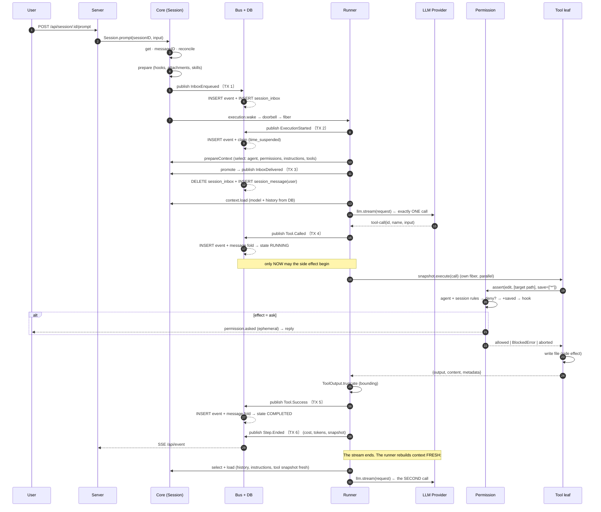

# 06 – The round trip: Session → LLM → permissions → tool → Session

> **Depth:** exact. Every step with `path:line`, every transaction boundary
> marked, every DB row named.
> **Purpose:** the path a prompt takes until the tool result lands back in the
> session – and why that is a **new** model call.
> **Basis:** `docs/spec/session-engine/` (neutral spec) + verified actual
> code.

## Contents

- [0. The picture in one sentence](#0-the-picture-in-one-sentence)
- [1. The big sequence diagram](#1-the-big-sequence-diagram)
- [2. Step by step](#2-step-by-step)
- [3. The six transaction boundaries of a round](#3-the-six-transaction-boundaries-of-a-round)
- [4. Error paths at the same points](#4-error-paths-at-the-same-points)
- [5. What the user sees at each moment](#5-what-the-user-sees-at-each-moment)
- [6. The three places where the flow deviates from the spec](#6-the-three-places-where-the-flow-deviates-from-the-spec)

## 0. The picture in one sentence

> The tool result does **not** go back into the same model request. It lands
> in the event log, is projected, and the **next** step reads it from the
> database. That is why there is no tool loop in memory.

## 1. The big sequence diagram

One round: input → delivery → model call → tool → back into the session.
`TX` marks a **transaction boundary** (everything in it or nothing).



## 2. Step by step

### Part A – Ingress (server → core)

| # | Call | Location | Event | DB row |
|---|---|---|---|---|
| A1 | `POST /api/session/:sessionID/prompt` | `packages/protocol/src/groups/session.ts:335` | – | – |
| A2 | Location middleware (`x-opencode-directory`) | `packages/server/src/location.ts:71-99` | – | – |
| A3 | Session-location middleware (checks the session) | `packages/server/src/middleware/session-location.ts:22-27` | – | – |
| A4 | Handler → `session.prompt(...)` | `packages/server/src/handlers/session.ts:278-314` | – | – |
| A5 | `get(sessionID)` | `packages/core/src/session/session.ts:158` | – | SELECT `session_v2` |
| A6 | `admission.reconcile(...)` | `session.ts:161` → `inbox.ts:155-167` | – | SELECT `session_inbox` |
| A7 | `SessionPrompt.prepare(...)` | `session.ts:169` → `prompt.ts:29-91` | – | – |
| A8 | `SessionRevert.commit` (if staged) | `session.ts:175` | `session.revert.committed` | DELETE messages ≥ boundary |
| A9 | `admission.admit(...)` | `session.ts:176` → `inbox.ts:169-202` | `session.inbox.enqueued` | **TX 1** |
| A10 | `execution.wake(sessionID)` | `session.ts:184` → `execution.ts:169` → `run-coordinator.ts:131-140` | – | – |

**TX 1** – `bus.publish` (`packages/core/src/bus.ts:322-419`):

```
BEGIN
  seq = event_sequence.seq + 1
  INSERT event (aggregate_id, seq, type, data)
  projections:  INSERT session_inbox          ← projector.ts:683-699 → inbox.ts:277-317
                 UPDATE session_v2.time_updated
  UPSERT event_sequence
COMMIT
```

**TX 2** – execution start (`execution.ts:109-113`):

```
BEGIN
  INSERT event (session.execution.started)
  commit hook: UPDATE session_v2 SET time_suspended = now()   ← store.ts:208-219
COMMIT
```

> The claim and the start event are created **together**. Without the claim
> there is no resume; without the event there is no proof.

### Part B – Delivery and context (runner → DB)

| # | Call | Location | Event | DB row |
|---|---|---|---|---|
| B1 | `drain(...)` | `execution.ts:84-107` → `runner/llm.ts:56-193` | – | – |
| B2 | `nextPromotable(...)` | `llm.ts:64` → `inbox.ts:407-424` | – | SELECT `session_inbox` |
| B3 | `context.select(...)` | `llm.ts:196` → `context.ts:126-166` | – | – |
| B3a | `agents.select(session.agent)` | `context.ts:133` | – | – |
| B3b | `Permission.merge(agent, session)` | `context.ts:136` | – | – |
| B3c | `registry.snapshot(permissions)` | `context.ts:139` → `tool.ts:227-288` | – | – |
| B3d | Instructions (parallel) | `context.ts:137-148`, `:155-163` | – | – |
| B4 | `InstructionState.prepare(...)` | `llm.ts:198` → `instruction-state.ts:80-87` | `session.instructions.updated` | INSERT `instruction_entry`/`_blob`/`_state` |
| B5 | `SessionInbox.promote(...)` | `llm.ts:163` → `inbox.ts:496-531` | `session.inbox.delivered` | **TX 3** |
| B6 | `context.load(...)` | `llm.ts:176` → `context.ts:168-184` | – | SELECT `session_message` (in **one** transaction with the instruction baseline, `history.ts:193-210`) |

**TX 3** – delivery (`projector.ts:651-682`):

```
BEGIN
  DELETE FROM session_inbox WHERE id = ?
  INSERT INTO session_message (id, session_id, seq, type, data)   ← type = 'user'
COMMIT
```

> **This is the visibility point.** Before TX 3 the prompt is *pending*; after
> TX 3 it is part of the model history. If the session ends between A9 and B5,
> the prompt stays in the inbox and is delivered on the next start.

### Part C – The model call

| # | Call | Location |
|---|---|---|
| C1 | Auto-compaction (if needed) | `llm.ts:214` → `compaction.ts:208-243` |
| C2 | `baseTranscript(...)` | `llm.ts:221` → `model-request.ts:99-119` |
| C3 | `context.request.primary(...)` | `llm.ts:228` → `model-request.ts:236-404` |
| C3a | Hook `session.context` | `model-request.ts:253`, `:406-408` |
| C3b | Output budget | `model-request.ts:259-262` + `:87-97` |
| C3c | Headers, cache key | `model-request.ts:281-295` |
| C3d | `LLM.request(...)` | `model-request.ts:279-302` |
| C4 | `steps.attempt(...)` | `llm.ts:242` → `step.ts:73-289` |
| C5 | `llm.stream(request, options)` | `step.ts:107` |

**System prompt** = `agent.system` **or** `SessionSystemPrompt.make(toolNames)`,
plus the instruction block (`model-request.ts:109-116`).

### Part D – The tool (provider → permissions → leaf → session)

| # | Call | Location | Event | DB row |
|---|---|---|---|---|
| D1 | Provider delivers `tool-call` | `step.ts:122` | – | – |
| D2 | Publisher publishes `Tool.Called` | `publish-llm-event.ts:493-511` | `session.tool.called` | **TX 4** |
| D3 | Tool fiber starts | `step.ts:125-134` | – | – |
| D4 | `prepared.executeTool(...)` | `model-request.ts:388-402` → `tool.ts:264-285` | – | – |
| D5 | Hook `tool.execute.before` | `tool.ts:272` → `:103-111` | – | – |
| D6 | Name resolution in the frozen snapshot | `tool.ts:273-284` | – | – |
| D7 | `runtime.execute(...)` | `runtime.ts:30-62` | – | – |
| D7a | Input decoding | `runtime.ts:32`, `:64-70` | – | – |
| D7b | **Permission check in the leaf** | `write.ts:78-86` / `read.ts:55` | – | – |
| D7c | **Side effect** (file write) | `write.ts:87` | – | file on disk |
| D7d | Output decoding | `runtime.ts:56`, `:111-134` | – | – |
| D8 | `ToolOutput.truncate` | `step.ts:127` → `tool-output.ts:69-120` | – | possibly file under `tool-output/` |
| D9 | `publisher.toolExecution(...)` | `step.ts:128` → `publish-llm-event.ts:608-625` | `session.tool.success` | **TX 5** |
| D9' | on error: `publisher.failTool(...)` | `step.ts:129-131` → `publish-llm-event.ts:370-386` | `session.tool.failed` | **TX 5** |
| D10 | `Step.Ended` | `step.ts:250-260` | `session.step.ended` | **TX 6** |

**TX 4** – `Tool.Called` (`projector.ts:756` → `message-updater.ts:326-342`):

```
BEGIN
  INSERT event (session.tool.called)
  message fold: tool card → state RUNNING, input, execution time
COMMIT
```

**TX 5** – result (`projector.ts:757` / `:758` → `message-updater.ts:345-381`):

```
BEGIN
  INSERT event (session.tool.success | session.tool.failed)
  message fold: state → COMPLETED | ERROR, content or error
COMMIT
```

**TX 6** – step end (`projector.ts:733-738`):

```
BEGIN
  INSERT event (session.step.ended)
  message fold: assistant message completed, cost, tokens
  UPDATE session_v2 (cost, tokens)
COMMIT
```

### Part E – The permission check in detail (`permission.ts`)

```
assert({action, resources[], save[], sessionID, agent, source})
  │
  ├─ 1. rules = agent permissions ++ session permissions     permission.ts:158-163
  │      (agent missing: [{action:"*",resource:"*",effect:"deny"}]  :19)
  │
  ├─ 2. DENY pre-check                                        permission.ts:165-167, :175
  │      any resource = deny  →  BlockedError
  │      (runs BEFORE saved approvals!)
  │
  ├─ 3. + saved approvals (per project)                      permission.ts:148-156, :176
  │
  ├─ 4. effect: ask dominates allow                           permission.ts:177-178
  │
  ├─ 5. hook "permission.evaluate" may change effect+message   permission.ts:179-188
  │
  └─ 6. depending on effect:
         ALLOW → continue
         DENY  → BlockedError  → ToolFailure → visible to the model
         ASK   → publish permission.asked (ephemeral!)          permission.ts:220
                  → Deferred waits
                  → reply(once | always | reject)               permission.ts:269-329
                     once   → only this call
                     always → store save pattern per project     permission.ts:303-309
                              + re-evaluate all other pending   :312-326
                     reject → DeclinedError (defect tunnel)      permission.ts:280-299
                              → the step ENDS, the model sees NOTHING
```

**Two orderings that must not be swapped:**

| Order | Why |
|---|---|
| `deny` **before** saved approvals | otherwise "always allow" overrides a denial |
| `external_directory` **before** `read`/`edit` | the directory boundary is the wider condition (`file-access.ts:153-159`) |

### Part F – Back into the session

This is the part easily overlooked:

```
llm.stream ends  (step.ts:107-138)
        │
        ▼
await all tool fibers                (step.ts:151)
        │
        ▼
Step.Ended  (cost, tokens)           (step.ts:250-260)
        │
        ▼
┌───────────────────────────────────────────────────────────┐
│ while (true) {                                           │  llm.ts:185-192
│   advanceToStep()  ← FRESH:                              │
│     · check pending (inbox, control items)                │
│     · prepareContext()  → agent, instructions, TOOLS fresh│
│     · context.load()    → HISTORY fresh from DB           │
│   runStep()         → llm.stream()  ← SECOND call        │
└───────────────────────────────────────────────────────────┘
```

**What that means:**

| Question | Answer |
|---|---|
| Does the model get its tool result in the same call? | **No.** It gets it in the next one. |
| Where does it come from? | From `session_message` (projected by TX 3+5), read in `context.load`. |
| Why this way? | One step = **one** model call. State between two steps exists only in the log. |
| What on a crash mid-tool? | `Tool.Called` is committed, the result is missing. On next start the call is marked failed (`llm.ts:356-379`). |
| What if the tool runs long? | It runs in its own fiber (`step.ts:133`); several run in parallel, their **publication** stays in call order. |

**The client sees everything live**, independent of when the next step starts:
`event-feed.ts:48-69` encodes **once** per event and pushes the frame into each
connection's queue (`handlers/event.ts:18-24`).

## 3. The six transaction boundaries of a round

| TX | Content | Event | Affects |
|---|---|---|---|
| 1 | Admission | `session.inbox.enqueued` | `session_inbox` |
| 2 | Execution start | `session.execution.started` | `session_v2.time_suspended` (claim) |
| 3 | Delivery | `session.inbox.delivered` | `session_message` (user) |
| 4 | Tool start | `session.tool.called` | assistant message (RUNNING) |
| 5 | Tool end | `session.tool.success` / `.failed` | assistant message (COMPLETED/ERROR) |
| 6 | Step end | `session.step.ended` | assistant message, cost, tokens |

**Each of these boundaries is a promise:** after TX 4 the process can die and
the call is still in the log. After TX 1 the prompt is durable.

## 4. Error paths at the same points

| Location | Error | Consequence | Visible to |
|---|---|---|---|
| A6/A9 | ID conflict | `PromptConflictError`, **nothing admitted** | HTTP 409 |
| A7 | invalid attachment/skill | **nothing admitted** | HTTP 400 |
| B5 | no promotable item | `DrainResult.Complete` → idle | – |
| C4/D2 | provider error before output | retry (max. 4–10), same message ID | history |
| C4 | content filter | step fails, partial content stays | history |
| C4 | context overflow | **one** compaction, then new attempt | transparent |
| D7b | `deny` | `BlockedError` → `ToolFailure` → **text to the model** | tool result |
| D7b | `reject` without reason | **abort** → step ends, model sees nothing | history only |
| D7b | `reject` with reason | `CorrectedError` → `ToolFailure` → **text to the model** | tool result |
| D7a | invalid input | `Tool.Error` with correctable message | tool result |
| D7 | tool throws foreign | normalized to `Tool.Error` at the boundary | tool result |
| D8 | output too large | truncated + `metadata.outputPath` | tool result |
| after D3 | user interrupt | `session.execution.interrupted`, claim released | history |

## 5. What the user sees at each moment

| Time | Display | Source |
|---|---|---|
| immediately | prompt line (optimistic) | TUI `prompt/index.tsx:1360-1378` / App `submit.ts:545` |
| TX 1 | prompt confirmed | `session.inbox.enqueued` |
| TX 3 | prompt "delivered" | `session.inbox.delivered` |
| model streams | text/reasoning blocks | `session.text.*` / `session.reasoning.*` |
| TX 4 | tool card "running" | `session.tool.called` |
| on `ask` | approval dock with diff | `permission.asked` (ephemeral) |
| TX 5 | tool result or error | `session.tool.success` / `.failed` |
| TX 6 | cost/tokens on the turn | `session.step.ended` |
| end | idle marker | `session.execution.succeeded` → `idle("succeeded")` (`message-updater.ts:146`) |

## 6. The three places where the flow deviates from the spec

| Spec | Actual code | Assessment |
|---|---|---|
| "One step = one model call, no tool loop in memory" | **honored** (`llm.ts:185-192`) | core |
| "Tool call durable **before** the side effect" | **honored** (`step.ts:121-134`) | core |
| "Rejection without feedback ends the step, without model text" | **honored** (`permission.ts:257` + `model-request.ts:388-402`) | core |

→ The round trip is **structurally correct**. The open points concern not the
flow but robustness (recovery after crash, bounding, compaction trigger) – see
`docs/spec/session-engine/09-invariants-audit.md`.