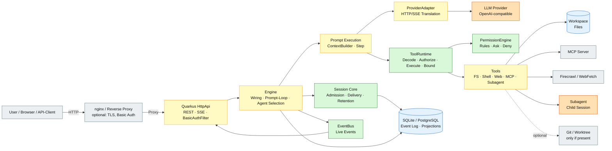

# 01 – System Context

## Purpose

The diagram shows QOC as a whole: client, HTTP layer, engine, LLM, tools,
external services and persistence. It makes visible where deterministic logic
lives and where a model or an external service is involved.

## What is deterministic?

| Part | Why |
|---|---|
| `HttpApi` validation and error codes | fixed rules, no model involvement |
| `SessionService`, `Admission`, `Delivery` | fixed order, idempotency, inbox rules |
| `Journal` / projections | append-only, sequence, transaction |
| `PermissionEngine` | rules, wildcards, deny/ask/allow |
| `ToolRuntime` | snapshot, schema-decode, authorizer, bounding |
| `ContextBuilder` | fixed order, history folding, budget |
| `SessionRetention` | timestamps and configured deletion rule |

## What is not deterministic?

| Part | Why |
|---|---|
| Model text output | LLM-generated |
| Selection of tool calls | LLM decides which tools to call |
| Title generation | LLM-generated |
| Compaction summary | LLM-generated (the trigger is deterministic) |
| Subagent result | separate LLM run in a child session |
| MCP, Firecrawl, WebFetch responses | external services |

## Important consequence

The **Step framework** is deterministic: it reads the stream completely,
validates it, executes requested tools in a defined order and produces exactly
one terminal result. **Which** tools are called, however, is decided by the
LLM. QOC is therefore today a deterministically framed agent – not yet a
deterministic workflow orchestrator.

## Sources

- `quarkus/src/main/java/de/augmentia/oc/engine/http/HttpApi.java`
- `quarkus/src/main/java/de/augmentia/oc/engine/http/Engine.java`
- `quarkus/src/main/java/de/augmentia/oc/engine/http/EventBus.java`
- `engine/src/main/java/de/augmentia/oc/engine/runtime/step/Step.java`
- `engine/src/main/java/de/augmentia/oc/engine/runtime/tool/runtime/ToolRuntime.java`
- `engine/src/main/java/de/augmentia/oc/engine/runtime/permission/engine/PermissionEngine.java`
- `engine/src/main/java/de/augmentia/oc/engine/runtime/session/core/`
- `engine/src/main/java/de/augmentia/oc/engine/adapter/`