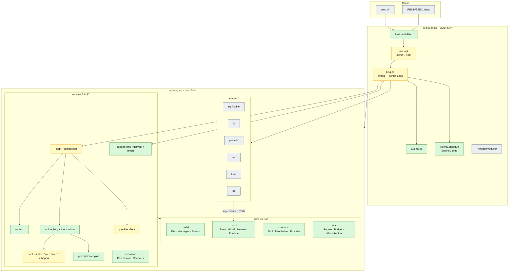
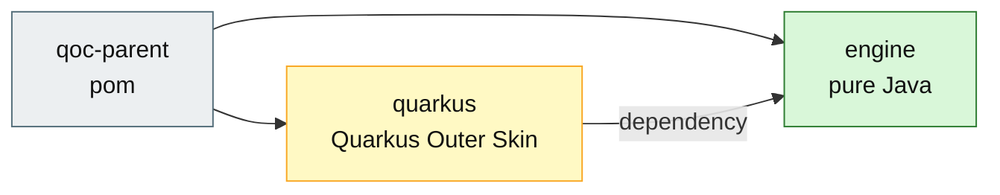

# 02 – Architektur und Schichten

## Zweck

QOC besteht aus zwei Maven-Modulen: einer **reinen Java-Engine** und einer
**Quarkus-Outer-Skin**. Die Engine ist in vier Bereiche gegliedert:
`core`, `runtime`, `adapter` und – laut Spec – `http`. Im aktuellen Code liegt
die HTTP-/Wiring-Schicht im Quarkus-Modul.

## Maven-Module

## Schichten und Stages

| Stage | Package / Modul | Aufgabe | Determinismus |
|---|---|---|---|
| **S0** | `core.model`, `core.error`, `core.json`, `core.pattern`, `core.shell.scan`, `core.port.*` | Werte, Ports, reine Hilfen | deterministisch |
| **S1** | `core.event`, `core.contract.*` | Typen und Verträge | deterministisch |
| **S2** | `core.eval` | reine Auswerter: Regeln, Budget, Klassifikation | deterministisch |
| **S3** | `runtime.tool.registry`, `runtime.permission.engine`, `runtime.provider.client`, `runtime.context`, `runtime.skill`, `runtime.credential` | Registry, Authorisierung, Provider-Übersetzung, Kontext | überwiegend deterministisch; Provider ruft LLM |
| **S4** | `runtime.tool.runtime`, `runtime.tool.fs`, `runtime.tool.shell`, `runtime.tool.mcp`, `runtime.tool.web`, `runtime.tool.subagent` | Tool-Ausführung | Ausführung deterministisch; externe Wirkung/LLM möglich |
| **S5** | `runtime.step`, `runtime.compaction` | ein Modell-Step, Compaction | gemischt |
| **S6** | `runtime.session.core`, `runtime.session.delivery`, `runtime.session.revert` | Session, Inbox, Delivery, Revert | deterministisch |
| **S7** | `runtime.execution` | Claim, Coordinator, Recovery | deterministisch |
| **S8** | `quarkus` (`HttpApi`, `Engine`, `EventBus`, `EngineConfig`) | HTTP/SSE und Wiring | gemischt |

> Die Spec beschreibt S8 als `engine.http` innerhalb der Engine. Im aktuellen
> Build liegt diese Schicht im Modul `quarkus`. Das ist die effektive
> Architektur; die Engine bleibt frei von Quarkus-, CDI- und HTTP-Abhängigkeiten.

## Zentrale Architekturregeln

1. **Abhängigkeiten zeigen nur nach unten.** S0 → S1 → … → S8.
2. **Über eine Stage-Grenze geht nur eine Schnittstelle**, keine konkrete
   Adapter-Klasse.
3. **Ports gehören dem Verbraucher**, nicht dem Adapter.
4. **Adapter liegen außerhalb der Stages** und werden nur von der
   Wiring-Schicht verwendet.
5. **`core` ist reines Java**: keine Quarkus-, Jackson-, CDI- oder
   HTTP-Abhängigkeiten.
6. **ArchUnit prüft die Regeln** in
   `qoc/engine/src/test/java/de/augmentia/oc/engine/arch/ArchitectureTest.java`.

## Ist-Stand vs. Spec

| Punkt | Ist-Stand | Konsequenz |
|---|---|---|
| HTTP/Wiring | im Modul `quarkus` | Quarkus-Abhängigkeiten bleiben aus der Engine heraus |
| `Coordinator` | vorhanden und getestet, aber im HTTP-Pfad nicht verdrahtet | `Engine` nutzt aktuell einen eigenen Prompt-Loop mit `running`-Map |
| Step-/Execution-Events | Event-Typen existieren | der aktuelle Prompt-Loop schreibt vor allem Conversation- und Inbox-Events |
| Workflow-Orchestrator | nicht vorhanden | siehe Zielbild in `08-agent-orchestrator.md` |

## Quellen

- `qoc/pom.xml`, `qoc/engine/pom.xml`, `qoc/quarkus/pom.xml`
- `qoc/docs/spec/module-plan.md`
- `qoc/docs/spec/java-packages.md`
- `qoc/engine/src/test/java/de/augmentia/oc/engine/arch/ArchitectureTest.java`
- `qoc/quarkus/src/main/java/de/augmentia/oc/engine/http/Engine.java`
- `qoc/engine/src/main/java/de/augmentia/oc/engine/runtime/execution/Coordinator.java`
