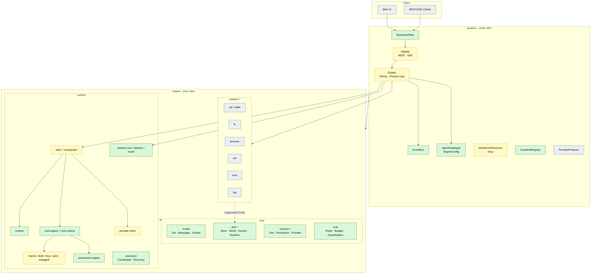
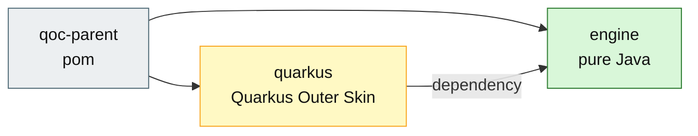

# 02 – Architecture and Layers

## Purpose

QOC consists of two Maven modules: a **pure Java engine** and a
**Quarkus outer skin**. The engine is divided into four areas:
`core`, `runtime`, `adapter` and – per spec – `http`. In the current code the
HTTP/wiring layer lives in the Quarkus module.

## Maven modules

## Layers and stages

| Stage | Package / module | Task | Determinism |
|---|---|---|---|
| **S0** | `core.model`, `core.error`, `core.json`, `core.pattern`, `core.shell.scan`, `core.port.*` | values, ports, pure helpers | deterministic |
| **S1** | `core.event`, `core.contract.*` | types and contracts | deterministic |
| **S2** | `core.eval` | pure evaluators: rules, budget, classification | deterministic |
| **S3** | `runtime.tool.registry`, `runtime.permission.engine`, `runtime.provider.client`, `runtime.context`, `runtime.skill`, `runtime.credential` | registry, authorization, provider translation, context | mostly deterministic; provider calls LLM |
| **S4** | `runtime.tool.runtime`, `runtime.tool.fs`, `runtime.tool.shell`, `runtime.tool.mcp`, `runtime.tool.web`, `runtime.tool.subagent` | tool execution | execution deterministic; external effect/LLM possible |
| **S5** | `runtime.step`, `runtime.compaction` | one model step, compaction | mixed |
| **S6** | `runtime.session.core`, `runtime.session.delivery`, `runtime.session.revert` | session, inbox, delivery, revert | deterministic |
| **S7** | `runtime.execution` | claim, coordinator, recovery | deterministic |
| **S8** | `quarkus` (`HttpApi`, `Engine`, `EventBus`, `EngineConfig`) | HTTP/SSE and wiring | mixed |

> The spec describes S8 as `engine.http` inside the engine. In the current
> build this layer lives in the module `quarkus`. This is the effective
> architecture; the engine stays free of Quarkus, CDI and HTTP dependencies.

## Central architectural rules

1. **Dependencies point only downward.** S0 → S1 → … → S8.
2. **Only an interface crosses a stage boundary**, not a concrete
   adapter class.
3. **Ports belong to the consumer**, not the adapter.
4. **Adapters live outside the stages** and are only used by the
   wiring layer.
5. **`core` is pure Java**: no Quarkus, Jackson, CDI or
   HTTP dependencies.
6. **ArchUnit rules are documented** and intended for
   `engine/src/test/java/de/augmentia/oc/engine/arch/ArchitectureTest.java`,
   but are not implemented yet; enforcement currently comes from module
   boundaries and review.

## Current state vs. spec

| Point | Current state | Consequence |
|---|---|---|
| HTTP/wiring | in module `quarkus` | Quarkus dependencies stay out of the engine |
| `Coordinator` | present and tested, but not wired into the HTTP path | `Engine` currently uses its own prompt loop with a `running` map |
| Step/execution events | event types exist | the current prompt loop mainly writes conversation and inbox events |
| Workflow orchestrator | not present | see target picture in `08-agent-orchestrator.md` |

## Sources

- `qoc/pom.xml`, `engine/pom.xml`, `quarkus/pom.xml`
- `docs/spec/module-plan.md`
- `docs/spec/java-packages.md`
- `engine/src/test/java/de/augmentia/oc/engine/arch/ArchitectureTest.java`
- `quarkus/src/main/java/de/augmentia/oc/engine/http/Engine.java`
- `engine/src/main/java/de/augmentia/oc/engine/runtime/execution/Coordinator.java`