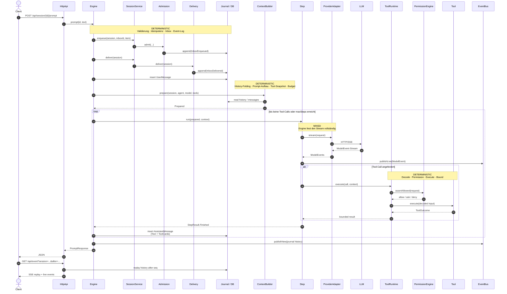

# 03 – Laufzeit- und Datenfluss eines Prompts

## Zweck

Dieses Diagramm verfolgt einen Prompt vom HTTP-Aufruf bis zur Antwort, zu den
persistierten Daten und zum SSE-Stream. Es zeigt außerdem, welche Schritte
deterministisch sind und wo das LLM ins Spiel kommt.



```text
Hinweis: Im Sequenzdiagramm steht „Journal / DB“ als Sammelbezeichnung für
Event-Log, Conversation-Projektion und die übrigen Stores. Die konkrete
Persistenz ist in `09-persistence.md` getrennt dargestellt.
```

## API-Oberfläche (Auszug)

| Endpoint | Aufgabe |
|---|---|
| `POST /api/session` | Session anlegen, optional mit Agent |
| `GET /api/session` | Sessions auflisten |
| `GET /api/session/{id}` | Session lesen |
| `DELETE /api/session/{id}` | Session löschen |
| `POST /api/session/{id}/agent` | Agent in bestehender Session wechseln |
| `POST /api/session/{id}/prompt` | Prompt ausführen |
| `POST /api/session/{id}/command` | Slash-Command als Prompt ausführen |
| `GET /api/event` | SSE: Replay + Live-Events |
| `GET /api/session/{id}/messages` | Nachrichten lesen |
| `POST /api/session/{id}/interrupt` | Lauf unterbrechen |
| `POST /api/session/{id}/revert` | letzten User-Turn zurücknehmen |
| `POST /api/session/{id}/compact` | manuelle Compaction |
| `POST /api/session/{id}/permission/{requestId}/reply` | Permission beantworten |
| `POST /api/session/{id}/question/{questionId}/reply` | Frage beantworten |
| `GET /api/agent` | Agenten auflisten |
| `GET /api/skill` | Skills auflisten |
| `GET /api/mcp` | MCP-Server und Status |
| `GET /api/health` | Health |

## Deterministische Schritte

1. **Request-Validierung** in `HttpApi`.
2. **Admission**: Idempotenzprüfung, `InboxEnqueued`, Scheduling.
3. **Delivery**: Steer vor Queue, ein Queue-Eintrag pro Lauf.
4. **ContextBuilder**: feste Reihenfolge von System-Prompt, Instructions,
   History, Tool-Snapshot und Budget.
5. **Permission Engine**: Regeln, Wildcards, Saved Approvals, Ask/Deny.
6. **ToolRuntime**: Input-Decode, Authorisierung, Ausführung, Output-Decode,
   Bounding.
7. **Persistenz**: Event-Sequenz und Projektionen.
8. **SSE-Replay**: History nach Sequenz, dann Live-Subscription.

## LLM-/Mixed-Schritte

1. **Provider-Aufruf** liefert Text, Reasoning und Tool-Call-Vorschläge.
2. **Step** führt die vom Modell gewählten Tool-Calls aus.
3. **Titelgenerierung** und **Compaction-Zusammenfassung** nutzen ebenfalls das
   Modell.
4. **Subagent** ist ein eigener LLM-Lauf in einer Child-Session.

## Beobachtete Abweichungen zum Spec-Ideal

- Der aktuelle HTTP-Pfad persistiert die Assistant-Nachricht in
  `session_message`. Die Event-Typen `StepStarted`, `StepEnded`, `ToolCalled`
  usw. existieren, werden in diesem Pfad aber nicht vollständig geschrieben.
- `Delivery` schreibt `InboxDelivered` und entfernt den Inbox-Eintrag über
  getrennte Store-Aufrufe; das ist keine gemeinsame Transaktion.
- Der `Coordinator` ist implementiert und getestet, wird vom HTTP-Pfad aber
  nicht verwendet. `Engine` nutzt eine eigene `running`-Map und einen direkten
  Prompt-Loop.

Diese Punkte sind für das Verständnis wichtig: Die **Bausteine** für einen
stärker deterministischen Ablauf sind vorhanden, aber noch nicht überall
verdrahtet.

## Quellen

- `qoc/quarkus/src/main/java/de/augmentia/oc/engine/http/HttpApi.java`
- `qoc/quarkus/src/main/java/de/augmentia/oc/engine/http/Engine.java`
- `qoc/engine/src/main/java/de/augmentia/oc/engine/runtime/session/core/Admission.java`
- `qoc/engine/src/main/java/de/augmentia/oc/engine/runtime/session/delivery/Delivery.java`
- `qoc/engine/src/main/java/de/augmentia/oc/engine/runtime/context/ContextBuilder.java`
- `qoc/engine/src/main/java/de/augmentia/oc/engine/runtime/step/Step.java`
- `qoc/engine/src/main/java/de/augmentia/oc/engine/runtime/tool/runtime/ToolRuntime.java`
- `qoc/engine/src/main/java/de/augmentia/oc/engine/runtime/permission/engine/PermissionEngine.java`
