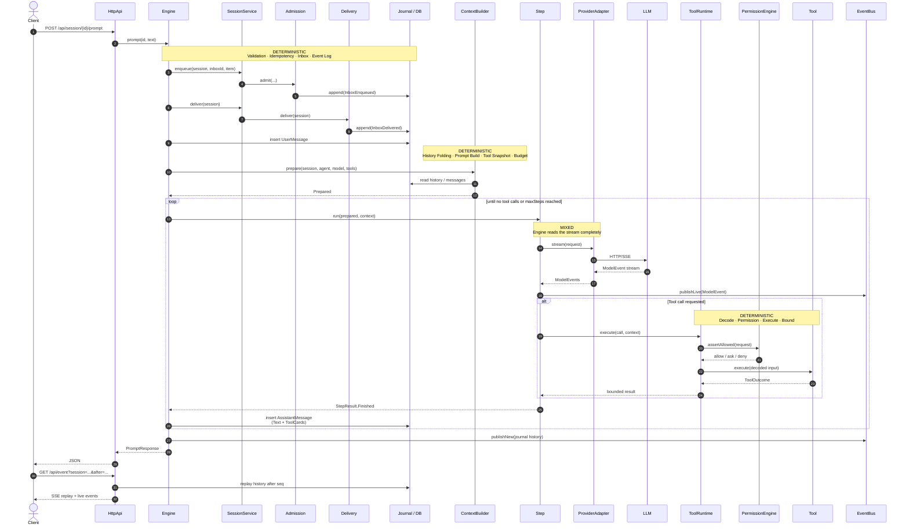

# 03 – Runtime and Data Flow of a Prompt

## Purpose

This diagram traces a prompt from the HTTP call to the response, to the
persisted data and to the SSE stream. It also shows which steps are
deterministic and where the LLM comes into play.



```text
Note: In the sequence diagram "Journal / DB" is a collective term for
the event log, the conversation projection and the other stores. The
concrete persistence is shown separately in `09-persistence.md`.
```

## API surface (excerpt)

| Endpoint | Task |
|---|---|
| `POST /api/session` | create a session, optionally with an agent |
| `GET /api/session` | list sessions |
| `GET /api/session/{id}` | read a session |
| `DELETE /api/session/{id}` | delete a session |
| `POST /api/session/{id}/agent` | switch agent in an existing session |
| `POST /api/session/{id}/prompt` | execute a prompt |
| `POST /api/session/{id}/command` | execute a slash command as a prompt |
| `GET /api/event` | SSE: replay + live events |
| `GET /api/session/{id}/messages` | read messages |
| `POST /api/session/{id}/interrupt` | interrupt a run |
| `POST /api/session/{id}/revert` | revert the last user turn |
| `POST /api/session/{id}/compact` | manual compaction |
| `POST /api/session/{id}/permission/{requestId}/reply` | answer a permission request |
| `POST /api/session/{id}/question/{questionId}/reply` | answer a question |
| `GET /api/agent` | list agents |
| `GET /api/skill` | list skills |
| `GET /api/mcp` | MCP servers and status |
| `GET /api/health` | health |

## Deterministic steps

1. **Request validation** in `HttpApi`.
2. **Admission**: idempotency check, `InboxEnqueued`, scheduling.
3. **Delivery**: steer before queue, one queue entry per run.
4. **ContextBuilder**: fixed order of system prompt, instructions,
   history, tool snapshot and budget.
5. **Permission Engine**: rules, wildcards, saved approvals, ask/deny.
6. **ToolRuntime**: input decode, authorization, execution, output decode,
   bounding.
7. **Persistence**: event sequence and projections.
8. **SSE replay**: history after sequence, then live subscription.

## LLM / mixed steps

1. **Provider call** returns text, reasoning and tool-call suggestions.
2. **Step** executes the tool calls chosen by the model.
3. **Title generation** and **compaction summary** also use the model.
4. **Subagent** is a separate LLM run in a child session.

## Observed deviations from the spec ideal

- The current HTTP path persists the assistant message in
  `session_message`. The event types `StepStarted`, `StepEnded`, `ToolCalled`
  etc. exist, but are not fully written on this path.
- `Delivery` writes `InboxDelivered` and removes the inbox entry via
  separate store calls; this is not a single transaction.
- The `Coordinator` is implemented and tested, but not used by the HTTP path.
  `Engine` uses its own `running` map and a direct prompt loop.

These points are important for understanding: the **building blocks** for a
more deterministic flow are present, but not yet wired everywhere.

## Sources

- `quarkus/src/main/java/de/augmentia/oc/engine/http/HttpApi.java`
- `quarkus/src/main/java/de/augmentia/oc/engine/http/Engine.java`
- `engine/src/main/java/de/augmentia/oc/engine/runtime/session/core/Admission.java`
- `engine/src/main/java/de/augmentia/oc/engine/runtime/session/delivery/Delivery.java`
- `engine/src/main/java/de/augmentia/oc/engine/runtime/context/ContextBuilder.java`
- `engine/src/main/java/de/augmentia/oc/engine/runtime/step/Step.java`
- `engine/src/main/java/de/augmentia/oc/engine/runtime/tool/runtime/ToolRuntime.java`
- `engine/src/main/java/de/augmentia/oc/engine/runtime/permission/engine/PermissionEngine.java`