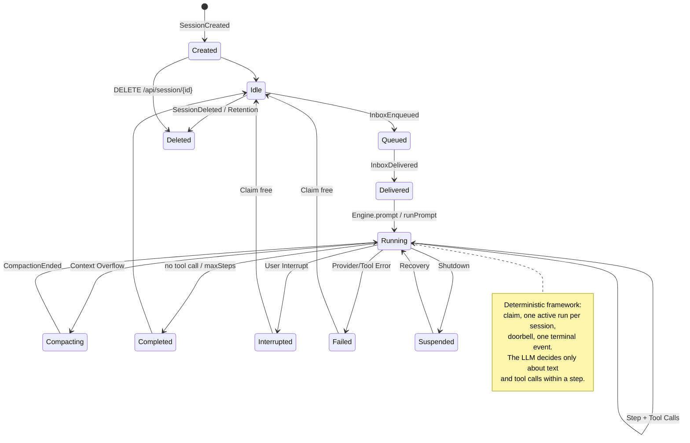
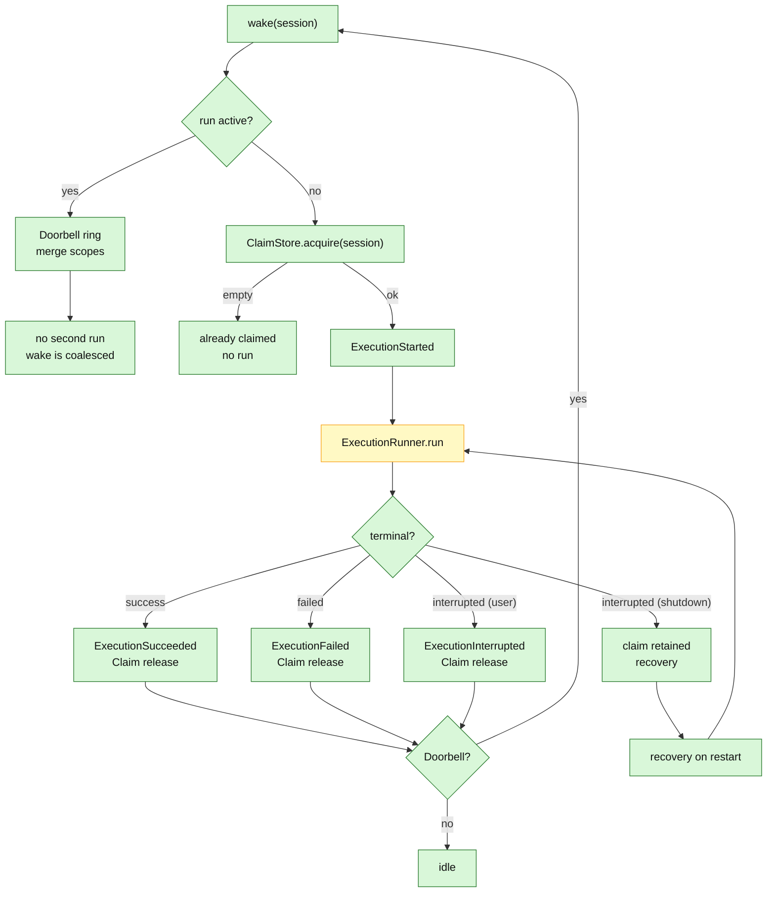

# 04 – Session Lifecycle and Execution Control

## Purpose

This diagram shows the lifecycle of a session and the deterministic control
of a run: claim, doorbell, exactly one active run per session and a terminal
event.

> **Current state:** The states are a reading of the existing events,
> projections and building blocks. There is no separate `session_state` table.
> `Coordinator`, `SessionExecution` and `Recovery` exist and are tested,
> but are not yet used by the HTTP path. `Engine` currently works with its
> own `running` map and a direct prompt loop.

## Session states

## Claim, doorbell and recovery

## Rules

| Rule | Meaning |
|---|---|
| **One active run per session** | `Coordinator` holds a `SessionExecution` per session; parallel wakes are coalesced via the doorbell. |
| **Claim survives the process** | A shutdown does not release the claim; on restart `Recovery` takes over. |
| **Exactly one terminal event** | `ExecutionSucceeded`, `ExecutionFailed` or `ExecutionInterrupted`. |
| **Doorbell is coalescing** | Multiple wakes during a run lead to exactly one follow-up run. |
| **Interrupt is idempotent** | An interrupt on an inactive session is a no-op. |
| **User interrupt releases the claim** | Shutdown retains it for recovery. |

## Where does the LLM fit in?

The LLM share lies **inside** `ExecutionRunner.run` / `Step.run`:
text and tool calls. The state transitions, claims, doorbell and terminal
events are deterministic.

## Sources

- `engine/src/main/java/de/augmentia/oc/engine/runtime/execution/Coordinator.java`
- `engine/src/main/java/de/augmentia/oc/engine/runtime/execution/SessionExecution.java`
- `engine/src/main/java/de/augmentia/oc/engine/runtime/execution/ExecutionRunner.java`
- `engine/src/main/java/de/augmentia/oc/engine/runtime/execution/Recovery.java`
- `engine/src/main/java/de/augmentia/oc/engine/core/model/SessionEvent.java`
- `quarkus/src/main/java/de/augmentia/oc/engine/http/Engine.java`