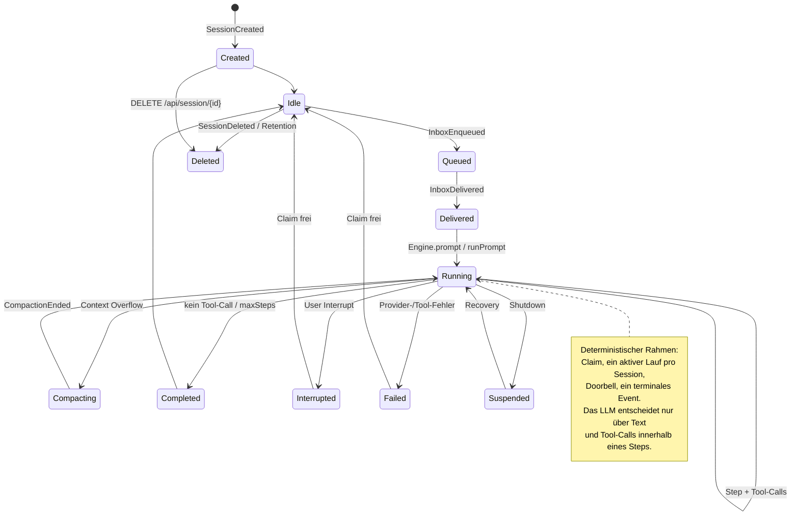
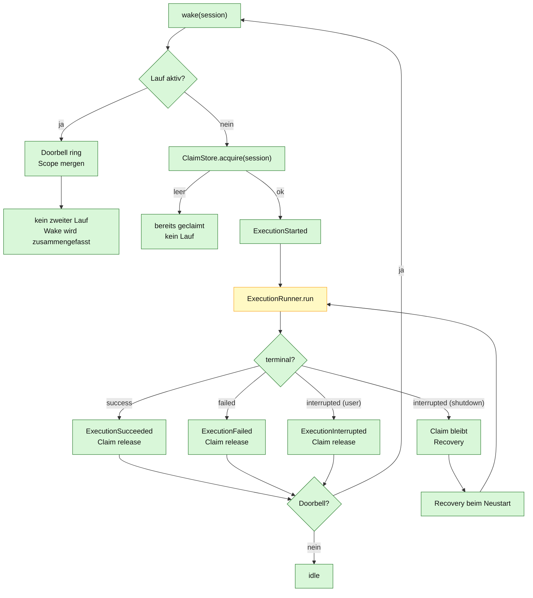

# 04 – Session-Lebenszyklus und Ausführungssteuerung

## Zweck

Dieses Diagramm zeigt den Lebenszyklus einer Session und die deterministische
Steuerung eines Laufs: Claim, Doorbell, genau ein aktiver Lauf pro Session und
ein terminales Ereignis.

> **Ist-Stand:** Die Zustände sind eine Lesart der vorhandenen Events,
> Projektionen und Bausteine. Es gibt keine separate `session_state`-Tabelle.
> `Coordinator`, `SessionExecution` und `Recovery` existieren und sind getestet,
> werden vom HTTP-Pfad aber noch nicht verwendet. `Engine` arbeitet aktuell mit
> einer eigenen `running`-Map und einem direkten Prompt-Loop.

## Session-Zustände

## Claim, Doorbell und Recovery

## Regeln

| Regel | Bedeutung |
|---|---|
| **Ein aktiver Lauf pro Session** | `Coordinator` hält `SessionExecution` pro Session; parallele Wakes werden über die Doorbell zusammengefasst. |
| **Claim überlebt den Prozess** | Ein Shutdown gibt den Claim nicht frei; beim Neustart übernimmt `Recovery`. |
| **Genau ein terminales Event** | `ExecutionSucceeded`, `ExecutionFailed` oder `ExecutionInterrupted`. |
| **Doorbell ist koaleszierend** | Mehrere Wakes während eines Laufs führen zu genau einem Folge-Lauf. |
| **Interrupt ist idempotent** | Ein Interrupt auf einer inaktiven Session ist ein No-op. |
| **User-Interrupt gibt Claim frei** | Shutdown behält ihn für Recovery. |

## Wo bleibt das LLM?

Der LLM-Anteil liegt **innerhalb** von `ExecutionRunner.run` bzw. `Step.run`:
Text und Tool-Calls. Die Zustandsübergänge, Claims, Doorbell und terminalen
Events sind deterministisch.

## Quellen

- `qoc/engine/src/main/java/de/augmentia/oc/engine/runtime/execution/Coordinator.java`
- `qoc/engine/src/main/java/de/augmentia/oc/engine/runtime/execution/SessionExecution.java`
- `qoc/engine/src/main/java/de/augmentia/oc/engine/runtime/execution/ExecutionRunner.java`
- `qoc/engine/src/main/java/de/augmentia/oc/engine/runtime/execution/Recovery.java`
- `qoc/engine/src/main/java/de/augmentia/oc/engine/core/model/SessionEvent.java`
- `qoc/quarkus/src/main/java/de/augmentia/oc/engine/http/Engine.java`
