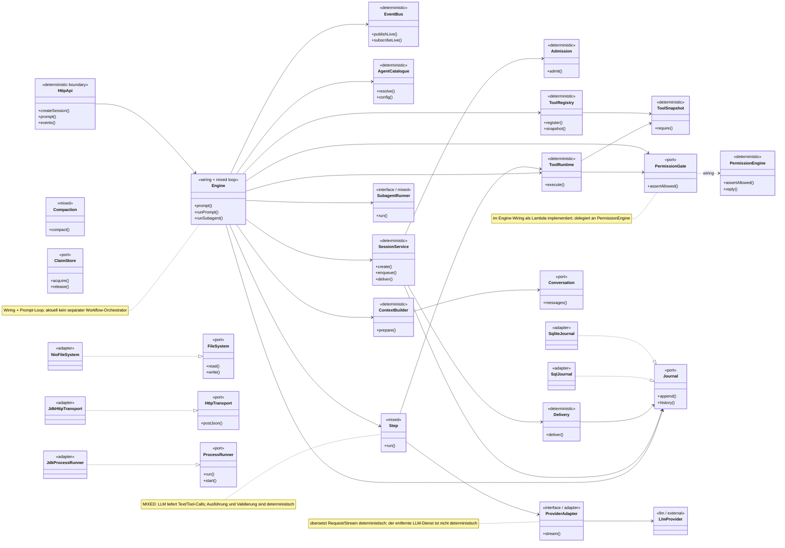

# 05 – Klassen- und Rollenmodell

## Zweck

Das Diagramm zeigt die zentralen Typen und ihre wichtigsten Beziehungen –
nicht jede Hilfsklasse. Die Stereotype markieren die Rolle im
Determinismus-Modell; sie ersetzen hier die Farbkennzeichnung der
Flussdiagramme.

## Legende

| Stereotyp | Bedeutung |
|---|---|
| `<<deterministic>>` | feste Regeln, keine Modellentscheidung |
| `<<mixed>>` | deterministischer Rahmen mit LLM-Aufruf |
| `<<llm / external>>` | Modell oder externer Dienst |
| `<<port>>` | Schnittstelle, die von einem Adapter erfüllt wird |
| `<<adapter>>` | technische Implementierung eines Ports |
| `<<wiring + mixed loop>>` | verdrahtet alles und enthält den Prompt-Loop |

## Die wichtigsten Verträge

| Vertrag | Bedeutung |
|---|---|
| `ProviderAdapter.stream(request)` | ein Stream von `ModelEvent`, keine Callback-/Future-Semantik |
| `ToolRuntime.execute(call, context)` | Decode → Permission → Execute → Encode/Bound |
| `PermissionEngine.assertAllowed(check)` | `Denied` ist modellseitig sichtbar, `Aborted` beendet den Step ohne Modellsicht |
| `Journal.append(draft)` | vergibt die nächste Sequenz und schreibt das Event; die Spec fordert zusätzlich die Projektionen in derselben Transaktion, der Ist-Stand trennt sie |
| `SessionWake.wake(session)` | entkoppelt Session-Schreibseite von der Ausführung |

## Warum diese Aufteilung?

- `core` kennt nur Werte, Ports und Verträge.
- `runtime` orchestriert, ohne HTTP oder Quarkus zu kennen.
- `quarkus` verdrahtet die Technik und stellt REST/SSE bereit.
- Adapter implementieren Ports und werden nur von der Wiring-Schicht
  instanziiert.

## Quellen

- `qoc/engine/src/main/java/de/augmentia/oc/engine/core/port/`
- `qoc/engine/src/main/java/de/augmentia/oc/engine/core/contract/`
- `qoc/engine/src/main/java/de/augmentia/oc/engine/runtime/`
- `qoc/quarkus/src/main/java/de/augmentia/oc/engine/http/`
- `qoc/docs/spec/java-packages.md`
