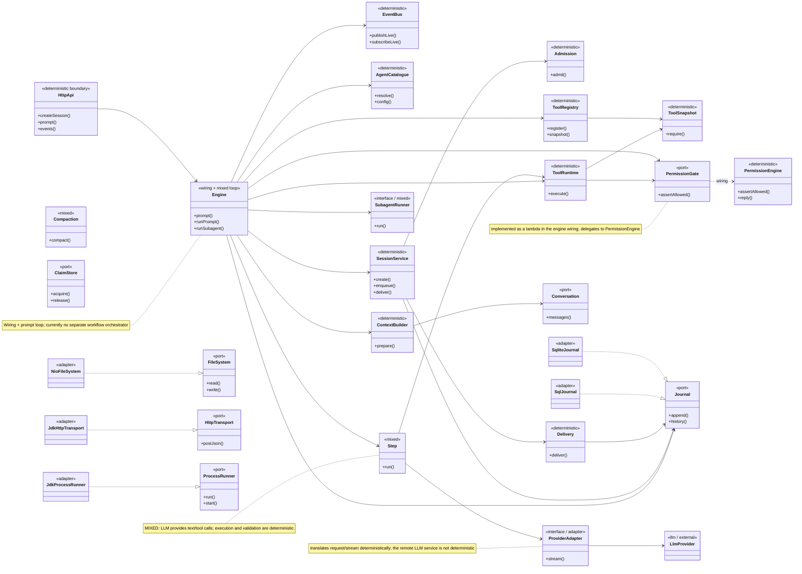

# 05 – Class and Role Model

## Purpose

The diagram shows the central types and their most important relationships –
not every helper class. The stereotypes mark the role in the determinism
model; here they replace the color coding of the flow diagrams.

## Legend

| Stereotype | Meaning |
|---|---|
| `<<deterministic>>` | fixed rules, no model decision |
| `<<mixed>>` | deterministic framework with an LLM call |
| `<<llm / external>>` | model or external service |
| `<<port>>` | interface implemented by an adapter |
| `<<adapter>>` | technical implementation of a port |
| `<<wiring + mixed loop>>` | wires everything together and contains the prompt loop |

## The most important contracts

| Contract | Meaning |
|---|---|
| `ProviderAdapter.stream(request)` | a stream of `ModelEvent`, no callback/future semantics |
| `ToolRuntime.execute(call, context)` | Decode → Permission → Execute → Encode/Bound |
| `PermissionEngine.assertAllowed(check)` | `Denied` is visible to the model, `Aborted` ends the step without model visibility |
| `Journal.append(draft)` | assigns the next sequence and writes the event; the spec additionally requires the projections in the same transaction, the current state separates them |
| `SessionWake.wake(session)` | decouples the session write side from execution |

## Why this split?

- `core` knows only values, ports and contracts.
- `runtime` orchestrates without knowing HTTP or Quarkus.
- `quarkus` wires the technology and provides REST/SSE.
- Adapters implement ports and are instantiated only by the wiring layer.

## Sources

- `engine/src/main/java/de/augmentia/oc/engine/core/port/`
- `engine/src/main/java/de/augmentia/oc/engine/core/contract/`
- `engine/src/main/java/de/augmentia/oc/engine/runtime/`
- `quarkus/src/main/java/de/augmentia/oc/engine/http/`
- `docs/spec/java-packages.md`

## Planned security and MCP types

The following types are not yet present in the class model, but are planned
for the security/MCP work:

- `Principal`
- `PermissionEvaluation` with principal
- `CredentialStore` / `SqliteCredentials`
- `McpServerManager`
- `McpServerResource`
- `McpDiscoveryClient`
- `McpOAuth`
- `GuardrailRegistry`
- `ToolCallJournal`

These are intentionally listed separately so the current class diagram stays
accurate.
