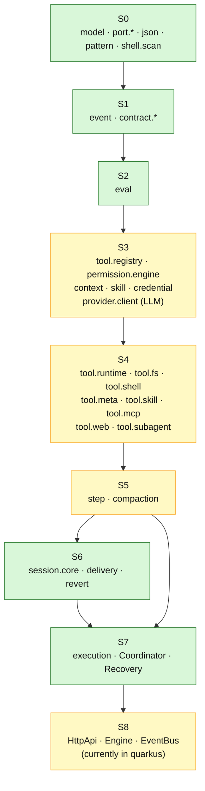
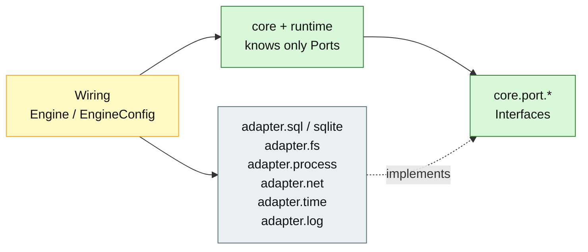

# 06 – Dependencies and Architecture Rules

## Purpose

This diagram shows the allowed dependency direction of stages S0–S8 and
the rules checked by ArchUnit in the build. It makes visible why
the core stays testable and where technology (SQL, HTTP, time) belongs.

## Stage Dependencies

S3 is predominantly deterministic. The `provider.client` translates request and
stream deterministically; the remote LLM service is not deterministic and is
therefore marked as "mixed".

## Adapters outside the stages

## Allowed imports

| Package | May import | Must not import |
|---|---|---|
| `core.model`, `core.error`, `core.json`, `core.pattern`, `core.shell.scan`, `core.port.*` | `java.*` | `core.event`, `core.contract`, `core.eval`, `runtime`, `adapter` |
| `core.event`, `core.contract.*` | S0 | `core.eval`, `runtime`, `adapter` |
| `core.eval` | S0, S1 | `runtime`, `adapter` |
| `runtime.*` | S0–S2, own runtime packages | `adapter.*`, `http`/Quarkus |
| `adapter.*` | S0 ports, technology | `runtime` |
| `quarkus` | everything | – (outer skin) |

## ArchUnit rules (planned / not yet implemented)

| Rule | Check |
|---|---|
| `s0DoesNotDependOnLaterStages` | S0 must not access S1/S2/Runtime/Adapter |
| `s1DoesNotDependOnLaterStages` | S1 must not access S2/Runtime/Adapter |
| `s2DoesNotDependOnLaterStages` | S2 must not access Runtime/Adapter |
| `runtimeDoesNotDependOnAdapters` | Runtime knows no concrete adapters |
| `adaptersDoNotDependOnRuntime` | Adapters know no Runtime |
| `adaptersAreOnlyUsedByWiring` | within the Engine no class outside `adapter.*` imports an adapter; the wiring layer in the Quarkus module instantiates them |
| `noCyclesBetweenPackages` | no package cycles |
| `javaSqlOnlyInSqlAdapter` | `java.sql` only in `adapter.sql` / `adapter.sqlite` |
| `engineStaysFreeOfQuarkusAndHttp` | Engine free of Quarkus, CDI, JAX-RS, Jackson, SmallRye |
| `noImplSuffix` | no classes with `Impl` suffix |
| `noStandardStreams` | no direct access to `System.out`/`System.err` |
| `noGenericExceptions` | no generic exceptions |
| `portsAreInterfaces` | top-level types in `core.port` are interfaces |

> **Current state:** The dependency rules are documented and reviewed, but there
> is currently **no ArchUnit test** in the repository. Enforcement today comes
> from Maven module boundaries, package conventions and code review.

## Why this direction?

- **Testability:** S0–S2 can be tested without DB, HTTP, or LLM.
- **Replaceability:** SQLite/PostgreSQL, JDK-HTTP, and process execution are
  adapters, not domain.
- **Determinism:** The core makes decisions; technology only executes.
- **Security:** SQL, HTTP, and time are bound to clearly named adapters.

## Known deviations

1. The spec calls `engine.http` S8; in the current build the
   HTTP/wiring layer lives in the module `quarkus`.
2. `runtime.execution.Coordinator` exists but is not wired into the HTTP path.
3. The stage order within `runtime` is not fully checked mechanically; the
   package-info comments and reviews supplement the ArchUnit rules.

## Sources

- `engine/src/test/java/de/augmentia/oc/engine/arch/ArchitectureTest.java`
- `docs/spec/module-plan.md`
- `docs/spec/java-packages.md`
- `engine/src/main/java/de/augmentia/oc/engine/`
- `quarkus/src/main/java/de/augmentia/oc/engine/http/`
