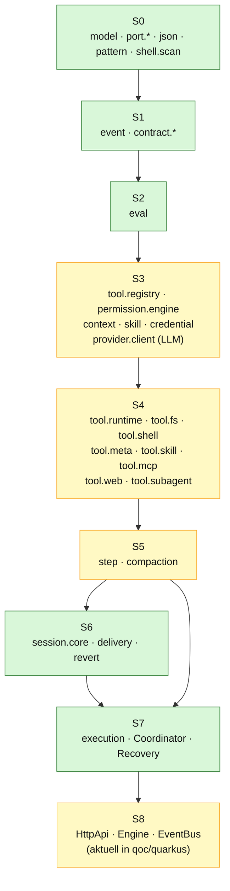
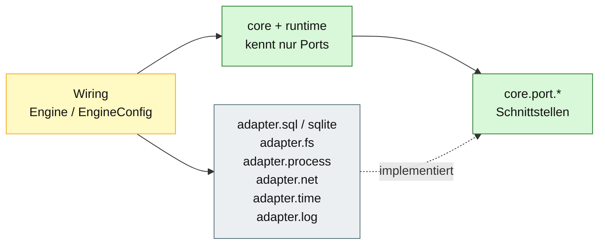

# 06 – Abhängigkeiten und Architekturregeln

## Zweck

Dieses Diagramm zeigt die erlaubte Abhängigkeitsrichtung der Stages S0–S8 und
die Regeln, die per ArchUnit im Build geprüft werden. Es macht sichtbar, warum
der Kern testbar bleibt und wo Technik (SQL, HTTP, Zeit) hingehört.

## Stage-Abhängigkeiten

S3 ist überwiegend deterministisch. Der `provider.client` übersetzt Request und
Stream deterministisch; der entfernte LLM-Dienst ist nicht deterministisch und
wird deshalb als „mixed“ markiert.

## Adapter außerhalb der Stages

## Erlaubte Importe

| Package | Darf importieren | Darf **nicht** importieren |
|---|---|---|
| `core.model`, `core.error`, `core.json`, `core.pattern`, `core.shell.scan`, `core.port.*` | `java.*` | `core.event`, `core.contract`, `core.eval`, `runtime`, `adapter` |
| `core.event`, `core.contract.*` | S0 | `core.eval`, `runtime`, `adapter` |
| `core.eval` | S0, S1 | `runtime`, `adapter` |
| `runtime.*` | S0–S2, eigene Runtime-Packages | `adapter.*`, `http`/Quarkus |
| `adapter.*` | S0-Ports, Technik | `runtime` |
| `quarkus` | alles | – (Outer Skin) |

## ArchUnit-Regeln (Ist-Stand)

| Regel | Prüfung |
|---|---|
| `s0DoesNotDependOnLaterStages` | S0 darf nicht auf S1/S2/Runtime/Adapter zugreifen |
| `s1DoesNotDependOnLaterStages` | S1 darf nicht auf S2/Runtime/Adapter zugreifen |
| `s2DoesNotDependOnLaterStages` | S2 darf nicht auf Runtime/Adapter zugreifen |
| `runtimeDoesNotDependOnAdapters` | Runtime kennt keine konkreten Adapter |
| `adaptersDoNotDependOnRuntime` | Adapter kennen keine Runtime |
| `adaptersAreOnlyUsedByWiring` | innerhalb der Engine importiert keine Klasse außerhalb `adapter.*` einen Adapter; die Wiring-Schicht im Quarkus-Modul instanziiert sie |
| `noCyclesBetweenPackages` | keine Package-Zyklen |
| `javaSqlOnlyInSqlAdapter` | `java.sql` nur in `adapter.sql` / `adapter.sqlite` |
| `engineStaysFreeOfQuarkusAndHttp` | Engine frei von Quarkus, CDI, JAX-RS, Jackson, SmallRye |
| `noImplSuffix` | keine Klassen mit `Impl`-Suffix |
| `noStandardStreams` | kein direkter Zugriff auf `System.out`/`System.err` |
| `noGenericExceptions` | keine generischen Exceptions |
| `portsAreInterfaces` | Top-Level-Typen in `core.port` sind Interfaces |

## Warum diese Richtung?

- **Testbarkeit:** S0–S2 lassen sich ohne DB, HTTP oder LLM testen.
- **Austauschbarkeit:** SQLite/PostgreSQL, JDK-HTTP und Prozessausführung sind
  Adapter, keine Domain.
- **Determinismus:** Der Kern trifft Entscheidungen; Technik führt nur aus.
- **Sicherheit:** SQL, HTTP und Zeit sind an klar benannte Adapter gebunden.

## Bekannte Abweichungen

1. Die Spec nennt `engine.http` als S8; im aktuellen Build liegt die
   HTTP-/Wiring-Schicht im Modul `quarkus`.
2. `runtime.execution.Coordinator` ist vorhanden, aber nicht im HTTP-Pfad
   verdrahtet.
3. Die Stage-Reihenfolge innerhalb von `runtime` wird nicht vollständig
   mechanisch geprüft; die package-info-Kommentare und Reviews ergänzen die
   ArchUnit-Regeln.

## Quellen

- `qoc/engine/src/test/java/de/augmentia/oc/engine/arch/ArchitectureTest.java`
- `qoc/docs/spec/module-plan.md`
- `qoc/docs/spec/java-packages.md`
- `qoc/engine/src/main/java/de/augmentia/oc/engine/`
- `qoc/quarkus/src/main/java/de/augmentia/oc/engine/http/`
