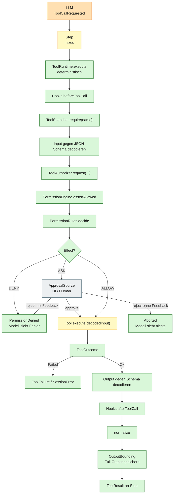
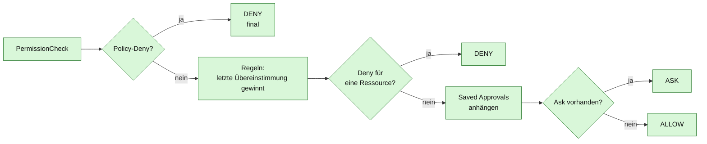

# 07 – Tool- und Permission-Kette

## Zweck

Das Diagramm zeigt, was mit einem vom LLM vorgeschlagenen Tool-Call passiert:
Input-Decode, Snapshot-Auflösung, Permission-Entscheidung, Ausführung,
Output-Decode, Bounding und Rückgabe an den Step.



## Reihenfolge ist Vertrag

```text
decode → permission → execute → encode
```

Diese Reihenfolge darf nicht vertauscht werden. Ein Tool darf nicht ausgeführt
werden, bevor Input und Permission geprüft sind. Ein Tool schreibt auch keine
Events; die Persistenz liegt beim Step bzw. der Session.

## Permission-Entscheidung



Wichtig:

- **Policy-Deny hat Vorrang**, auch vor gespeicherten Approvals.
- **Policy-Allow** kann eine Regel-Deny aufheben (lift), gewährt aber nie
  selbst eine Erlaubnis.
- **Deny vor Saved Approval**: eine Regel-Deny blockiert die Operation.
- **Ask dominiert Allow**: wenn eine Ressource `ASK` ist, wird gefragt.
- **Kein Treffer** bedeutet `ASK` (nicht `ALLOW`).
- **Keine Regeln** bedeutet `DENY` (sichere Voreinstellung).

## Tool-Katalog

| Tool | Ausführung | Nebenwirkung | Determinismus |
|---|---|---|---|
| `read`, `glob`, `grep` | FS-Zugriff | lesen | deterministisch |
| `write`, `edit`, `patch` | FS-Zugriff | schreiben | deterministisch |
| `shell` | Prozess | externer Prozess | deterministisch gerahmt |
| `skill` | Katalog | lesen | deterministisch |
| `mcp` | JSON-RPC/HTTP | externer Dienst | extern |
| `websearch` | Firecrawl | Netzwerk | extern |
| `webfetch` | HTTP | Netzwerk | extern |
| `subagent` | Child-Session | LLM-Lauf | gemischt |
| `todo` | In-Memory/Store | Zustand | deterministisch |
| `question` | UI/Human | Interaktion | extern |
| `session` (rename/move/models) | Store | Metadaten | deterministisch |
| `worktree` | Git-Prozess | Worktree | nur wenn Git vorhanden |

## Parallelität

`Step` führt Tool-Calls aus einem Modell-Stream parallel aus
(`MAX_PARALLEL_TOOLS = 8`) und hält die Ergebnisse in Call-Reihenfolge. Die
Determinismus-Grenze bleibt: Die **Auswahl** kommt vom LLM, die **Ausführung**
und Reihenfolge der Ergebnisse sind kontrolliert.

## Fehlerkanäle

| Ereignis | Kanal |
|---|---|
| Regel-Deny | `PermissionDenied` → Modell sieht den Fehler |
| User-Reject ohne Feedback | `Aborted` → Step endet, Modell sieht nichts |
| User-Reject mit Feedback | `PermissionDenied` mit Feedback |
| Tool-Fehler | `ToolOutcome.Failed` / `SessionError` |
| Schema-Fehler | `ToolFailure` → `ToolOutcome.Failed` |

## Quellen

- `qoc/engine/src/main/java/de/augmentia/oc/engine/runtime/tool/runtime/ToolRuntime.java`
- `qoc/engine/src/main/java/de/augmentia/oc/engine/runtime/permission/engine/PermissionEngine.java`
- `qoc/engine/src/main/java/de/augmentia/oc/engine/core/eval/PermissionRules.java`
- `qoc/engine/src/main/java/de/augmentia/oc/engine/runtime/tool/registry/ToolRegistry.java`
- `qoc/engine/src/main/java/de/augmentia/oc/engine/runtime/step/Step.java`
- `qoc/engine/src/main/java/de/augmentia/oc/engine/runtime/tool/`
