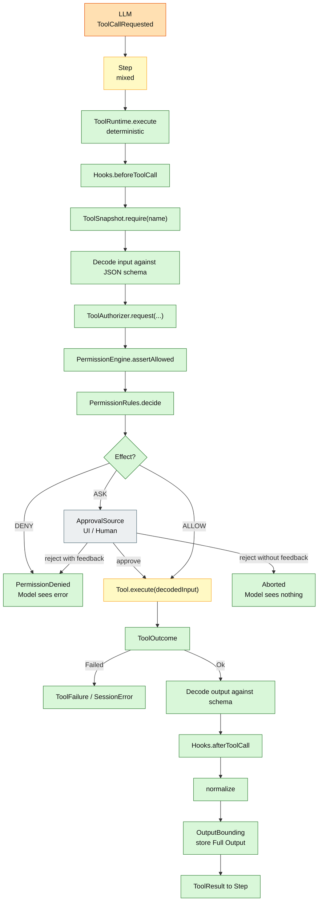
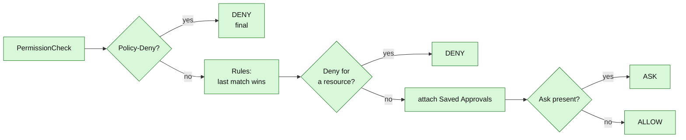

# 07 – Tool and Permission Chain

## Purpose

The diagram shows what happens to a tool call proposed by the LLM:
input decode, snapshot resolution, permission decision, execution,
output decode, bounding, and return to the step.



## Order is contract

```text
decode → permission → execute → encode
```

This order must not be reversed. A tool must not be executed
before input and permission have been checked. A tool also writes no
events; persistence is handled by the step or the session.

## Permission decision



Important:

- **Policy-Deny takes precedence**, even over saved approvals.
- **Policy-Allow** can lift a rule-Deny, but never grants permission
  itself.
- **Deny before Saved Approval**: a rule-Deny blocks the operation.
- **Ask dominates Allow**: if a resource is `ASK`, the user is asked.
- **No match** means `ASK` (not `ALLOW`).
- **No rules** means `DENY` (safe default).

## Tool catalog

| Tool | Execution | Side effect | Determinism |
|---|---|---|---|
| `read`, `glob`, `grep` | FS access | read | deterministic |
| `write`, `edit`, `patch` | FS access | write | deterministic |
| `shell` | Process | external process | deterministically framed |
| `skill` | Catalog | read | deterministic |
| `mcp` | JSON-RPC/HTTP | external service | external |
| `websearch` | Firecrawl | Network | external |
| `webfetch` | HTTP | Network | external |
| `subagent` | Child-Session | LLM run | mixed |
| `todo` | In-Memory/Store | State | deterministic |
| `question` | UI/Human | Interaction | external |
| `session` (rename/move/models) | Store | Metadata | deterministic |
| `worktree` | Git process | Worktree | only if Git present |

## Concurrency

`Step` executes tool calls from a model stream in parallel
(`MAX_PARALLEL_TOOLS = 8`) and keeps the results in call order. The
determinism boundary remains: the **selection** comes from the LLM, the
**execution** and result ordering are controlled.

## Error channels

| Event | Channel |
|---|---|
| Rule-Deny | `PermissionDenied` → Model sees the error |
| User-Reject without feedback | `Aborted` → Step ends, model sees nothing |
| User-Reject with feedback | `PermissionDenied` with feedback |
| Tool error | `ToolOutcome.Failed` / `SessionError` |
| Schema error | `ToolFailure` → `ToolOutcome.Failed` |


## QOC as MCP server

QOC can also act as an MCP server through `McpServerResource` under `/mcp`.

| Item | Value |
|---|---|
| Endpoint | `/mcp` |
| Exposed tool | `qoc_run_agent` |
| Auth | Basic Auth today; OAuth 2.1 resource server planned |
| User | currently hardcoded to `opencode` |
| Session mode | `new` or `reuse` |
| Ownership check | not implemented yet |
| Structured output | optional JSON schema |

This is separate from the MCP client tool chain above. The client-side `mcp`
tool calls external MCP servers; the server-side `/mcp` endpoint exposes QOC
as an MCP server.

## Guardrails

The current hook model is intentionally small:

- `Hooks.beforeToolCall`
- `Hooks.afterToolCall`
- `PermissionHook` (present, but not wired in `Engine`)

Planned guardrail layers:

1. built-in rules
2. declarative `settings.json` rules
3. Java SPI / CDI guardrails
4. optional external webhook guardrails


## Sources

- `engine/src/main/java/de/augmentia/oc/engine/runtime/tool/runtime/ToolRuntime.java`
- `engine/src/main/java/de/augmentia/oc/engine/runtime/permission/engine/PermissionEngine.java`
- `engine/src/main/java/de/augmentia/oc/engine/core/eval/PermissionRules.java`
- `engine/src/main/java/de/augmentia/oc/engine/runtime/tool/registry/ToolRegistry.java`
- `engine/src/main/java/de/augmentia/oc/engine/runtime/step/Step.java`
- `engine/src/main/java/de/augmentia/oc/engine/runtime/tool/`
