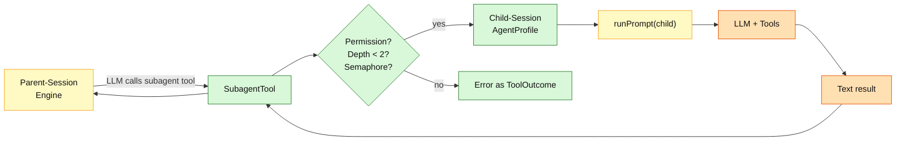
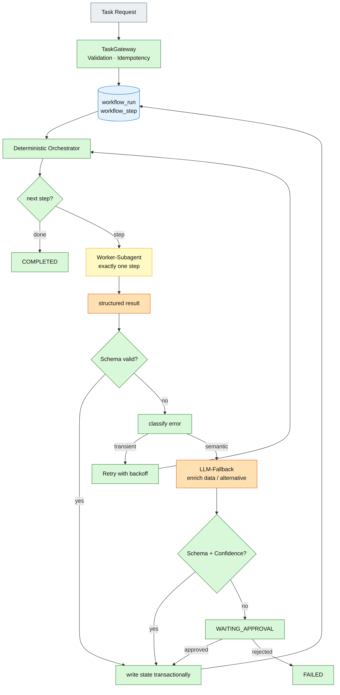
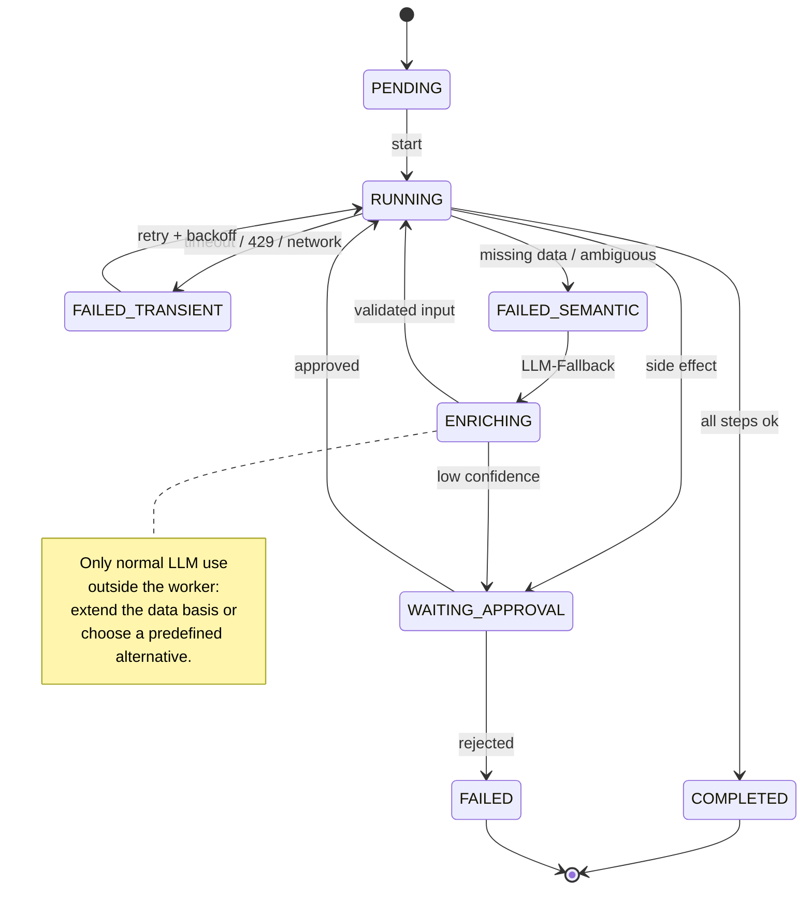

# 08 – Agents, Subagents, and Deterministic Orchestrator

## Purpose

This diagram describes two things separately:

1. **Current state:** how agents and subagents work in QOC today.
2. **Target design:** what a deterministic orchestrator with LLM only in
   the error case can look like.

The target design is **not yet implemented**. It serves as an architecture
plan and makes the determinism boundary explicit.

---

## Current state: Agents and Subagents

An agent is a configuration of system prompt, model, `maxSteps`,
tool filters, and permissions. `AgentCatalogue` holds the agents; `AgentProfile`
is the view that the `ContextBuilder` needs for a prompt.



### Rules in the current state

| Rule | Implementation |
|---|---|
| Subagent agents | `build` and `plan` are not allowed as subagents |
| Depth | maximum 2 |
| Concurrency | at most 4 simultaneous subagents (semaphore) |
| Child-Session | own `SessionId`, own agent, own prompt |
| Token accounting | usage is added to the parent session |
| Result | final text of the child run as tool output |
| Background | `background=true` starts a daemon thread |

### Determinism

- **Deterministic:** permission check, depth limit, semaphore, creating the
  child session, token summation, tool outcome.
- **LLM:** the actual child run and its result.

---

## Target design: deterministic orchestrator with LLM fallback

The orchestrator is **not a free LLM agent**. It is a state machine
that derives the next step from the persisted state. Workers are
subagents, but they execute only **one** step and may not write the
workflow state. The LLM is invoked only for defined errors as a
repair/enrichment service.



### State machine



### Proposed data model

```sql
create table workflow_run (
  id            text primary key,
  status        text not null,
  current_step  text not null,
  input_json    text not null,
  output_json   text,
  version       integer not null,
  created_at    text not null,
  updated_at    text not null
);

create table workflow_step (
  id            text primary key,
  run_id        text not null references workflow_run(id),
  step_name     text not null,
  status        text not null,
  input_json    text not null,
  output_json   text,
  attempts      integer not null default 0,
  error_code    text,
  error_message text,
  started_at    text,
  finished_at   text
);

create table fallback_attempt (
  id            text primary key,
  run_id        text not null references workflow_run(id),
  step_name     text not null,
  reason        text not null,
  strategy      text not null,
  llm_input     text not null,
  llm_output    text,
  accepted      integer not null default 0,
  created_at    text not null
);
```

### Orchestrator rules

| Rule | Meaning |
|---|---|
| **Step order in code** | The next step comes from the workflow definition, not from the LLM. |
| **Worker = Subagent** | The worker executes exactly one step and returns structured JSON. |
| **Worker minimal** | Only the tools needed for the step; no further subagents. |
| **Worker writes no state** | Only the orchestrator writes `workflow_run` / `workflow_step`. |
| **Retry only transient** | Timeout, 429, network, lock conflict. |
| **LLM only for semantic** | Missing data, ambiguity, unknown structure. |
| **Fallback is bounded** | At most 1–2 attempts, then circuit breaker / approval. |
| **Schema validation** | Every LLM output is validated against a JSON schema. |
| **Confidence threshold** | Proposals that are too uncertain go to `WAITING_APPROVAL`. |
| **Side effects need approval** | Writing, deleting, shell, external writes. |
| **Audit** | Every step and every fallback is persisted. |

### What the LLM fallback may do

- extract missing fields from existing data,
- normalize ambiguous input,
- expand search terms or candidates,
- choose a **predefined** alternative from an allowlist,
- propose a corrected input for a deterministic step.

### What the LLM fallback may not do

- skip steps,
- change the workflow state directly,
- execute arbitrary tools or shell commands,
- trigger a retry without a content change,
- be marked as "done" without validation.

### Deterministic and LLM parts

| Part | Status |
|---|---|
| Task gateway, validation, idempotency | deterministic |
| Workflow definition and transition table | deterministic |
| State persistence and transactions | deterministic |
| Error classification | deterministic |
| Retry/backoff | deterministic |
| Worker execution | LLM (Subagent) |
| Data enrichment / alternative selection | LLM, but schema- and policy-validated |
| Approval | Human/UI |
| Audit | deterministic |

### Implementation gap

Today these are missing:

- `workflow_run` / `workflow_step` / `fallback_attempt`,
- a workflow definition and transition table,
- a `TaskGateway` with idempotency store,
- a worker contract with JSON schema,
- an LLM fallback policy with confidence and allowlist,
- wiring the existing `Coordinator` into the HTTP path.

The existing building blocks this can build on:

- `SessionService`, `Admission`, `Delivery`,
- `Journal` and SQL adapter,
- `PermissionEngine`,
- `Step`, `ToolRuntime`, `SubagentTool`,
- `Coordinator`, `SessionExecution`, `Recovery`.

## Sources

- `quarkus/src/main/java/de/augmentia/oc/engine/http/Engine.java`
- `quarkus/src/main/java/de/augmentia/oc/engine/http/AgentCatalogue.java`
- `engine/src/main/java/de/augmentia/oc/engine/runtime/context/AgentProfile.java`
- `engine/src/main/java/de/augmentia/oc/engine/runtime/tool/subagent/SubagentTool.java`
- `engine/src/main/java/de/augmentia/oc/engine/runtime/tool/subagent/SubagentRunner.java`
- `engine/src/main/java/de/augmentia/oc/engine/runtime/execution/Coordinator.java`
- `docs/guides/LoadAgentConfig.md`
- `docs/guides/ideas.md`
