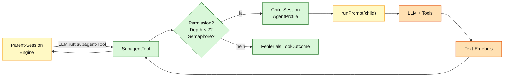
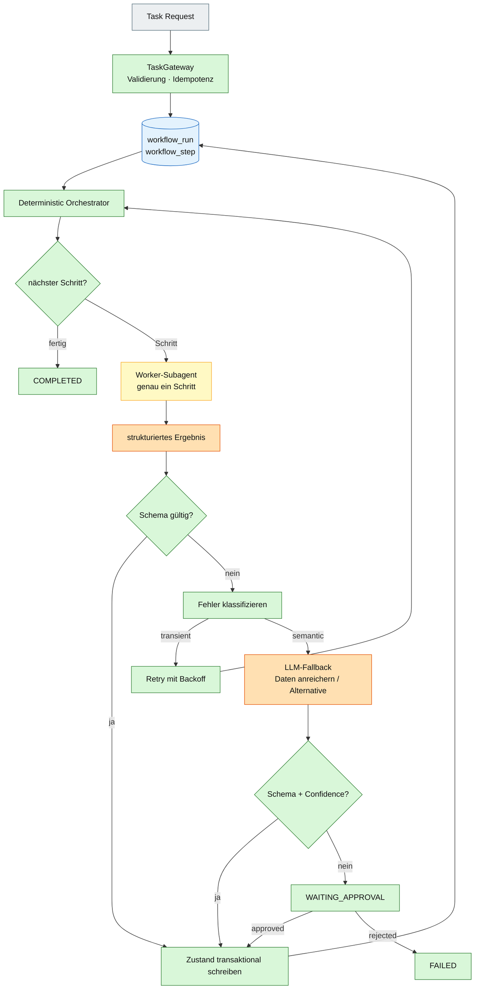
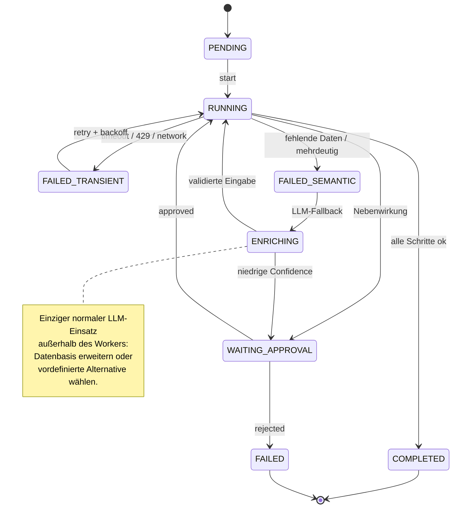

# 08 – Agenten, Subagents und deterministischer Orchestrator

## Zweck

Dieses Diagramm beschreibt zwei Dinge getrennt:

1. **Ist-Stand:** wie Agenten und Subagents heute in QOC funktionieren.
2. **Zielbild:** wie ein deterministischer Orchestrator mit LLM nur im
   Fehlerfall aussehen kann.

Das Zielbild ist **noch nicht implementiert**. Es dient als Architekturplan und
macht die Determinismus-Grenze explizit.

---

## Ist-Stand: Agenten und Subagents

Ein Agent ist eine Konfiguration aus System-Prompt, Modell, `maxSteps`,
Tool-Filtern und Permissions. `AgentCatalogue` hält die Agenten; `AgentProfile`
ist die Sicht, die der `ContextBuilder` für einen Prompt benötigt.



### Regeln im Ist-Stand

| Regel | Umsetzung |
|---|---|
| Subagent-Agenten | `build` und `plan` sind nicht als Subagent erlaubt |
| Tiefe | maximal 2 |
| Parallelität | maximal 4 gleichzeitige Subagents (Semaphore) |
| Child-Session | eigener `SessionId`, eigener Agent, eigener Prompt |
| Token-Abrechnung | Usage wird auf die Parent-Session addiert |
| Ergebnis | finaler Text des Child-Laufs als Tool-Output |
| Hintergrund | `background=true` startet einen Daemon-Thread |

### Determinismus

- **Deterministisch:** Permission-Check, Depth-Limit, Semaphore, Child-Session
  anlegen, Token-Aufsummierung, Tool-Outcome.
- **LLM:** der eigentliche Child-Lauf und sein Ergebnis.

---

## Zielbild: deterministischer Orchestrator mit LLM-Fallback

Der Orchestrator ist **kein freier LLM-Agent**. Er ist eine Zustandsmaschine,
die den nächsten Schritt aus dem persistierten Zustand ableitet. Worker sind
Subagents, führen aber nur **einen** Schritt aus und dürfen den Workflow-State
nicht schreiben. Das LLM wird nur bei definierten Fehlern als
Reparatur-/Anreicherungsdienst aufgerufen.



### Zustandsmaschine



### Vorgeschlagenes Datenmodell

```sql
create table workflow_run (
  id            text primary key,
  status        text not null,
  current_step  text not null,
  input_json    text not null,
  output_json   text,
  version       integer not null,
  created_at    text not null,
  updated_at    text not null
);

create table workflow_step (
  id            text primary key,
  run_id        text not null references workflow_run(id),
  step_name     text not null,
  status        text not null,
  input_json    text not null,
  output_json   text,
  attempts      integer not null default 0,
  error_code    text,
  error_message text,
  started_at    text,
  finished_at   text
);

create table fallback_attempt (
  id            text primary key,
  run_id        text not null references workflow_run(id),
  step_name     text not null,
  reason        text not null,
  strategy      text not null,
  llm_input     text not null,
  llm_output    text,
  accepted      integer not null default 0,
  created_at    text not null
);
```

### Regeln für den Orchestrator

| Regel | Bedeutung |
|---|---|
| **Schrittfolge im Code** | Der nächste Schritt kommt aus der Workflow-Definition, nicht aus dem LLM. |
| **Worker = Subagent** | Der Worker führt genau einen Schritt aus und liefert strukturiertes JSON. |
| **Worker minimal** | Nur die für den Schritt nötigen Tools; keine weiteren Subagents. |
| **Worker schreibt keinen State** | Nur der Orchestrator schreibt `workflow_run` / `workflow_step`. |
| **Retry nur transient** | Timeout, 429, Netzwerk, Lock-Konflikt. |
| **LLM nur bei semantic** | Fehlende Daten, Mehrdeutigkeit, unbekannte Struktur. |
| **Fallback ist begrenzt** | Maximal 1–2 Versuche, dann Circuit Breaker / Approval. |
| **Schema-Validierung** | Jede LLM-Ausgabe wird gegen ein JSON-Schema geprüft. |
| **Confidence-Schwelle** | Zu unsichere Vorschläge gehen in `WAITING_APPROVAL`. |
| **Nebenwirkungen brauchen Approval** | Schreiben, Löschen, Shell, externe Writes. |
| **Audit** | Jeder Schritt und jeder Fallback wird persistiert. |

### Was der LLM-Fallback darf

- fehlende Felder aus vorhandenen Daten extrahieren,
- mehrdeutige Eingaben normalisieren,
- Suchbegriffe oder Kandidaten erweitern,
- eine **vordefinierte** Alternative aus einer Allowlist wählen,
- eine korrigierte Eingabe für einen deterministischen Schritt vorschlagen.

### Was der LLM-Fallback nicht darf

- Schritte überspringen,
- den Workflow-State direkt ändern,
- beliebige Tools oder Shell-Befehle ausführen,
- einen Retry ohne inhaltliche Änderung auslösen,
- ohne Validierung als „erledigt“ markiert werden.

### Deterministische und LLM-Anteile

| Teil | Status |
|---|---|
| Task-Gateway, Validierung, Idempotenz | deterministisch |
| Workflow-Definition und Transitionstabelle | deterministisch |
| State-Persistenz und Transaktionen | deterministisch |
| Fehlerklassifikation | deterministisch |
| Retry/Backoff | deterministisch |
| Worker-Ausführung | LLM (Subagent) |
| Datenanreicherung / Alternativwahl | LLM, aber schema- und policy-validiert |
| Approval | Mensch/UI |
| Audit | deterministisch |

### Umsetzungslücke

Heute fehlen:

- `workflow_run` / `workflow_step` / `fallback_attempt`,
- eine Workflow-Definition und Transitionstabelle,
- ein `TaskGateway` mit Idempotency-Store,
- ein Worker-Vertrag mit JSON-Schema,
- eine LLM-Fallback-Policy mit Confidence und Allowlist,
- die Verdrahtung des vorhandenen `Coordinator` in den HTTP-Pfad.

Die vorhandenen Bausteine, auf denen das aufsetzen kann:

- `SessionService`, `Admission`, `Delivery`,
- `Journal` und SQL-Adapter,
- `PermissionEngine`,
- `Step`, `ToolRuntime`, `SubagentTool`,
- `Coordinator`, `SessionExecution`, `Recovery`.

## Quellen

- `qoc/quarkus/src/main/java/de/augmentia/oc/engine/http/Engine.java`
- `qoc/quarkus/src/main/java/de/augmentia/oc/engine/http/AgentCatalogue.java`
- `qoc/engine/src/main/java/de/augmentia/oc/engine/runtime/context/AgentProfile.java`
- `qoc/engine/src/main/java/de/augmentia/oc/engine/runtime/tool/subagent/SubagentTool.java`
- `qoc/engine/src/main/java/de/augmentia/oc/engine/runtime/tool/subagent/SubagentRunner.java`
- `qoc/engine/src/main/java/de/augmentia/oc/engine/runtime/execution/Coordinator.java`
- `qoc/docs/LoadAgentConfig.md`
- `qoc/docs/ideas.md`
