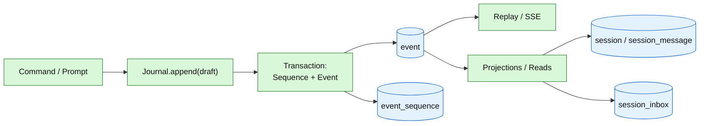

# 09 – Persistence, Event Log, and Transactions

## Purpose

QOC stores sessions, messages, inbox, claims, instructions, and snapshots
in SQLite or PostgreSQL. The event log is append-only and the foundation for
replay, projections, and audit. This diagram shows the tables and the
most important transaction boundaries.

> `EVENT.aggregate_id` is deliberately **not** a foreign key: the event log is
> an independent stream per aggregate. `event_sequence` holds the next
> sequence. `SAVED_APPROVAL`, `CREDENTIAL`, `TOOL_OUTPUT`, and `SNAPSHOT` are
> supporting stores without a hard session FK.

## Event log vs. projections

## Transaction boundaries (current state)

| Operation | Transaction? | Note |
|---|---|---|
| `Journal.append` | yes | Sequence and event together; `appendAll` as well |
| `SessionStore.put` | yes | Session projection |
| `SessionStore.putInbox` | yes | Inbox row |
| `SessionStore.removeInbox` | yes | own transaction |
| `Delivery.deliver` | no, across two stores | `InboxDelivered` and `removeInbox` are separate calls |
| `SessionStore.delete` | yes | deletes dependent projections |
| `SessionRetention.delete` | no, across two stores | first session, then event aggregate |
| `Snapshot.capture/restore` | adapter-dependent | SQL snapshots store files in `snapshot_file` |
| `Revert` | across Journal + Snapshot + Instructions | Event stays append-only; Revert is stored as an event, snapshot is restored, instructions are removed |

## Deterministic persistence rules

1. **Sequence is gapless and monotonic** per aggregate.
2. **Event + projection** should be written in one transaction when
   they belong together.
3. **Event log is never rewritten**; compaction is a view, not a
   `DELETE`.
4. **Claims survive the process**; shutdown does not release them.
5. **Retention** deletes session and event aggregate; running sessions are
   skipped.
6. **SQL only in the SQL adapter** (`adapter.sql` / `adapter.sqlite`).

## SQLite vs. PostgreSQL

| Property | SQLite | PostgreSQL |
|---|---|---|
| Default | yes | no |
| Multiple workers/containers | no | yes |
| WAL | `Sqlite.enableWal` | – |
| Migrations | `db/migration-sqlite` | `db/migration` |
| Suitable for | local instance, GCP single-node | distributed orchestrator/worker architecture |

## Sources

- `engine/src/main/resources/db/migration/V1__engine.sql`
- `engine/src/main/resources/db/migration-sqlite/V1__engine.sql`
- `engine/src/main/java/de/augmentia/oc/engine/adapter/sqlite/`
- `engine/src/main/java/de/augmentia/oc/engine/adapter/sql/`
- `engine/src/main/java/de/augmentia/oc/engine/runtime/session/core/SessionRetention.java`
- `engine/src/main/java/de/augmentia/oc/engine/runtime/session/delivery/Delivery.java`
