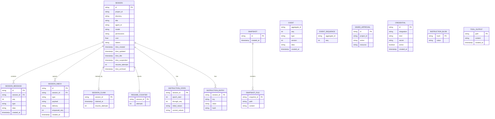
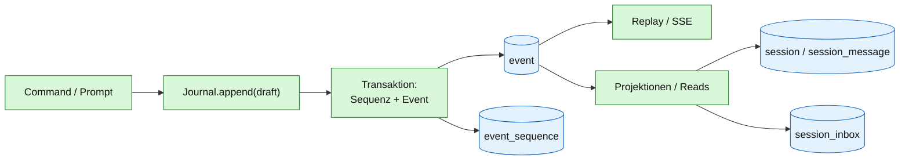

# 09 – Persistenz, Event-Log und Transaktionen

## Zweck

QOC speichert Sessions, Nachrichten, Inbox, Claims, Instructions und Snapshots
in SQLite oder PostgreSQL. Das Event-Log ist append-only und die Grundlage für
Replay, Projektionen und Audit. Dieses Diagramm zeigt die Tabellen und die
wichtigsten Transaktionsgrenzen.

> `EVENT.aggregate_id` ist bewusst **kein** Fremdschlüssel: Das Event-Log ist
> ein eigenständiger Strom pro Aggregat. `event_sequence` hält die nächste
> Sequenz. `SAVED_APPROVAL`, `CREDENTIAL`, `TOOL_OUTPUT` und `SNAPSHOT` sind
> unterstützende Stores ohne harte Session-FK.

## Event-Log vs. Projektionen

## Transaktionsgrenzen (Ist-Stand)

| Operation | Transaktion? | Hinweis |
|---|---|---|
| `Journal.append` | ja | Sequenz und Event gemeinsam; `appendAll` ebenfalls |
| `SessionStore.put` | ja | Session-Projektion |
| `SessionStore.putInbox` | ja | Inbox-Zeile |
| `SessionStore.removeInbox` | ja | eigene Transaktion |
| `Delivery.deliver` | nein, über zwei Stores | `InboxDelivered` und `removeInbox` sind getrennte Aufrufe |
| `SessionStore.delete` | ja | löscht abhängige Projektionen |
| `SessionRetention.delete` | nein, über zwei Stores | erst Session, dann Event-Aggregat |
| `Snapshot.capture/restore` | adapterabhängig | SQL-Snapshots speichern Dateien in `snapshot_file` |
| `Revert` | über Journal + Snapshot + Instructions | Event bleibt append-only; Revert wird als Event gespeichert, Snapshot wird wiederhergestellt, Instructions werden entfernt |

## Deterministische Persistenzregeln

1. **Sequenz ist lückenlos und monoton** pro Aggregat.
2. **Event + Projektion** sollen in einer Transaktion geschrieben werden, wenn
   sie zusammengehören.
3. **Event-Log wird nie umgeschrieben**; Compaction ist eine Sicht, kein
   `DELETE`.
4. **Claims überleben den Prozess**; Shutdown gibt sie nicht frei.
5. **Retention** löscht Session und Event-Aggregat; laufende Sessions werden
   übersprungen.
6. **SQL nur im SQL-Adapter** (`adapter.sql` / `adapter.sqlite`).

## SQLite vs. PostgreSQL

| Eigenschaft | SQLite | PostgreSQL |
|---|---|---|
| Default | ja | nein |
| Mehrere Worker/Container | nein | ja |
| WAL | `Sqlite.enableWal` | – |
| Migrationen | `db/migration-sqlite` | `db/migration` |
| Geeignet für | lokale Instanz, GCP-Single-Node | verteilte Orchestrator-/Worker-Architektur |

## Quellen

- `qoc/engine/src/main/resources/db/migration/V1__engine.sql`
- `qoc/engine/src/main/resources/db/migration-sqlite/V1__engine.sql`
- `qoc/engine/src/main/java/de/augmentia/oc/engine/adapter/sqlite/`
- `qoc/engine/src/main/java/de/augmentia/oc/engine/adapter/sql/`
- `qoc/engine/src/main/java/de/augmentia/oc/engine/runtime/session/core/SessionRetention.java`
- `qoc/engine/src/main/java/de/augmentia/oc/engine/runtime/session/delivery/Delivery.java`
