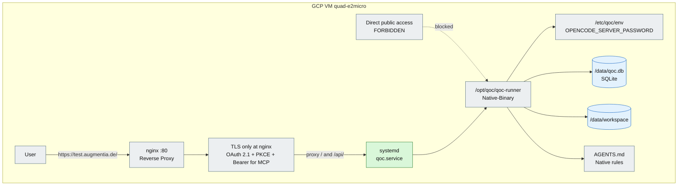

# 10 – Deployment: Native and GCP

## Purpose

QOC can be operated as a JVM application or as a Native Image. The
Native Image deliberately contains **no Git** and no build environment. On the
GCP VM the Native binary runs directly under systemd, not in Docker.

> **Rule:** Never expose QOC or the MCP server directly. All public access
> goes through nginx with TLS. The engine listens on loopback only.

## Variants

| Variant | Build environment | Git | Worktree tools | Typical use |
|---|---|---|---|---|
| **Native/GCP** | no JDK/Maven on the VM | no | disabled | productive single-node on GCP |

> Local Docker/JVM deployments are intentionally not part of this diagram.

## Native rules

- No build environment in the image.
- No Git, not even optionally.
- `WorktreeTool.available(...)` checks `git --version` and
  `git -C <workspace> rev-parse --is-inside-work-tree`.
- If the check fails, the worktree tools are not registered.
- `AGENTS.native.md` lies in the image or in the workspace and documents the
  limitations.

## GCP operation

| Component | Value |
|---|---|
| Instance | `quad-e2micro`, Zone `us-central1-a` |
| Public IP | `34.72.145.97` |
| Service | `qoc.service` (systemd) |
| Binary | `/opt/qoc/qoc-runner` |
| Environment | `/etc/qoc/env` |
| Database | `/data/qoc.db` |
| Workspace | `/data/workspace` |
| Reverse proxy | nginx on `80` → `443` (TLS), proxy to `127.0.0.1:8081`; static `/sites/` from `/data/workspace/sites` |
| Auth | OAuth 2.1 + PKCE + Bearer for MCP; Basic Auth only for legacy/admin, never for MCP |
| Direct access | None. Engine and MCP are reachable only through nginx over HTTPS. |

The password is deliberately not in the repository. It lives in
`/etc/qoc/env` and in the nginx password file. When changed, both must be
updated and the services reloaded.

## Sources

- `qoc/deploy/Dockerfile`
- `qoc/deploy/Dockerfile.native`
- `qoc/deploy/docker-compose.yml`
- `qoc/deploy/docker-compose.native.yml`
- `qoc/deploy/AGENTS.jvm.md`
- `qoc/deploy/AGENTS.native.md`
- `qoc/deploy/vm.md` (gitignored, local operations doc)
- `engine/src/main/java/de/augmentia/oc/engine/runtime/tool/meta/WorktreeTool.java`
