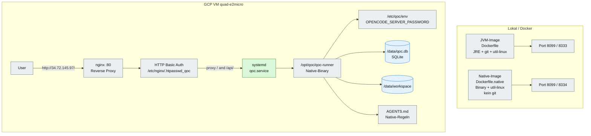

# 10 – Deployment: JVM, Native, Docker und GCP

## Zweck

QOC kann als JVM-Anwendung oder als Native-Image betrieben werden. Das
Native-Image enthält bewusst **kein Git** und keine Build-Umgebung. Auf der
GCP-VM läuft das Native-Binary direkt unter systemd, nicht in Docker.

## Varianten

| Variante | Build-Umgebung | Git | Worktree-Tools | Typischer Einsatz |
|---|---|---|---|---|
| **JVM** | JRE, Maven-Build außerhalb | ja | verfügbar, wenn Workspace ein Git-Repo ist | lokale Entwicklung, CI, Debugging |
| **Native** | kein JDK/Maven im Image | nein | deaktiviert | schlanke Runtime, GCP |
| **GCP** | kein Docker, kein Git | nein | deaktiviert | produktiver Single-Node |

> **Offen:** Ein separates JVM-**Build**-Image mit JDK, Maven und
> Maven-Cache ist noch nicht umgesetzt. Das aktuelle `deploy/Dockerfile` ist ein
> JVM-**Runtime**-Image auf Basis einer JRE.

## Native-Regeln

- Keine Build-Umgebung im Image.
- Kein Git, auch nicht optional.
- `WorktreeTool.available(...)` prüft `git --version` und
  `git -C <workspace> rev-parse --is-inside-work-tree`.
- Wenn die Prüfung fehlschlägt, werden die Worktree-Tools nicht registriert.
- `AGENTS.native.md` liegt im Image bzw. im Workspace und dokumentiert die
  Einschränkungen.

## GCP-Betrieb

| Komponente | Wert |
|---|---|
| Instanz | `quad-e2micro`, Zone `us-central1-a` |
| Öffentliche IP | `34.72.145.97` |
| Dienst | `qoc.service` (systemd) |
| Binary | `/opt/qoc/qoc-runner` |
| Umgebung | `/etc/qoc/env` |
| Datenbank | `/data/qoc.db` |
| Workspace | `/data/workspace` |
| Reverse Proxy | nginx auf Port 80 → `127.0.0.1:8080` |
| Auth | HTTP Basic, Benutzer `opencode` |

Das Passwort steht bewusst nicht im Repository. Es liegt in
`/etc/qoc/env` und in der nginx-Passwortdatei. Bei einer Änderung müssen beide
aktualisiert und die Dienste neu geladen werden.

## Quellen

- `qoc/deploy/Dockerfile`
- `qoc/deploy/Dockerfile.native`
- `qoc/deploy/docker-compose.yml`
- `qoc/deploy/docker-compose.native.yml`
- `qoc/deploy/AGENTS.jvm.md`
- `qoc/deploy/AGENTS.native.md`
- `qoc/deploy/vm.md` (gitignored, lokale Betriebsdoku)
- `qoc/engine/src/main/java/de/augmentia/oc/engine/runtime/tool/meta/WorktreeTool.java`
