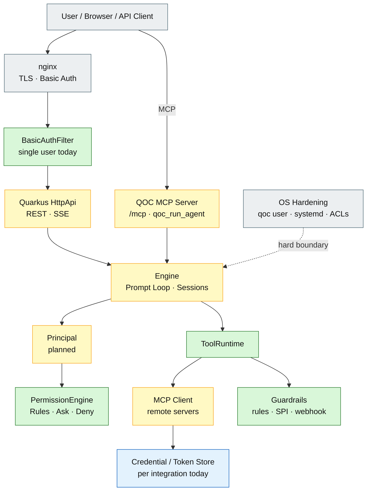

# 11 – Security, MCP Server, and Access Control

## Purpose

This diagram summarizes the current and planned security architecture of QOC,
including HTTP authentication, engine policy, MCP client/server modes, and
user-based access control.

## Current state

| Area | Current state |
|---|---|
| HTTP auth | Basic Auth with one shared password |
| User identity | `X-QOC-User` is spoofable |
| MCP client OAuth | Partial: discovery, code exchange, refresh helper |
| MCP server OAuth | Not implemented (`501`) |
| Token storage | Plaintext, per integration, not per user |
| Session ownership | Not implemented |
| Guardrails | `Hooks` exists, but is mostly noop |
| OS security | Documented and deployed |

## Planned state

| Area | Planned improvement |
|---|---|
| HTTP auth | OIDC/Keycloak or trusted proxy headers |
| User identity | `Principal` from auth layer |
| MCP client OAuth | RFC 9728 discovery, PKCE, `resource`, state, refresh |
| MCP server OAuth | OAuth 2.1 resource server, audience and scope validation |
| Token storage | Per-user encrypted tokens |
| Session ownership | `ownerId` on `SessionInfo` and DB |
| Guardrails | Declarative, SPI and webhook guardrails |
| OS security | Keep as hard boundary |

## Rules

1. **Authentication is optional.** Without auth, all callers are `opencode`.
2. **Basic Auth is single-user.** It is not a multi-user identity system.
3. **Hooks must not replace authentication.** They authorize; auth identifies.
4. **MCP tokens must not be passed through.** Downstream calls need their own tokens.
5. **OS security remains the hard boundary.** Engine policy is not a sandbox.

## Sources

- `quarkus/src/main/java/de/augmentia/oc/engine/http/BasicAuthFilter.java`
- `quarkus/src/main/java/de/augmentia/oc/engine/http/HttpApi.java`
- `quarkus/src/main/java/de/augmentia/oc/engine/http/McpServerResource.java`
- `quarkus/src/main/java/de/augmentia/oc/engine/http/Engine.java`
- `engine/src/main/java/de/augmentia/oc/engine/runtime/tool/mcp/McpDiscoveryClient.java`
- `engine/src/main/java/de/augmentia/oc/engine/runtime/tool/mcp/McpOAuth.java`
- `docs/guides/OS-based-security.md`
- `docs/Security.md`
- `docs/webhook.md`
