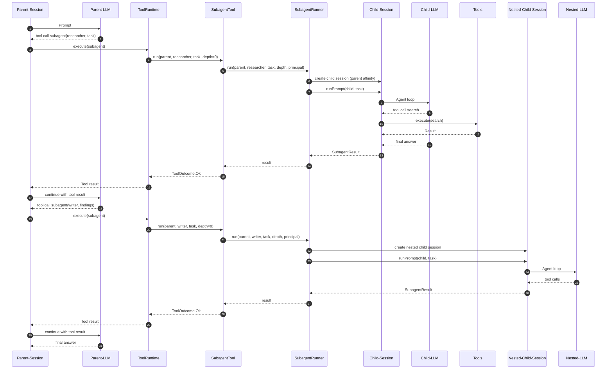

# 12 – Workflow Mode and Complete Subagent Run

## Purpose

This diagram shows two distinct execution modes in QOC:

1. **Workflow mode with `context_agent_executor`**  
   The outer loop is deterministic. Nodes are executed one after another.
   The `context_agent_executor` is a special node that runs an LLM agent in a
   child session with full or focused context and returns only the result.

2. **Complete subagent run**  
   A normal agent invokes one or more subagents in their own child sessions
   via `SubagentTool`. The subagents have their own tools and can themselves
   invoke further subagents. They receive **no** shared workflow context.

---

## A. Workflow Mode with `context_agent_executor`

### Explanation

- The outer loop uses `WorkflowStepProvider`, not the LLM step.
- Deterministic nodes only modify `WorkflowContext` and the journal.
- Agent nodes and context-agent nodes run in **child sessions**.
- Only the final result is taken over into `WorkflowContext`.
- `ContextAssembler` can deliver `FULL`, `FOCUSED`, `ARTIFACTS`, or `CUSTOM`.
- `ContextBudgetGate` aborts before the provider call if the context is too
  large.
- `Guard`/`Inject` can set `nextNode` and thereby dynamically override the
  static graph.

---

## B. Complete Subagent Run with Own Subagents and Tools

### Explanation

- The parent agent decides when a subagent is invoked.
- `SubagentTool` and `SubagentRunner` create a **separate child session**.
- The subagent has its own tools and can itself invoke further subagents.
- The parent receives **only the cleaned-up final result**, not internal
  intermediate steps.
- Subagents receive **no** shared workflow context.
- The child session is retained for audit but is not carried over into
  subsequent prompts of the parent.

---

## Comparison

| Aspect | Workflow Mode with Context-Agent | Subagent Run |
|---|---|---|
| Outer loop | deterministic (WorkflowStepProvider) | LLM-driven |
| Context | WorkflowContext (structured) | Task prompt |
| LLM call | in child session of a node | in child session of the subagent |
| Tools | Node tools + agent tools | subagent tools only |
| Result return | node result only | subagent result only |
| Shared context | yes, via WorkflowContext | no |
| Cache hygiene | possible via Focused/Artifacts | within the child session |
| Audit | Journal + child session | Child session |

---

## Sources

- `workflow-runner/.../runner/DefaultNodeDispatcher.java`
- `workflow-runner/.../runner/WorkflowStepProviderImpl.java`
- `workflow-runner/.../runner/WorkflowContext.java`
- `workflow-runner/.../runner/ContextAssembler` (target)
- `engine/.../runtime/tool/subagent/SubagentTool.java`
- `engine/.../runtime/tool/subagent/SubagentRunner.java`
- `docs/plans/WorkflowMode-ContextAgent.md`
