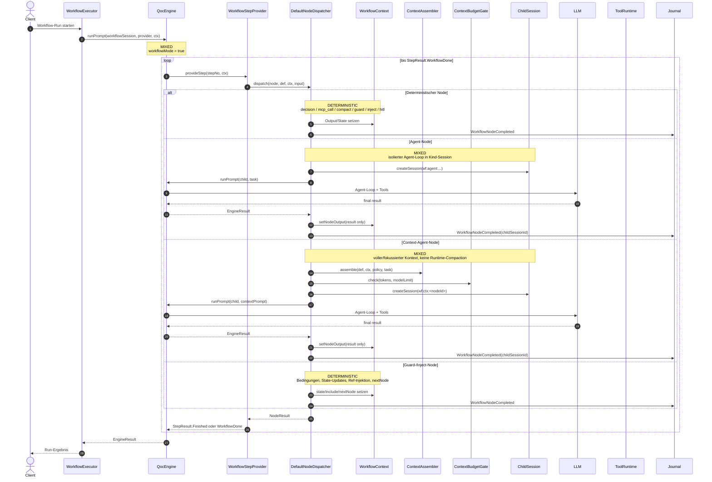
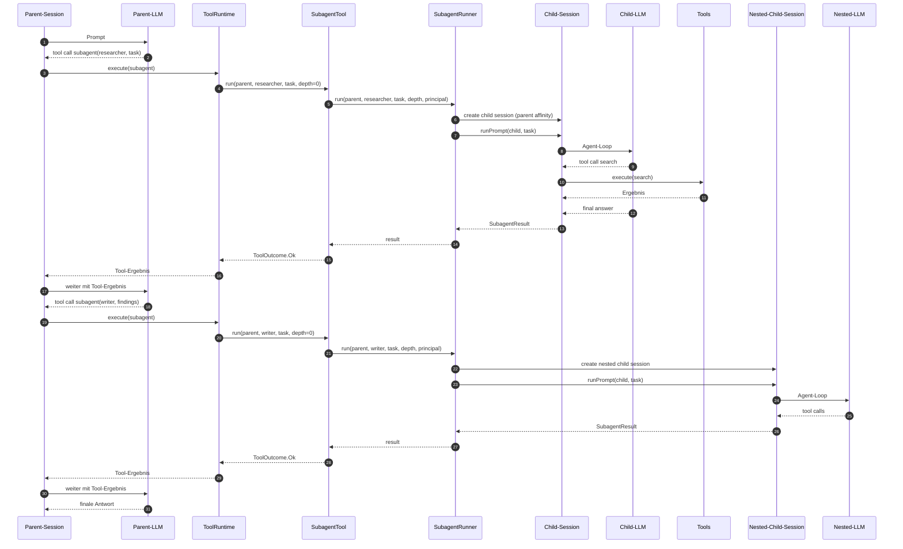

# 12 – Workflow-Modus und vollständiger Subagent-Lauf

## Zweck

Dieses Diagramm zeigt zwei getrennte Ausführungsarten in QOC:

1. **Workflow-Modus mit `context_agent_executor`**  
   Der äußere Loop ist deterministisch. Nodes werden nacheinander ausgeführt.
   Der `context_agent_executor` ist ein spezieller Node, der in einer
   Kind-Session einen LLM-Agenten mit vollem oder fokussiertem Kontext
   ausführt und nur das Ergebnis zurückgibt.

2. **Vollständiger Subagent-Lauf**  
   Ein normaler Agent ruft über `SubagentTool` einen oder mehrere Subagenten
   in eigenen Kind-Sessions auf. Die Subagenten haben eigene Tools und können
   selbst weitere Subagenten aufrufen. Sie erhalten **keinen** Shared-
   Workflow-Kontext.

---

## A. Workflow-Modus mit `context_agent_executor`

### Erläuterung

- Der äußere Loop nutzt `WorkflowStepProvider`, nicht den LLM-Step.
- Deterministische Nodes verändern nur `WorkflowContext` und Journal.
- Agent-Nodes und Context-Agent-Nodes laufen in **Kind-Sessions**.
- Nur das finale Ergebnis wird in `WorkflowContext` übernommen.
- `ContextAssembler` kann `FULL`, `FOCUSED`, `ARTIFACTS` oder `CUSTOM`
  liefern.
- `ContextBudgetGate` bricht vor dem Provider-Call ab, wenn der Kontext zu
  groß ist.
- `Guard`/`Inject` können `nextNode` setzen und damit den statischen Graph
  dynamisch überschreiben.

---

## B. Vollständiger Subagent-Lauf mit eigenen Subagenten und Tools

### Erläuterung

- Der Parent-Agent entscheidet, wann ein Subagent aufgerufen wird.
- `SubagentTool` und `SubagentRunner` erzeugen eine **eigene Kind-Session**.
- Der Subagent hat eigene Tools und kann selbst weitere Subagenten
  aufrufen.
- Der Parent erhält **nur das bereinigte Endergebnis**, keine internen
  Zwischenschritte.
- Subagenten erhalten **keinen** Shared-Workflow-Kontext.
- Die Kind-Session bleibt für Audit erhalten, wird aber nicht in
  nachfolgende Prompts des Parent übernommen.

---

## Gegenüberstellung

| Aspekt | Workflow-Modus mit Context-Agent | Subagent-Lauf |
|---|---|---|
| Äußerer Loop | deterministisch (WorkflowStepProvider) | LLM-gesteuert |
| Kontext | WorkflowContext (strukturiert) | Task-Prompt |
| LLM-Aufruf | in Kind-Session eines Nodes | in Kind-Session des Subagenten |
| Tools | Node-Tools + Agent-Tools | nur Subagent-Tools |
| Ergebnis-Rückgabe | nur Node-Ergebnis | nur Subagent-Ergebnis |
| Shared-Kontext | ja, über WorkflowContext | nein |
| Cache-Hygiene | durch Focused/Artifacts möglich | innerhalb der Kind-Session |
| Audit | Journal + Kind-Session | Kind-Session |

---

## Quellen

- `workflow-runner/.../runner/DefaultNodeDispatcher.java`
- `workflow-runner/.../runner/WorkflowStepProviderImpl.java`
- `workflow-runner/.../runner/WorkflowContext.java`
- `workflow-runner/.../runner/ContextAssembler` (Ziel)
- `engine/.../runtime/tool/subagent/SubagentTool.java`
- `engine/.../runtime/tool/subagent/SubagentRunner.java`
- `docs/plans/WorkflowMode-ContextAgent.md`
