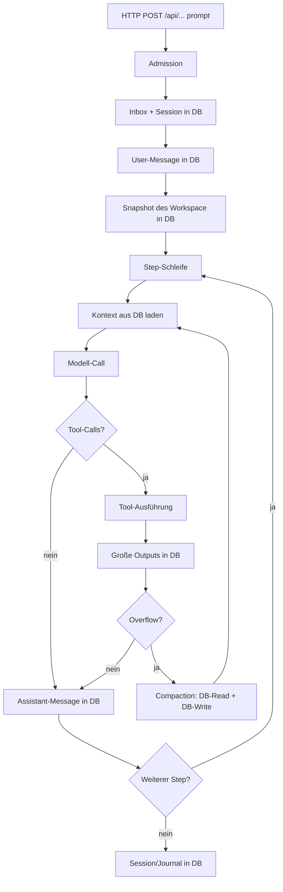

# Memory-Nutzung und DB-/File-Storage während der Task-Ausführung

> **Status:** 2026-11-05
> **Bezug:** QOC Java-Engine unter `qoc/`.
> **Rolle:** Analyse- und Referenzdokument, keine operative Spezifikation.
> **Methode:** Code-Lesen im Working Tree. Alle Aussagen mit
> `path:line`-Belegen; Interpretationen sind als solche markiert.

## 1. Ziel und Abgrenzung

Dieses Dokument beantwortet zwei Fragen für die Ausführung **eines einzelnen
Tasks** (eines Prompt-Laufs):

1. **Wo wird JVM-Heap-Speicher gehalten?**
2. **Wann und wo werden dabei Datenbank oder Dateisystem berührt?**

Nicht Gegenstand sind:

- konkrete Heap-Dumps oder Produktionsmessungen (die Werte sind
  konfigurations- und lastabhängig),
- Native-Image-Off-Heap-Verhalten,
- das Verhalten des externen Modell-Providers.

„Memory“ meint hier den Java-Heap: Listen, Strings, Byte-Arrays und
In-Memory-Maps. Persistente Daten liegen je nach Konfiguration in SQLite oder
PostgreSQL; Dateien liegen im Workspace oder im ephemeren Scratch-Verzeichnis.

## 2. Begriffe

| Begriff | Bedeutung |
|---|---|
| **Task** | Ein Prompt-Lauf über `Engine.prompt` → `Engine.runPrompt`. |
| **Step** | Ein Modellaufruf inklusive der zugehörigen Tool-Ausführungen. Ein Task besteht aus einem oder mehreren Steps. |
| **Session** | Dauerhafte Aggregat-ID; besitzt Conversation, Journal, Inbox und optional einen Workspace. |
| **History** | Persistierte Conversation-Messages einer Session. |
| **Snapshot** | Pre-Turn-Kopie der Workspace-Dateien für `revert`. |

## 3. Ablauf eines Tasks



Die Step-Schleife steht in `quarkus/src/main/java/de/augmentia/oc/engine/http/Engine.java:1615`.
Der Kontext wird pro Step neu aufgebaut
(`Engine.java:1625`), auch nach einer Compaction noch einmal
(`Engine.java:1643`).

## 4. Memory-Hotspots

### 4.1 History wird pro Step vollständig geladen

`ContextBuilder.history` ruft `conversation.messages(session, from)` auf und
faltet daraus die Nachrichtenliste
(`engine/src/main/java/de/augmentia/oc/engine/runtime/context/ContextBuilder.java:208-215`).
Die Liste lebt für die Dauer des `prepared`-Objekts und wird an den
Provider-Aufruf übergeben. Bei langen Sessions wächst dieser Anteil linear
mit der Anzahl der Messages seit dem letzten Compaction-Checkpoint.

**Besonderheit:** `prepare` wird bei einem Overflow-Step zweimal aufgerufen
(`Engine.java:1625` und `Engine.java:1643`). Die erste History-Liste wird erst
nach dem zweiten Aufruf garbage-collectable, sofern keine Referenz mehr
besteht.

### 4.2 Compaction lädt die gesamte History erneut

`CompactionService.compact` liest alle Messages ab `Seq.zero()`
(`engine/src/main/java/de/augmentia/oc/engine/runtime/compaction/CompactionService.java:117`),
teilt sie in ein Fenster (`:118`) und baut daraus einen
`StringBuilder`-Body für den Summary-Prompt. Der Peak liegt damit ungefähr
bei „History + Summary-Body“, zusätzlich zu der bereits im Step gehaltenen
History.

### 4.3 Große Tool-Outputs werden temporär im Heap gehalten

`ToolRuntime.bound` ruft `OutputBounding.boundStoring` auf
(`engine/src/main/java/de/augmentia/oc/engine/runtime/tool/runtime/ToolRuntime.java:168-169`).
Die Grenzen sind 2.000 Zeilen bzw. 50 KiB
(`engine/src/main/java/de/augmentia/oc/engine/core/eval/OutputBounding.java:21-22`).
Überschreitet ein Tool-Ergebnis diese Grenzen, hält `OutputBounding` den
**vollständigen Text** als `String` im Heap, bis der Saver ihn als `byte[]`
in den `ToolOutputStore` geschrieben hat
(`OutputBounding.java:39`, `:34-40`). Erst danach wird der sichtbare Teil
gebunden.

### 4.4 Tool-Result-Cache

Bei gesetztem Idempotency-Key wird das serialisierte Tool-Ergebnis als
`JsonValue` gelesen bzw. geschrieben
(`ToolRuntime.java:75`, `:113`, `:121`, `:131`). Das ist zwar kein
History-Wachstum, kann aber bei großen Tool-Outputs ebenfalls große
JSON-Strings im Heap halten.

### 4.5 Workspace-Snapshot vor jedem Prompt

Vor dem eigentlichen Task wird der Workspace gescannt und in die DB
gespeichert (`Engine.java:917-935`, Aufruf in `Engine.java:1421`).

Grenzen:

- maximal 2.000 Dateien (`Engine.java:908`),
- maximal 1 MiB pro Datei (`Engine.java:909`),
- maximal 20 MiB Gesamtgröße (`Engine.java:910`).

`SqlSnapshots.capture` liest jede Datei über den `FileSystem`-Port in ein
`byte[]` und schreibt sie in die Tabelle `snapshot_file`
(`engine/src/main/java/de/augmentia/oc/engine/adapter/sql/SqlSnapshots.java:37-54`).
Bei 20 MiB Gesamtbudget kann das pro Prompt ein kurzzeitiges Heap-Objekt in
dieser Größenordnung erzeugen, zusätzlich zum JDBC-Batch.

### 4.6 In-Memory-Registries und Maps

| Struktur | Ort | Lebensdauer / Wachstum |
|---|---|---|
| `promptSlots` (Semaphore) | `Engine.java:375`, `:394` | begrenzt parallele Prompts (Default 16) |
| `running` (`SessionId` → `Thread`) | `Engine.java:372-373` | pro laufendem Prompt; wird im `finally` entfernt (`Engine.java:1459`) |
| `pausedPrompts` (`SessionId` → `String`) | `Engine.java:343` | bleibt nach einer Pause bis zum Resume |
| `revertSnapshots` (`SessionId` → `CapturedSnapshot`) | `Engine.java:368` | letzter Snapshot pro Session |
| `subagentDepths` | `Engine.java:1843` | pro Subagent-Baum |
| `ProcessRegistry` | `engine/.../runtime/tool/shell/ProcessRegistry.java` | laufende Shell-Prozesse |
| `BackgroundTasks` | `engine/.../runtime/tool/subagent/BackgroundTasks.java` | Hintergrund-Subagents |
| `TodoTool` | `engine/.../runtime/tool/meta/TodoTool.java` | Todo-Liste pro Prozess/Lauf |

### 4.7 Datei-Scan-Cache

`CachedFileSystem` cached **nur** Glob-/Search-Ergebnisse, nicht
Dateiinhalte. Der Cache ist auf 64 Einträge begrenzt und läuft nach 1 Sekunde
ab (`engine/src/main/java/de/augmentia/oc/engine/adapter/fs/CachedFileSystem.java:18-19`).
`read` und `readText` delegieren immer direkt an das Dateisystem (`:30-37`).

## 5. Datenbank-Zugriffe im Task-Verlauf

Die folgenden Tabellen zeigen die Reihenfolge innerhalb eines Tasks. Die
Ports sind in `engine/src/main/java/de/augmentia/oc/engine/core/port/store/`
definiert; die konkreten Adapter liegen unter `adapter/sql` (PostgreSQL) und
`adapter/sqlite` (SQLite).

### 5.1 Vor dem Step-Loop

| Zeitpunkt | Operation | Speicherort | Beleg |
|---|---|---|---|
| Admission | `sessionService.enqueue` → Journal | DB | `Engine.java:1537` |
| Admission | `sessions.putInbox` | DB (`session_inbox`) | `Engine.java:1539` |
| Admission | `sessionService.deliver` | DB (Journal/Inbox) | `Engine.java:1541` |
| Admission | `sessions.put` (aktualisiertes `SessionInfo`) | DB (`session`) | `Engine.java:1543` |
| Prompt-Start | `captureSnapshot` → `snapshots.capture` | DB (`snapshot`, `snapshot_file`) | `Engine.java:1421`, `:917-935` |
| Prompt-Start | `conversation.insert` (User-Message) | DB (`message`) | `Engine.java:1550-1552` |
| Prompt-Start | `conversation.nextSeq` | DB (Sequenz) | `Engine.java:1550` |

### 5.2 Pro Step

| Zeitpunkt | Operation | Speicherort | Beleg |
|---|---|---|---|
| Kontextaufbau | `instructionStore.state` (Compaction-Checkpoint) | DB | `ContextBuilder.java:195-205` |
| Kontextaufbau | `instructionStore.blob` (Summary) | DB | `ContextBuilder.java:202` |
| Kontextaufbau | `conversation.messages` (History) | DB | `ContextBuilder.java:215` |
| Modell-Call | keine DB-/FS-Zugriffe | – | `Engine.java:1631` |
| Tool-Ausführung | Tool-spezifisch (FS, HTTP, MCP, …) | FS/Netz | `ToolRuntime.java:88` |
| Großer Tool-Output | `outputStore.save` | DB (`tool_output`) | `ToolRuntime.java:168-169` |
| Idempotency-Key | `resultCache.find` / `store` | DB (`tool_result_cache`) | `ToolRuntime.java:75`, `:113` |
| Overflow | `compaction.compact` → History laden | DB (`message`) | `CompactionService.java:117` |
| Overflow | Summary-Body bilden | Heap | `CompactionService.java:120-145` |
| Overflow | `instructions.putBlob` + `putState` | DB (`instruction_blob`, `instruction_state`) | `CompactionService.java:201-202` |
| Assistant-Turn | `conversation.nextSeq` + `conversation.insert` | DB (`message`) | `Engine.java:1748-1753` |

### 5.3 Nach dem Step-Loop

| Zeitpunkt | Operation | Speicherort | Beleg |
|---|---|---|---|
| Erfolg | `sessions.put` (Titel/Usage) | DB (`session`) | `Engine.java:1363-1373` |
| Titel | `generateTitle` → `conversation.messages` + LLM + `sessions.put` | DB + Heap | `Engine.java:1363-1373`, `:1811-1813` |
| Pause | `pausedPrompts.put` | Heap | `Engine.java:1704` |
| Pause | `sessionWorkspaces.setPausedPrompt` / `updateState` | DB/File | `Engine.java:1705-1708` |
| Pause | `sessions.put` | DB | `Engine.java:1711` |
| Ephemeral-Cleanup | `toolResultCache.deleteBySession` | DB | `Engine.java:1822-1823` |
| Ephemeral-Cleanup | `sessionRetention.delete` | DB (Session + Journal) | `Engine.java:1825` |
| Ephemeral-Cleanup | Workspace-Verzeichnis löschen | File | `Engine.java:1829-1833` |
| Ephemeral-Cleanup | `sessionWorkspaces.deleteWorkspace` | DB/File | `Engine.java:1835` |

> **Hinweis:** Die `ExecutionStarted`-/`ExecutionSucceeded`-Events werden im
> engine-core-`Coordinator` geschrieben (`engine/src/main/java/de/augmentia/oc/engine/runtime/execution/Coordinator.java:82`,
> `:98-104`). Im aktuellen Quarkus-Adapter wird kein `Coordinator`
> instanziiert; der produktive Pfad ist `Engine.prompt` → `Engine.runPrompt`.
> Die Event-Typen sind daher vor allem für den engine-core-Pfad und Tests
> relevant.

## 6. File-Storage-Zugriffe im Task-Verlauf

| Zeitpunkt | Zugriff | Pfad / Ort | Beleg |
|---|---|---|---|
| Prompt-Start | Workspace-Scan für Snapshot | Workspace-Root, ohne `.`, `node_modules`, `target`, `data` | `Engine.java:937-980` |
| Kontextaufbau | Instruktionen laden (`AGENTS.md` etc.) | Workspace + Home | `ContextBuilder.java:152-159` |
| Kontextaufbau | Skill-Instruktionen | Workspace `skill/`, `skills/`, `.opencode/skills`, konfigurierte Pfade | `Engine.java:580-596` |
| Tool `read` | Datei lesen | Workspace/erlaubter Pfad | `FileSystem.read` |
| Tool `write` / `edit` / `patch` | Datei schreiben/ändern | Workspace/erlaubter Pfad | `FileSystem.write` |
| Tool `glob` / `grep` | Verzeichnis scannen | Workspace/erlaubter Pfad | `FileSystem.glob` / `search`, kurz gecacht |
| Tool `shell` | Prozess im Workspace | Workspace (Sandbox) | `ShellTool` / `ProcessRunner` |
| Ephemeral-Mode | Scratch-Verzeichnis pro Session | `sessionWorkspaces.workspaceRoot` | `Engine.java:1523-1525` |
| Snapshot-Restore | Dateien aus DB zurück in den Workspace | Workspace | `SqlSnapshots.restore` |

Wichtig: Der `CachedFileSystem`-Cache betrifft nur Verzeichnis-Scans. Ein
wiederholtes `read` derselben Datei führt **jedes Mal** zu einem
Dateisystem-Zugriff (`CachedFileSystem.java:39-47`).

## 7. Wann entsteht der größte Speicherdruck?

Aus dem Code ergeben sich drei Peaks:

1. **Prompt-Start mit Snapshot:** Der Workspace-Scan plus `capture` kann bis
   zu 20 MiB Dateiinhalte gleichzeitig in den Heap laden
   (`Engine.java:908-910`, `SqlSnapshots.java:37-54`). Das passiert **vor**
   dem ersten Modell-Call.
2. **Langer Step mit History:** `contextBuilder.prepare` lädt die gesamte
   History; bei einem Overflow kommt ein zweites `prepare` hinzu
   (`Engine.java:1625`, `:1643`). Der Speicher wächst mit der Anzahl der
   Messages, nicht mit der Anzahl der Steps.
3. **Compaction:** `CompactionService.compact` lädt die History erneut und
   baut den Summary-Body (`CompactionService.java:117-145`). Das ist der
   größte einzelne Heap-Block nach dem Snapshot.

## 8. Konfiguration und Limits

| Eigenschaft | Default | Wirkung | Beleg |
|---|---:|---|---|
| `engine.max.concurrent.prompts` | 16 | begrenzt parallele Prompts und damit die Zahl gleichzeitig gehaltener Historien | `Engine.java:377-378` |
| `engine.turn.max.tool-calls` | 64 | begrenzt Tool-Calls pro Task | `Engine.java:381-382` |
| `engine.turn.max.tokens` | 0 (aus) | kumulatives Token-Budget pro Task | `Engine.java:385-386` |
| `engine.turn.max.wall-minutes` | 30 | Wall-Clock-Budget pro Task | `Engine.java:388-389` |
| `engine.revert.snapshot.enabled` | true | schaltet den Pre-Turn-Snapshot ab | `Engine.java:301-303` |
| Snapshot-Dateien | 2.000 | Obergrenze pro Snapshot | `Engine.java:908` |
| Snapshot-Dateigröße | 1 MiB | Obergrenze pro Datei | `Engine.java:909` |
| Snapshot-Gesamtgröße | 20 MiB | Obergrenze pro Snapshot | `Engine.java:910` |
| Output-Bounding | 2.000 Zeilen / 50 KiB | ab hier wird der Volltext in die DB ausgelagert | `OutputBounding.java:21-22` |

## 9. Messpunkte für eine Laufzeitanalyse

Wer die tatsächliche Memory-Nutzung messen will, kann folgende Punkte
kombinieren:

1. **Heap-Histogramm** während eines laufenden Tasks:
   `jcmd <pid> GC.class_histogram` oder JFR mit `jdk.ObjectAllocationSample`.
2. **DB-Wachstum** pro Task: `tool_output`, `snapshot_file`, `message` und
   `tool_result_cache` vor/nach dem Task zählen.
3. **Logs**: `Engine.runPrompt` loggt Step-Nummer und Agent
   (`Engine.java:1548`, `:1616`); `prompt finish` loggt Usage
   (`Engine.java:1435-1436`).
4. **OpenTelemetry-Spans**: `engine.prompt`, `engine.step`, `compaction`,
   `permission.assert` sind instrumentiert
   (`Engine.java:1415-1418`, `:1617-1620`, `:1634-1641`).

## 10. Optimierungsansätze

| Ansatz | Wirkung | Risiko |
|---|---|---|
| Step-lokalen History-Cache einführen | vermeidet doppeltes `conversation.messages` bei Overflow | Cache-Invalidierung nach Tool-Writes |
| Snapshot standardmäßig deaktivieren oder auf Diff beschränken | entfernt bis zu 20 MiB Heap/DB pro Prompt | `revert` kann Dateien nicht mehr wiederherstellen |
| Snapshot-Dateien streamen statt als Batch | senkt den Heap-Peak | mehr DB-Roundtrips |
| Compaction früher auslösen (kleineres Context-Window) | begrenzt History-Wachstum | mehr Summary-Calls |
| Output-Bounding vor dem vollständigen Einlesen | senkt den Heap-Peak bei großen Tool-Outputs | Tool-spezifische Streaming-Unterstützung nötig |
| TTL/Eviction für `pausedPrompts` und `revertSnapshots` | begrenzt Map-Wachstum bei vielen Sessions | Resume-/Revert-Semantik muss angepasst werden |

## 11. Alternative Speicher (Analyse, nicht implementiert)

Dieser Abschnitt ordnet die gespeicherten Daten alternativen Speicherarten zu
und skizziert ein lokales Docker-Setup sowie günstige Cloud-Varianten. Die
QOC-Ports bleiben dabei die Austauschgrenze; die genannten Adapter sind
**Vorschläge**, kein Bestandteil des aktuellen Codes.

### 11.1 Datenklassen und passende Speicher

| Datenklasse | Aktuell | Geeigneter Alternativ-Speicher | Begründung |
|---|---|---|---|
| Journal-Events | DB | Append-only Log / Event-Store (Kafka, Redpanda, EventStoreDB, Pub/Sub, Kinesis) | Audit, Replay, sequentielles Schreiben |
| Session-Metadaten | DB | Key-Value (DynamoDB, Redis, Cosmos DB) | kleine Records, hohe Skalierung |
| Conversation-Messages | DB | Dokumenten-DB (MongoDB, DynamoDB) oder Event-Store | geordnete Liste pro Session |
| Tool-Output (große Blobs) | DB (`tool_output`) | Objekt-Speicher (S3, GCS, MinIO, Azure Blob) + Metadaten-DB | Größe, Kosten, Content-Addressing |
| Workspace-Snapshots | DB (`snapshot_file`) | Objekt-Speicher (versioniert) | bis 20 MiB, binär, selten gelesen |
| Tool-Result-Cache | DB (`tool_result_cache`) | Redis/Valkey (TTL) | kurzlebig, Idempotency |
| Compaction-Summaries | DB (`instruction_blob`) | Objekt-Speicher oder KV | Content-Addressing, selten gelesen |
| Instruction-State | DB (`instruction_state`) | KV oder DB | klein, by Session |
| Claims/Locks | DB (`claim`) | Redis (SETNX/Redlock) oder DB-Row-Lock | sehr kurzlebig, verteiltes Locking |
| Approvals (async) | DB (`approval`) | DB + Queue (SQS, Pub/Sub) | durable + asynchrones Wecken |
| Credentials | DB (`credential`) | Secret-Manager (Vault, KMS, Secrets Manager, Secret Manager) | sensible Daten, Rotation |
| Skills/Instructions | FS + In-Memory | Git/Config-Store oder FS | read-only, versionierbar |
| Scratch-Workspace | FS (ephemeral) | tmpfs, ephemere Volume oder S3/GCS-Prefix | kein Shared Space im Serverless-Modus |
| In-Memory-Registries | Heap | verteiltes In-Memory (Hazelcast, Infinispan) | nur bei Multi-Instance nötig |

### 11.2 Top 5 nach Mehrwert

| Rang | Maßnahme | Mehrwert | Aufwand |
|---:|---|---|---|
| 1 | Snapshots und Tool-Outputs in Objekt-Speicher | DB bleibt klein, Backups/Restore schneller, Kosten sinken | mittel |
| 2 | Redis für Tool-Result-Cache und Claims | weniger DB-Last, TTL, verteiltes Locking | niedrig–mittel |
| 3 | Secret-Manager für Credentials | Secrets verlassen die DB, Rotation/Audit | niedrig |
| 4 | Event-Log für das Journal | Replay/Audit, Entkopplung der Read-Modelle | mittel–hoch |
| 5 | Ephemere Scratch-Speicher | Serverless-/Worker-Kompatibilität, sauberes Cleanup | niedrig–mittel |

### 11.3 Lokales Docker-Setup

Minimal-Setup für die Top-5-Speicher:

| Service | Image | Zweck | Port |
|---|---|---|---|
| `postgres` | `postgres:16` | transaktionale DB (Session, Conversation, Journal) | 5432 |
| `minio` | `minio/minio` | S3-kompatibler Objekt-Speicher | 9000/9001 |
| `redis` | `redis:7-alpine` | Cache, Claims, TTL | 6379 |
| `qoc` | eigenes Image | Engine | 8081 |
| optional `redpanda` | `redpandadata/redpanda` | Event-Log (Kafka-API) | 9092 |
| optional `vault` | `hashicorp/vault` | Secret-Manager | 8200 |

Beispiel-Compose (Auszug; die QOC-Variablen sind Zielbild, nicht aktueller
Code):

```yaml
services:
  postgres:
    image: postgres:16
    environment:
      POSTGRES_DB: qoc
      POSTGRES_USER: qoc
      POSTGRES_PASSWORD: qoc
    volumes: [pgdata:/var/lib/postgresql/data]
    ports: ["5432:5432"]

  minio:
    image: minio/minio
    command: server /data --console-address ":9001"
    environment:
      MINIO_ROOT_USER: minioadmin
      MINIO_ROOT_PASSWORD: minioadmin
    volumes: [miniodata:/data]
    ports: ["9000:9000", "9001:9001"]

  redis:
    image: redis:7-alpine
    command: redis-server --appendonly yes
    volumes: [redisdata:/data]
    ports: ["6379:6379"]

  qoc:
    build: .
    environment:
      ENGINE_DB_KIND: postgresql
      QUARKUS_DATASOURCE_JDBC_URL: jdbc:postgresql://postgres:5432/qoc
      QUARKUS_DATASOURCE_USERNAME: qoc
      QUARKUS_DATASOURCE_PASSWORD: qoc
      QOC_OBJECT_STORE: s3
      QOC_OBJECT_STORE_ENDPOINT: http://minio:9000
      QOC_OBJECT_STORE_BUCKET: qoc-artifacts
      QOC_REDIS_URL: redis://redis:6379
    depends_on: [postgres, minio, redis]
    ports: ["8081:8081"]
    volumes:
      - qocdata:/data
      - ./workspace:/data/workspace

volumes:
  pgdata:
  miniodata:
  redisdata:
  qocdata:
```

Lokale Kostentreiber gibt es nicht; der Aufwand liegt in den Adaptern.
Redpanda und Vault nur starten, wenn Event-Log bzw. Secret-Rotation getestet
werden.

### 11.4 Günstiges GCP-Setup

| Komponente | GCP-Service | Günstige Variante | Hinweis |
|---|---|---|---|
| Compute | Cloud Run oder e2-micro VM | Cloud Run scale-to-zero; e2-micro Free Tier in `us-central1` | Dauerbetrieb eher VM |
| Objekt-Speicher | Cloud Storage | Standard + Lifecycle-Regeln | Snapshots nach 7 Tagen löschen |
| Cache/Claims | Memorystore for Redis | Basic Tier, kleinste Größe | für sehr günstig: Redis auf der VM |
| Secrets | Secret Manager | Pay-per-Access | Injection als Env |
| Event-Log | Pub/Sub | Pay-per-Message | nur bei Bedarf |
| DB | Cloud SQL oder externe Free-DB (Neon/Supabase) | Cloud SQL klein oder extern | Kosten stark von DB abhängig |
| Scratch | GCS-Prefix oder tmpfs | – | nicht durable |

**Empfehlung:** eine e2-micro-VM mit Docker Compose (Postgres, MinIO, Redis,
QOC) plus GCS-Bucket für Snapshots/Tool-Outputs. Das ist die günstigste
Variante mit denselben Ports wie lokal.

### 11.5 Günstiges AWS-Setup

| Komponente | AWS-Service | Günstige Variante | Hinweis |
|---|---|---|---|
| Compute | ECS Fargate oder EC2 t4g.micro | t4g.micro Free Tier / Spot | Dauerbetrieb eher EC2 |
| Objekt-Speicher | S3 | Standard + Lifecycle | alte Snapshots nach 7 Tagen löschen |
| Cache/Claims | ElastiCache (Redis) | kleinste Node-Größe | für sehr günstig: Redis auf EC2 |
| Secrets | Secrets Manager oder Parameter Store | Parameter Store Standard | kostenlos für Standard-Parameter |
| Event-Log | SQS, EventBridge oder Kinesis | SQS pay-per-request | nur bei Bedarf |
| DB | RDS oder externe Free-DB (Neon/Supabase) | RDS t4g.micro oder extern | Kosten stark von DB abhängig |
| Scratch | S3-Prefix oder tmpfs | – | nicht durable |

**Empfehlung:** eine t4g.micro-EC2-Instanz mit Docker Compose plus
S3-Bucket und Parameter Store. Das entspricht dem lokalen Setup am nächsten
und vermeidet managed Redis/Event-Log-Kosten.

### 11.6 Migrationspfad und Constraints

1. **Objekt-Speicher:** `ToolOutputStore` und `SnapshotStore` gegen
   S3/GCS/MinIO implementieren; die DB speichert URI + Metadaten.
2. **Redis:** `ToolResultCache` und `ClaimStore` gegen Redis; TTL-basiert.
3. **Secret-Manager:** `CredentialStore` gegen Vault, Secret Manager oder
   Parameter Store.
4. **Event-Log (optional):** Journal über Outbox-Pattern an Pub/Sub, SQS oder
   Kafka anbinden; die DB bleibt zunächst Source of Truth.
5. **Scratch:** `SessionWorkspaceStore` auf S3-Prefix oder tmpfs umstellen.

Constraints:

- **Transaktionen:** Journal, Session und Conversation müssen konsistent
  bleiben; polyglotte Speicher erfordern Outbox/Saga.
- **Native Image:** neue Adapter müssen in `NativeReflectionConfig` registriert
  werden.
- **Latenz:** Objekt-Speicher ist langsamer als DB; kleine, häufig gelesene
  Daten (History) bleiben in der DB.
- **Kosten:** Lifecycle-Regeln und TTL sind Pflicht, sonst wachsen
  Objekt-Speicher und Cache unbegrenzt.

## 12. Offene Punkte

- Die tatsächlichen Heap- und DB-Größen sind lastabhängig; dieses Dokument
  liefert die **Orte und Zeitpunkte**, keine absoluten Messwerte.
- `SqlToolOutput` und `SqliteToolOutput` nehmen im Konstruktor ein
  `directory`-Argument entgegen, speichern den Inhalt aber in der DB
  (`adapter/sql/SqlToolOutput.java:25-31`, `adapter/sqlite/SqliteToolOutput.java:25-31`).
  Das Argument ist derzeit ungenutzt; eine spätere File-Variante ist damit
  vorbereitet, aber nicht aktiv.
- Die Snapshot-Erzeugung ist standardmäßig aktiv (`engine.revert.snapshot.enabled=true`)
  und läuft vor **jedem** Prompt, nicht nur bei Datei-Änderungen.
