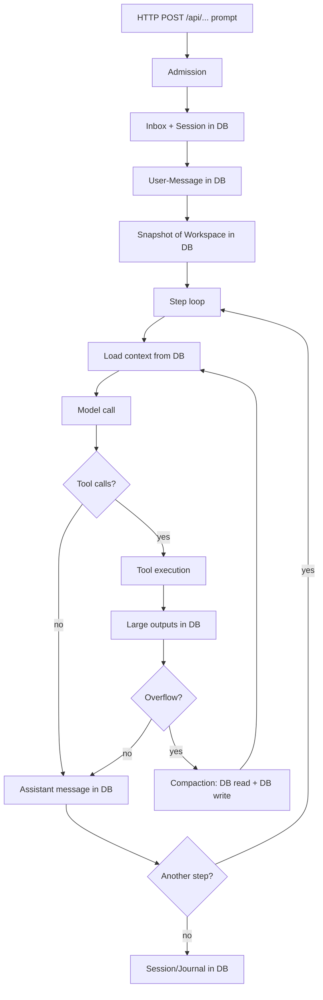

# Memory Usage and DB/File Storage During Task Execution

> **Status:** 2026-11-05
> **Reference:** QOC Java Engine under `qoc/`.
> **Role:** Analysis and reference document, not an operative specification.
> **Method:** Reading code in the working tree. All statements include
> `path:line` evidence; interpretations are marked as such.

## 1. Goal and Scope

This document answers two questions for the execution of **a single task**
(a single prompt run):

1. **Where is JVM heap memory held?**
2. **When and where are the database or file system touched?**

Not in scope:

- concrete heap dumps or production measurements (values depend on
  configuration and load),
- native-image off-heap behavior,
- the behavior of the external model provider.

Here "memory" means the Java heap: lists, strings, byte arrays and
in-memory maps. Persistent data resides in SQLite or PostgreSQL depending
on configuration; files reside in the workspace or in the ephemeral scratch
directory.

## 2. Terms

| Term | Meaning |
|---|---|
| **Task** | A prompt run via `Engine.prompt` → `Engine.runPrompt`. |
| **Step** | A model call including the associated tool executions. A task consists of one or more steps. |
| **Session** | Persistent aggregate ID; owns a conversation, journal, inbox and optionally a workspace. |
| **History** | Persisted conversation messages of a session. |
| **Snapshot** | Pre-turn copy of workspace files for `revert`. |

## 3. Task Flow



The step loop is in `quarkus/src/main/java/de/augmentia/oc/engine/http/Engine.java:1615`.
Context is rebuilt per step (`Engine.java:1625`), including after a
compaction (`Engine.java:1643`).

## 4. Memory Hotspots

### 4.1 History Is Loaded in Full per Step

`ContextBuilder.history` calls `conversation.messages(session, from)` and
folds the result into the message list
(`engine/src/main/java/de/augmentia/oc/engine/runtime/context/ContextBuilder.java:208-215`).
The list lives for the lifetime of the `prepared` object and is passed to
the provider call. For long sessions this share grows linearly with the
number of messages since the last compaction checkpoint.

**Special case:** `prepare` is called twice during an overflow step
(`Engine.java:1625` and `Engine.java:1643`). The first history list only
becomes garbage-collectable after the second call, once no references
remain.

### 4.2 Compaction Reloads the Entire History

`CompactionService.compact` reads all messages from `Seq.zero()`
(`engine/src/main/java/de/augmentia/oc/engine/runtime/compaction/CompactionService.java:117`),
splits them into a window (`:118`) and builds a `StringBuilder` body for
the summary prompt. The peak is therefore roughly "History + Summary body",
in addition to the history already held in the step.

### 4.3 Large Tool Outputs Are Temporarily Held in the Heap

`ToolRuntime.bound` calls `OutputBounding.boundStoring`
(`engine/src/main/java/de/augmentia/oc/engine/runtime/tool/runtime/ToolRuntime.java:168-169`).
The limits are 2,000 lines or 50 KiB
(`engine/src/main/java/de/augmentia/oc/engine/core/eval/OutputBounding.java:21-22`).
When a tool result exceeds these limits, `OutputBounding` holds the **full
text** as a `String` in the heap until the saver writes it as a `byte[]`
into the `ToolOutputStore`
(`OutputBounding.java:39`, `:34-40`). Only then is the visible part bound.

### 4.4 Tool-Result Cache

When an idempotency key is set, the serialized tool result is read or
written as a `JsonValue`
(`ToolRuntime.java:75`, `:113`, `:121`, `:131`). This is not history
growth, but it can also hold large JSON strings in the heap for large tool
outputs.

### 4.5 Workspace Snapshot Before Every Prompt

Before the actual task, the workspace is scanned and stored in the DB
(`Engine.java:917-935`, invoked in `Engine.java:1421`).

Limits:

- at most 2,000 files (`Engine.java:908`),
- at most 1 MiB per file (`Engine.java:909`),
- at most 20 MiB total size (`Engine.java:910`).

`SqlSnapshots.capture` reads each file through the `FileSystem` port into a
`byte[]` and writes it into the `snapshot_file` table
(`engine/src/main/java/de/augmentia/oc/engine/adapter/sql/SqlSnapshots.java:37-54`).
With a 20 MiB total budget this can create a short-lived heap object of
that size per prompt, in addition to the JDBC batch.

### 4.6 In-Memory Registries and Maps

| Structure | Location | Lifetime / Growth |
|---|---|---|
| `promptSlots` (Semaphore) | `Engine.java:375`, `:394` | limits parallel prompts (default 16) |
| `running` (`SessionId` → `Thread`) | `Engine.java:372-373` | per running prompt; removed in `finally` (`Engine.java:1459`) |
| `pausedPrompts` (`SessionId` → `String`) | `Engine.java:343` | remains after a pause until resume |
| `revertSnapshots` (`SessionId` → `CapturedSnapshot`) | `Engine.java:368` | last snapshot per session |
| `subagentDepths` | `Engine.java:1843` | per subagent tree |
| `ProcessRegistry` | `engine/.../runtime/tool/shell/ProcessRegistry.java` | running shell processes |
| `BackgroundTasks` | `engine/.../runtime/tool/subagent/BackgroundTasks.java` | background subagents |
| `TodoTool` | `engine/.../runtime/tool/meta/TodoTool.java` | todo list per process/run |

### 4.7 File-Scan Cache

`CachedFileSystem` caches **only** glob/search results, not file contents.
The cache is limited to 64 entries and expires after 1 second
(`engine/src/main/java/de/augmentia/oc/engine/adapter/fs/CachedFileSystem.java:18-19`).
`read` and `readText` always delegate directly to the file system (`:30-37`).

## 5. Database Accesses During a Task

The ports are defined in
`engine/src/main/java/de/augmentia/oc/engine/core/port/store/`; the concrete
adapters live under `adapter/sql` (PostgreSQL) and `adapter/sqlite`
(SQLite).

### 5.1 Before the Step Loop

| Point in time | Operation | Storage | Evidence |
|---|---|---|---|
| Admission | `sessionService.enqueue` → Journal | DB | `Engine.java:1537` |
| Admission | `sessions.putInbox` | DB (`session_inbox`) | `Engine.java:1539` |
| Admission | `sessionService.deliver` | DB (Journal/Inbox) | `Engine.java:1541` |
| Admission | `sessions.put` (updated `SessionInfo`) | DB (`session`) | `Engine.java:1543` |
| Prompt start | `captureSnapshot` → `snapshots.capture` | DB (`snapshot`, `snapshot_file`) | `Engine.java:1421`, `:917-935` |
| Prompt start | `conversation.insert` (user message) | DB (`message`) | `Engine.java:1550-1552` |
| Prompt start | `conversation.nextSeq` | DB (sequence) | `Engine.java:1550` |

### 5.2 Per Step

| Point in time | Operation | Storage | Evidence |
|---|---|---|---|
| Context build | `instructionStore.state` (compaction checkpoint) | DB | `ContextBuilder.java:195-205` |
| Context build | `instructionStore.blob` (summary) | DB | `ContextBuilder.java:202` |
| Context build | `conversation.messages` (history) | DB | `ContextBuilder.java:215` |
| Model call | no DB/FS accesses | – | `Engine.java:1631` |
| Tool execution | tool-specific (FS, HTTP, MCP, …) | FS/network | `ToolRuntime.java:88` |
| Large tool output | `outputStore.save` | DB (`tool_output`) | `ToolRuntime.java:168-169` |
| Idempotency key | `resultCache.find` / `store` | DB (`tool_result_cache`) | `ToolRuntime.java:75`, `:113` |
| Overflow | `compaction.compact` → load history | DB (`message`) | `CompactionService.java:117` |
| Overflow | build summary body | Heap | `CompactionService.java:120-145` |
| Overflow | `instructions.putBlob` + `putState` | DB (`instruction_blob`, `instruction_state`) | `CompactionService.java:201-202` |
| Assistant turn | `conversation.nextSeq` + `conversation.insert` | DB (`message`) | `Engine.java:1748-1753` |

### 5.3 After the Step Loop

| Point in time | Operation | Storage | Evidence |
|---|---|---|---|
| Success | `sessions.put` (title/usage) | DB (`session`) | `Engine.java:1363-1373` |
| Title | `generateTitle` → `conversation.messages` + LLM + `sessions.put` | DB + Heap | `Engine.java:1363-1373`, `:1811-1813` |
| Pause | `pausedPrompts.put` | Heap | `Engine.java:1704` |
| Pause | `sessionWorkspaces.setPausedPrompt` / `updateState` | DB/File | `Engine.java:1705-1708` |
| Pause | `sessions.put` | DB | `Engine.java:1711` |
| Ephemeral cleanup | `toolResultCache.deleteBySession` | DB | `Engine.java:1822-1823` |
| Ephemeral cleanup | `sessionRetention.delete` | DB (Session + Journal) | `Engine.java:1825` |
| Ephemeral cleanup | delete workspace directory | File | `Engine.java:1829-1833` |
| Ephemeral cleanup | `sessionWorkspaces.deleteWorkspace` | DB/File | `Engine.java:1835` |

> **Note:** The `ExecutionStarted`/`ExecutionSucceeded` events are written in
> the engine-core `Coordinator`
> (`engine/src/main/java/de/augmentia/oc/engine/runtime/execution/Coordinator.java:82`,
> `:98-104`). In the current Quarkus adapter no `Coordinator` is
> instantiated; the productive path is `Engine.prompt` → `Engine.runPrompt`.
> The event types are therefore mainly relevant for the engine-core path and
> tests.

## 6. File-Storage Accesses During a Task

| Point in time | Access | Path / Location | Evidence |
|---|---|---|---|
| Prompt start | Workspace scan for snapshot | Workspace root, excluding `.`, `node_modules`, `target`, `data` | `Engine.java:937-980` |
| Context build | Load instructions (`AGENTS.md`, etc.) | Workspace + Home | `ContextBuilder.java:152-159` |
| Context build | Skill instructions | Workspace `skill/`, `skills/`, `.opencode/skills`, configured paths | `Engine.java:580-596` |
| Tool `read` | Read file | Workspace/allowed path | `FileSystem.read` |
| Tool `write` / `edit` / `patch` | Write/modify file | Workspace/allowed path | `FileSystem.write` |
| Tool `glob` / `grep` | Scan directory | Workspace/allowed path | `FileSystem.glob` / `search`, briefly cached |
| Tool `shell` | Process in workspace | Workspace (sandbox) | `ShellTool` / `ProcessRunner` |
| Ephemeral mode | Scratch directory per session | `sessionWorkspaces.workspaceRoot` | `Engine.java:1523-1525` |
| Snapshot restore | Files from DB back into workspace | Workspace | `SqlSnapshots.restore` |

Important: the `CachedFileSystem` cache only covers directory scans. A
repeated `read` of the same file triggers a file-system access **every
time** (`CachedFileSystem.java:39-47`).

## 7. When Does Memory Pressure Peak?

Three peaks follow from the code:

1. **Prompt start with snapshot:** The workspace scan plus `capture` can
   load up to 20 MiB of file contents into the heap simultaneously
   (`Engine.java:908-910`, `SqlSnapshots.java:37-54`). This happens **before**
   the first model call.
2. **Long step with history:** `contextBuilder.prepare` loads the entire
   history; on overflow a second `prepare` is added
   (`Engine.java:1625`, `:1643`). Memory grows with the number of messages,
   not the number of steps.
3. **Compaction:** `CompactionService.compact` reloads the history and
   builds the summary body (`CompactionService.java:117-145`). This is the
   largest single heap block after the snapshot.

## 8. Configuration and Limits

| Property | Default | Effect | Evidence |
|---|---:|---|---|
| `engine.max.concurrent.prompts` | 16 | limits parallel prompts and thus the number of simultaneously held histories | `Engine.java:377-378` |
| `engine.turn.max.tool-calls` | 64 | limits tool calls per task | `Engine.java:381-382` |
| `engine.turn.max.tokens` | 0 (off) | cumulative token budget per task | `Engine.java:385-386` |
| `engine.turn.max.wall-minutes` | 30 | wall-clock budget per task | `Engine.java:388-389` |
| `engine.revert.snapshot.enabled` | true | disables the pre-turn snapshot | `Engine.java:301-303` |
| Snapshot files | 2,000 | upper bound per snapshot | `Engine.java:908` |
| Snapshot file size | 1 MiB | upper bound per file | `Engine.java:909` |
| Snapshot total size | 20 MiB | upper bound per snapshot | `Engine.java:910` |
| Output bounding | 2,000 lines / 50 KiB | above this the full text is offloaded to the DB | `OutputBounding.java:21-22` |

## 9. Measurement Points for Runtime Analysis

To measure actual memory usage, the following points can be combined:

1. **Heap histogram** during a running task:
   `jcmd <pid> GC.class_histogram` or JFR with `jdk.ObjectAllocationSample`.
2. **DB growth** per task: count `tool_output`, `snapshot_file`, `message`
   and `tool_result_cache` before/after the task.
3. **Logs**: `Engine.runPrompt` logs step number and agent
   (`Engine.java:1548`, `:1616`); `prompt finish` logs usage
   (`Engine.java:1435-1436`).
4. **OpenTelemetry spans**: `engine.prompt`, `engine.step`, `compaction`,
   `permission.assert` are instrumented
   (`Engine.java:1415-1418`, `:1617-1620`, `:1634-1641`).

## 10. Optimization Approaches

| Approach | Effect | Risk |
|---|---|---|
| Introduce a step-local history cache | avoids duplicate `conversation.messages` on overflow | cache invalidation after tool writes |
| Disable snapshots by default or limit to diff | removes up to 20 MiB heap/DB per prompt | `revert` can no longer restore files |
| Stream snapshot files instead of batching | lowers the heap peak | more DB round trips |
| Trigger compaction earlier (smaller context window) | bounds history growth | more summary calls |
| Bound output before reading fully | lowers the heap peak for large tool outputs | requires tool-specific streaming support |
| TTL/eviction for `pausedPrompts` and `revertSnapshots` | bounds map growth across many sessions | resume/revert semantics must be adjusted |

## 11. Alternative Storage (Analysis, Not Implemented)

This section maps the stored data to alternative storage types and sketches a
local Docker setup plus inexpensive cloud variants. The QOC ports remain the
exchange boundary; the adapters mentioned are **proposals**, not part of the
current code.

### 11.1 Data Classes and Suitable Storage

| Data class | Currently | Suitable alternative storage | Rationale |
|---|---|---|---|
| Journal events | DB | Append-only log / event store (Kafka, Redpanda, EventStoreDB, Pub/Sub, Kinesis) | audit, replay, sequential writes |
| Session metadata | DB | Key-value (DynamoDB, Redis, Cosmos DB) | small records, high scale |
| Conversation messages | DB | Document DB (MongoDB, DynamoDB) or event store | ordered list per session |
| Tool output (large blobs) | DB (`tool_output`) | Object storage (S3, GCS, MinIO, Azure Blob) + metadata DB | size, cost, content addressing |
| Workspace snapshots | DB (`snapshot_file`) | Object storage (versioned) | up to 20 MiB, binary, rarely read |
| Tool-result cache | DB (`tool_result_cache`) | Redis/Valkey (TTL) | short-lived, idempotency |
| Compaction summaries | DB (`instruction_blob`) | Object storage or KV | content addressing, rarely read |
| Instruction state | DB (`instruction_state`) | KV or DB | small, by session |
| Claims/locks | DB (`claim`) | Redis (SETNX/Redlock) or DB row lock | very short-lived, distributed locking |
| Approvals (async) | DB (`approval`) | DB + queue (SQS, Pub/Sub) | durable + asynchronous wake-up |
| Credentials | DB (`credential`) | Secret manager (Vault, KMS, Secrets Manager, Secret Manager) | sensitive data, rotation |
| Skills/instructions | FS + in-memory | Git/config store or FS | read-only, versionable |
| Scratch workspace | FS (ephemeral) | tmpfs, ephemeral volume or S3/GCS prefix | no shared space in serverless mode |
| In-memory registries | Heap | Distributed in-memory (Hazelcast, Infinispan) | only needed for multi-instance |

### 11.2 Top 5 by Value

| Rank | Measure | Value | Effort |
|---:|---|---|---|
| 1 | Snapshots and tool outputs in object storage | DB stays small, backups/restore faster, cost drops | medium |
| 2 | Redis for tool-result cache and claims | less DB load, TTL, distributed locking | low–medium |
| 3 | Secret manager for credentials | Secrets leave the DB, rotation/audit | low |
| 4 | Event log for the journal | replay/audit, decouples read models | medium–high |
| 5 | Ephemeral scratch storage | serverless/worker compatibility, clean cleanup | low–medium |

### 11.3 Local Docker Setup

Minimal setup for the top-5 storage types:

| Service | Image | Purpose | Port |
|---|---|---|---|
| `postgres` | `postgres:16` | transactional DB (session, conversation, journal) | 5432 |
| `minio` | `minio/minio` | S3-compatible object storage | 9000/9001 |
| `redis` | `redis:7-alpine` | cache, claims, TTL | 6379 |
| `qoc` | own image | engine | 8081 |
| optional `redpanda` | `redpandadata/redpanda` | event log (Kafka API) | 9092 |
| optional `vault` | `hashicorp/vault` | secret manager | 8200 |

Compose example (excerpt; the QOC variables are the target image, not the
current code):

```yaml
services:
  postgres:
    image: postgres:16
    environment:
      POSTGRES_DB: qoc
      POSTGRES_USER: qoc
      POSTGRES_PASSWORD: qoc
    volumes: [pgdata:/var/lib/postgresql/data]
    ports: ["5432:5432"]

  minio:
    image: minio/minio
    command: server /data --console-address ":9001"
    environment:
      MINIO_ROOT_USER: minioadmin
      MINIO_ROOT_PASSWORD: minioadmin
    volumes: [miniodata:/data]
    ports: ["9000:9000", "9001:9001"]

  redis:
    image: redis:7-alpine
    command: redis-server --appendonly yes
    volumes: [redisdata:/data]
    ports: ["6379:6379"]

  qoc:
    build: .
    environment:
      ENGINE_DB_KIND: postgresql
      QUARKUS_DATASOURCE_JDBC_URL: jdbc:postgresql://postgres:5432/qoc
      QUARKUS_DATASOURCE_USERNAME: qoc
      QUARKUS_DATASOURCE_PASSWORD: qoc
      QOC_OBJECT_STORE: s3
      QOC_OBJECT_STORE_ENDPOINT: http://minio:9000
      QOC_OBJECT_STORE_BUCKET: qoc-artifacts
      QOC_REDIS_URL: redis://redis:6379
    depends_on: [postgres, minio, redis]
    ports: ["8081:8081"]
    volumes:
      - qocdata:/data
      - ./workspace:/data/workspace

volumes:
  pgdata:
  miniodata:
  redisdata:
  qocdata:
```

There are no local cost drivers; the effort is in the adapters. Start
Redpanda and Vault only when testing the event log or secret rotation.

### 11.4 Inexpensive GCP Setup

| Component | GCP service | Inexpensive variant | Note |
|---|---|---|---|
| Compute | Cloud Run or e2-micro VM | Cloud Run scale-to-zero; e2-micro Free Tier in `us-central1` | continuous operation better on VM |
| Object storage | Cloud Storage | Standard + lifecycle rules | delete snapshots after 7 days |
| Cache/claims | Memorystore for Redis | Basic Tier, smallest size | for very cheap: Redis on the VM |
| Secrets | Secret Manager | Pay-per-access | inject as env |
| Event log | Pub/Sub | Pay-per-message | only when needed |
| DB | Cloud SQL or external free DB (Neon/Supabase) | small Cloud SQL or external | cost strongly depends on DB |
| Scratch | GCS prefix or tmpfs | – | not durable |

**Recommendation:** an e2-micro VM with Docker Compose (Postgres, MinIO,
Redis, QOC) plus a GCS bucket for snapshots/tool outputs. This is the
cheapest variant with the same ports as locally.

### 11.5 Inexpensive AWS Setup

| Component | AWS service | Inexpensive variant | Note |
|---|---|---|---|
| Compute | ECS Fargate or EC2 t4g.micro | t4g.micro Free Tier / Spot | continuous operation better on EC2 |
| Object storage | S3 | Standard + lifecycle | delete old snapshots after 7 days |
| Cache/claims | ElastiCache (Redis) | smallest node size | for very cheap: Redis on EC2 |
| Secrets | Secrets Manager or Parameter Store | Parameter Store Standard | free for standard parameters |
| Event log | SQS, EventBridge or Kinesis | SQS pay-per-request | only when needed |
| DB | RDS or external free DB (Neon/Supabase) | RDS t4g.micro or external | cost strongly depends on DB |
| Scratch | S3 prefix or tmpfs | – | not durable |

**Recommendation:** a t4g.micro EC2 instance with Docker Compose plus an S3
bucket and Parameter Store. This is closest to the local setup and avoids
managed Redis/event-log costs.

### 11.6 Migration Path and Constraints

1. **Object storage:** implement `ToolOutputStore` and `SnapshotStore`
   against S3/GCS/MinIO; the DB stores URI + metadata.
2. **Redis:** implement `ToolResultCache` and `ClaimStore` against Redis;
   TTL-based.
3. **Secret manager:** implement `CredentialStore` against Vault, Secret
   Manager or Parameter Store.
4. **Event log (optional):** connect the journal via the outbox pattern to
   Pub/Sub, SQS or Kafka; the DB remains the source of truth initially.
5. **Scratch:** switch `SessionWorkspaceStore` to an S3 prefix or tmpfs.

Constraints:

- **Transactions:** journal, session and conversation must stay
  consistent; polyglot storage requires outbox/saga.
- **Native image:** new adapters must be registered in
  `NativeReflectionConfig`.
- **Latency:** object storage is slower than the DB; small, frequently read
  data (history) stays in the DB.
- **Cost:** lifecycle rules and TTL are mandatory, otherwise object storage
  and cache grow without bound.

## 12. Open Points

- Actual heap and DB sizes depend on load; this document provides the
  **locations and points in time**, not absolute measurements.
- `SqlToolOutput` and `SqliteToolOutput` accept a `directory` argument in
  their constructor but store the content in the DB
  (`adapter/sql/SqlToolOutput.java:25-31`, `adapter/sqlite/SqliteToolOutput.java:25-31`).
  The argument is currently unused; a later file variant is prepared but
  not active.
- Snapshot generation is active by default
  (`engine.revert.snapshot.enabled=true`) and runs before **every** prompt,
  not only on file changes.
