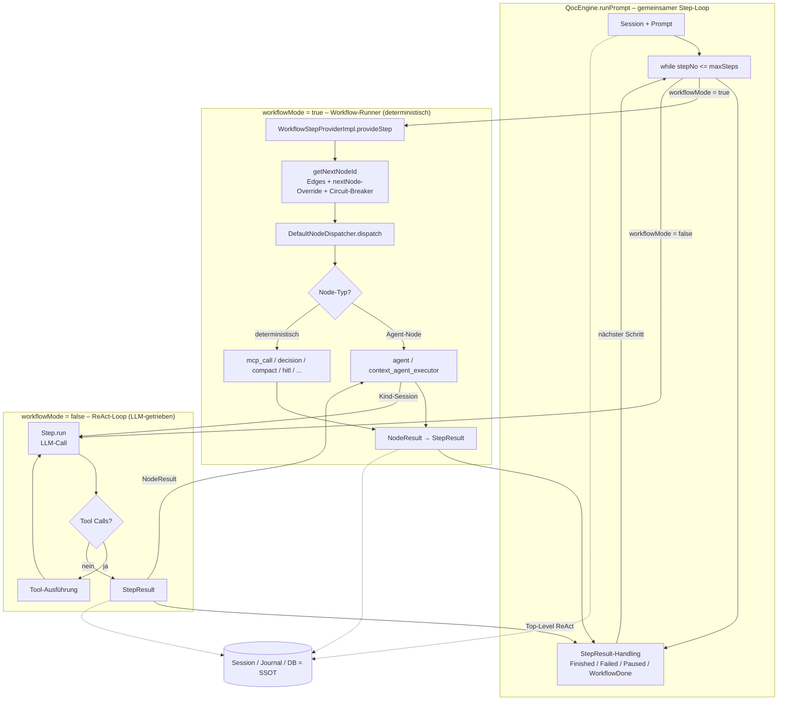

# QocEngine Loop – parallele isomorphe Nutzung

> **Zweck:** Schnelle Übersicht, wie derselbe `QocEngine.runPrompt`-Loop und derselbe `StepResult`-Vertrag einmal als **deterministischer Workflow-Runner** und einmal als **LLM-getriebener ReAct-Loop** verwendet werden.

## Legende

- **Durchgezogene Pfeile:** Steuerfluss.
- **Gestrichelte Pfeile:** gemeinsame Persistenz (Session, Journal, DB als Single Source of Truth).
- **Äußerer Loop:** `QocEngine.runPrompt` mit `workflowMode = true`; navigiert deterministisch über Nodes.
- **Innerer Loop:** `QocEngine.runPrompt` mit `workflowMode = false`; läuft pro Agent-Node in einer Kind-Session und führt LLM + Tool-Calls aus.
- **Isomorph:** Beide Loops liefern denselben `StepResult`-Vertrag (`Finished`, `Failed`, `Paused`, `WorkflowDone`, `ToolCallOutcome`). Der Workflow-Loop entscheidet über Nodes, der ReAct-Loop über LLM-/Tool-Schritte.
- **Zwei Sichten, ein Zustand:** `WorkflowContext` (Node-Outputs, Workflow-State) und der Agent-Kontext (`Prepared`, History, Tools) sind Projektionen derselben Session-/Journal-Persistenz.

## Kurz gesagt

Der Workflow-Runner ist der **äußere deterministische Loop**; jeder Agent-Node startet darin denselben QocEngine-Loop erneut als **inneren ReAct-Loop**. Dadurch bleiben Ausführung, Kontext und Persistenz strukturell gleich – nur die Entscheidungsquelle unterscheidet sich: Graph-Navigation vs. LLM/Tool-Calls.