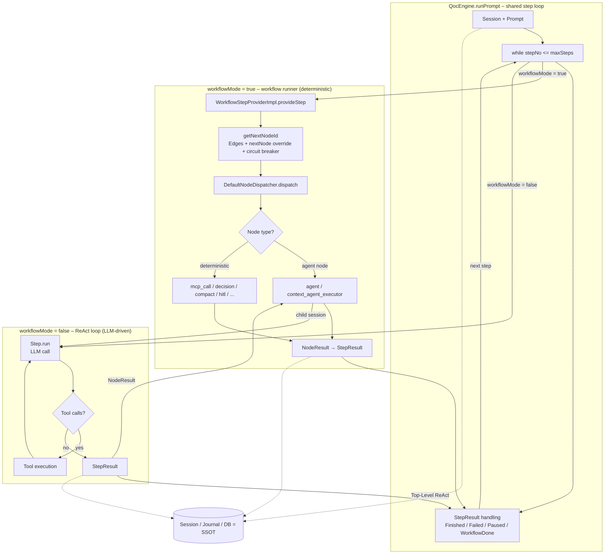

# QocEngine Loop – parallel isomorphic usage

> **Purpose:** Quick overview of how the same `QocEngine.runPrompt` loop and the same `StepResult` contract are used once as a **deterministic workflow runner** and once as an **LLM-driven ReAct loop**.

## Legend

- **Solid arrows:** control flow.
- **Dashed arrows:** shared persistence (session, journal, DB as single source of truth).
- **Outer loop:** `QocEngine.runPrompt` with `workflowMode = true`; navigates deterministically across nodes.
- **Inner loop:** `QocEngine.runPrompt` with `workflowMode = false`; runs per agent node in a child session and executes LLM + tool calls.
- **Isomorphic:** Both loops deliver the same `StepResult` contract (`Finished`, `Failed`, `Paused`, `WorkflowDone`, `ToolCallOutcome`). The workflow loop decides over nodes; the ReAct loop over LLM/tool steps.
- **Two views, one state:** `WorkflowContext` (node outputs, workflow state) and the agent context (`Prepared`, history, tools) are projections of the same session/journal persistence.

## In short

The workflow runner is the **outer deterministic loop**; each agent node starts the same QocEngine loop again within it as an **inner ReAct loop**. This keeps execution, context, and persistence structurally identical – only the decision source differs: graph navigation vs. LLM/tool calls.
