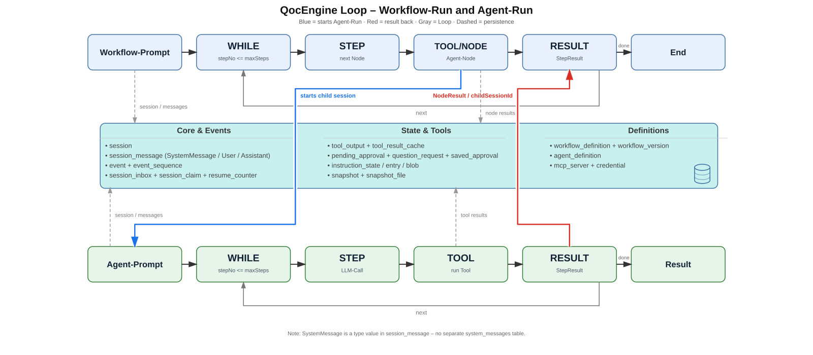

# QocEngine Loop – parallele isomorphe Nutzung

> **Zweck:** Derselbe `QocEngine.runPrompt`-Loop und derselbe `StepResult`-Vertrag – einmal als **deterministischer Workflow-Run**, einmal als **LLM-getriebener Agent-Run**.

> **Hinweis:** Das SVG ist die maßgebliche Darstellung. Der frühere Mermaid-Entwurf ist entfernt, weil Mermaid keine festen Positionen erlaubt. Der Workflow-Run läuft oben; der Agent-Run wird aus dem Agent-Node (`W4`) gestartet und liefert sein Ergebnis über `childSessionId` an `W5` zurück.

## Kann man in Mermaid Positionen angeben?

**Nein** – Mermaid unterstützt keine absoluten Koordinaten für Nodes. Man kann die Anordnung nur indirekt beeinflussen:

- `direction TB` / `LR` pro Graph und Subgraph
- Reihenfolge der Deklaration
- Gruppierung in Subgraphs
- unsichtbare Kanten (`~~~`) für erzwungene Reihenfolgen
- `linkStyle` nur für Linien, nicht für Positionen

Für exakte Positionen braucht man ein anderes Werkzeug:

- **Graphviz DOT** mit `neato -n` und `pos`-Attributen
- **draw.io**, **Excalidraw** oder **tldraw** (manuelles Layout)
- **Mermaid + ELK** (`%%{init: {"layout": "elk"}}%%`) für bessere Automatik, aber weiterhin ohne feste Koordinaten

## Die identische Logik

| Phase | Workflow-Run | Agent-Run |
|---|---|---|
| **WHILE** | `stepNo <= maxSteps` | `stepNo <= maxSteps` |
| **STEP** | nächste Node bestimmen | LLM-Call |
| **TOOL** | Node ausführen (agent, mcp_call, decision, …) | Tool ausführen |
| **RESULT** | `StepResult` | `StepResult` |
| **Selbst-Link** | `RESULT → WHILE` | `RESULT → WHILE` |
| **Ende** | `WorkflowDone` | `Finished` |

## Was ist die „Kind-Session“?

Die Kind-Session ist die Session des Agent-Nodes. Sie wird mit `engine.createSession(...)` erzeugt und enthält:

- einen eigenen `WHILE`-Loop,
- eine eigene `session_message`-History (User-/Assistant-/Tool-Nachrichten),
- eigene `event`-Einträge (`Step*`, `Tool*`, `Execution*`),
- ein eigenes Ergebnis, das als `NodeResult` an den Workflow-Node zurückgeht.

Die Verknüpfung steht im Workflow-Journal:

| Von | Nach | Feld |
|---|---|---|
| Workflow-Node | Agent-Run | `WorkflowNodeCompleted.childSessionId` |
| Workflow-Run | Workflow-Session | `session.id = runId` |
| Agent-Run | Agent-Session | `session.id = childSessionId` |

## Wichtige Tabellen (Dual-Use)

> **Legende:** „ja“ = wird direkt in diesem Loop verwendet; „indirekt“ = über den verschachtelten Agent-/Tool-Run; „nein“ = nicht in diesem Loop.

| Tabelle | Inhalt | Workflow-Run | Agent-Run | Hinweis |
|---|---|---|---|---|
| `session` | Session-Kopf | **ja** | **ja** | `runId` vs. `childSessionId` |
| `session_message` | Konversation (`id`, `session_id`, `seq`, `type`, `data`, `parent_id`) | **ja** | **ja** | Workflow: Prompt + Node-Output als `AssistantMessage`; Agent: komplette Turns inkl. Tool-Cards. `SystemMessage` ist ein `type`-Wert, keine eigene Tabelle. |
| `event` | Event-Journal (`aggregate_id`, `seq`, `type`, `data`) | **ja** | **ja** | Workflow: `WorkflowRun*` / `WorkflowNode*`; Agent-Run: `Step*` / `Tool*` / `Execution*` |
| `event_sequence` | Sequenzzähler pro `aggregate_id` | **ja** | **ja** | |
| `session_claim` | aktiver Ausführungs-Claim | **ja** | **ja** | verhindert parallele Runs |
| `resume_counter` | Resume-Versuche | **ja** | **ja** | |
| `session_inbox` | Steering-/Queue-Nachrichten | **ja** | **ja** | |
| `pending_approval` | HITL-Freigaben | indirekt | **ja** | Workflow-HITL pausiert; Agent-Tools erzeugen Approvals |
| `question_request` | Rückfragen an Menschen | indirekt | **ja** | |
| `saved_approval` | gespeicherte Freigabe-Regeln | indirekt | **ja** | projektbezogene Approval-Regeln |
| `tool_output` | Tool-Artefakte | nein | **ja** | `mcp_call` nutzt MCP direkt, nicht den `ToolOutputStore` |
| `tool_result_cache` | Idempotenz-Cache | nein | **ja** | |
| `instruction_state` | Instruktions-State | nein | **ja** | `workflowMode` ruft keinen `ContextBuilder` pro Step auf |
| `instruction_entry` | Instruktionswerte | nein | **ja** | |
| `instruction_blob` | Instruktions-Blobs | nein | **ja** | |
| `snapshot` | Datei-Snapshots | nein | **ja** | Tool-Runs / Revert |
| `snapshot_file` | Snapshot-Dateien | nein | **ja** | |
| `workflow_definition` | Workflow-Spec (SSOT) | **ja** | nein | |
| `workflow_version` | Workflow-Versionen | **ja** | nein | |
| `agent_definition` | Agent-Spec (DB) | **ja** | **ja** | Workflow-Node referenziert, Agent-Run führt aus |
| `mcp_server` | MCP-Server-Config | **ja** | **ja** | `mcp_call` und MCP-Tools |
| `credential` | MCP-/Integrations-Credentials | **ja** | **ja** | OAuth/Secrets für MCP |

> **Hinweis:** Es gibt keine separate Tabelle `system_messages`. Systemnachrichten liegen in `session_message` mit `type = 'SystemMessage'`. Die kombinierten Tabellen-Knoten im Mittelband bündeln Tabellen gleicher Rolle; alle genannten Tabellen sind enthalten.

## Kernaussage

Es gibt **keine eigene Workflow-Run-Tabelle**. Der Workflow-Zustand wird aus `event` replayed (`WorkflowRunJournal`). Workflow-Run und Agent-Run sind beides normale Sessions; getrennt werden sie nur durch `session_id` bzw. `aggregate_id`. Dadurch sind `session_message`, `event` und die Session-Tabellen echte Dual-Use-Tabellen.