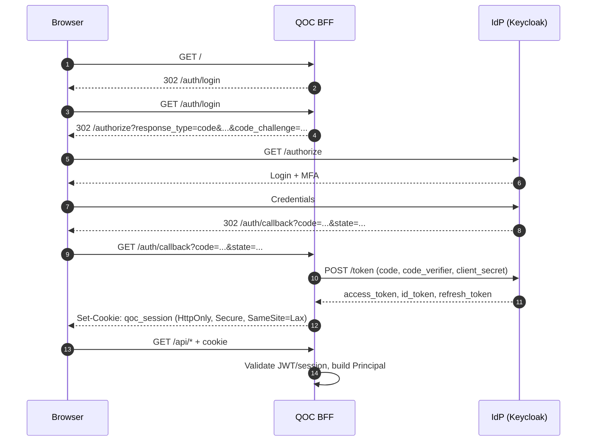

# security.md – QOC Production Security

> **Status:** Specification · 2026-11-04
> **Target:** `de.augmentia.oc.engine` (Java 21 / Quarkus)
> **Companion:** `docs/guides/OS-based-security.md`,
> `docs/spec/permissions/*`,
> `docs/spec/betrieb/*`,
> `docs/webhook.md`

---

## 1. Purpose

This document describes the security model of QOC and the production-ready
features that must be enabled for a secure deployment.

Authentication is **optional**. If no authentication is configured, QOC grants
all rights to every caller. This is intentional for local development and
trusted environments, but it is **not** a production configuration.

---

## 2. Security model

### 2.1 Core principles

1. **Defense in depth.** OS permissions, engine policy, tool boundaries and
   transport security are separate layers.
2. **Fail closed for sensitive actions.** Permission checks deny by default.
3. **No sandbox claim.** QOC does not sandbox the agent. Permissions are a
   usability and policy feature, not a security boundary.
4. **Least privilege.** Tools, agents and users receive only the rights they
   need.
5. **Explicit identity.** Every production action should be attributable to a
   user, agent or service identity.
6. **Auditable decisions.** Permission, tool and guardrail decisions are
   observable.

### 2.2 Authentication modes

| Mode | Description | Production use |
|---|---|---|
| `none` | No authentication; all callers are treated as `anonymous` | Development only |
| `basic` | HTTP Basic Auth with username `opencode` | Small trusted deployments |
| `oidc` | OpenID Connect via Keycloak or another IdP | Recommended for multi-user |
| `proxy` | Trusted reverse proxy sets identity headers | Enterprise SSO integration |
| `mcp-oauth` | OAuth 2.1 for MCP clients | MCP server mode |

If authentication is disabled, QOC behaves as if every caller is treated as
`anonymous` unless Basic Auth is configured.

> The end-to-end OAuth target (user → QOC → MCP server), including the local
> Keycloak definition and cloud transfer, is described in §9.

---

## 3. Optional Keycloak integration

Keycloak can run separately, for example in Docker on port `8180`.

> For the reproducible local realm, clients, scopes, token exchange, and the
> MCP target, see §9.5.

```bash
docker run -d \
  --name keycloak \
  -p 8180:8080 \
  -e KEYCLOAK_ADMIN=admin \
  -e KEYCLOAK_ADMIN_PASSWORD=admin \
  quay.io/keycloak/keycloak:latest \
  start-dev
```

QOC can optionally use Keycloak as an OIDC provider.

Example configuration:

```json
{
  "security": {
    "mode": "oidc",
    "oidc": {
      "issuer": "http://localhost:8180/realms/qoc",
      "clientId": "qoc-engine",
      "clientSecret": "${QOC_OIDC_CLIENT_SECRET}",
      "scopes": ["openid", "profile", "email", "qoc:agent:run"]
    }
  }
}
```

When OIDC is enabled:

- QOC validates the ID/access token (JWKS + issuer + audience).
- Claims are mapped to the QOC `Principal` (`sub`/`preferred_username` -> id/name, `groups`/`roles` -> roles/groups).
- The token subject becomes the QOC principal.
- Sessions are owned by the principal.
- Permissions and guardrails can be user- and role-aware.

When OIDC is disabled, QOC falls back to `none` or `basic` mode.

---

## 4. Production-ready security features

### 4.1 Transport security

- TLS terminates at Nginx or another reverse proxy.
- HTTP is redirected to HTTPS.
- The engine listens on loopback only (`127.0.0.1`).
- Large request bodies are limited by Nginx (`client_max_body_size`).
- Long-running requests use extended read timeouts.

### 4.2 Authentication

- Basic Auth is available for simple deployments.
- OIDC/Keycloak is available for multi-user deployments.
- Trusted proxy headers are supported only from configured CIDRs.
- MCP clients use OAuth 2.1 when MCP server mode is enabled.
- Local development may disable authentication.

#### 4.2.1 Trusted Proxy
When `security.mode = "proxy"`:

```json
{
  "security": {
    "mode": "proxy",
    "trustedProxies": ["10.0.0.0/8", "192.168.0.0/16", "172.16.0.0/12"]
  }
}
```

- Header-based identity (`X-Forwarded-User`, `X-Remote-User`, `Remote-User`, `X-Forwarded-Groups`, `X-Forwarded-Email`) is **only** read from requests whose client IP matches `trustedProxies` (CIDR or exact IP).
- `X-Forwarded-For` is inspected to determine the original client IP; trust is evaluated against configured ranges.
- If the request does not come from a trusted proxy, proxy headers are ignored.
- A `Principal` is created and stored in the request-scoped `PrincipalContext`.

#### 4.2.2 OIDC
When `security.mode = "oidc"`:

- Bearer tokens are validated against the configured issuer/JWKS.
- Issuer and audience must match.
- Clock skew is applied.
- Claims are mapped to `Principal` (id/name/roles/groups).
- Token validation failures result in `401 Unauthorized`.

### 4.3 Authorization

- Rule-based permission chain.
- `deny` overrides saved approvals.
- `ask` dominates `allow`.
- No matching rule means `ask`.
- Empty rule set means deny all.
- Agent-specific rules.
- Session-specific rules.
- Policy rules can deny tool use even when normal rules allow it.
- Permission hooks may change effect and message.

### 4.4 Tool security

- Tool snapshots are frozen per request.
- Tool names are resolved in the snapshot, not in the live registry.
- Agent-specific `tools.allow` and `tools.deny`.
- MCP tools are namespaced.
- Tool output is bounded and spilled to artifacts.
- Tool calls are logged as events.
- Tool execution has timeouts.

### 4.5 Filesystem security

- Workspace boundary via `FileAccess`.
- `external_directory` permission for paths outside the workspace.
- Read/write distinction.
- Artifact URI resolution.
- OS-level ownership and permissions.

### 4.6 Shell security

- Command scanning before execution.
- Subcommand extraction.
- Directory extraction from commands.
- HITL approval for dangerous commands.
- Background process registry.
- Process timeouts.
- OS-level process isolation.

### 4.7 Session security

- Sessions are identified by opaque IDs.
- **Session ownership**: Sessions are associated with the authenticated principal (or `anonymous` in dev mode). Cross-owner access is denied.
- **Claim-based execution**: Only the session owner can claim/run an active session; concurrent runs are prevented.
- **Recovery**: Orphaned tool calls are failed/marked `ORPHANED` on restart (at-least-once, never exactly-once).
- Approvals can have deadlines.
- Idle and suspended states are tracked.
- Identity is propagated via `PrincipalContext` and mirrored into `ToolContext.metadata()` for auditability.

### 4.8 MCP security

- MCP servers are namespaced.
- Remote MCP uses HTTP transport.
- OAuth 2.1 is supported for remote MCP clients.
- Tokens are stored per integration.
- Local MCP servers run as child processes.
- MCP resources are read-only.
- MCP tool calls go through the normal tool chain.

#### 4.8a A2A client and server

- **Client auth**: remote A2A agents can be protected. Configure `auth=bearer:<token>`, `auth=basic:<user>:<password>` or `headers=K:V,...` in `engine.a2a.endpoints`. Headers are applied to both card fetch and JSON-RPC calls and are part of the cache key.
- **Client egress**: A2A endpoints are checked by `A2AEgress` against optional `allowedHosts`/`allowedIps`/`tlsRequired` (per-endpoint or global `engine.a2a.egress.*`). Blocked endpoints are skipped at registration and reported as `error` in discovery. Transport-level enforcement via custom HTTP client is a future improvement.
- **Discovery**: `GET /api/a2a/agents` and `POST /api/a2a/agents/refresh` use the same authentication as the rest of `/api` (Basic, trusted proxy or OIDC). They expose only name, description, version, protocol version, skills, tool name and fetch status; no credentials or internal paths. Agent cards are cached (`engine.a2a.cache.ttl-seconds`, default 300, `0` disables). Failures are not cached.
- **Server opt-in**: `engine.a2a.server.enabled=false` by default. While disabled, `/.well-known/agent-card.json`, tenant cards and `POST /` return `404`; the agent is not discoverable.
- **Public URL**: `engine.a2a.server.base-url` must match the externally reachable URL. It is published in the agent card and used by clients for JSON-RPC calls.
- **Authentication**: the A2A transport uses Vert.x routes, not JAX-RS. `A2AAuthenticationMechanism` supplies a Quarkus identity for these routes: `none` for local mode, HTTP Basic against `engine.auth.password`, or trusted-proxy headers from configured CIDRs. In `oidc` mode the Quarkus OIDC extension performs authentication.
- **Authorization**: `A2ATaskAuthorizationProvider` is fail-closed. Task reads/writes are restricted to the creating principal; `none` mode is intentionally single-user. Missing or anonymous identities are rejected when authentication is required.
- **Task isolation**: every A2A context (or task without a context) maps to its own QOC session. The session then runs through the regular permission, guardrail and audit pipeline, so A2A does not bypass QOC controls.
- **Agent card**: contains only name, description, version, capabilities and skills; no secrets, tokens or internal paths.
- **Limits**: executor pool, blocking-agent timeout and task store retention come from the A2A SDK configuration (`a2a.*`). Keep them bounded in production.

### 4.9 Guardrails

- Declarative guardrails in `settings.json`.
- Java SPI guardrails via CDI.
- Optional external webhook guardrails (see §4.9a).
- Pre-hooks may block or rewrite.
- Post-hooks may redact or replace.
- Permission hooks may change effect and message.
- Hooks are ordered and fail closed where appropriate.

#### 4.9a External webhook guardrails

- **Service**: External provider `qoc/webhook-guardrail/` (Quarkus) implementing the contract in [`docs/webhook.md`](webhook.md).
- **Activation**: `disabled` / `enabled` / `shadow`. QOC works normally when disabled. A webhook is only active if `guardrails.webhook.enabled = true` and `url` is set.
- **Events**: `tool.before`, `tool.after`, `permission.evaluate`.
- **PII**: Optional PII detection/redaction handled by the webhook service (categories: `email`, `phone`, `credit_card`, `iban`, `national_id`, `address`, `name`, `secret`). Categories are fixed. QOC transports and receives redacted results.
- **Security**: HTTPS required in production, HMAC-SHA256 signatures (`X-QOC-Signature`, `X-QOC-Timestamp`), optional bearer/mTLS, host allowlists, size limits.
- **Fail modes**: `closed-before-open-after` (default), `closed`, `open`, `shadow`. Timeouts apply per fail mode.
- **Idempotency**: Requests include `eventId` and `idempotencyKey`; decisions are not cached.
- **Chaining**: Multiple webhooks execute in order; the first `block`/`deny` stops the chain and redactions compose.
- **Logging**: Redacted audit logs, no secrets/PII in logs by default. Correlation via trace/session/event/idempotency keys.
- **Data minimization**: Only required data sent; large payloads can use `payloadMode: metadata-only` for `tool.after`.

#### 4.9b Webhook integration in QOC

- **Configuration**: Parsed by `EngineConfig.WebhookConfig` from `guardrails.webhook` (or `guardrails.webhooks[0]` for compatibility). Disabled if missing/invalid.
- **Registry**: `de.augmentia.oc.engine.guardrail.GuardrailRegistry` provides the active webhook config.
- **Client**: `de.augmentia.oc.engine.guardrail.WebhookClient` signs outgoing requests with HMAC-SHA256 when `authType = hmac-sha256` and signs with `X-QOC-Timestamp`, `X-QOC-Signature`, `X-QOC-Event`, `X-QOC-Event-Id`, `X-QOC-Idempotency-Key`.
- **Secret resolution**: `secretRef` resolved via environment variables (direct or uppercased/normalized). Secrets never stored in `settings.json`.
- **Egress protection**: Only `allowedHosts` (and planned `allowedIps`) should be contacted. TLS and hostname verification required in production.
- **Wiring**: Webhook hooks are applied in order `tool.before` -> execute -> `tool.after` and `permission.evaluate`, combined with built-in/declarative/SPI guardrails. Decisions follow fail modes on timeout/error/network failure.
- **No caching**: Every event is evaluated when it occurs.

### 4.10 Secrets and credentials

- Secrets come from environment variables.
- `settings.json` must not contain secrets.
- Webhook secrets are referenced via `secretRef` and resolved from the environment (e.g. `QOC_WEBHOOK_SECRET` or named env vars). Never log secrets.
- Credentials are stored in the database.
- MCP OAuth tokens should be encrypted at rest.
- Basic Auth passwords are configured via environment.
- API keys are never logged.
- Webhook request/response bodies are redacted in logs; only metadata is logged by default.

### 4.11 Observability and audit

- OpenTelemetry spans for prompts, steps and tools.
- Structured logs for permission decisions.
- Guardrail decision logging (webhook + SPI + declarative), redacted.
- Cost and token tracking.
- Session history and event replay.
- Error classification.
- `/api/metrics` and `/api/audit` are available for monitoring; auth requirements follow the configured auth mode but should remain reachable for health/monitoring where appropriate.
- Correlation via `traceId`, `spanId`, `sessionId`, `eventId`, `idempotencyKey`.

### 4.12 Backup and recovery

- SQLite/PostgreSQL persistence.
- Append-only event journal.
- Claim-based recovery.
- Flyway migrations.
- Snapshot/revert support.
- Retention policies.

---

## 5. Optional OS access rights and roles

This section is optional. It describes how OS-level access rights can be used
in addition to QOC's engine-level security.

### 5.1 Dedicated OS user

QOC should run as a dedicated `qoc` user:

```bash
useradd --system --home /var/lib/qoc --shell /usr/sbin/nologin qoc
```

Properties:

- no login shell,
- owns only engine data,
- cannot access other users' files,
- process isolation via systemd.

### 5.2 Directory model

```text
/var/lib/qoc/
├── data/                  # SQLite DB, snapshots, tool output
├── workspaces/            # project directories
├── log/                   # log files
└── plans/        # plan files
```

Permissions:

- `data/`: `700`, qoc only
- `workspaces/`: `750`, qoc + group
- `log/`: `750`, qoc + group

### 5.3 OS groups for roles

OS groups can represent coarse roles:

| Group | Purpose |
|---|---|
| `qoc` | Engine process owner |
| `qoc-admin` | Operators with read access to logs/config |
| `qoc-developer` | Developers with workspace access |
| `qoc-guest` | Read-only workspace access |

Example:

```bash
groupadd qoc-admin
groupadd qoc-developer
groupadd qoc-guest

usermod -aG qoc-admin torsten
usermod -aG qoc-developer torsten
```

### 5.4 Filesystem ACLs

ACLs can grant fine-grained access without changing ownership:

```bash
setfacl -m u:torsten:rx /var/lib/qoc/workspaces/project-a
setfacl -m g:qoc-developer:rx /var/lib/qoc/workspaces/project-a
setfacl -m u:torsten:r /var/lib/qoc/log/qoc.log
```

Use ACLs for:

- operator log access,
- developer workspace access,
- read-only guest access,
- backup user access.

### 5.5 systemd hardening

```ini
NoNewPrivileges=true
ProtectSystem=strict
ReadWritePaths=/var/lib/qoc
PrivateTmp=true
User=qoc
Group=qoc
```

This prevents privilege escalation and restricts writes.

### 5.6 SELinux / AppArmor (optional)

On hardened systems, use SELinux or AppArmor profiles to restrict:

- network access,
- file access,
- process execution,
- capability use.

This is optional but recommended for high-security environments.

### 5.7 OS roles vs. application roles

OS roles and application roles are separate:

| Layer | Example |
|---|---|
| OS | `qoc-developer` can read workspace files |
| Application | `developer` agent can use `read`, `write`, `edit` |
| Application | `researcher` agent can use `read`, `websearch` |

OS roles protect the host. Application roles protect the agent. Both are needed.

---

## 6. Threat model

### 6.1 In scope

- unauthorized access to the engine,
- session hijacking,
- tool misuse,
- secret leakage,
- filesystem escape,
- shell abuse,
- MCP token theft,
- PII leakage,
- denial of service.

### 6.2 Out of scope

- physical access to the host,
- compromised OS kernel,
- malicious root user,
- side-channel attacks at hardware level.

---

## 7. Non-goals

- QOC does not sandbox the agent.
- QOC does not provide multi-tenant isolation beyond OS and engine policy.
- QOC does not guarantee exactly-once execution.
- QOC does not replace a WAF or network firewall.
- QOC does not provide its own user directory; use Keycloak or another IdP.

---

## 8. Configuration examples

### 8.1 Development (no auth)

```json
{
  "auth": {
    "password": ""
  }
}
```

All callers are treated as `anonymous` with all rights.

### 8.2 Basic Auth

```json
{
  "auth": {
    "password": "change-me"
  }
}
```

### 8.3 Keycloak (OIDC)

```json
{
  "security": {
    "mode": "oidc",
    "oidc": {
      "issuer": "http://localhost:8180/realms/qoc",
      "clientId": "qoc-engine",
      "clientSecret": "${QOC_OIDC_CLIENT_SECRET}",
      "scopes": ["openid", "profile", "email", "qoc:agent:run"]
    }
  }
}
```

### 8.4 Trusted Proxy

```json
{
  "security": {
    "mode": "proxy",
    "trustedProxies": ["127.0.0.1", "::1", "10.0.0.0/8"]
  }
}
```

### 8.5 Hardened production

```json
{
  "auth": {
    "password": "${OPENCODE_SERVER_PASSWORD}"
  },
  "security": {
    "mode": "oidc",
    "oidc": {
      "issuer": "https://idp.example/realms/qoc",
      "clientId": "qoc-engine",
      "clientSecret": "${QOC_OIDC_CLIENT_SECRET}"
    },
    "mcp": {
      "server": {
        "oauth": {
          "enabled": true
        }
      }
    }
  },
  "guardrails": {
    "enabled": true,
    "webhook": {
      "enabled": true,
      "mode": "enforce",
      "url": "https://guardrail.example/qoc/guardrail",
      "timeoutMs": 1500,
      "failMode": "closed-before-open-after",
      "maxPayloadBytes": 65536,
      "payloadMode": "metadata-only",
      "pii": {
        "enabled": true,
        "defaultMode": "redact",
        "categories": {
          "email": "redact",
          "phone": "redact",
          "credit_card": "block",
          "secret": "block"
        },
        "minConfidence": 0.8
      },
      "security": {
        "tlsRequired": true,
        "authType": "hmac-sha256",
        "secretRef": "qoc-webhook-secret",
        "allowedHosts": ["guardrail.example"],
        "verifyHostname": true,
        "clockSkewSeconds": 60
      },
      "logging": {
        "enabled": true,
        "logRequests": true,
        "logResponses": "redacted",
        "logPii": false,
        "retentionDays": 30
      }
    }
  }
}
```

---

## 9. OAuth end-to-end: current state and target (User → QOC → MCP)

> **Status:** 2026-11-04. This section is the authoritative target for user
> authentication and MCP authorization. It supplements, not replaces, the
> controls in §4.

### 9.1 Scope

This chapter covers:

1. Browser user login to QOC.
2. QOC API authentication and authorization.
3. QOC as an OAuth client to remote MCP servers (user-delegated).
4. QOC as an OAuth resource server for MCP clients.
5. Local Keycloak definition and transfer to GCP/AWS.

Out of scope: IdP administration, MFA policy, user lifecycle, tenant
isolation.

### 9.2 Actors and trust boundaries

| Actor | Trust boundary | Credential |
|---|---|---|
| User / browser | Untrusted | OIDC session or short-lived access token |
| QOC UI / API | Confidential client | Session cookie or Bearer token |
| QOC engine | Resource server + OAuth client | Token validation + client credentials |
| IdP (Keycloak) | Trust anchor | Realm keys, client secrets |
| MCP server | Resource server | Access token with `aud=mcp-server` |

Rules:

- The browser never sees client secrets.
- QOC never uses a service token for user-initiated actions.
- The MCP server trusts only tokens signed by the IdP, never QOC headers.
- Tokens are audience-scoped. A token for QOC is not valid for MCP.

### 9.3 Current state (as of 2026-11-04)

#### 9.3.1 Authentication modes

| Mode | Implementation | Notes |
|---|---|---|
| `none` | `Principal.localAdmin()` (id `local`, role `admin`) | Local development without login |
| `basic` | `BasicAuthFilter`, username `opencode` | Shared password |
| `oidc` | Quarkus OIDC + `OidcPrincipalProducer` | Bearer validation; UI uses Authorization Code + PKCE |
| `proxy` | `TrustedProxyFilter` | Only `X-Forwarded-User`, `X-Remote-User`, `Remote-User`; GCP/AWS headers missing |
| `mcp-oauth` | `McpServerResource` + `SecurityConfig` | Partial; `/mcp/authorize` and `/mcp/callback` return `501` |

#### 9.3.2 UI login

- `index.html` uses **Authorization Code + PKCE (S256)** against Keycloak or
  Auth0 (OIDC discovery, issuer/audience via `/config.js` or `localStorage`).
- The UI starts in **OIDC-free mode** by default: no issuer, no login button,
  no discovery request. OIDC is enabled explicitly via `qoc.oidcEnabled`.
- State and verifier are kept in `sessionStorage`; access and refresh tokens
  are kept in `sessionStorage` and are cleared when the tab closes.
- The Bearer token is attached to all `/api/*` calls. A `401` triggers one
  refresh-token attempt; if that fails, the session is cleared.
- Login and logout redirect to the IdP authorization/logout endpoints
  (discovered via `.well-known/openid-configuration`).
- `EventSource` cannot send an `Authorization` header, so the UI reads
  `/api/event` with `fetch` and parses the SSE stream itself.
- Auth0 setup: `deploy/gcp-vm/gcp-auth0.sh`, `deploy/gcp-vm/gcp-auth0.env.example`,
  `deploy/gcp-vm/vm.md` §Auth0.
- Local setup: `deploy/keycloak/docker-compose.yml`,
  `deploy/keycloak/setup-keycloak.sh`, `deploy/start-oidc.sh`, and
  `deploy/keycloak/README.md`.
- Remaining gap: tokens live in `sessionStorage` (XSS-exposed) because the BFF
  session is not implemented yet. ROPC is only enabled on the separate
  `qoc-cli` client for local automation.

Historical note: the old local Keycloak setup (see `deploy/keycloak/README.md`) used `redirectUris=["*"]` and
direct access grants. It is superseded by `deploy/keycloak/` and must not be
used.

#### 9.3.3 API authentication

- Quarkus OIDC validates the Bearer token when `quarkus.oidc.enabled=true`.
- `OidcPrincipalProducer` maps `sub`, `preferred_username`/`name`/`nickname`/
  `email`, `realm_access.roles`, `roles`, `role`, `permissions`, `groups` (and
  namespaced Auth0 claims `*/roles`, `*/role`, `*/groups`) to `Principal`.
- `BasicAuthFilter` rejects requests in `oidc`/`proxy`/`mcp-oauth` mode when
  no principal is set.
- `HttpApi.isOwner()` is now implemented (directory-based per-user isolation).
- Audience is configured via `QUARKUS_OIDC_TOKEN_AUDIENCE` (the local OIDC
  overlay uses `qoc-engine`; the application default is `account`).
- Roles are captured and mapped, but not yet enforced by the permission engine
  (roles are available in `Principal.roles()` for A2A and future enforcement).

#### 9.3.4 QOC as MCP client (QOC → external MCP)

- `McpServerConfig.Remote` has an `oauth` flag, but `McpServerManager` does
  not consume it: every remote server is handled by `McpDiscoveryClient`, and
  authentication is triggered manually through
  `/api/mcp/{server}/authorize` and `/api/mcp/{server}/callback`.
- `McpDiscoveryClient` supports metadata discovery, authorization URL, code
  exchange, refresh, and `Authorization: Bearer`.
- `authorizationUrl` passes `null` for `code_challenge`, and
  `Engine.mcpAuthenticate` passes no `code_verifier`. PKCE, which MCP
  authorization requires, is therefore not implemented.
- `McpOAuth.discover` now uses `GET` for
  `/.well-known/oauth-authorization-server` (RFC 8414). `ScriptedHttp` supports
  both methods.
- Tokens are stored in the `credential` table under integration
  `mcp:<server>`.
- **The credential is global, not per user.** The schema has
  `unique (integration) where active`, so only one active token per server
  exists.
- **Metadata is not persisted** by `SqlCredentials`/`SqliteCredentials`; the
  `refreshToken` and `expires` values from `McpOAuth` are discarded. Refresh
  cannot work reliably with the SQL stores.
- Tokens are stored in plaintext; there is no encryption at rest.
- `Engine.mcpAuthorizationUrl` uses a fixed local callback
  `http://127.0.0.1:8080/api/mcp/<server>/callback`; there is no per-user
  state.
- There is no token exchange and no audience/scope binding to the user.

#### 9.3.5 QOC as MCP server (external MCP → QOC)

- `McpServerResource` exposes `/mcp` with `initialize`, `tools/list`, and
  `tools/call`.
- If `engine.mcp.server.oauth.enabled=true` or mode `mcp-oauth`, a
  `PrincipalContext` principal is required.
- `/mcp/authorize` and `/mcp/callback` return **`501 Not Implemented`**.
- `toolsCall` now resolves `user` from `principalContext` when a principal is
  present (falls back to `"opencode"`). The caller's identity is propagated
  to the session owner.
- There is no protected-resource metadata, no
  `WWW-Authenticate: Bearer resource_metadata=...`, and no scope/audience
  enforcement specific to `/mcp`.

#### 9.3.6 Identity propagation

- `PrincipalContext` is request-scoped and used by `HttpApi` for session
  ownership.
- `Principal.toMetadata()` exists, but `ToolContext` does not carry a
  principal.
- Webhook payloads include `principalId`/`principalName`
  (`GuardrailHooks`, `WebhookPermissionAuthorizer`).
- MCP client credentials are not keyed by principal.
- `McpServerResource.toolsCall` now propagates the principal to the session
  owner.
- Async tool execution can lose the request-scoped principal.

#### 9.3.7 Gap summary

| Area | Current | Target |
|---|---|---|
| UI login | Authorization Code + PKCE, tokens in `sessionStorage` | BFF session cookie, tokens server-side |
| API audience | `qoc-engine` (local setup); `account` default | `qoc-engine` |
| API scopes | Not enforced | `qoc-api` |
| MCP client token | Global per server | Per user, exchanged |
| MCP token storage | Plaintext, no metadata, no principal | Encrypted, per user, TTL |
| MCP server identity | Principal from `principalContext` (fallback `opencode`) | Principal from token |
| MCP server OAuth | `/authorize` and `/callback` return `501` | Protected-resource metadata + IdP |
| Token exchange | None | RFC 8693 |
| Proxy headers | `X-Forwarded-*` only | + GCP/AWS |
| `ToolContext` | No principal | Principal-aware |
| Roles | Mapped from Keycloak/Auth0, not enforced | Permission engine |
| Per-user isolation | Directory-based (`Engine.isOwner`) | Explicit `owner` field + DB migration |

### 9.4 Target architecture

#### 9.4.1 Principles

1. **Authorization Code + PKCE** for all browser logins.
2. **No password grant** in production. ROPC only for local CLI tests.
3. **Audience separation**: `qoc-engine` for the QOC API, `mcp-server` for
   MCP.
4. **User delegation**: QOC acts on behalf of the user, never with a shared
   service token, for user-initiated MCP calls.
5. **Short-lived tokens** and refresh rotation.
6. **Encrypted token storage** keyed by principal and server.
7. **Fail closed**: missing/invalid token → `401`; missing scope → `403`.
8. **Standard contracts**: OIDC, OAuth 2.1, PKCE, RFC 8693, RFC 8707,
   RFC 9728, RFC 8414.

#### 9.4.2 Flow A: User → QOC (login)

Recommended: **Backend-for-Frontend (BFF)**.



- QOC is a **confidential client** (`qoc-engine` or a dedicated `qoc-bff`).
- The UI never handles tokens; `localStorage` is not used.
- The session cookie is `HttpOnly`, `Secure`, and `SameSite=Lax` (or
  `Strict`), with CSRF protection for state-changing requests.
- Session store: in-memory for a single instance; DB/Redis for multi-instance.
- Logout: clear the session, revoke the refresh token, RP-initiated logout.

MVP alternative: SPA with Authorization Code + PKCE, access token in memory,
refresh token in `sessionStorage`/BFF. Not recommended for production.

#### 9.4.3 Flow B: QOC → MCP (token exchange)

Preferred: **RFC 8693 token exchange** at the IdP.

```mermaid
sequenceDiagram
    autonumber
    participant Q as QOC
    participant I as IdP (Keycloak)
    participant M as MCP Server
    Q->>I: POST /token (grant_type=token-exchange, subject_token=<user token>, audience=mcp-server, scope=mcp:tools)
    I-->>Q: access_token (aud=mcp-server, sub=<user>)
    Q->>M: POST /mcp Authorization: Bearer <token>
    M->>I: Fetch JWKS (cached)
    I-->>M: Signing keys
    M->>M: Validate iss, aud, exp, scope; authorize user
    M-->>Q: JSON-RPC result
```

- QOC uses the user's access token as `subject_token`.
- The exchanged token has `aud=mcp-server`, `sub=<user>`, and
  `scope=mcp:tools`.
- Cache the exchanged token until `exp - skew` (e.g., 60 seconds).
- If token exchange is unavailable, the fallback is pass-through **only if**
  the user token already contains `aud=mcp-server`. Never silently downgrade
  to a service token.
- For multiple MCP servers, exchange per audience/resource.

#### 9.4.4 Flow C: MCP client → QOC (QOC as resource server)

```mermaid
sequenceDiagram
    autonumber
    participant C as MCP Client
    participant Q as QOC /mcp
    participant I as IdP (Keycloak)
    C->>Q: POST /mcp (no token)
    Q-->>C: 401 WWW-Authenticate: Bearer resource_metadata="..."
    C->>Q: GET /.well-known/oauth-protected-resource
    Q-->>C: authorization_servers, scopes
    C->>I: OAuth 2.1 Authorization Code + PKCE
    I-->>C: access_token (aud=qoc-mcp, scope=mcp:run)
    C->>Q: POST /mcp Authorization: Bearer <token>
    Q->>I: Fetch JWKS (cached)
    I-->>Q: Signing keys
    Q->>Q: Validate iss, aud, exp, scope; Principal from sub; session owner
    Q-->>C: JSON-RPC result
```

- QOC exposes `/.well-known/oauth-protected-resource` (RFC 9728).
- QOC validates `iss`, `aud=qoc-mcp`, `exp`, signature, and `scope=mcp:run`.
- `sub` becomes the QOC `Principal` and the session owner.
- Remove the hardcoded `opencode` user.
- `/mcp/authorize` and `/mcp/callback` are not needed if the IdP handles the
  flow. Keep them only for dynamic client registration or a local test helper.
- Add per-user rate limits and audit.

#### 9.4.5 Token model

| Token | Audience | Scopes | Lifetime | Storage |
|---|---|---|---|---|
| User access (QOC) | `qoc-engine` | `openid profile email qoc-api` | 5 min | BFF session (server-side) |
| User refresh | `qoc-engine` | `offline_access` | 30 min sliding | BFF session (encrypted) |
| MCP access (exchanged) | `mcp-server` | `mcp:tools` | 5 min | QOC cache (encrypted) |
| QOC MCP access | `qoc-mcp` | `mcp:run` | 5 min | MCP client |
| Service access (background) | target | target | 5 min | QOC (client credentials) |

#### 9.4.6 Per-user credential storage

Target schema (new table or extended `credential`):

```sql
create table principal_credential (
  id                  text primary key,
  principal_id        text not null,
  server              text not null,
  kind                text not null,          -- oauth | api-key
  access_token_enc    text,
  refresh_token_enc   text,
  expires_at          timestamptz,
  scopes              text,
  created_at          timestamptz not null default now(),
  updated_at          timestamptz not null default now(),
  unique (principal_id, server, kind)
);
```

- Encrypt with AES-GCM; key from KMS/Secret Manager (envelope encryption).
- Never store tokens in `settings.json`, logs, or audit payloads.
- Redact `Authorization` and `Cookie` headers.
- Delete/revoke on logout and on user deletion.
- Retention: delete expired tokens; revoke refresh tokens on password change.

#### 9.4.7 Identity propagation

- Add `Principal` or `principalId` to `ToolContext` (or a `SecurityContext`
  passed alongside it).
- `McpDiscoveryClient` gets a `UserTokenProvider` that resolves the current
  principal's token; there is no global `mcp:<server>` credential for user
  calls.
- `Engine` passes the principal into async tool execution (do not rely on
  request-scoped CDI in background threads).
- The permission engine uses roles/groups from `Principal`.
- Webhook payload: add `roles`, `groups`, `tokenAudience`, and `tokenScope`.
- Audit: log `sub`, `aud`, `scope`, `client_id`, and `jti` (not the token).

### 9.5 Local Keycloak setup

#### 9.5.1 Components

| Component | Container | Host port | Notes |
|---|---|---|---|
| Keycloak | `keycloak-local` | 8180 | `start-dev --features=token-exchange` |
| QOC | `qoc-local` | 8071 | Erreicht Keycloak über `host.docker.internal:8180` |
| MCP test server | `mcp-echo` | 9000 | Optional; validates Bearer tokens |

Use a pinned Keycloak version (e.g., `quay.io/keycloak/keycloak:26.0`) and a
named volume. `start-dev` is for local use only.

#### 9.5.2 Start

```bash
cd qoc
./deploy/start-oidc.sh

# If the image is already built:
SKIP_BUILD=true ./deploy/start-oidc.sh
```

The script starts `deploy/keycloak/docker-compose.yml` (Keycloak 26.0 on
`http://localhost:8180`), runs the idempotent `setup-keycloak.sh`, builds the
QOC image with `QUARKUS_OIDC_ENABLED=true`, and starts `qoc-local` with
`deploy/docker-compose.oidc.yml` on `http://localhost:8071`.

> Docker resources: network `qoc-keycloak_default`, volume
> `qoc-keycloak-data`. The old `keycloak-local_default` network and
> `keycloak-local_keycloak-data` volume from the early `docker run` setup are
> not used.

> **Issuer and hostnames.** The browser must reach the authorization endpoint,
> so the issuer is the browser-visible `http://localhost:8180/realms/qoc`.
> QOC in Docker reaches Keycloak via `host.docker.internal:8180` (compose must
> add `extra_hosts: ["host.docker.internal:host-gateway"]`). Configure QOC with
> `QUARKUS_OIDC_AUTH_SERVER_URL=http://host.docker.internal:8180/realms/qoc`,
> `QUARKUS_OIDC_TOKEN_ISSUER=http://localhost:8180/realms/qoc`, and
> `QUARKUS_OIDC_JWKS_PATH=/protocol/openid-connect/certs`. If QOC runs on the
> host, both URLs can be `http://localhost:8180/...`.
>
> The old `KC_HOSTNAME=http://keycloak:8080` setup from `deploy/keycloak/README.md` is
> superseded. The current local setup uses `KC_HOSTNAME=http://localhost:8180`
> (`deploy/keycloak/docker-compose.yml`) so the browser and the container can
> use the same issuer via split-horizon resolution.

#### 9.5.3 Realm and clients

| Object | Type | Settings |
|---|---|---|
| `qoc` | Realm | Enabled |
| `qoc-ui` | Public client | Standard flow, PKCE S256, redirects `http://localhost:8070/*`, `http://localhost:8071/*`, `http://localhost:8073/*`; no direct grants |
| `qoc-cli` | Public client | Direct access grants only; local test tokens only |
| `qoc-engine` | Confidential client | Service account, token exchange; no direct grants |
| `mcp-server` | Bearer-only client | Resource server; audience for MCP tokens |
| `qoc-mcp` | Bearer-only client | Resource server for QOC `/mcp` |

Commands (using `kcadm.sh`):

> The idempotent implementation is `deploy/keycloak/setup-keycloak.sh`
> (invoked by `deploy/start-oidc.sh`). The commands below are the equivalent
> reference steps; the script is the source of truth for the local setup.

```bash
kc() { docker exec -i keycloak-local /opt/keycloak/bin/kcadm.sh "$@"; }
kc config credentials --server http://localhost:8080 --realm master \
  --user admin --password admin

kc create realms -s realm=qoc -s enabled=true

kc create roles -r qoc -s name=qoc-user
kc create roles -r qoc -s name=qoc-admin
kc create roles -r qoc -s name=mcp-user

kc create clients -r qoc \
  -s clientId=qoc-ui -s enabled=true -s publicClient=true \
  -s standardFlowEnabled=true -s directAccessGrantsEnabled=false \
  -s 'redirectUris=["http://localhost:8070/*","http://localhost:8071/*","http://localhost:8073/*"]' \
  -s 'webOrigins=["http://localhost:8070","http://localhost:8071","http://localhost:8073"]' \
  -s 'attributes={"pkce.code.challenge.method":"S256"}'

kc create clients -r qoc \
  -s clientId=qoc-cli -s enabled=true -s publicClient=true \
  -s standardFlowEnabled=false -s directAccessGrantsEnabled=true

kc create clients -r qoc \
  -s clientId=qoc-engine -s enabled=true -s publicClient=false \
  -s standardFlowEnabled=false -s serviceAccountsEnabled=true \
  -s directAccessGrantsEnabled=false \
  -s secret="$QOC_ENGINE_SECRET"

kc create clients -r qoc \
  -s clientId=mcp-server -s enabled=true -s publicClient=false \
  -s bearerOnly=true

kc create clients -r qoc \
  -s clientId=qoc-mcp -s enabled=true -s publicClient=false \
  -s bearerOnly=true
```

#### 9.5.4 Client scopes, audiences, mappers

| Scope | Audience | Included in |
|---|---|---|
| `qoc-api` | `qoc-engine` | Access token for the UI/BFF |
| `mcp-tools` | `mcp-server` | Exchanged MCP token |
| `qoc-mcp` | `qoc-mcp` | MCP client token for QOC |

Each scope uses an **Audience** mapper (`included.custom.audience`). Assign
`qoc-api` to `qoc-ui` and `qoc-cli`; assign `mcp-tools` to `mcp-server`;
assign `qoc-mcp` to `qoc-mcp`.

> In Keycloak, an audience mapper adds `aud` to the token. The target resource
> server must validate that `aud` value.
>
> The local bootstrap script attaches the `qoc-engine` audience mapper directly
> to `qoc-ui`/`qoc-cli` instead of creating `qoc-api`. The resulting `aud`
> claim is the same; the scope is the target for reuse in cloud/IaC setups.

#### 9.5.5 Users and roles

| User | Password (local) | Roles |
|---|---|---|
| `alice` | `alice-password` | `qoc-user`, `mcp-user` |
| `bob` | `bob-password` | `qoc-admin`, `mcp-user` |

```bash
for u in alice bob; do
  kc create users -r qoc -s username=$u -s enabled=true \
    -s email=$u@example.com -s firstName=${u^} -s lastName=QOC \
    -s emailVerified=true
  kc set-password -r qoc --username $u --new-password ${u}-password
done

kc add-roles -r qoc --uusername alice --rolename qoc-user
kc add-roles -r qoc --uusername alice --rolename mcp-user
kc add-roles -r qoc --uusername bob --rolename qoc-admin
kc add-roles -r qoc --uusername bob --rolename mcp-user
```

> Local passwords are examples only. Never commit real credentials.

#### 9.5.6 Token exchange permission

In the Keycloak Admin Console:

1. Clients → `qoc-engine` → Permissions → **Token exchange** → Enable.
2. Add a policy that allows `qoc-engine` to exchange to `mcp-server`
   (client policy) and, if needed, only for users with `mcp-user`.
3. Ensure `mcp-server` is an allowed audience.

Or via Admin REST (the exact payload depends on the Keycloak version). The
important invariant: `qoc-engine` may exchange **only** to `mcp-server`, not to
arbitrary audiences.

Test:

```bash
USER_TOKEN=$(curl -s -X POST \
  http://localhost:8180/realms/qoc/protocol/openid-connect/token \
  -H 'Content-Type: application/x-www-form-urlencoded' \
  -d 'grant_type=password&client_id=qoc-cli&username=alice&password=alice-password' \
  | jq -r .access_token)

MCP_TOKEN=$(curl -s -X POST \
  http://localhost:8180/realms/qoc/protocol/openid-connect/token \
  -H 'Content-Type: application/x-www-form-urlencoded' \
  -d 'grant_type=urn:ietf:params:oauth:grant-type:token-exchange' \
  -d 'client_id=qoc-engine' \
  -d "client_secret=$QOC_ENGINE_SECRET" \
  -d 'subject_token='"$USER_TOKEN" \
  -d 'subject_token_type=urn:ietf:params:oauth:token-type:access_token' \
  -d 'requested_token_type=urn:ietf:params:oauth:token-type:access_token' \
  -d 'audience=mcp-server' \
  -d 'scope=mcp:tools' \
  | jq -r .access_token)
```

> The `password` grant is used here only to obtain a test token. The target UI
> uses Authorization Code + PKCE.

#### 9.5.7 QOC configuration (target)

```properties
ENGINE_SECURITY_MODE=oidc
QUARKUS_OIDC_ENABLED=true
QUARKUS_OIDC_AUTH_SERVER_URL=http://host.docker.internal:8180/realms/qoc
QUARKUS_OIDC_TOKEN_ISSUER=http://localhost:8180/realms/qoc
QUARKUS_OIDC_JWKS_PATH=/protocol/openid-connect/certs
QUARKUS_OIDC_TOKEN_AUDIENCE=qoc-engine
QUARKUS_OIDC_CLIENT_ID=qoc-engine
QUARKUS_OIDC_CREDENTIALS_SECRET=<qoc-engine-secret>
QUARKUS_HTTP_AUTH_PERMISSION_AUTHENTICATED_PATHS=/*
QUARKUS_HTTP_AUTH_PERMISSION_AUTHENTICATED_POLICY=authenticated

ENGINE_MCP_SERVER_OAUTH_ENABLED=true
ENGINE_MCP_SERVER_AUDIENCE=qoc-mcp
ENGINE_MCP_SERVER_SCOPE=mcp:run

ENGINE_MCP_OAUTH_TOKEN_EXCHANGE_ENABLED=true
ENGINE_MCP_OAUTH_TOKEN_ENDPOINT=http://host.docker.internal:8180/realms/qoc/protocol/openid-connect/token
ENGINE_MCP_OAUTH_CLIENT_ID=qoc-engine
ENGINE_MCP_OAUTH_CLIENT_SECRET=<qoc-engine-secret>
ENGINE_MCP_OAUTH_AUDIENCE=mcp-server
ENGINE_MCP_OAUTH_SCOPE=mcp:tools
```

> These `ENGINE_MCP_*` properties are the target contract. The current code
> uses `engine.mcp.server.oauth.enabled` and per-server `oauth: true`.
>
> The local overlay (`deploy/.env.oidc.example`) protects
> `/api/*,/mcp/*,/mcp` instead of `/*`, so the static SPA at `/` stays public
> for the PKCE redirect. Protect `/*` once the BFF serves the UI.

#### 9.5.8 Test matrix

| Test | Expected |
|---|---|
| `GET /api/config` without token | `401` |
| `GET /api/config` with `aud=qoc-engine` | `200` |
| `GET /api/config` with `aud=mcp-server` | `401` |
| `POST /mcp` without token | `401` + `WWW-Authenticate` |
| `POST /mcp` with `aud=qoc-mcp`, `scope=mcp:run` | `200` |
| `POST /mcp` with `aud=qoc-engine` | `403` |
| Token exchange to `mcp-server` | `aud=mcp-server`, `sub=alice` |
| MCP call | Session owner `alice` |
| Logout | Session cleared, refresh revoked |

### 9.6 Cloud transfer

#### 9.6.1 IdP options

| Option | Token exchange | Effort | Notes |
|---|---|---|---|
| Keycloak on Cloud Run/GKE/ECS/EKS | Yes (RFC 8693) | Medium | Same realm export; external DB; TLS |
| Google Identity Platform | Limited | Low | OIDC; token exchange not native |
| Entra ID | Yes (OBO) | Medium | OBO flow, not exactly RFC 8693 |
| Auth0 | Yes | Low | Token exchange for custom APIs |
| Cognito | No native RFC 8693 | Low | Pass-through/audience workarounds |

Recommendation: use an IdP with standard token exchange (Keycloak, Auth0,
Entra OBO). Keep QOC IdP-agnostic via OIDC discovery, issuer, audience, and
scopes.

#### 9.6.2 GCP

- **UI/API**: Cloud Run (min=max=1) behind a custom domain; TLS.
- **IdP**: Keycloak on Cloud Run + Cloud SQL, or Identity Platform.
- **Secrets**: Secret Manager for client secrets and token-encryption keys.
- **DB**: Cloud SQL PostgreSQL.
- **MCP**: same IdP; `aud=mcp-server`; QOC calls MCP over HTTPS.
- **IAP**: optional for UI/API; do not rely on IAP headers for MCP Bearer
  tokens. If IAP is used, add `X-Goog-Authenticated-User-Email` to
  `TrustedProxyFilter` and treat it as a trusted proxy.
- **Token storage**: Cloud SQL with KMS-encrypted columns or application-level
  AES-GCM with a key from Secret Manager.
- **Logs**: Cloud Logging; redact tokens.

#### 9.6.3 AWS

- **UI/API**: ECS Fargate (desired=1) behind ALB; TLS.
- **IdP**: Keycloak on ECS/EKS + RDS, or Cognito.
- **Secrets**: Secrets Manager.
- **DB**: RDS PostgreSQL.
- **MCP**: same IdP; `aud=mcp-server`; QOC calls MCP over HTTPS.
- **ALB OIDC**: Cognito/ALB can authenticate the UI; add
  `x-amzn-oidc-identity` to `TrustedProxyFilter` for proxy mode.
- **Cognito limitation**: no native RFC 8693 token exchange. Use pass-through
  with Cognito resource-server scopes, or run Keycloak for delegation.
- **Token storage**: RDS with KMS-encrypted columns or app-level AES-GCM.
- **Logs**: CloudWatch; redact tokens.

#### 9.6.4 Cloud checklist

- [ ] Issuer URL is public, stable, and HTTPS.
- [ ] Redirect URIs are an explicit allowlist (no `*`).
- [ ] PKCE S256 enforced.
- [ ] Audience separation (`qoc-engine`, `mcp-server`, `qoc-mcp`).
- [ ] Token exchange restricted to the QOC client and target audience.
- [ ] Tokens encrypted at rest; keys in KMS/Secret Manager.
- [ ] Session store is shared or single-instance.
- [ ] Cookies: `HttpOnly`, `Secure`, `SameSite`.
- [ ] CSRF protection for state-changing requests.
- [ ] Logout revokes refresh tokens.
- [ ] `Authorization`/`Cookie` headers redacted in logs.
- [ ] Rate limits on `/auth/*` and `/mcp`.
- [ ] Keycloak `start-dev` not used in production.
- [ ] Keycloak admin console not publicly exposed.
- [ ] Backup/restore of realm and DB tested.

### 9.7 Implementation plan

| Phase | Deliverable | Exit criteria |
|---|---|---|
| 0 | This document + local realm definition | Realm reproducible; test tokens |
| 1 | UI Authorization Code + PKCE (BFF) | No ROPC; tokens not in `localStorage` |
| 2 | QOC API audience/scope validation | `aud=qoc-engine`; 401/403 tests |
| 3 | Per-user MCP credential schema + encryption | Tokens per user; encrypted; TTL |
| 4 | RFC 8693 token exchange in MCP client | `aud=mcp-server`; user `sub` |
| 5 | QOC as MCP resource server | Metadata, 401 challenge, scope, principal owner |
| 6 | Identity propagation to ToolContext/permissions/webhooks | Principal available in async tools |
| 7 | Cloud IdP + hardening | GCP/AWS checklist green |

### 9.8 Acceptance criteria

- [ ] Browser login uses Authorization Code + PKCE; no password grant in
      production.
- [ ] Tokens are not stored in `localStorage`.
- [ ] QOC validates `iss`, `aud`, `exp`, signature, and required scopes.
- [ ] QOC exchanges user tokens for MCP tokens; no shared service token for
      user actions.
- [ ] The MCP server receives `aud=mcp-server` and `sub=<user>`.
- [ ] QOC `/mcp` validates `aud=qoc-mcp` and `scope=mcp:run`.
- [ ] The QOC `/mcp` session owner is the token subject, not `opencode`.
- [ ] Tokens are encrypted at rest and redacted in logs.
- [ ] Per-user MCP credentials are isolated by `principal_id`.
- [ ] Logout revokes refresh tokens.
- [ ] GCP/AWS proxy headers are supported only from trusted CIDRs.
- [ ] Token exchange permissions are restricted to the target audience.

### 9.9 Open decisions

1. BFF session store: in-memory (single instance) vs. DB/Redis
   (multi-instance)?
2. Should QOC be a confidential client (`qoc-engine`) or a dedicated
   `qoc-bff`?
3. Token exchange: RFC 8693 (Keycloak/Auth0) vs. IdP-specific OBO (Entra)?
4. Should QOC support pass-through tokens as a fallback, or require exchange?
5. Should `/mcp/authorize` and `/mcp/callback` be removed or kept for dynamic
   client registration?
6. Where to store the encryption key: KMS/Secret Manager vs. Vault?
7. Should roles be enforced by the QOC permission engine or only by MCP?
8. Multi-tenant: one realm per tenant or one realm with groups?

### 9.10 Open TODOs (optional)

- [ ] **BFF session cookie**: Replace `sessionStorage` tokens with an
      `HttpOnly`/`Secure`/`SameSite` session cookie backed by a server-side
      store (in-memory for single instance, DB/Redis for multi-instance).
- [ ] **Explicit `owner` field** in `SessionInfo` + DB migration + adapter
      mapping for robust per-user isolation (currently directory-based).
- [ ] **`/mcp/authorize` + `/mcp/callback`**: Implement OAuth 2.1
      authorization server (PKCE, state, code issuance, token exchange).
- [ ] **RFC 8693 token exchange**: QOC mints `aud=mcp-server` tokens for
      MCP delegation.
- [ ] **QOC as MCP resource server**: `aud=qoc-mcp`, `scope=mcp:run`,
      protected-resource metadata, `WWW-Authenticate` challenge.
- [ ] **Per-user MCP credentials**: Encrypted storage keyed by `principal_id`,
      replacing the global `credential` table entries.
- [ ] **`ToolContext` principal**: Propagate principal to async tool execution
      and permission evaluation.
- [ ] **Proxy headers**: Add GCP (`X-Goog-Authenticated-User-Email`) and AWS
      (`x-amzn-oidc-identity`) to `TrustedProxyFilter`.
- [ ] **Role enforcement**: Enforce `Principal.roles()` in the permission
      engine and A2A authorization.
- [ ] **MCP OAuth client**: Implement PKCE code verifier (currently
      `Engine.mcpAuthorizationUrl` passes a literal `"challenge"`).
- [ ] **Production tenant**: Migrate from dev tenant to production tenant or
      custom domain (`auth.augmentia.de`).

---

## 10. Acceptance criteria

A production deployment is acceptable when:

- [ ] TLS is enabled.
- [ ] Authentication is enabled.
- [ ] The engine runs as a dedicated OS user.
- [ ] Filesystem permissions are restrictive.
- [ ] Secrets are not in `settings.json`.
- [ ] Shell commands are scanned.
- [ ] Tool output is bounded.
- [ ] Sessions have owners and claiming is enforced.
- [ ] MCP OAuth is enabled when MCP is exposed.
- [ ] Guardrails are configured.
- [x] Webhook only active when configured; disabled without side effects.
- [x] Webhook TLS + hostname verification + HMAC-SHA256 configured if active.
- [x] `secretRef` used for webhook secrets; no secrets in `settings.json`.
- [x] Webhook fail-mode tested for `tool.before`/`permission.evaluate` (fail-closed by default).
- [ ] `payloadMode` set according to data minimization needs.
- [ ] Webhook logs are redacted (no secrets/PII).
- [x] Trusted proxy only accepts headers from configured CIDRs.
- [ ] OIDC tokens validated (JWKS/issuer/audience) when enabled.
- [x] Logs are redacted.
- [ ] Backups are tested.
- [ ] Recovery is tested.
- [x] Metrics and audit logs are available.

---

## 11. Open decisions

1. Should Keycloak be the default IdP or only one option?
2. Should OS groups be mapped to QOC roles automatically?
3. Should ACLs be managed by QOC or by deployment tooling?
4. Should SELinux/AppArmor profiles be shipped with QOC?
5. Should Basic Auth be discouraged/replaced by OIDC or trusted proxy in production?
6. Should MCP OAuth be mandatory when `/mcp` is public/exposed?
7. Should `secretRef` be resolved from a dedicated secret store (Vault/KMS) in addition to env vars?
