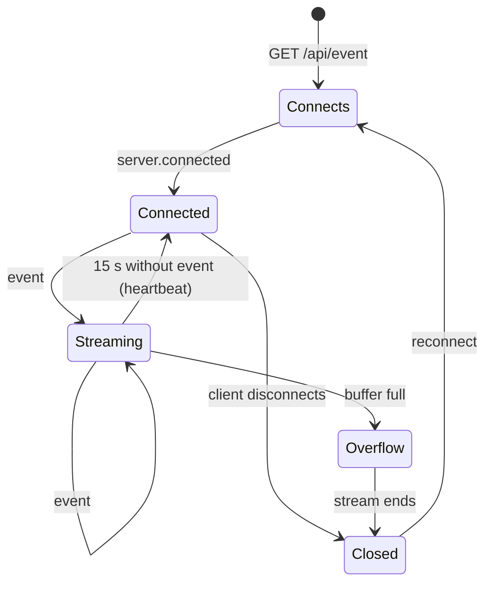
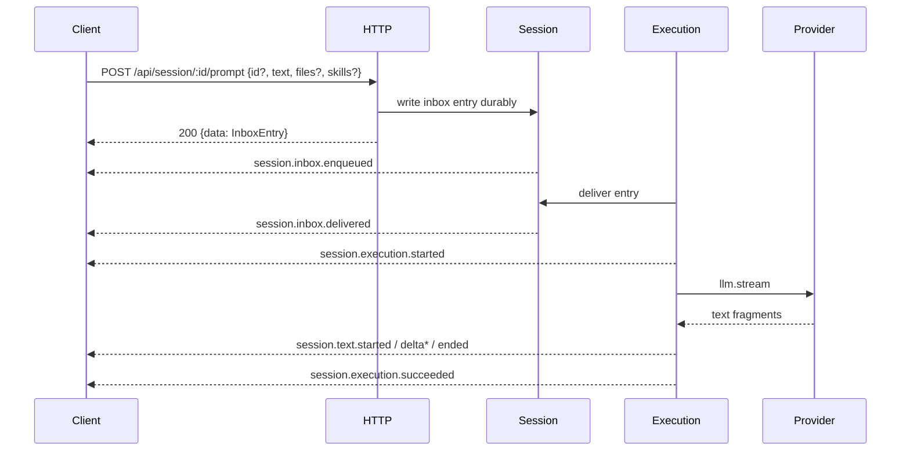

# 01 – HTTP and streaming

> **Question:** How does a client talk to the engine so that text appears **while**
> the answer is being produced, permissions can be answered, and a dropped
> connection does not corrupt state?
>
> **Answer:** A JSON HTTP API under `/api`, **one** SSE stream under
> `GET /api/event`, and the rule: the stream is an **accelerator**, the snapshot
> is the **truth**.

This chapter is the external contract. It describes no engine internals; event
names and states come from
[`../session-engine/02-events.md`](../session-engine/02-events.md).

## 1. Principles

1. **One API tree.** Everything lives under `/api`. Stable endpoints are under
   `/api/...`; endpoints with `experimental` in the path may change.
2. **JSON as body.** Requests and responses are JSON unless the table says
   otherwise. SSE is the only exception.
3. **Three response forms.** `{data: T}`, `{location, data: T}` or a flat
   object for control responses (`{interrupted: boolean}`). `GET /api/config`
   returns a bare array. The table in §6 names the form per endpoint.
4. **The client is dumb.** It renders events and answers permissions. It does
   not compose prompts or system parts.
5. **The stream is volatile.** Events can be missing. The client must be able to
   build a correct screen from a snapshot.

## 2. Transport

| Property | Value | Evidence |
|---|---|---|
| Method and path | `GET /api/event` | `packages/protocol/src/groups/event.ts:44` |
| Content type | `text/event-stream` | `packages/server/src/handlers/event.ts:25` |
| Frame | `data: <JSON>\n\n` | `packages/server/src/event-feed.ts:29` |
| Comment | `: <Text>\n\n` | `packages/server/src/handlers/event.ts:21` |
| Heartbeat | `: heartbeat\n\n` every 15 seconds | `packages/server/src/handlers/event.ts:21` |
| First frame | `server.connected` | `packages/server/src/handlers/event.ts:15` |
| Buffer per subscriber | 4096 frames | `packages/server/src/event-feed.ts:8` |
| Buffer behavior | `dropping`; overflow **ends** the stream | `packages/server/src/event-feed.ts:76` |
| Client buffering | forbidden | `Cache-Control: no-cache, no-transform` (`handlers/event.ts:27`) |
| Proxy buffering | forbidden | `X-Accel-Buffering: no` (`handlers/event.ts:28`) |
| MIME sniffing | forbidden | `X-Content-Type-Options: nosniff` (`handlers/event.ts:29`) |
| Resumption | **no** `Last-Event-ID`, **no** replay | `handlers/event.ts` knows no cursor |

**Encoding.** A frame contains exactly one JSON line. Line breaks in JSON are
forbidden (the reference serializes compactly). A frame is **not** split across
multiple `data:` lines.

**Order.** The stream is the order in which the process publishes events. Across
aggregates there is **no** global order; within an aggregate `durable.seq` is
monotonic.

**Scope.** The stream is **process-wide**: it contains events from **all
locations** of the server. The client filters by `location` and session; there
is no location-specific second stream
(`packages/protocol/src/groups/event.ts:51`).

## 3. Connection lifecycle



> **Overflow is an error, not silent data loss.** The reference removes the
> subscriber and ends its stream with `SubscriberOverflow`
> (`packages/server/src/event-feed.ts:67`). The client notices the end and must
> reconnect – and fetch the snapshot.

## 4. The event envelope

| Field | Type | Required | Meaning |
|---|---|---|---|
| `id` | `string` (`evt_…`) | yes | event identifier; do not use as ordering |
| `type` | `string` | yes | e.g. `session.text.delta` |
| `created` | `number` (ms since epoch) | yes, **except** `server.connected` | wall-clock time of publication |
| `data` | type-specific | yes | payload |
| `location` | `{directory}` | no | location the event belongs to |
| `metadata` | object | no | additional information |
| `durable` | `{aggregateID, seq, version}` | only for durable events | position in the aggregate log |

Evidence: `packages/schema/src/event.ts:67` (base), `:56`/`:78` (durable vs.
ephemeral). `server.connected` is built in
`packages/server/src/handlers/event.ts:15` without `created` – the client must
tolerate that.

**Durable does not mean "deliverable".** A durable event is part of the
aggregate log; it is still distributed only **live** over SSE. A client that is
not connected at publication time never sees it. Recovery happens through
projections, not through the log.

## 5. The minimal event set

A base-environment client needs exactly these events. "D" = durable, "E" =
ephemeral.

| Event | Kind | Meaning | Client reaction |
|---|---|---|---|
| `server.connected` | – | connection up | load snapshot, then render |
| `session.created` | D | session created | add session to the list |
| `session.inbox.enqueued` | D | input durably accepted | show "waiting" |
| `session.inbox.delivered` | D | input delivered | show "running" |
| `session.execution.started` | D | execution begins | spinner |
| `session.step.started` | D | model step begins | – |
| `session.text.started` | D | text block begins | open new block |
| `session.text.delta` | E | text fragment | append |
| `session.text.ended` | D | text block complete | **replace with `text`** |
| `session.reasoning.started` | D | reasoning block begins | open block |
| `session.reasoning.delta` | E | reasoning fragment | append |
| `session.reasoning.ended` | D | reasoning block complete | replace with `text` |
| `session.tool.input.started` | D | tool input begins | open tool card |
| `session.tool.input.delta` | E | input fragment | append |
| `session.tool.input.ended` | D | input complete | – |
| `session.tool.called` | D | tool is being executed | card "running" |
| `session.tool.progress` | E | progress | update |
| `session.tool.success` | D | tool succeeded | show result |
| `session.tool.failed` | D | tool failed | show error |
| `session.execution.succeeded` | D | execution done | spinner off |
| `session.execution.failed` | D | execution failed | show error |
| `session.execution.interrupted` | D | execution aborted | show "aborted" |
| `permission.asked` | E | permission requested | open dialog |
| `permission.replied` | E | permission answered | close dialog |
| `session.instructions.updated` | D | system part changed (e.g. skills) | do not render, only cache |
| `session.compaction.started` | D | compaction begins | notice |
| `session.compaction.delta` | E | summary grows | optionally show |
| `session.compaction.ended` | D | compaction done | close notice |
| `session.skill.activated` | D | skill loaded | show skill message |

Evidence: `packages/schema/src/session-event.ts:407-440` (text),
`:456-470` (reasoning), `:500-530` (tool), `:254` (execution),
`packages/schema/src/permission.ts:45` (permission).

> **`text.ended` is the truth, `text.delta` is only the animation.** Whoever
> loses all deltas loses no text, as long as they receive `text.ended`. That is
> why deltas are ephemeral and end values are durable
> (`packages/schema/src/session-event.ts:417`).

## 6. The base-environment endpoints

| Method | Path | Purpose | Success | Error |
|---|---|---|---|---|
| `GET` | `/api/event` | SSE stream | `text/event-stream` | – |
| `POST` | `/api/session` | create session | `{data: SessionInfo}` | `404` |
| `GET` | `/api/session` | list sessions | `{data: SessionInfo[], cursor}` | `400` |
| `GET` | `/api/session/:id` | read session | `{data: SessionInfo}` | `404` |
| `POST` | `/api/session/:id/prompt` | admit input | `{data: InboxEntry}` | `400`, `404`, `409` |
| `POST` | `/api/session/:id/command` | admit command (text macro) | `{data: InboxEntry}` | `400`, `404` |
| `POST` | `/api/session/:id/interrupt` | abort execution | `{interrupted: boolean}` | `404` |
| `GET` | `/api/session/:id/message` | messages (snapshot) | `{data: Message[], cursor}` | `400`, `404`, `500` |
| `GET` | `/api/session/:id/permission` | open rights of the session | `{data: Request[]}` | `404` |
| `POST` | `/api/session/:id/permission/:requestID/reply` | answer right | `204` | `404` |
| `GET` | `/api/permission/request` | open rights of the location | `{location, data: Request[]}` | `404` |
| `GET` | `/api/agent` | agents | `{location, data: AgentInfo[]}` | `404` |
| `GET` | `/api/skill` | skills | `{location, data: SkillInfo[]}` | `404` |
| `GET` | `/api/model` | models | `{location, data: ModelInfo[]}` | `404` |
| `GET` | `/api/provider` | providers | `{location, data: ProviderInfo[]}` | `503` |
| `GET` | `/api/integration` | integrations incl. status | `{location, data: IntegrationInfo[]}` | `404` |
| `GET` | `/api/credential` | stored credentials | `{data: Entry[]}` | – |
| `GET` | `/api/config` | config entries | `ConfigEntry[]` | – |
| `GET` | `/api/location` | current location | `{directory, project: {id, directory, canonical}}` | `404` |

Evidence: `packages/protocol/src/groups/session.ts:117,156,223,335,685`,
`message.ts:70`, `permission.ts:113,141`, `agent.ts:10`, `skill.ts:9`,
`model.ts:10`, `provider.ts:10`, `integration.ts:16`, `credential.ts:8`,
`config.ts:9`, `location.ts:36`.

> **Decision (2026-10-22, L-6/PRM-C).** Commands live in the engine as a text
> macro (`command/<id>.md` with `$ARGUMENTS`); the endpoint
> `POST /api/session/:id/command` is part of the base set. The client sends only
> name and arguments.

**Not in the base set** (but present): `fork`, `move`, `revert`, `compact`,
`shell`, `synthetic`, `form`, `pty`, `vcs`, `worktree`, `debug`, `rpc`,
`generate`. They do not change the contract.

## 7. The flow of an input



1. The client sends `text`, optionally `files`, `skills`, `agents`, `metadata`,
   `delivery`, `resume` and optionally `id`
   (`packages/schema/src/prompt-input.ts:29`,
   `packages/protocol/src/groups/session.ts:335`).
2. The server writes **one** inbox entry and replies. The reply contains the
   **inbox entry**, not the assistant message.
3. Execution runs only afterwards. The client learns about it via SSE.
4. `resume: false` only admits the input and starts no execution.
5. An abort happens via `POST /interrupt`; the reply says whether **this**
   process had an active execution (`session.ts:685`).

> **The HTTP reply is not a progress bar.** It means "durably admitted", not
> "understood" and not "answered".

## 8. Permissions

| Step | Message / call | Meaning |
|---|---|---|
| 1 | `permission.asked` (SSE) | request with `id`, `action`, `resources`, `save`, `metadata`, `source` |
| 2 | dialog | the client shows action and resources |
| 3 | `POST …/permission/:requestID/reply` | `{decision: "once" \| "always" \| "reject", message?}` |
| 4 | `204` | answered; execution continues or ends |
| 5 | `permission.replied` (SSE) | other clients close the dialog |

* `once` allows **exactly this** call.
* `always` stores the `save` resources named in the request as a rule
  (`packages/core/src/permission.ts:303`).
* `reject` ends the call; execution receives an error result.
* An unknown or already answered request is `404`.
* Permissions are **ephemeral**. After a dropped connection the client fetches
  `GET /api/permission/request` (location) or `GET /api/session/:id/permission`
  (session).

## 9. Location

Every location-related request carries the location in **one** of two ways:

| Way | Form | Evidence |
|---|---|---|
| Query | `?location[directory]=<absolute path>` | `packages/protocol/src/groups/location.ts:9` |
| Header | `x-opencode-directory: <absolute path>` | `packages/server/src/location.ts:76` |
| Default | working directory of the process | `packages/server/src/location.ts:76` |

The query parameter is transmitted as `deepObject`
(`packages/protocol/src/groups/location.ts:24`). The client must use the same
location at which it created the session. A **non-existent** location returns
`404 LocationNotFoundError`; a different, existing location does not find the
session (`404 SessionNotFoundError`).

**Exception:** `POST /api/session` carries the location in the **body**
(`location`), not in the query
(`packages/protocol/src/groups/session.ts:156-170`).

> **A location is a directory, not a project.** The project is derived from it.
> A move (`POST /move`) is a separate operation and not part of the base
> environment.

## 10. Errors → status

| Class | Status | Body | Evidence |
|---|---|---|---|
| `InvalidRequestError` | `400` | `{_tag, message, kind?, field?}` | `packages/protocol/src/errors.ts:11` |
| `UnauthorizedError` | `401` | `{_tag, message}` + `WWW-Authenticate` | `errors.ts:41`, `packages/server/src/middleware/authorization.ts:13,54` |
| `LocationNotFoundError` | `404` | `{_tag, location, message}` | `packages/protocol/src/errors.ts:5` |
| `SessionNotFoundError` | `404` | `{_tag, sessionID, message}` | `packages/protocol/src/errors.ts:148` |
| `PermissionNotFoundError` | `404` | `{_tag, requestID, message}` | `packages/protocol/src/errors.ts:209` |
| `ConflictError` | `409` | `{_tag, message, resource?}` | `packages/protocol/src/errors.ts:47` |
| `SessionBusyError` | `409` | `{_tag, sessionID, message}` | `packages/protocol/src/errors.ts:56` |
| `UnknownError` | `500` | `{_tag, message, ref?}` | `packages/protocol/src/errors.ts:74` |
| `ServiceUnavailableError` | `503` | `{_tag, message, service?}` | `packages/protocol/src/errors.ts:65` |

The client decides **by `_tag` and status**, never by the message text. The
text is for humans.

## 11. Authentication

* Method: **HTTP Basic** with username `opencode` and the server password
  (`packages/server/src/auth.ts:33`).
* Without a password authentication is off; that is only allowed for loopback
  and a trusted environment.
* A `401` carries `WWW-Authenticate: Basic realm="Secure Area"` for
  non-browser requests
  (`packages/server/src/middleware/authorization.ts:13,54`).
* Session cookies (`opencode_session_<port>`) are a browser convenience, not
  part of the base environment (`packages/server/src/auth.ts:40`).
* TLS terminates before the process (reverse proxy). The base environment itself
  terminates no TLS.

> **The server password is not a provider credential.** It protects HTTP
> access; it is not sent to a provider and not stored in the credential table.

## 12. Resumption

The stream knows **no** resumption point. Recovery is therefore a **snapshot**,
not a replay:

```
function resume(session):
  connect_sse()                       # step 1
  wait_for("server.connected")        # step 2
  state = GET /api/session/{id}      # step 3: header data
  pages = GET /api/session/{id}/message?order=desc&limit=200
  known = set(displayed_messages)
  while pages.cursor.previous exists:
      page = GET ...&cursor={cursor.previous}
      if all ids of page in known: break
      append page
  render(state, messages)            # step 4: full screen
  open_rights = GET /api/permission/request
  render_dialogs(open_rights)
  keep_streaming()                   # step 5
```

**Gap detection.** For a durable event of the same `aggregateID`: `seq` must
rise by exactly one. If it jumps, events are missing; the client discards its
delta state and reloads the snapshot. Deltas (ephemeral) are **not** missed,
because `text.ended` carries the end value.

**Frames during the snapshot.** The client buffers events arriving between
`server.connected` and the finished snapshot and applies them **after**
rendering. An event whose effect the snapshot already shows (same message ID
and end value) is not applied twice.

**What the snapshot cannot do.** It shows no running animation. A client that
reconnects mid-stream shows the last complete block and waits for the next
`text.delta`. That is intended.

## 13. Rules

| # | Rule | Check |
|---|---|---|
| **HS-01** | An SSE frame is `data: <JSON>\n\n`; comments are `: <Text>\n\n`. There are no multi-line data frames. | Protocol |
| **HS-02** | Every connection begins with **exactly one** `server.connected`; afterwards only events and heartbeats follow. | Flow |
| **HS-03** | Every 15 seconds the server sends a heartbeat, independent of events. A heartbeat is **not** an event and is not rendered. | Flow |
| **HS-04** | The buffer per subscriber is limited. IF it overflows, THEN the stream ends with an error; **no** frame is silently dropped. | Effect |
| **HS-05** | There is no resumption point. IF the connection ends, THEN the client restores state from `GET /message`. | Flow |
| **HS-06** | `created` is required, except for `server.connected`. | Protocol |
| **HS-07** | Durable events carry `durable {aggregateID, seq, version}`; ephemeral ones do not. `seq` is monotonic per aggregate, not global. | Protocol |
| **HS-08** | `text.delta` and `reasoning.delta` are ephemeral; `text.ended` and `reasoning.ended` carry the full text. | Protocol |
| **HS-09** | `POST /prompt` replies as soon as the inbox entry is durable. The reply contains the inbox entry, not the assistant message. | Flow |
| **HS-10** | The same inbox ID in the same session is idempotent; the first admission wins. An ID from another session or with a different type is `409`. | State |
| **HS-11** | Errors are classified by `_tag` and HTTP status, never by the message text. | State |
| **HS-12** | Every location-related request carries the location as query `location[directory]` or header `x-opencode-directory`; `POST /api/session` carries it in the body. Without specification the process working directory applies. | State |

## 14. Evidence

| Rule | Test | Kind |
|---|---|---|
| HS-01 | Two events in one frame? Parser must fail. | pure |
| HS-02 | First frame is `server.connected`, exactly once. | Integration |
| HS-03 | Fast-forward clock: after 15 s comes `: heartbeat`. | Integration (clock controlled) |
| HS-04 | Subscriber slower than 4096 frames: stream ends with error. | Integration |
| HS-05 | Disconnect, miss events, load snapshot: text complete. | Integration |
| HS-06 | `server.connected` without `created` is accepted; any other without `created` is rejected. | pure |
| HS-07 | `text.delta` has no `durable`; `text.ended` has `seq`. | pure |
| HS-08 | Send only deltas, omit `text.ended`: client shows incomplete text (expected behavior). | Integration |
| HS-09 | Prompt replies before the first `text.delta`. | Integration |
| HS-10 | Second prompt with same ID: one inbox entry; other session: `409`. | Integration |
| HS-11 | `404` body carries `SessionNotFoundError`, not just text. | Contract |
| HS-12 | Request without location uses the process directory; with header the header wins. | Integration |

The full test pyramid is in
[`../qualitaet/01-tests.md`](../qualitaet/01-tests.md).

## 15. Non-goals

| Non-goal | Reason |
|---|---|
| WebSocket | SSE carries all events in one direction; permissions go back over HTTP |
| SSE replay / `Last-Event-ID` | The snapshot is the truth; a replay would have to hold the whole log |
| Binary streams | Attachments are files with URI, not streams |
| HTTP/2 requirement | HTTP/1.1 suffices; heartbeats prevent idle timeouts |
| Multiple streams per client | One stream, one filter in the client |
| Server push for permissions | Permissions are answered by the client, not enforced by the server |

## 16. Open points

| Point | Question | Impact |
|---|---|---|
| **HS-A** | Should a client get a `since` parameter for messages? | would shorten resumption from "scan all pages" to "from known ID" |
| **HS-B** | Should `GET /api/config` also return `{data}`? | consistency; the reference returns a bare array |
| **HS-C** | Should the stream send a `retry:` hint? | reconnect timing would be server-side instead of client-side |
| **HS-D** | Should deltas carry a `blockID`? | would simplify assignment with parallel blocks |

> **Decision (2026-10-22, HS-A…HS-D).** `since` later (snapshot suffices);
> `GET /api/config` stays a bare array; `retry:` hint optional; `blockID`
> later.