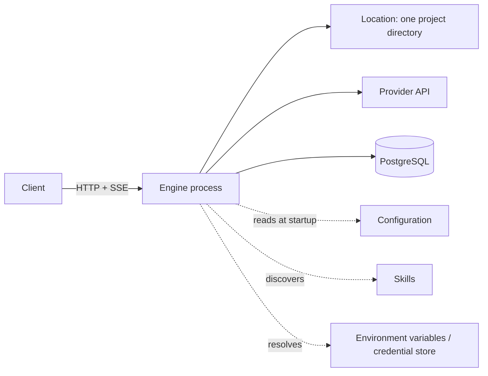

# Operations – the base environment

> **Question:** What is the smallest environment that suffices for a client to
> create a session, stream text, trigger tools and answer permissions – without
> MCP, without plugins, without agent variety?
>
> **Answer:** One process, one location, one provider, one model, one agent,
> seven tools, at most three skills and **exactly one** active provider
> connection. Everything else is an extension, not a prerequisite.

The base environment is **not** a minimal demo example. It is the smallest cut
that still fully carries the invariants of the engine (111 rules `I-xx-yy`)
and of the tools (W-01…W-56). Whoever produces it can build every later
extension as an **addition**, without changing the core.

## 1. Topology

There is **one** server process. It serves **one** location (a directory with a
project). Several locations, several processes and several clients are allowed,
but are not part of the base environment.

## 2. The smallest set

| Building block | Count | Decision | Described in |
|---|---|---|---|
| Process | 1 | binds to `127.0.0.1`, one port | this chapter §4 |
| Location | 1 | one project directory, one project | [`01-http-streaming.md`](./01-http-streaming.md) §9 |
| Provider | 1 | exactly one provider, no fallback | [`03-credentials.md`](./03-credentials.md) §6 |
| Model | 1 | chosen fixed, no automatic switch | [`03-credentials.md`](./03-credentials.md) §6 |
| Agent | 1 | `build`, no subagents | this chapter §3 |
| Tools | 7 | `read`, `write`, `edit`, `glob`, `grep`, `shell`, `skill` | [`02-skills.md`](./02-skills.md) §7 |
| Skills | 0–3 | from the project directory | [`02-skills.md`](./02-skills.md) §6 |
| Provider credentials | 1 | one provider key, no OAuth | [`03-credentials.md`](./03-credentials.md) §6 |
| Persistence | 1 schema | PostgreSQL, Flyway, no cache service | [`../persistence/`](../persistence/README.md) |
| Push channel | 1 | SSE under `GET /api/event` | [`01-http-streaming.md`](./01-http-streaming.md) §2 |

**Not** included: MCP servers, plugins, subagents, LSP, formatters, commands,
custom agents, several providers, cloud sync, telemetry.

## 3. The one agent

The base environment needs **one** agent. It is not a catalog but a constant:

| Field | Value | Why |
|---|---|---|
| `id` | `build` | a stable name for client and session |
| `mode` | `primary` | no selection by a subagent |
| `steps` | 32 | limits one input; enough for reading, changing, checking |
| `system` | empty | the base prompt applies (see [`13-internal-prompts.md`](../session-engine/13-internal-prompts.md)) |
| `permissions` | `shell`, `write`, `edit` → `ask`, everything else `allow` | effect immediately visible, permissions answerable |
| `hidden` | `false` | the client lists it |

> **Decision:** The base environment defines **no** agent catalog. It sets
> exactly one agent. The full catalog (L-1) is **decided** (2026-10-22):
> file-based – `agent/<id>.md` (project) and `~/.config/opencode/agent/<id>.md`
> (global) plus built-in `build`; project beats global. It remains a later
> extension; it changes nothing in this line.

Thus `choose_agent(session.agent)` is implementable: there is exactly one match.
An unknown agent name is a configuration error, not a fallback to `build`.

## 4. Startup order

The order is binding, because each step creates a precondition for the next. An
error ends startup, unless it is explicitly marked "start anyway".

| # | Step | Precondition | Error behavior |
|---|---|---|---|
| 1 | Read configuration (files, then environment) | – | invalid file → startup abort with file and line |
| 2 | Connect and migrate database | step 1 | unreachable → startup abort |
| 3 | Load prompt catalog (manifest, checksums) | step 1 | missing prompt → startup abort |
| 4 | Resolve provider credential | step 1 | missing → **start anyway**, no active connection |
| 5 | Discover skills | step 1 | invalid skill → skip, log |
| 6 | Bind HTTP, set password | steps 2–5 | port taken → startup abort |
| 7 | Provide event stream | step 6 | – |
| 8 | Client: `GET /api/config`, `/api/agent`, `/api/skill` | step 6 | 5xx → retry, then show |
| 9 | Client: **connect SSE** (`GET /api/event`) | step 7 | without SSE do not proceed |
| 10 | Client: `POST /api/session`, then `/prompt` | step 9 | 4xx → show input, do not repeat |

**Why step 9 before step 10?** The event stream is lossy (§1 point 5 in
[`01-http-streaming.md`](./01-http-streaming.md)). Whoever opens it only after
the prompt can miss the first events. The connection is opened **before** the
first state change.

**Why may step 4 be missing?** An installation without a key should be able to
start and show its state. The first prompt then fails with a `provider.*` class
(with missing authentication `provider.auth`, see
[`03-credentials.md`](./03-credentials.md) §7), not the server startup.

## 5. Rules of the base environment

| # | Rule | Check |
|---|---|---|
| **U-01** | The base environment has **one** process and **one** location. Every session belongs to exactly this location. | State |
| **U-02** | There is **one** active provider and **one** active model. A missing model is a configuration error, not a switch. | State |
| **U-03** | There is **one** agent (`build`). An unknown agent name is an error. | State |
| **U-04** | The tool set is **closed**: `read`, `write`, `edit`, `glob`, `grep`, `shell`, `skill`. No tool is loaded dynamically. | State |
| **U-05** | Every tool with external effect (`write`, `edit`, `shell`) asks, as long as no stored rule allows it. | Effect |
| **U-06** | The only push channel is **SSE**. There is no WebSocket, no long poll and no second stream. | Flow |
| **U-07** | Skills are **optional**. Zero skills is a valid state; the session starts and the system part contains the sentence "No skills are currently available." | State |
| **U-08** | There is **one** active provider connection. Environment variable and store are two ways to the **same** connection, not two providers. | State |
| **U-09** | Persistence is **one** PostgreSQL schema. There is no second store for session state. | State |
| **U-10** | The client **composes no prompts**. It sends text, files and skill references; the engine builds the system part. | State |

### Check kinds

* **State** – verifiable after startup or after every state change.
* **Flow** – only in a defined step of the startup or input sequence.
* **Effect** – verifiable by external effect (file, process, request).

## 6. What the base environment deliberately omits

| Omitted | Why it is not needed | When it is added |
|---|---|---|
| MCP servers | no tool of the base set needs them | when an MCP tool is needed |
| Plugins | the engine is complete without extensions | when behavior should vary per project |
| Subagents | one agent suffices for one input | when work should be split |
| LSP, formatters | tools of the surface, not the engine | when code intelligence is desired |
| Commands | a prompt text suffices | when reusable flows are needed |
| Custom agents | `build` covers the normal case | when roles should be separated |
| Several providers | one model suffices to work | when outage or price matters |
| OAuth | one key is simpler to verify | when a provider offers no key |
| Telemetry, cloud sync | no invariant depends on them | when operational data is needed |

## 7. Boundary

The base environment **does not extend** the engine. It selects from what the
specification already requires:

* Session, inbox, execution, steps and rights: [`../session-engine/`](../session-engine/README.md)
* Tool contract and the three families: [`../tools/`](../tools/README.md)
* Decision rules: [`../permissions/`](../permissions/README.md)
* Model call and error classes: [`../provider/`](../provider/README.md)
* Tables and ownership: [`../persistence/`](../persistence/README.md)
* Build order and ports: [`../module-plan.md`](../module-plan.md)

Only three **external contracts** are new, which were missing so far:

| Contract | Chapter | Module |
|---|---|---|
| HTTP + SSE | [`01-http-streaming.md`](./01-http-streaming.md) | `httpapi` (S8) |
| Skills | [`02-skills.md`](./02-skills.md) | `skills` (S3) |
| Credentials | [`03-credentials.md`](./03-credentials.md) | `credentials` (S3) |

## 8. Acceptance criteria

The base environment counts as produced when **all** of the following points are
verifiable without recourse to the reference code:

1. A client can create a session with **one** `POST /api/session`.
2. A `POST /api/session/:id/prompt` replies **before** the model has answered.
3. Text appears as `session.text.delta`, the end value as `session.text.ended`.
4. A `permission.asked` can be answered with `once`, `always` or `reject`.
5. After a dropped connection `GET /api/session/:id/message` delivers the full text.
6. Without a provider key the server starts and reports the missing key.
7. Without skills the session starts and the system part contains the empty state.
8. The three skills from [`02-skills.md`](./02-skills.md) §6 are available again after a restart.
9. No event and no log entry contains a key in plain text.
10. All rules `U-01…U-10`, `HS-01…HS-12`, `SK-01…SK-12`, `CR-01…CR-12` have evidence in [`../qualitaet/01-tests.md`](../qualitaet/01-tests.md).