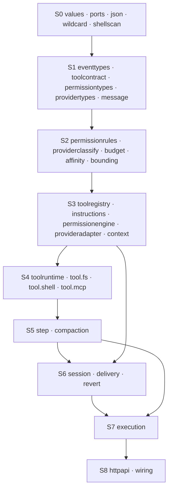

# Module plan – dependencies, interfaces, testability

> **Purpose:** Decompose the spec into **individually implementable and
> individually testable modules** – topologically sorted, with clear interfaces
> and an explicit right to internal simplification.
>
> **Basis:** [`session-engine/`](./session-engine/README.md),
> [`tools/`](./tools/README.md), [`permissions/`](./permissions/README.md),
> [`provider/`](./provider/README.md), [`persistence/`](./persistence/README.md).
>
> **Physical realisation:** [`java-packages.md`](./java-packages.md) (Option B –
> stages S0–S2 in `core`, S3–S7 in `runtime`, S8 in `http`). The logical
> modules below stay unchanged; only the package mapping is bundled.
>
> **Status:** 2026-10-22

## 1. Five rules

| # | Rule | Consequence |
|---|---|---|
| 1 | **Dependencies point only downward.** | The stage number of a module is greater than that of every module it uses. |
| 2 | **Across a stage boundary only an interface goes, never a class.** | No module imports `SqlJournal`, `HttpProviderAdapter` or `RealFileSystem`. |
| 3 | **Ports belong to the consumer.** | The interface `Journal` arises from the need of `session`, not from the capabilities of PostgreSQL. |
| 4 | **Simplify yes, change semantics no.** | A module may omit caches, concurrency, persistence and optimization – never a rule from §6. |
| 5 | **Every stage is fully testable without the stages above it.** | Whoever tests `permissionengine` needs neither database nor HTTP nor a session. |

> **Rule 2 is the most important.** It is the difference between a "module"
> and a "folder". A folder whose contents are used directly everywhere cannot
> be tested individually – and never changes in isolation.

## 2. The stages

```
S0  values, ports, pure helpers          ← no dependencies
S1  contracts (types only)               ← S0
S2  pure evaluators                      ← S0, S1
S3  chain, registry, adapter             ← S0–S2
S4  tool families, tool execution        ← S0–S3
S5  one model step                       ← S0–S4
S6  session, delivery, revert            ← S0–S3 (+ wake port)
S7  execution, claim, resumption          ← S0–S6
S8  outer skin (HTTP, wiring)            ← all
```



> **`S6` does not depend on `S5`.** The session writes inputs and delivers;
> it does **not** call the model. The trigger runs through the port
> `SessionWake`, which `S7` implements. Without this reversal `session` would
> have to know the whole execution path – and would no longer be individually
> testable.

## 3. The ports

A port is an interface that a **consumer** needs and that an **outside world**
fulfills. All ports live in `S0` (module `ports`), so that no consumer has to
import an adapter.

### 3.1 Storage ports

| Port | Consumer | Methods |
|---|---|---|
| `Journal` | `session`, `delivery`, `step`, `revert` | `append(draft) -> Seq` · `appendAll(drafts) -> List<Seq>` · `history(aggregate, after) -> List<Event>` · `historyOfType(aggregate, type, after)` |
| `Conversation` | `step`, `httpapi` | `messages(session, afterSeq) -> List<Message>` · `message(session, id) -> Option<Message>` |
| `SessionReader` | `context`, `delivery`, `execution` | `info(session) -> Option<SessionInfo>` · `inbox(session) -> List<InboxEntry>` · `inboxItem(session, id) -> Option<InboxEntry>` |
| `ClaimStore` | `execution` | `acquire(session, at) -> Option<Claim>` · `release(session)` · `open() -> List<Claim>` |
| `ApprovalStore` | `permissionengine` | `add(project, action, resource)` · `list(project) -> List<SavedApproval>` · `remove(project, action, resource)` |
| `CredentialStore` | `credentials` | `saved(integration) -> List<Credential>` · `get(id) -> Option<Credential>` · `create(input)` · `activate(id)` · `remove(id)` |
| `InstructionStore` | `instructions` | `state(session) -> Option<State>` · `putState(session, state)` · `entries(session) -> List<Entry>` · `putEntry` · `removeEntry` · `blob(hash) -> Option<Value>` · `putBlob(hash, value)` |
| `ToolOutputStore` | `bounding`, `tool.mcp` | `save(suffix, bytes) -> Path` · `load(path) -> Bytes` · `sweep(olderThan)` |
| `SnapshotStore` | `revert` | `capture(paths) -> SnapshotID` · `restore(snapshot, paths)` · `diff(from, to) -> List<FileDiff>` |

### 3.2 World ports

| Port | Consumer | Methods |
|---|---|---|
| `FileSystem` | `tool.fs`, `bounding`, `revert` | `read` · `readText` · `write` · `stat` · `list` · `glob` · `search` · `realPath` |
| `ProcessRunner` | `tool.shell` | `start(spec) -> Handle` · `run(spec, timeout) -> Exit` (with `cwd`, `env`, `stdin`, `pty`) |
| `HttpTransport` | `provideradapter`, `tool.mcp` | `postJson(url, headers, body, timeout) -> ResponseStream` · `openChannel(url, headers) -> Channel` |

### 3.3 Human and time ports

| Port | Consumer | Methods |
|---|---|---|
| `ApprovalSource` | `permissionengine` | `request(action, context) -> ApprovalResult` |
| `PolicySource` | `permissionengine`, `toolregistry` | `statements() -> List<PolicyStatement>` |
| `Clock` | `session`, `execution`, `step` | `now() -> Instant` · `sleep(duration)` · `deadline(timeout) -> Deadline` |
| `SessionWake` | `session` | `wake(session)` |

> **`SessionWake` is the only port that points "upward".** It is the
> reversal that decouples `S6` from `S7`. In tests it is a counter; in
> operation it is the coordinator.

## 4. The modules per stage

### 4.1 S0 – values and pure helpers

| Module | Task | May use | Public interface |
|---|---|---|---|
| `values` | IDs, money, tokens, timestamps, references | – | `ID.new(prefix)` · value types |
| `ports` | all interfaces from §3 | `values` | interfaces |
| `json` | encode/decode against declarative schemas | `values` | `encode(value)` · `decode(json, schema) -> Result` |
| `wildcard` | pattern matching (`*`, `?`, ` *`-rule) | – | `matches(value, pattern) -> Bool` |
| `shellscan` | command → `commands` + `directories` | `values` | `scan(command, shell, cwd) -> ScanResult` |

**Simplification:** `json` may have a single exchange format (JSON text);
`shellscan` may be a heuristic instead of a grammar – as long as `ScanResult`
is complete. `wildcard` has **no** simplification: the pattern semantics is
the semantics ([`permissions/02-evaluation.md`](./permissions/02-evaluation.md)
§2).

### 4.2 S1 – contracts (types only, no behavior)

| Module | Content |
|---|---|
| `eventtypes` | `EventDraft`, `StoredEvent`, all payload forms, `upgrade(type, version, raw)` |
| `toolcontract` | `ToolDefinition`, `ToolResult`, `ToolContent`, `ToolFailure`, `ToolGate`, `ToolExecutor` |
| `permissiontypes` | `Rule`, `Effect`, `Request`, `Reply`, `PermissionGate`, `Denied`, `Aborted` |
| `providertypes` | `ModelRequest`, `ModelEvent`, `ProviderFailure`, `ModelInfo`, `ProviderAdapter` |
| `message` | `Message`, `Content`, `ToolCard`, `Usage` |

**Simplification:** none. A type module that contains behavior is not a type
module. `upgrade` is the only function – it is pure data transformation.

> **Here lies the most important interface decision:** `ToolExecutor`,
> `PermissionGate` and `ProviderAdapter` are **interfaces in S1**. Thus
> `tool.fs`, `tool.shell` and `step` depend on interfaces they can replace in a
> test with one line.

### 4.3 S2 – pure evaluators

| Module | Task | Interface |
|---|---|---|
| `permissionrules` | last rule wins, `deny` before `ask` before `allow` | `effect(rules, action, resource) -> Effect` · `decide(rules, action, resources) -> Decision` |
| `providerclassify` | raw error → `ProviderFailure`, retryability, backoff | `classify(status, code, type, cause) -> Failure` · `retryable(f)` · `backoff(attempt, jitter)` |
| `budget` | output budget | `outputLimit(limit, kind, input) -> Int` |
| `affinity` | cache key and headers | `of(session) -> Affinity` · `headers(a)` · `promptCacheKey(a)` |
| `bounding` | truncation + store full output | `truncate(result, limits) -> Truncated` |
| `instructions` | hashes, deltas, epoch, baseline | `apply(session, sources) -> Delta` · `render(session) -> View` |

**Simplification:** `bounding` may check only **one** limit (bytes instead of
bytes **and** lines) when the interface reports both. `providerclassify` may
know fewer status codes – unknown ones fall back to
`InvalidRequest(Other)`, i.e. **not** retryable. That is the safe direction:
when in doubt, do not retry.

### 4.4 S3 – chain, registry, adapter

| Module | Task | May use | Interface |
|---|---|---|---|
| `toolregistry` | registrations, snapshot, catalog filter | `toolcontract`, `PolicySource` | `register(def) -> Registration` · `snapshot(policy) -> Snapshot` · `reload()` |
| `skills` | scan sources, read frontmatter, visible skills | `FileSystem`, `permissionrules` | `list(permissions) -> List<Summary>` · `get(id) -> Option<Skill>` · `reload()` |
| `permissionengine` | rule chain, saved approvals, inquiry, batch | `permissionrules`, `ApprovalStore`, `ApprovalSource`, `PolicySource` | `assert(request)` · `reply(id, reply, feedback)` |
| `credentials` | stored credentials, `env` connections, OAuth renewal | `CredentialStore`, `HttpTransport`, `Clock`, `providertypes` | `connections(integrationID) -> List<Connection>` · `active(integrationID) -> Option<Connection>` · `create(input)` · `activate(id)` · `remove(id)` |
| `provideradapter` | send request, translate stream, classify errors | `HttpTransport`, `providerclassify`, `budget`, `credentials` | `stream(request) -> Stream<ModelEvent>` |
| `context` | build transcript (system, instructions, history, tools) | `message`, `toolcontract`, `instructions`, `skills` | `build(session, agent, model, snapshot, input) -> Prepared` |

**Simplification:**

| Module | May omit | Must keep |
|---|---|---|
| `toolregistry` | `reload`, `close`, catalog filter | registration order, last wins |
| `skills` | URL catalog, watcher, file list | frontmatter, visibility, deterministic order |
| `permissionengine` | policy, hook, HITL | `deny` before saved, `ask` over `allow`, channel separation |
| `credentials` | OAuth, `external`, several credentials | resolution order, `env` fallback, at most one active connection |
| `provideradapter` | WebSocket, retry, cache headers | event protocol, classification, fully reading |
| `context` | caching, compaction window | deterministic order, frozen snapshot |

### 4.5 S4 – tools

| Module | Task | May use | Interface |
|---|---|---|---|
| `toolruntime` | execution chain, hooks, bounding | `toolcontract`, `PermissionGate`, `bounding` | `execute(call, context, snapshot) -> Outcome` |
| `tool.fs` | `read`, `write`, `edit`, `patch`, `glob`, `grep` | `FileSystem`, `PermissionGate`, `bounding` | `definitions(...) -> List<ToolDefinition>` |
| `tool.shell` | `shell` incl. scanner, background, timeout | `ProcessRunner`, `shellscan`, `PermissionGate` | `definition(...) -> ToolDefinition` |
| `tool.skill` | load `skill`, check right, deliver content | `skills`, `PermissionGate` | `definition(...) -> ToolDefinition` |
| `tool.mcp` | MCP tools, namespace, debounce | `HttpTransport`, `toolregistry`, `PermissionGate` | `registrar(...) -> McpRegistrar` |

**Simplification:** `tool.fs` may omit `patch` (it is `edit` with a different
input format) and map `glob`/`grep` onto `list`/`search` of the port.
`tool.shell` may replace the tree scanner with the portable one. `tool.skill`
may omit the file list, but **not** the rights check before delivering the
content. `tool.mcp` may support **only** tools, no resources and no OAuth.

> **Not simplifiable:** the **order** `directory boundary → file rule → side
> effect` and the **single action** `edit` for three tools. Both are semantics,
> not optimization.

### 4.6 S5 – one model step

| Module | Task | May use | Interface |
|---|---|---|---|
| `step` | build request, read stream, write events, trigger tools | `context`, `provideradapter`, `toolruntime`, `Journal`, `Conversation` | `run(session, agent, model, snapshot, input) -> StepResult` |
| `compaction` | compact and set epoch | `context`, `provideradapter`, `Journal`, `InstructionStore` | `compact(session) -> CompactionResult` |

**Simplification:** `step` may omit retry, cost accounting and hooks – but
**not** "read completely", "log before side effect" and "one terminal event per
call". `compaction` may **truncate** instead of summarize, as long as the
epoch semantics holds.

### 4.7 S6 – session

| Module | Task | May use | Interface |
|---|---|---|---|
| `session` | admission, idempotency, cancellation, resumption | `Journal`, `SessionReader`, `Clock`, `SessionWake` | `prompt(session, input) -> InboxID` · `cancel(session, inboxId)` |
| `delivery` | delivery/steer, create message | `Journal`, `Conversation`, `SessionReader` | `promote(session) -> Option<InboxEntry>` |
| `revert` | snapshot boundary, commit, abort | `Journal`, `SnapshotStore`, `FileSystem` | `begin(session, boundary)` · `commit(session)` · `abort(session)` |

**Simplification:** `session` may omit resumption (`resume`); `delivery` may
always deliver exactly one element (no steer priority); `revert` may only
revert whole snapshots, not partial paths.

### 4.8 S7 – execution

| Module | Task | May use | Interface |
|---|---|---|---|
| `execution` | claim, step sequence, resumption, interruption | `step`, `delivery`, `ClaimStore`, `SessionReader`, `Clock`, `Journal` | `wake(session)` · `interrupt(session)` · `recover()` |

**Simplification:** `execution` may run **one** session at a time (global lock)
and omit resumption. But it may **not** omit the claim – it is the only trace
that survives a crash.

### 4.9 S8 – outer skin

| Module | Task | Interface |
|---|---|---|
| `httpapi` | REST + SSE, translation `Domain → wire`; contract in [`betrieb/01-http-streaming.md`](./betrieb/01-http-streaming.md) | endpoints |
| `wiring` | wiring: SQL adapters, real ports, order | `main()` |

> **`httpapi` is now specified.** Paths, methods, SSE frames, error mapping and
> resumption stand in
> [`betrieb/01-http-streaming.md`](./betrieb/01-http-streaming.md); the module
> stays the thin translation toward it.

> **`wiring` is the only module that knows all others.** It is deliberately
> boring: call constructors, assign ports, startup order. Every decision that
> stands there is a decision missing somewhere else.

## 5. Interfaces that make the difference

### 5.1 `Journal`

```
Port Journal
  append(draft: EventDraft) -> Seq
      # issues the next sequence, writes the event and all
      # projections in ONE transaction; throws on error
  history(aggregate, after: Seq) -> List<StoredEvent>
```

> **`append` returns the sequence.** Thus the caller can check the order
> without reading the log – and the test can check "sequence 7" without knowing
> SQL.

### 5.2 `ToolExecutor`

```
Interface ToolExecutor
  execute(call: ToolCall, context: ToolContext, snapshot: Snapshot) -> Outcome
```

> **Three parameters, no fourth.** `snapshot` is the frozen tool set of the
> request. Whoever passes the registry instead makes the snapshot ineffective –
> and loses I-01 (W-01).

### 5.3 `PermissionGate`

```
Interface PermissionGate
  assert(request: PermissionRequest) -> Unit
      # throws Denied     → visible to the model
      # throws Aborted    → step ends, model sees NOTHING
```

> **Two exceptions, two channels.** A test can distinguish both without knowing
> the engine – that is why channel separation is visible as an interface and not
> as a comment.

### 5.4 `ProviderAdapter`

```
Interface ProviderAdapter
  stream(request: ModelRequest) -> Stream<ModelEvent>
```

> **One stream, no callback, no future.** A test can return a fixed event list;
> the order is part of the contract.

### 5.5 `SessionWake`

```
Port SessionWake
  wake(session) -> Unit
```

> **Fire-and-forget.** `session` does not know whether, when or how often it
> actually runs. In tests it is a counter, in operation the coordinator.

## 6. What a simplification may never change

| # | Rule | Affected modules |
|---|---|---|
| 1 | **Order** `decode → permission → execute → encode` | `toolruntime`, `tool.*` |
| 2 | **Directory boundary before file rule** | `tool.fs`, `tool.shell` |
| 3 | **Log before side effect** | `step`, `toolruntime` |
| 4 | **Exactly one terminal event per call** | `step`, `toolruntime` |
| 5 | **`deny` before saved approval, `ask` over `allow`** | `permissionengine` |
| 6 | **Denial without reason = abort, with reason = error** | `permissionengine`, `toolruntime` |
| 7 | **Read the stream completely** | `step`, `provideradapter` |
| 8 | **Context overflow compacts exactly once** | `step` |
| 9 | **Sequence gapless and monotonic** | `Journal` |
| 10 | **Delivery is a transaction** (delete + insert) | `delivery` |
| 11 | **Claim survives the process** | `execution`, `ClaimStore` |
| 12 | **Admission is idempotent** (same ID, same intent) | `session` |

> **These twelve lines are the contract.** Everything else is implementation –
> and may be missing in the first version.

## 7. Test strategy

> **The evidence itself** – which rule is proven by which test, with which data
> and in which CI stage – stands in
> [`qualitaet/01-tests.md`](./qualitaet/01-tests.md).

### 7.1 Three test kinds

| Kind | Where | What it proves |
|---|---|---|
| **Pure test** | S0–S2 | computation rule, pattern, classification – without doubles |
| **Contract test** | every port | that fake **and** real adapter show the same behavior |
| **Module test** | S3–S7 | the interaction of a module with fakes of the stages below |

### 7.2 Contract tests are the core

For every port there is **one** test class that runs against **two**
implementations:

```
JournalContractTest
  ├── InMemoryJournal      (for module tests)
  └── SqlJournal           (for integration)

ConversationContractTest
  ├── InMemoryConversation
  └── SqlConversation

ClaimStoreContractTest
  ├── InMemoryClaims
  └── SqlClaims
```

> **Why this is the core:** Without a contract test the fake is an assertion.
> With a contract test it is proven – and every module test built on it is worth
> as much as the contract.

### 7.3 The fakes

| Port | Fake | Behavior |
|---|---|---|
| `Journal` | `InMemoryJournal` | list per aggregate, sequence as counter, `append` synchronous |
| `Conversation` | `InMemoryConversation` | folded messages in memory |
| `SessionReader` | `InMemorySessions` | fixed sessions + inbox |
| `ClaimStore` | `InMemoryClaims` | set of sessions |
| `ApprovalStore` | `InMemoryApprovals` | set of `(project, action, resource)` |
| `InstructionStore` | `InMemoryInstructions` | map |
| `FileSystem` | `FakeFileSystem` | map `path → bytes`, directories derived |
| `ProcessRunner` | `FakeProcess` | given output/exit/timeout |
| `HttpTransport` | `ScriptedHttp` | one response per request from a list |
| `ApprovalSource` | `ScriptedApproval` | one answer per action from a list |
| `PolicySource` | `EmptyPolicy` / `FixedPolicy` | empty or fixed list |
| `Clock` | `FixedClock` | fixed time, immediate `sleep` |
| `SessionWake` | `CountingWake` | counts calls |

> **No mocking framework.** The fakes are **real implementations** of the
> interface – small, readable, without `globalThis` interference. That is
> exactly what the repo's test convention demands.

### 7.4 What is **not** tested

| Do not test | Why |
|---|---|
| private fields, class names, call counts | that is structure, not contract |
| "was `log.info` called" | log is not behavior |
| exact form of an error message | the class is the contract, not the text |
| order of two independent writes | it is not specified |

## 8. Order of implementation

Every milestone is **green before the next begins**. The stated check runs
without the stages above it and without real infrastructure.

| # | Modules | Checkpoint |
|---|---|---|
| **M0** | `values`, `json`, `wildcard`, `shellscan` | pattern tests (A-03, A-04 from permissions), scan examples |
| **M1** | `eventtypes`, `toolcontract`, `permissiontypes`, `providertypes`, `message` | encode/decode every type, `upgrade` for an old version |
| **M2** | `permissionrules`, `providerclassify`, `budget`, `affinity`, `bounding` | P-01…P-04, V-30…V-56, budget limits, affinity for child/fork |
| **M3** | `ports` + all fakes | **contract tests** run against the fakes |
| **M4** | `toolregistry`, `skills`, `instructions`, `permissionengine` | frontmatter/visibility, registration/close, epoch, deny-before-approval, channel separation |
| **M5** | `credentials`, `provideradapter` (against `ScriptedHttp`) | V-20…V-29, V-33…V-36, CR-03/CR-04 |
| **M6** | `tool.fs`, `tool.shell`, `tool.skill`, `tool.mcp` (against `FakeFileSystem`, `FakeProcess`, `ScriptedHttp`) | W-30…W-41, W-50…W-60, W-70…W-80, SK-09/SK-11 |
| **M7** | `toolruntime` | chain, hooks, bounding, defect vs. error |
| **M8** | `context`, `step` | event sequence of a step, tool call before execution, skill list in instruction part |
| **M9** | `session`, `delivery` | admission/idempotency, delivery as transaction |
| **M10** | `compaction` | exactly one compaction, epoch movement |
| **M11** | `revert` | snapshot boundary, conditional deletion of instructions |
| **M12** | `execution` (against `InMemoryClaims`, `FixedClock`) | claim, one run per session, resumption |
| **M13** | SQL adapter (all ports) | **the same contract tests** as in M3 |
| **M14** | `httpapi`, `wiring` | one end-to-end run in process |

> **M13 is the proof:** If the contract tests from M3 run unchanged against
> PostgreSQL, the fake is faithful – and all module tests from M4–M12 keep
> their validity.

## 9. Prohibitions

| # | Prohibition | Why |
|---|---|---|
| 1 | A module imports a module of a **higher** stage or a module of an **earlier** position in the same stage. | Within a stage the table order is binding; cycles arise exactly this way. |
| 2 | `provider` knows `session`, `tool` or `permission`. | Otherwise the adapter is no longer interchangeable. |
| 3 | A tool writes an event. | Only `step` writes; tools have no journal dependency. |
| 4 | `session` calls `provideradapter` or `step`. | The path goes through `SessionWake`. |
| 5 | A module reads the clock directly. | Tests would be time-dependent; only `Clock`. |
| 6 | A port is implemented by its consumer. | Then it is not a boundary but a class. |
| 7 | A test uses a real database to check a rule. | Rule and storage are separately testable. |

> **Prohibition 6 is the trap you notice only late:** A "port" that the module
> implements itself is only a method with extra steps. The point of a port is
> that **someone else** fulfills it.

## 10. Package tree

> **Binding for the implementation:** [`java-packages.md`](./java-packages.md).
> The tree here shows the **logical** modules; the package document shows the
> **physical** packages under `de.augmentia.oc.engine` (with conscious
> summaries, e.g. `values` + `message` → `model`) and the ArchUnit rules that
> enforce the stages.

```
<wurzel>/
  values/          S0
  ports/           S0   (interfaces only)
  json/            S0
  wildcard/        S0
  shellscan/       S0

  eventtypes/      S1
  toolcontract/    S1
  permissiontypes/ S1
  providertypes/   S1
  message/         S1

  permission/rules/       S2
  provider/classify/      S2
  provider/budget/        S2
  provider/affinity/      S2
  tool/bounding/          S2

  tool/registry/          S3
  skill/                  S3
  instruction/core/       S3
  permission/engine/      S3
  credential/             S3
  provider/adapter/       S3
  context/                S3

  tool/runtime/           S4
  tool/fs/                S4
  tool/shell/             S4
  tool/skill/             S4
  tool/mcp/               S4

  step/                   S5
  compaction/             S5

  session/core/           S6
  session/delivery/       S6
  session/revert/         S6

  session/execution/      S7

  http/                   S8
  wiring/                 S8

  adapter/sql/            (implements storage ports)
  adapter/fs/             (implements FileSystem, SnapshotStore)
  adapter/proc/           (implements ProcessRunner)
  adapter/http/           (implements HttpTransport)
```

> **Adapters lie outside the stages.** They implement ports and are used only by
> `wiring`. Thus `adapter/sql` can know everything about PostgreSQL without any
> domain module importing it.

## 11. Spec → module mapping

| Spec | Modules |
|---|---|
| [`session-engine/`](./session-engine/README.md) | `session.core`, `delivery`, `execution`, `revert`, `step`, `compaction`, `context`, `instruction.core` |
| [`tools/`](./tools/README.md) | `toolcontract`, `tool.registry`, `tool.runtime`, `tool.fs`, `tool.shell`, `tool.skill`, `tool.mcp`, `bounding`, `shellscan` |
| [`permissions/`](./permissions/README.md) | `permissiontypes`, `permission.rules`, `permission.engine`, `wildcard`, `ApprovalStore`, `ApprovalSource`, `PolicySource` |
| [`provider/`](./provider/README.md) | `providertypes`, `provider.classify`, `provider.budget`, `provider.affinity`, `provider.adapter`, `credential` |
| [`persistence/`](./persistence/README.md) | `ports` (storage), `adapter.sql`, `wiring` |
| [`betrieb/`](./betrieb/README.md) | `httpapi`, `skills`, `credential`, `tool.skill`, `wiring` |

## 12. Open decisions (all decided 2026-10-22)

| # | Question | Impact | Proposal |
|---|---|---|---|
| **M-A** | Is `Journal` a port or part of `session`? | A port makes `session` testable without a DB; a part saves one indirection. | **Port** |
| **M-B** | Does `Conversation` get its own fake or read from `Journal`? | Reading from `Journal` is more correct but slower in tests. | **own fake**, contract test against SQL |
| **M-C** | Does `wiring` wire the projections or `adapter.sql`? | With `wiring` the projection list is visible; with `adapter.sql` hidden. | **`adapter.sql`**, list in the constructor |
| **M-D** | Is `shellscan` its own module or part of `tool.shell`? | A separate port allows the tree scanner **and** the portable scanner as interchangeable implementations. | **own module** |
| **M-E** | May `execution` run several sessions in parallel? | Concurrency is an internal matter; the interface does not change. | **later**, first correct, then parallel |
/home/torsten/dev/my-projects/2oc/qoc/docs/spec/module-plan.md