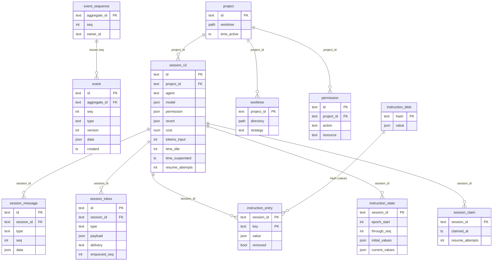

# Database structure – description

> **Purpose:** The complete persistence model of the session engine: which
> tables exist, what each column means, who writes, who reads, in which
> transaction – and what the new implementation **must not** carry over.
>
> **Basis:** [`../session-engine/`](../session-engine/README.md) (spec),
> [`../tools/`](../tools/README.md), [`../permissions/`](../permissions/README.md),
> [`../provider/`](../provider/README.md) – and the verified reference checkout
> (SQLite/Drizzle, `dev` @ `3108505b2f`) as evidence of the semantics.
>
> **Status:** 2026-10-22
>
> **Further:** [`02-data-ownership.md`](./02-data-ownership.md) answers **who**
> a table belongs to and who may write it.

## 1. Four principles

| # | Principle | Consequence in the structure |
|---|---|---|
| 1 | **The event log is the truth.** Everything else is a projection. | Exactly **one** table with events; everything else is derived. |
| 2 | **One transaction, one aggregate.** Event + all projections arise together. | Every table has an aggregate reference (`session_id` / `aggregate_id`) and is written in the same transaction. |
| 3 | **State is not kept twice.** | Cost, tokens, idle time, revert state live in **one** row, not per message. |
| 4 | **No table without a writer.** | Five tables of the reference checkout have no writer – they are not carried over (§8). |

## 2. Overall picture

> **Two things the picture does not show:** The **snapshots** (undo) live in a
> **separate version-control repository**, not in the database. And the **tool
> outputs** (large outputs) live as files in the data directory, not in the DB.
> Both are intentional – see §7.

## 3. Group A – The protocol

### 3.1 `event` – the truth

| Column | Type | Null | Meaning |
|---|---|---|---|
| `id` | text | no | **Primary key.** Unique event identifier. |
| `aggregate_id` | text | no | Aggregate, usually the session ID. Foreign key → `event_sequence`. |
| `seq` | int | no | **Monotonic, gapless sequence per aggregate.** |
| `type` | text | no | Event type, e.g. `session.tool.called`. |
| `version` | int | no | **Payload format version.** Upgrading old forms happens in one place. |
| `data` | json | no | Encoded payload. |
| `created` | ts | no | Creation time (set by the server). |

**Constraints**

* `UNIQUE (aggregate_id, seq)` – no gap, no duplicate sequence.
* Foreign key `aggregate_id → event_sequence.aggregate_id` with `ON DELETE CASCADE`.

**Indexes**

| Index | Purpose |
|---|---|
| `event_aggregate_seq_idx` (unique) | Replay: all events of an aggregate in sequence |
| `event_aggregate_type_seq_idx` | targeted query by event type (e.g. all tool calls) |

> **The `version` column is missing in the reference checkout** – there the
> format version lives in the event definition. It is **deliberately explicit**
> here, because the spec requires central upgrading
> ([`../session-engine/07-invariants.md`](../session-engine/07-invariants.md),
> I-07-04) and because without a version upgrading is not implementable.

### 3.2 `event_sequence` – the sequence counter

| Column | Type | Null | Meaning |
|---|---|---|---|
| `aggregate_id` | text | no | **Primary key.** |
| `seq` | int | no | last issued sequence. |
| `owner_id` | text | yes | Optional owner for replay checks. |

> `event_sequence` is **read and advanced**, but never deleted (except via
> cascade). It is the counter, not the log.

## 4. Group B – The session

### 4.1 `session_v2` – metadata and derived state

| Column | Type | Null | Meaning |
|---|---|---|---|
| `id` | text | no | **Primary key.** |
| `project_id` | text | no | FK → `project`, `ON DELETE CASCADE`. |
| `workspace_id` | text | yes | reserved for clustering. |
| `parent_id` | text | yes | parent session (subagent/fork). |
| `fork_session_id` | text | yes | predecessor on a fork. |
| `fork_boundary` | json | yes | boundary up to which was forked. |
| `slug` | text | no | display name. |
| `directory` | path | no | **location directory** of the session. |
| `path` | path | yes | full path. |
| `title` | text | yes | title. |
| `version` | text | no | schema/agent version. |
| `share_url` | text | yes | share link. |
| `summary_*` | int/json | yes | diff statistics (additions/deletions/files/diffs). |
| `metadata` | json | yes | free metadata. |
| `cost` | num | no (0) | accumulated cost. |
| `tokens_input` … `tokens_cache_write` | int | no (0) | five token counters. |
| `revert` | json | yes | revert state (snapshot list). |
| `permission` | json | no (`[]`) | **session-local rights ruleset.** |
| `agent` | text | yes | chosen agent. |
| `model` | json | yes | `{ id, providerID, variant? }`. |
| `time_created` / `time_updated` | ts | no | default: now / automatic on change. |
| `time_idle` | ts | yes | last idle time. |
| `time_viewed` | ts | yes | last viewed (monotonic watermark). |
| `idle_outcome` | text | yes | `succeeded` / `failed` / `interrupted`. |
| `time_compacting` | ts | yes | **legacy** – the current compaction state lives in `session_message`. |
| `time_archived` | ts | yes | archive time. |
| `time_suspended` | ts | yes | **the execution claim.** |
| `resume_attempts` | int | no (0) | durable counter for resumption. |

**Indexes**

| Index | Purpose |
|---|---|
| `session_v2_project_idx` | all sessions of a project |
| `session_v2_workspace_idx` | sessions of a workspace |
| `session_v2_parent_idx` | subagent/fork hierarchy |
| `session_v2_time_suspended_idx` (**partial**, `WHERE time_suspended IS NOT NULL`) | **recovery sweep:** only sessions with an open claim |

> **The partial index is the recovery index.** Without it the sweep would have to
> search all sessions. Resumption reads exactly this index subset.

> **The claim lives in `session_v2.time_suspended`, not in its own table** – in
> the reference checkout. The new implementation uses a **separate table
> `session_claim`** (see §9, decision D-2): it keeps the state separate from the
> session record and makes the sweep independent of the session table.

### 4.2 `session_message` – the history

| Column | Type | Null | Meaning |
|---|---|---|---|
| `id` | text | no | **Primary key.** |
| `session_id` | text | no | FK → `session_v2`, `ON DELETE CASCADE`. |
| `type` | text | no | message type: `user`, `assistant`, `synthetic`, `system`, `skill`, `shell`, `compaction`, `idle`, `agent-switched`, `model-switched`, `location-switched`. |
| `seq` | int | no | **monotonic sequence per session.** |
| `data` | json | no | message content (text, reasoning, tool cards, states). |
| `time_created` / `time_updated` | ts | no | default: now / automatic. |

**Indexes**

| Index | Purpose |
|---|---|
| `session_message_session_seq_idx` (**unique**) | order per session, no gap |
| `session_message_session_type_seq_idx` | filter history by type |
| `session_message_session_time_created_id_idx` | paging (time + ID as cursor) |
| `session_message_time_created_idx` | all sessions, newest first |

> **The message table is the second projection layer.** The message is **folded
> from the event**, not written directly. That is why `data` also contains the
> tool state (`streaming` → `running` → `completed`/`error`) – it arises from
> the event sequence.

> **Compaction deletes nothing.** Older messages remain; the compaction message
> marks from where the history is summarized. Only a **committed revert** deletes
> messages (from the boundary).

### 4.3 `session_inbox` – pending input

| Column | Type | Null | Meaning |
|---|---|---|---|
| `id` | text | no | **Primary key.** |
| `session_id` | text | no | FK → `session_v2`, `ON DELETE CASCADE`. |
| `type` | text | no | `user` / `synthetic` / `compaction` / `move`. |
| `payload` | json | no | content (text, attachments, agents, skills …). |
| `delivery` | text | no | `steer` / `queue`. |
| `enqueued_seq` | int | no | **order of admission** (the event sequence). |
| `time_created` | ts | no | default: now. |

**Indexes**

| Index | Purpose |
|---|---|
| `session_inbox_session_delivery_seq_idx` | "which steers are waiting?" / "which queue entries?" |
| `session_inbox_session_enqueued_seq_idx` (**unique**) | order, no duplicate admission |

> **The row IS the state.** There is no additional "pending" table: present =
> waiting, absent = delivered or cancelled.

> **Delivery is a transaction:** `DELETE FROM session_inbox` **and**
> `INSERT INTO session_message` happen together. In between there is no state in
> which the input exists but is invisible.

## 5. Group C – Instructions

### 5.1 `instruction_entry` – the deltas

| Column | Type | Null | Meaning |
|---|---|---|---|
| `session_id` | text | no | **PK part.** FK → `session_v2`, cascade. |
| `key` | text | no | **PK part.** source key (e.g. `project/AGENTS.md`). |
| `value` | json | yes | the **canonical value** (or the hash, depending on implementation). |
| `removed` | bool | no (false) | source is **removed**. |

> The delta entry **never** contains the privileged content in plain text in the
> client-visible part – the message metadata names only the **changed keys**.

### 5.2 `instruction_blob` – the contents, once

| Column | Type | Null | Meaning |
|---|---|---|---|
| `hash` | text | no | **Primary key.** SHA-256 hex (64 characters). |
| `value` | json | no | the canonical content. |

> **One content, one row.** Two sessions that read the same `AGENTS.md` share
> the same blob. That is the reason for the split `entry` (delta) ↔ `blob`
> (content).

### 5.3 `instruction_state` – epoch and baseline

| Column | Type | Null | Meaning |
|---|---|---|---|
| `session_id` | text | no | **Primary key.** FK → `session_v2`, cascade. |
| `epoch_start` | int | no | sequence from which the baseline applies. |
| `through_seq` | int | no | last processed sequence. |
| `initial_values` | json | no | baseline (hash → hash). |
| `current_values` | json | no | current state. |

> **The epoch start moves** on a completed compaction to its exact sequence. The
> baseline then becomes the current state.

## 6. Group D – Rights and projects

### 6.1 `permission` – saved approvals

| Column | Type | Null | Meaning |
|---|---|---|---|
| `id` | text | no | **Primary key.** |
| `project_id` | text | no | FK → `project`, cascade. |
| `action` | text | no | action name. |
| `resource` | text | no | stored resource pattern. |

**Constraint:** `UNIQUE (project_id, action, resource)`.

> **The saved approval is project-wide**, not session-wide. That is why it hangs
> off the project and not the session. And: it **never** acts against a denial
> (order of checks, see [`../permissions/`](../permissions/README.md)).

> **There is no row per approval request.** `permission.asked` and
> `permission.replied` are **ephemeral** – they are not logged. There is
> consequently **no** rights audit log.

### 6.2 `project` – directory identity

| Column | Type | Null | Meaning |
|---|---|---|---|
| `id` | text | no | **Primary key.** |
| `worktree` | path | no | **canonical checkout path** (project root). |
| `vcs` | text | yes | version-control type. |
| `name`, `icon_*` | text | yes | display. |
| `time_created` / `time_updated` | ts | no | default. |
| `time_initialized` | ts | yes | first initialization. |
| `time_active` | ts | no (0) | activity watermark. |
| `time_archived` | ts | yes | archive time. |
| `sandboxes` | path[] | no (`[]`) | approved directories. |
| `commands` | json | yes | project-specific slash commands. |

> **A project is a directory identity**, not a folder. Several directories
> (worktrees) share the same project ID. The ID is preferably derived from the
> version-control remote, otherwise from the canonical path.

### 6.3 `worktree` – additional checkouts

| Column | Type | Null | Meaning |
|---|---|---|---|
| `project_id` | text | no | **PK part.** FK → `project`, cascade. |
| `directory` | path | no | **PK part.** directory of the worktree. |
| `strategy` | text | no | creation strategy (default: version control). |

## 7. What is **not** in the database

| Thing | Where it lives | Why |
|---|---|---|
| **Snapshots (undo)** | separate version-control repository under `<data-dir>/snapshot/<projectID>/<hash>` | large binary blobs do not belong in a transactional database; a DB backup would then contain **no** undo history |
| **Tool outputs** (large output) | file under `<data-dir>/tool-output/tool_<id>` | same rationale; 7 days retention |
| **Configuration** | files (`settings.json`, `AGENTS.md`, `.opencode/`) | part of the workspace, not the system |
| **Console provider credentials** | obtained per request, not stored locally | trust boundary |
| **Write-provider connections** | keychain/token management | not part of domain logic |

> **Decision (2026-10-22, L-2).** One file `settings.json` (global
> `~/.config/opencode/`, then project), strict JSON, project precedence over
> global over session payload; lists are appended, objects overridden field by
> field; unknown keys warn, wrong types → `400`.

## 8. Dead tables – **do not carry over**

In the reference checkout five tables exist **without any writer** (verified by
source search). They come from V1 and are **not** taken into the new
implementation:

| Table | Why dead |
|---|---|
| `session_pending` | superseded by the `session_inbox` design (migration `20260812181746_session_inbox.ts`) |
| `project_directory` | superseded by the `worktree` model (marked `@deprecated` there) |
| `account`, `account_state` | never read, never written |
| `control_account` | ditto |

> **Rule for the new implementation:** A table without a writer is not created.
> That is the only schema-wide discipline needed at the start – and it prevents
> five dead tables existing after two years that nobody dares to delete.

## 9. Decisions for the new implementation

| # | Question | Reference | Recommendation | Why |
|---|---|---|---|---|
| **D-1** | Database product | SQLite | **PostgreSQL** | JSONB, partial indexes, real concurrency, `timestamptz` |
| **D-2** | Where is the claim? | column `session_v2.time_suspended` | **separate table `session_claim`** | the sweep reads only claims; the session record stays untouched; a later "claim per workspace" is easier |
| **D-3** | Event format version | in the definition | **own column `version`** | central upgrading (I-07-04) needs it |
| **D-4** | Event ID | text (random) | **UUID/ULID** | sortability; `bigserial` is problematic with aggregates |
| **D-5** | Timestamps | integer (Unix ms) | **`timestamptz`** | time zones, comparability, SQL functions |
| **D-6** | JSON | `text` in JSON mode | **`jsonb`** | queries, partial indexes, smaller storage |
| **D-7** | Token counters | 5 columns | **5 columns** (not JSON) | frequently filtered/aggregated |
| **D-8** | Cost | `real` | **`numeric(14,6)`** | `real` is binary → rounding errors with money |
| **D-9** | Rights rows | per action+resource | **unchanged** | uniqueness `(project, action, resource)` is the invariant |
| **D-10** | Where are events partitioned? | – | **optionally by time** | an event log grows without bound; monthly partitions allow deletion via `DROP` instead of `DELETE` |

## 10. Write patterns – who writes what in which transaction

| Transaction | Trigger | Tables | Reference |
|---|---|---|---|
| **TX 1** Admission | `Session.prompt` | `event` (INSERT), `event_sequence` (UPDATE), `session_inbox` (INSERT), `session_v2` (UPDATE `time_updated`) | `session.ts:176-180` |
| **TX 2** Execution start | Coordinator | `event` (INSERT), `session_claim` (INSERT) | `execution.ts:109-113` |
| **TX 3** Delivery | `promote` | `event` (INSERT), `session_inbox` (DELETE), `session_message` (INSERT) | `projector.ts:651-682` |
| **TX 4** Tool start | Publisher | `event` (INSERT), `session_message` (UPDATE state → running) | `publish-llm-event.ts:502` |
| **TX 5** Tool end | Publisher | `event` (INSERT), `session_message` (UPDATE state → completed/error) | `publish-llm-event.ts:617` |
| **TX 6** Step end | Step | `event` (INSERT), `session_message` (UPDATE), `session_v2` (UPDATE cost/tokens) | `step.ts:250-260` |
| **TX 7** Compaction | Compaction | `event` (INSERT), `session_message` (INSERT), `instruction_state` (UPDATE `epoch_start`) | `projector.ts:763-768` |
| **TX 8** Revert commit | Revert | `event` (INSERT), `session_message` (DELETE ≥ boundary), `session_inbox` (DELETE ≥ boundary), `session_v2` (UPDATE `revert`), `instruction_state` (DELETE **conditionally**) | `projector.ts:792-828` |
| **TX 9** Terminal | Coordinator | `event` (INSERT), `session_v2` (UPDATE `time_idle`, `idle_outcome`), `session_claim` (DELETE) | `execution.ts:116-144` |

> **Rule:** In **none** of these transactions is an event written without its
> projection being written in the **same** block. And in none is an external
> effect triggered (no HTTP, no cache invalidation, no log).

## 11. Read patterns – the typical queries

| Question | Query | Index |
|---|---|---|
| History of a session | `SELECT … FROM session_message WHERE session_id = ? ORDER BY seq` | `session_message_session_seq_idx` |
| Replay from a sequence | `SELECT … FROM event WHERE aggregate_id = ? AND seq > ? ORDER BY seq` | `event_aggregate_seq_idx` |
| Open inputs | `SELECT … FROM session_inbox WHERE session_id = ? AND delivery = 'steer' ORDER BY enqueued_seq` | `session_inbox_session_delivery_seq_idx` |
| **Recovery sweep** | `SELECT session_id FROM session_claim` | PK of the claim table |
| Saved approvals | `SELECT … FROM permission WHERE project_id = ?` | `permission_project_action_resource_idx` |
| Cost per session | `SELECT cost, tokens_* FROM session_v2 WHERE id = ?` | PK |
| Last message | `SELECT … FROM session_message WHERE session_id = ? ORDER BY seq DESC LIMIT 1` | `session_message_session_seq_idx` |
| Compaction basis | `SELECT … FROM instruction_state WHERE session_id = ?` | PK |

> **The history query always runs over `session_message`, not over `event`.**
> The event log is the truth, the message table is the **query form**. Both are
> folded from the same source – but the surface never reads the log.

## 12. Cleanup and retention

| Object | Rule | Trigger |
|---|---|---|
| `session_inbox` | row is deleted on delivery/cancellation | event |
| `session_message` | remains; only a **committed revert** deletes (from boundary) | event |
| `event` | **unbounded** (optionally deletable by monthly partition) | – |
| `event_sequence` | follows the aggregate | cascade |
| `permission` | unbounded; user can remove | API |
| Tool-output files | **7 days** | hourly sweep |
| Shell outputs | **7 days** | sweep |
| Snapshots | after the session's revert state | session operation |
| Token/rights account | resting agent (default 50) | time |

> **A database backup contains no undo history** (snapshots live outside) and
> no tool outputs (files). Both are deliberate decisions and belong in the
> operations documentation.

## 13. Proven semantics (reference checkout)

| Concept | Location |
|---|---|
| Tables `session_v2`, `session_message`, `session_inbox`, `instruction_*` | `packages/core/src/session/sql.ts:22-176` |
| Tables `event`, `event_sequence` | `packages/core/src/event/sql.ts:4-26` |
| Table `permission` | `packages/core/src/permission/sql.ts:7-20` |
| Tables `project`, `project_directory` (deprecated) | `packages/core/src/project/sql.ts:12-47` |
| Timestamp default | `packages/core/src/database/schema.sql.ts:3-10` |
| Transaction boundary `publish` | `packages/core/src/bus.ts:322-419` |
| Projection inbox/message | `packages/core/src/session/projector.ts:651-699` |
| Claim (`time_suspended`) | `packages/core/src/session/store.ts:208-227` |
| Compaction → epoch | `packages/core/src/session/projector.ts:763-768` |
| Revert commit | `packages/core/src/session/projector.ts:792-828` |
| Dead tables (by source search) | `docs/02-data-flow.md` §3.7 |