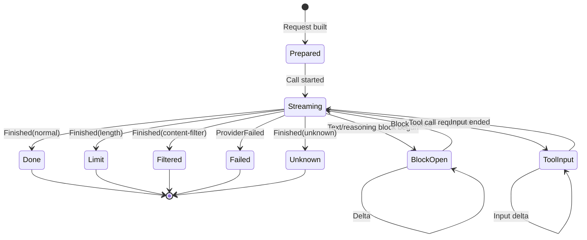

# 02 – The event stream

> How the stream is read, which states a call passes through, and which
> protocol violations count as **defects**.

## 1. The state machine of a call



> **A call has exactly one `Finished`.** Every other terminal state
> (error, unknown finish) is an **error state**, not success.

## 2. Read rules

```
1. The stream is read in FULL – not only up to `Finished`.
   Reason: the response should remain reusable for the next request,
   and an incomplete stream must be recognizable.

2. Every block is begun, continued and ended – exactly once.
   A delta without a begun block is a defect.

3. Every tool call is reported BEFORE its result.
   A result without a prior `ToolCallRequested` is a defect.

4. There is EXACTLY ONE result per tool call.
   A second result is a defect.
   Exception: a late ERROR result after an abort cleanup is harmless
   and is ignored (a late SUCCESS result would be a double execution → defect).

5. Tool calls executed by the provider itself carry a marker
   “executed by the provider". The engine does NOT execute them.

6. Provider errors are reported as EVENTS, not by aborting the stream –
   so the engine can decide whether to retry.
```

### The special case “unknown finish"

```
Finished(reason = Unknown) →
  treat as error with classification "incomplete stream"
```

> A provider that ends with an unknown reason has **not** completed the
> response properly. That is an error – but one that is **retryable**
> (the response was incomplete). That is why it is grouped into the same
> class as a truncated stream.

## 3. The tool call in the stream

A provider reports a tool call in three steps:

```
ToolInputStarted  { callID, name }
ToolInputDelta*   { callID, text }      # the JSON input is streamed
ToolInputEnded    { callID, text }
ToolCallRequested { callID, name, input }   # the finished, parsed input
```

> **The separate input phase matters:** it lets the model stream large
> JSON inputs, and it lets the engine report an **incomplete input** as
> an error instead of executing it.
>
> **Malformed input** (truncated JSON) → own error case (“malformed"),
> separate from the “length limit" case – because the difference
> determines whether a retry makes sense.

## 4. The engine side of the stream

```
For each event:
  1. Check the publisher state (already begun? already ended?)
  2. Publish the corresponding durable event
  3. On tool call: start execution
```

### The publisher state per block and per call

```
per block:
  begun: Bool
  ended:  Bool

per tool call:
  called:    Bool          # ToolCallRequested seen
  executed:  Bool          # executed by the provider?
  ended:     Bool          # result seen
  malformed: Bool          # malformed input
```

**The defects that follow from it:**

| Violation | Why it is a defect |
|---|---|
| Delta without begun block | order violated |
| Block ends twice | double completion |
| Name of a call changes | the call is no longer the same |
| Duplicate call with same ID | two executions of the same call |
| Result before call | order reversed |
| Double result | double execution |
| Execution before call | side effect began before logging |
| Result without content | nothing to show |

> **All of these cases end the call.** They are **not** converted into
> an ordinary error – that would be a programming error, not a user
> problem.

## 5. What the publisher produces

| Provider event | Durable event | Note |
|---|---|---|
| `TextStarted` | `session.text.started` | |
| `TextDelta` | **live** (no durable event) | |
| `TextEnded` | `session.text.ended` | |
| `ReasoningStarted` / `Delta` / `Ended` | `session.reasoning.*` | Delta live |
| `ToolInputStarted` | `session.tool.input.started` | |
| `ToolInputDelta` | **live** | |
| `ToolInputEnded` | `session.tool.input.ended` | |
| `ToolCallRequested` | `session.tool.called` | **before** execution |
| `ToolResultProvided` (success) | `session.tool.success` | executed by the provider |
| `ToolResultProvided` (error) | `session.tool.failed` | |
| `ToolFailed` | `session.tool.failed` | |
| `Finished` | `session.step.ended` (on `normal`) | otherwise error path |
| `ProviderFailed` | `session.step.failed` | |

> **The live deltas are why there are two event classes.** The history
> needs only start and end; the fluid display needs every intermediate
> state. Storing both from the same log would be waste.

## 6. Aborting the stream

```
An abort of the stream is an ABORT, not an error.
It is never converted into an error channel.
```

| Who aborts | Consequence |
|---|---|
| The user (interrupt) | The step ends with `aborted`. |
| The server (shutdown) | The claim remains → resumption on next start. |
| An engine timeout | The step ends; the attempt is retryable if it happened before output. |

> **The abort must also terminate the running tool executions.** A tool
> that keeps running after the step is already finished produces exactly
> the kind of side effect that voids the delivery guarantee.

## 7. Verified semantics (reference checkout)

| Concept | Location |
|---|---|
| Stream read in full | `packages/core/src/session/runner/step.ts:106-138` |
| Publisher state and defects | `packages/core/src/session/runner/publish-llm-event.ts:435-568` |
| Tool input streamed | `packages/core/src/session/runner/publish-llm-event.ts:473-492` |
| Unknown finish → error | `packages/core/src/session/runner/step.ts:171-179` |
| Content filter → `providerFailed` | `packages/core/src/session/runner/publish-llm-event.ts:578-582` |
| Abort terminates tool fibers | `packages/core/src/session/runner/step.ts:90`, `:150-152` |
