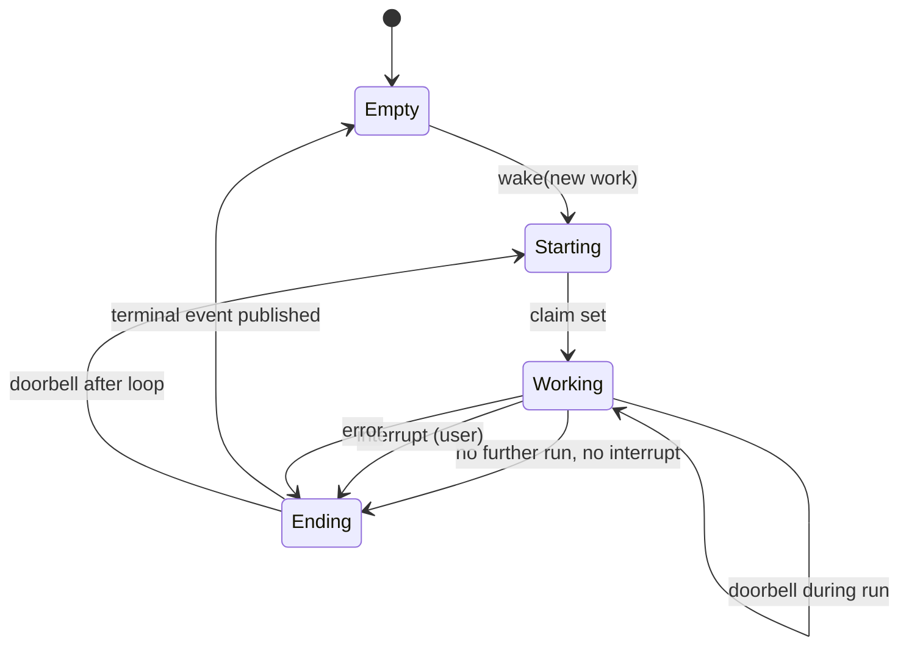
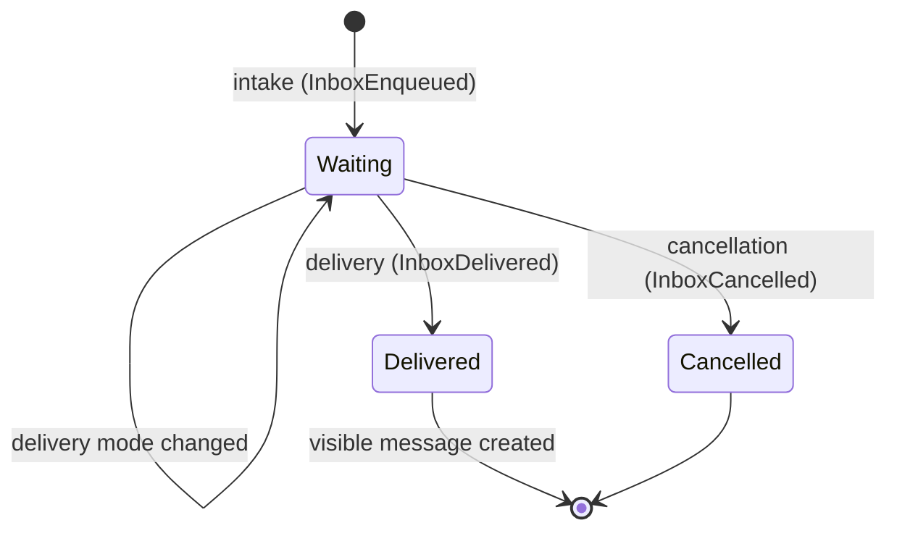
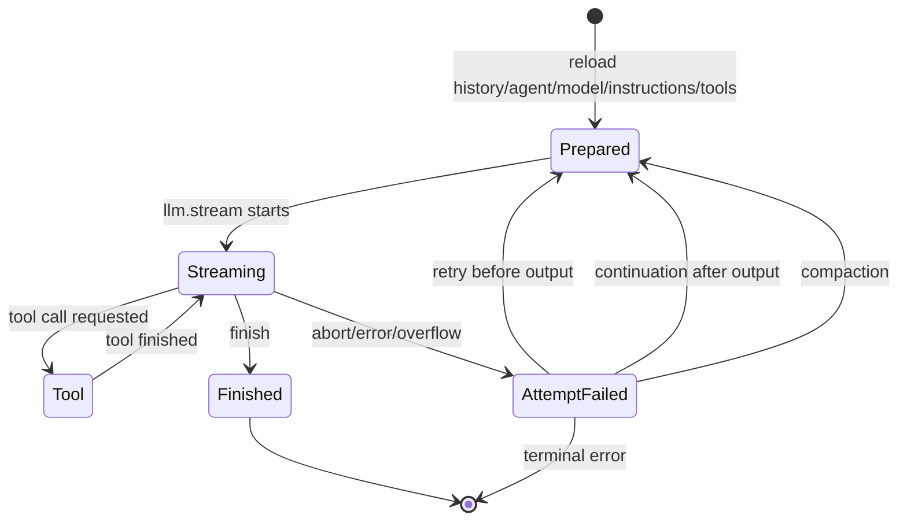
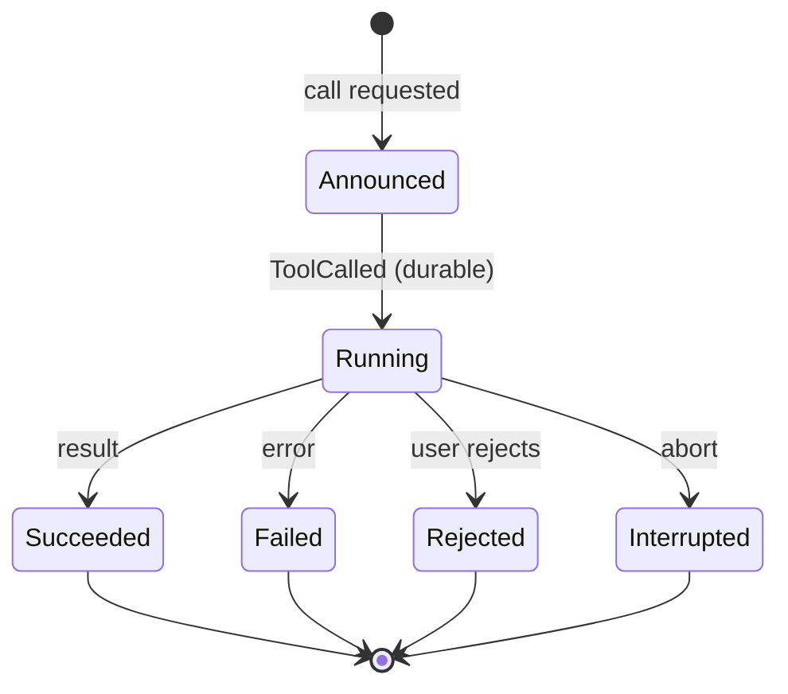
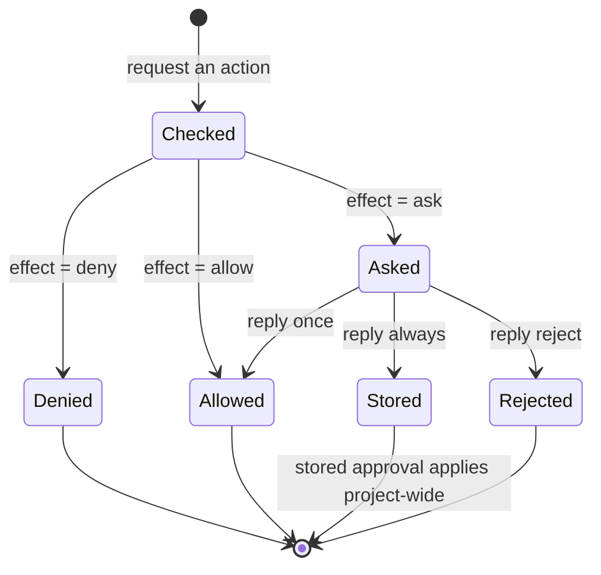
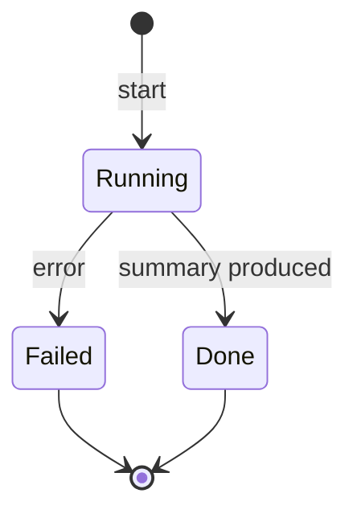

# 03 – State machines

> Every state diagram is a specification: the transitions, their
> conditions and their effects are binding. Implementations that introduce
> other states are non-conformant.

---

## 1. Execution (per session)

Execution is **process-local**: it lives in the memory of a process and is
bound to a session ID. There is exactly one execution per session ID
**per process**.

| Transition | Condition | Effect |
|---|---|---|
| Empty → Starting | `wake` hits a session without an active execution | new execution unit; `ExecutionStarted` + claim in **one** transaction |
| Empty → Empty | `wake` hits a session with an active execution | remember the "doorbell"; the running pass is repeated once afterwards |
| Working → Working | new work arrived during a pass | **exactly one** further pass in the same execution, with the broader scope |
| Working → Ending | pass finished, no doorbell | terminal event (`Succeeded`/`Failed`/`Interrupted`) |
| Working → Ending | interrupt by the user | `Interrupted(reason=User)`, release claim |
| Working → Ending | error in the pass | `Failed(error)`, release claim |
| Ending → Starting | doorbell arrived during ending | follow-up execution for the remaining work |

**Rules:**

* **A-01** Exactly one terminal event per execution period – even if
  multiple passes were coalesced.
* **A-02** An interrupt on a known but inactive session is a
  **no-op**. An interrupt on an unknown session is an error.
* **A-03** An interrupt is **confirmed immediately**; cleanup work runs
  asynchronously afterwards.
* **A-04** The claim is released on `Succeeded`, `Failed` and
  `Interrupted(User)`, **not** on `Interrupted(Shutdown)`.
* **A-05** Two different sessions run **in parallel**; two executions of
  the same session do not exist (process-local).

> **Deliberate boundary:** This execution is process-local. Clustering is not
> part of this specification; whoever needs it must add ownership, fencing and
> placement – that is a different specification.

---

## 2. Inbox entry

| Property | Rule |
|---|---|
| Create | exactly one row, key = ID; conflict ⇒ error |
| Switch | only if the old mode matches the expected one |
| Deliver | deletes the row **and** creates the visible message, in the same transaction |
| Cancel | deletes the row; afterwards the input never became visible |

> An entry that has already been delivered **no longer** exists in the
> inbox. Re-enqueuing the same ID is idempotent: the first intake wins,
> the retry changes nothing.

---

## 3. Step and attempt

A **step** is a logical model call. An **attempt** is a concrete run
within a step. A step can have multiple attempts (retry, continuation,
compaction).

| Transition | Condition | Effect |
|---|---|---|
| Prepared → Streaming | model call started | `StepStarted`, assistant message created |
| Streaming → Tool | provider reports tool call | `ToolCalled` (durable) **before** execution |
| Tool → Streaming | tool finished | `ToolSuccess` or `ToolFailed` |
| Streaming → Finished | finish with usage | `StepEnded` + cost/tokens |
| AttemptFailed → Prepared | error **before** first output | same assistant message, same step number, no additional step budget consumed |
| AttemptFailed → Prepared | incomplete stream **after** output | partial result stays visible, synthetic continuation instruction, **new** assistant message |
| AttemptFailed → Prepared | context overflow before output | exactly **one** compaction, afterwards the overflow is terminal |

**Rules:**

* **S-01** A step = **exactly one** model call.
* **S-02** After a local tool result a **new** step begins.
  There is no tool loop in memory.
* **S-03** At most **one** terminal event per step (`StepEnded` or
  `StepFailed`).
* **S-04** In the last permitted step tools are switched off
  (`toolChoice = none`), but the definitions stay in the request so the
  provider cache stays valid.
* **S-05** An interruption ends the step; parked inputs remain.

---

## 4. Tool call

| Transition | Condition | Effect |
|---|---|---|
| Announced → Running | `ToolCalled` commits | execution may begin |
| Running → Succeeded | tool returns result | `ToolSuccess` with content + metadata |
| Running → Failed | expected error | `ToolFailed` with classified error |
| Running → Rejected | user rejects the approval | **no** tool result; the step ends |
| Running → Interrupted | execution aborted | `ToolFailed` with `aborted` |

**Rules:**

* **W-01** Exactly **one** terminal event per call ID.
* **W-02** The event `ToolCalled` is committed **before** the side effect.
* **W-03** A rejection **without** feedback ends the step and produces
  **no** model-side tool text.
* **W-04** A rejection **with** feedback produces a classified tool
  error – the model may continue working.
* **W-05** A tool call for which there is no display (`ToolCalled`)
  is never executed.
* **W-06** Received outputs are truncated **after** execution; the
  truncation marks the result as truncated and names the storage location.

---

## 5. Permission request

| Transition | Condition | Effect |
|---|---|---|
| Checked → Denied | any resource yields deny | error with the triggering rules |
| Checked → Allowed | all resources allowed | execution continues |
| Checked → Asked | at least one resource yields ask | request is published, execution waits |
| Asked → Allowed | reply "once" | exactly this execution is approved |
| Asked → Stored | reply "always" + storage suggestion | approval is stored **per project**; all other open requests are re-evaluated and possibly auto-approved |
| Asked → Rejected | reply "reject" | **all** parallel requests of the same session are rejected |

**Rules:**

* **P-01** The last matching rule decides; with no hit "ask" applies.
* **P-02** "Deny" beats any stored approval. "Ask" beats
  "Allow". A stored approval never beats a denial.
* **P-03** The check runs in this order:
  1. Agent rules + session rules
  2. Denial pre-check
  3. Stored approvals
  4. Extension hook may change the result
* **P-04** A rejection **without** feedback travels as a special abort, not as
  an ordinary error – otherwise it would be turned into model-side tool text.
* **P-05** A rejection **with** feedback stays an ordinary error.

---

## 6. Compaction

| Transition | Effect |
|---|---|
| Start | message with status "running" |
| Done | summary stored, **epoch start moves** to the exact sequence, full transcript retained |
| Failed | error reported, original basis remains |

> **Compaction compacts the view, not the truth.** The complete
> transcript is retained durably; only the *sent* context is summarized.

---

## 7. Summary of transition disciplines

| Discipline | Meaning |
|---|---|
| **Simplicity** | a state has exactly one predecessor history |
| **Terminality** | terminal states are never left |
| **Exclusivity** | exactly one terminal event per call ID |
| **Idempotence** | repeated delivery/intake changes nothing |
| **Visibility** | only delivery makes input visible |
| **Interruptibility** | interruption is its own channel, not an error |